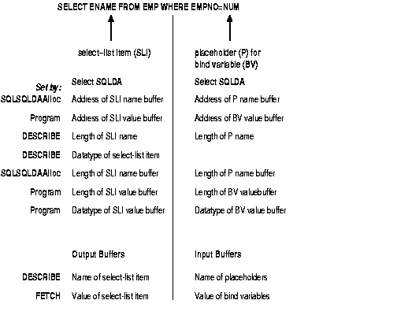
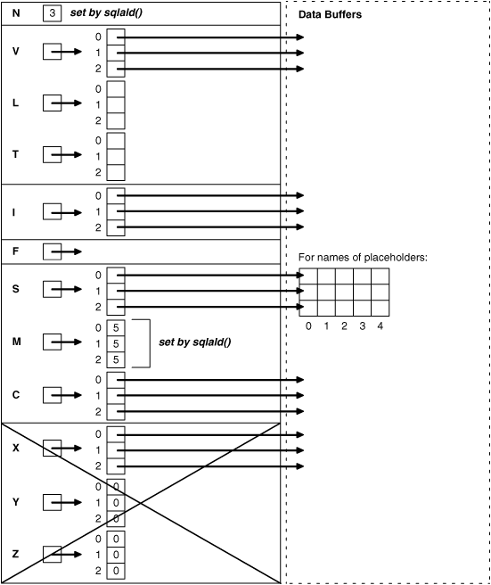
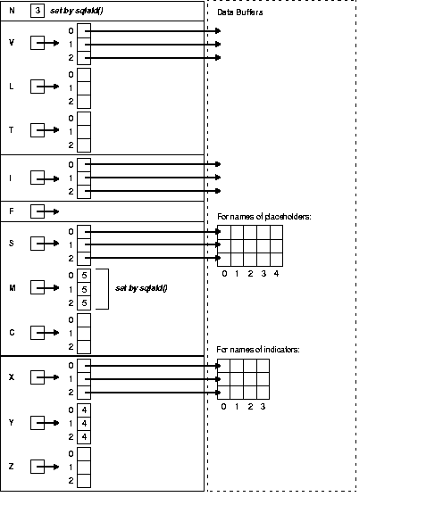
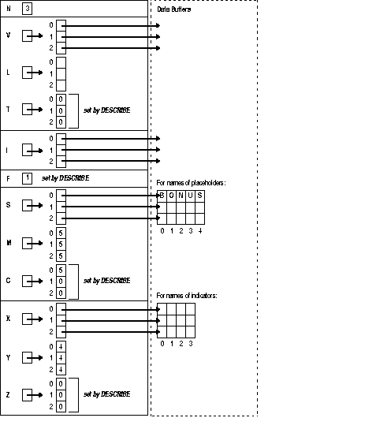
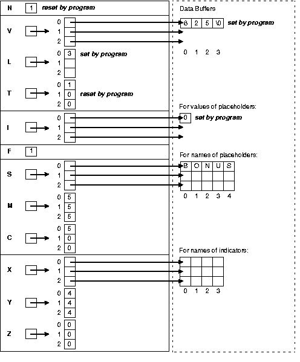
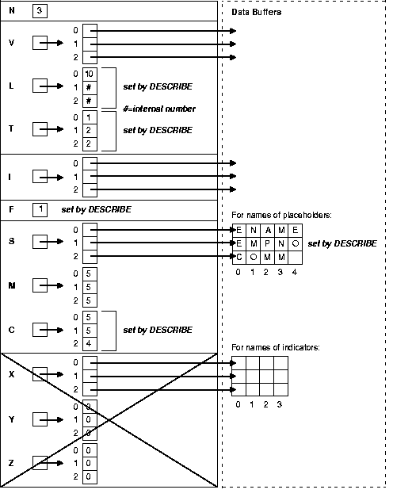
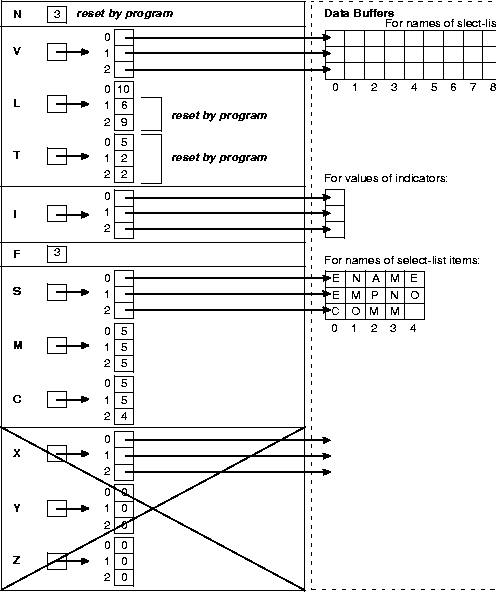
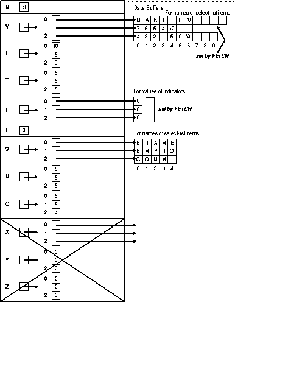

This chapter shows you how to implement Oracle dynamic SQL Method 4, which lets your program accept or build dynamic SQL statements that contain a varying number of host variables. Use this to support existing applications. Use ANSI Dynamic SQL Method 4 for all new applications.

Oracle Dynamic SQL Method 4 does not support object types, cursor variables, arrays of structs, DML returning clauses, Unicode variables, and LOBs. Use ANSI Dynamic SQL Method 4 instead. This chapter contains the following topics:

- Meeting the Special Requirements of Method 4

- Understanding the SQLDA

- About Using the SQLDA Variables

- Some Preliminaries

- The Basic Steps

- A Closer Look at Each Step

- Example Program: Dynamic SQL Method 4

- Sample Program : Dynamic SQL Method 4 using Scrollable Cursors

  **See Also:**

  - [Oracle Dynamic SQL](Oracle-dynamic-SQL.md) for a discussion of dynamic SQL Methods 1, 2, and 3, and an overview of Method 4

  - [ANSI Dynamic SQL](ANSI-dynamic-SQL.md)

### 15.1 Meeting the Special Requirements of Method 4

Before looking into the requirements of Method 4, you should feel comfortable with the terms select-list item and placeholder. Select-list items are the columns or expressions following the keyword SELECT in a query. For example, the following dynamic query contains three select-list items:

    SELECT ename, job, sal + comm FROM emp WHERE deptno = 20

Placeholders are dummy bind variables that hold places in a SQL statement for actual bind variables. You do not declare placeholders, and can name them anything you like.

Placeholders for bind variables are most often used in the SET, VALUES, and WHERE clauses. For example, the following dynamic SQL statements each contain two placeholders:

    INSERT INTO emp (empno, deptno) VALUES (:e, :d)
    DELETE FROM dept WHERE deptno = :num OR loc = :loc

#### 15.1.1 What Makes Method 4 Special?

Unlike Methods 1, 2, and 3, dynamic SQL Method 4 lets your program

- Accept or build dynamic SQL statements that contain an unknown number of select-list items or placeholders, and

- Take explicit control over datatype conversion between Oracle and C types

To add this flexibility to your program, you must give the Oracle runtime library additional information.

#### 15.1.2 What Information Does Oracle Need?

The Pro\*C/C++ Precompiler generates calls to Oracle for all executable dynamic SQL statements. If a dynamic SQL statement contains no select-list items or placeholders, Oracle needs no additional information to execute the statement. The following DELETE statement falls into this category:

    DELETE FROM emp WHERE deptno = 30

However, most dynamic SQL statements contain select-list items or placeholders for bind variables, as does the following

UPDATE statement:

    UPDATE emp SET comm = :c WHERE empno = :e

To execute a dynamic SQL statement that contains placeholders for bind variables or select-list items, Oracle needs information about the program variables that hold the input (bind) values, and that will hold the FETCHed values when a query is executed. The information needed by Oracle is:

- The number of bind variables and select-list items

- The length of each bind variable and select-list item

- The datatype of each bind variable and select-list item

- The address of each bind variable, and of the output variable that will receive each select-list item

#### 15.1.3 Where Is the Information Stored?

All the information Oracle needs about select-list items or placeholders for bind variables, except their values, is stored in a program data structure called the SQL Descriptor Area (SQLDA). The SQLDA struct is defined in the `sqlda.h` header file.

Descriptions of select-list items are stored in a select descriptor, and descriptions of placeholders for bind variables are stored in a bind descriptor.

The values of select-list items are stored in output variables; the values of bind variables are stored in input variables. You store the addresses of these variables in the select or bind SQLDA so that Oracle knows where to write output values and read input values.

How do values get stored in these data variables? Output values are FETCHed using a cursor, and input values are typically filled in by the program, usually from information entered interactively by the user.

#### 15.1.4 How is the SQLDA Referenced?

The bind and select descriptors are usually referenced by pointer. A dynamic SQL program should declare a pointer to at least one bind descriptor, and a pointer to at least one select descriptor, in the following way:

    #include <sqlda.h>
    ...
    SQLDA *bind_dp;
    SQLDA *select_dp;

You can then use the `SQLSQLDAAlloc()` function to allocate the descriptor, as follows:

    bind_dp = SQLSQLDAAlloc(runtime_context, size, name_length, ind_name_length);

SQLSQLDAAlloc() was known as sqlaldt() before Oracle8.

The constant `SQL_SINGLE_RCTX `is defined as `(dvoid*)0`. Use it for runtime_context when your application is single-threaded.

**See Also:**

- Table 15-3, for information on this and other SQLLIB functions

- "Allocating a SQLDA " for detailed information about `SQLSQLDAAlloc()` and its parameters

#### 15.1.5 How is the Information Obtained?

You use the DESCRIBE statement to help obtain the information Oracle needs.

The DESCRIBE SELECT LIST statement examines each select-list item to determine its name and name length. It then stores this information in the select SQLDA for your use. For example, you might use select-list names as column headings in a printout. The total number of select-list items is also stored in the SQLDA by DESCRIBE.

The DESCRIBE BIND VARIABLES statement examines each placeholder to determine its name and length, then stores this information in an input buffer and bind SQLDA for your use. For example, you might use placeholder names to prompt the user for the values of bind variables.

### 15.2 Understanding the SQLDA

This section describes the SQLDA data structure in detail. You learn how to declare it, what variables it contains, how to initialize them, and how to use them in your program.

#### 15.2.1 Purpose of the SQLDA

Method 4 is required for dynamic SQL statements that contain an unknown number of select-list items or placeholders for bind variables. To process this kind of dynamic SQL statement, your program must explicitly declare SQLDAs, also called descriptors. Each descriptor is a struct which you must copy or code into your program.

A select descriptor holds descriptions of select-list items, and the addresses of output buffers where the names and values of select-list items are stored.

**Note:**

The "name" of a select-list item can be a column name, a column alias, or the text of an expression such as sal + comm.

A bind descriptor holds descriptions of bind variables and indicator variables, and the addresses of input buffers where the names and values of bind variables and indicator variables are stored.

#### 15.2.2 Multiple SQLDAs

If your program has more than one active dynamic SQL statement, each statement must have its own SQLDA(s). You can declare any number of SQLDAs with different names. For example, you might declare three select SQLDAs named sel_desc1, sel_desc2, and sel_desc3, so that you can FETCH from three concurrently OPEN cursors. However, non-concurrent cursors can reuse SQLDAs.

#### 15.2.3 Declaring a SQLDA

To declare a SQLDA, include the `sqlda.h` header file. The contents of the SQLDA are:

    struct SQLDA
    {
        long    N;          /* Descriptor size in number of entries */
        char  **V;        Ptr to Arr of addresses of main variables */
        int   *L;              /* Ptr to Arr of lengths of buffers */
        short  *T;                /* Ptr to Arr of types of buffers */
        short **I;      * Ptr to Arr of addresses of indicator vars */
        long    F;         /* Number of variables found by DESCRIBE */
        char  **S;          /* Ptr to Arr of variable name pointers */
        short  *M;       /* Ptr to Arr of max lengths of var. names */
        short  *C;    * Ptr to Arr of current lengths of var. names */
        char  **X;         /* Ptr to Arr of ind. var. name pointers */
        short  *Y;  /* Ptr to Arr of max lengths of ind. var. names */
        short  *Z;  /* Ptr to Arr of cur lengths of ind. var. names */
    };

#### 15.2.4 Allocating a SQLDA

After declaring a SQLDA, you allocate storage space for it with the `SQLSQLDAAlloc()` library function (known as `sqlaldt()` before Oracle8), using the syntax:

    descriptor_name = SQLSQLDAAlloc (runtime_context, max_vars, max_name, max_ind_name);

where:

| Syntax          | Description                                                                                                                                                                                                    |
|:----------------|:---------------------------------------------------------------------------------------------------------------------------------------------------------------------------------------------------------------|
| runtime_context | pointer to runtime context                                                                                                                                                                                     |
| max_vars        | Is the maximum number of select-list items or placeholders that the descriptor can describe.                                                                                                                   |
| max_name        | Is the maximum length of select-list or placeholder names.                                                                                                                                                     |
| max_ind_name    | Is the maximum length of indicator variable names, which are optionally appended to placeholder names. This parameter applies to bind descriptors only, so set it to zero when allocating a select descriptor. |

Besides the descriptor, `SQLSQLDAAlloc()` allocates data buffers to which descriptor variables point.

Figure 15-1 shows whether variables are set by `SQLSQLDAAlloc()` calls, DESCRIBE commands, FETCH commands, or program assignments.

Figure 15-1 How Variables Are Set

[Description of "Figure 15-1 How Variables Are Set"](img_text/lnpcc010.md)

**Related Topics**

- About Using the SQLDA Variables
- Allocate Storage Space for the Descriptors

### 15.3 About Using the SQLDA Variables

This section explains the purpose and use of each variable in the SQLDA.

#### 15.3.1 The N Variable

N specifies the maximum number of select-list items or placeholders that can be DESCRIBEd. Thus, N determines the number of elements in the descriptor arrays.

Before issuing the optional DESCRIBE command, you must set N to the dimension of the descriptor arrays using the `SQLSQLDAAlloc()` library function. After the DESCRIBE, you must reset N to the actual number of variables DESCRIBEd, which is stored in the F variable.

#### 15.3.2 The V Variable

V is a pointer to an array of addresses of data buffers that store select-list or bind-variable values.

When you allocate the descriptor, `SQLSQLDAAlloc()` zeros the elements `V[0]` through `V[N - 1]` in the array of addresses.

For select descriptors, you must allocate data buffers and set this array before issuing the FETCH command. The statement

    EXEC SQL FETCH ... USING DESCRIPTOR ...

directs Oracle to store FETCHed select-list values in the data buffers to which `V[0]` through `V[N - 1]` point. Oracle stores the ith select-list value in the data buffer to which `V[i]` points.

For bind descriptors, you must set this array before issuing the OPEN command. The statement

    EXEC SQL OPEN ... USING DESCRIPTOR ...

directs Oracle to execute the dynamic SQL statement using the bind-variable values to which `V[0]` through `V[N - 1]` point. Oracle finds the ith bind-variable value in the data buffer to which `V[`i`]` points.

#### 15.3.3 The L Variable

L is a pointer to an array of lengths of select-list or bind-variable values stored in data buffers.

For select descriptors, DESCRIBE SELECT LIST sets the array of lengths to the maximum expected for each select-list item. However, you might want to reset some lengths before issuing a FETCH command. FETCH returns at most n characters, where n is the value of `L[`i`]` before the FETCH.

The format of the length differs among Oracle datatypes. For CHAR or VARCHAR2 select-list items, DESCRIBE SELECT LIST sets `L[`i`]` to the maximum length of the select-list item. For NUMBER select-list items, scale and precision are returned respectively in the low and next-higher bytes of the variable. You can use the library function `SQLNumberPrecV6()` to extract precision and scale values from `L[`i`]`.

You must reset `L[`i`]` to the required length of the data buffer before the FETCH. For example, when coercing a NUMBER to a C char string, set `L[`i`]` to the precision of the number plus two for the sign and decimal point. When coercing a NUMBER to a C float, set `L[`i`]` to the length of floats on your system.

For bind descriptors, you must set the array of lengths before issuing the OPEN command. For example, you can use `strlen()` to get the lengths of bind-variable character strings entered by the user, then set the appropriate array elements.

Because Oracle accesses a data buffer indirectly, using the address stored in `V[`i`]`, it does not know the length of the value in that buffer. If you want to change the length Oracle uses for the ith select-list or bind-variable value, reset `L[`i`]` to the length you need. Each input or output buffer can have a different length.

**Related Topics**

- Extracting Precision and Scale

#### 15.3.4 The T Variable

T is a pointer to an array of datatype codes of select-list or bind-variable values. These codes determine how Oracle data is converted when stored in the data buffers addressed by elements of the V array.

For select descriptors, DESCRIBE SELECT LIST sets the array of datatype codes to the internal datatype (CHAR, NUMBER, or DATE, for example) of the items in the select list.

Before FETCHing, you might want to reset some datatypes because the internal format of Oracle datatypes can be difficult to handle. For display purposes, it is usually a good idea to coerce the datatype of select-list values to VARCHAR2 or STRING. For calculations, you might want to coerce numbers from Oracle to C format.

The high bit of `T[`i`]` is set to indicate the NULL/not NULL status of the ith select-list item. You must always clear this bit before issuing an OPEN or FETCH command. You use the library function `SQLColumnNullCheck()` to retrieve the datatype code and clear the NULL/not NULL bit.

You should change the Oracle NUMBER internal datatype to an external datatype compatible with that of the C data buffer to which `V[`i`]` points.

For bind descriptors, DESCRIBE BIND VARIABLES sets the array of datatype codes to zeros. You must set the datatype code stored in each element before issuing the OPEN command. The code represents the external (C) datatype of the data buffer to which `V[`i`]` points. Often, bind-variable values are stored in character strings, so the datatype array elements are set to 1 (the VARCHAR2 datatype code). You can also use datatype code 5 (STRING).

To change the datatype of the ith select-list or bind-variable value, reset `T[`i`]` to the datatype you want.

**Related Topics**

- Converting Data
- Coercing Datatypes
- Handling NULL/Not NULL Datatypes

#### 15.3.5 The I Variable

I is a pointer to an array of addresses of data buffers that store indicator-variable values.

You must set the elements `I[0]` through `I[N - 1]` in the array of addresses.

For select descriptors, you must set the array of addresses before issuing the FETCH command. When Oracle executes the statement

    EXEC SQL FETCH ... USING DESCRIPTOR ...

if the ith returned select-list value is NULL, the indicator-variable value to which `I[`i`]` points is set to -1. Otherwise, it is set to zero (the value is not NULL) or a positive integer (the value was truncated).

For bind descriptors, you must set the array of addresses and associated indicator variables before issuing the OPEN command. When Oracle executes the statement

    EXEC SQL OPEN ... USING DESCRIPTOR ...

the data buffer to which `I[`i`]` points determines whether the ith bind variable has a NULL value. If the value of an indicator variable is -1, the value of its associated bind variable is NULL.

#### 15.3.6 The F Variable

F is the actual number of select-list items or placeholders found by DESCRIBE.

F is set by DESCRIBE. If F is less than zero, DESCRIBE has found too many select-list items or placeholders for the allocated size of the descriptor. For example, if you set N to 10 but DESCRIBE finds 11 select-list items or placeholders, F is set to -11. This feature lets you dynamically reallocate a larger storage area for select-list items or placeholders if necessary.

#### 15.3.7 The S Variable

S is a pointer to an array of addresses of data buffers that store select-list or placeholder names as they appear in dynamic SQL statements.

You use `SQLSQLDAAlloc()` to allocate the data buffers and store their addresses in the S array.

DESCRIBE directs Oracle to store the name of the ith select-list item or placeholder in the data buffer to which `S[`i`]` points.

#### 15.3.8 The M Variable

M is a pointer to an array of maximum lengths of data buffers that store select-list or placeholder names. The buffers are addressed by elements of the S array.

When you allocate the descriptor, `SQLSQLDAAlloc()` sets the elements `M[0]` through `M[N - 1]` in the array of maximum lengths. When stored in the data buffer to which `S[`i`]` points, the ith name is truncated to the length in `M[`i`]` if necessary.

#### 15.3.9 The C Variable

C is a pointer to an array of current lengths of select-list or placeholder names.

DESCRIBE sets the elements `C[0]` through `C[N - 1]` in the array of current lengths. After a DESCRIBE, the array contains the number of characters in each select-list or placeholder name.

#### 15.3.10 The X Variable

X is a pointer to an array of addresses of data buffers that store indicator-variable names. You can associate indicator-variable values with select-list items and bind variables. However, you can associate indicator-variable names only with bind variables. So, X applies only to bind descriptors.

Use `SQLSQLDAAlloc()` to allocate the data buffers and store their addresses in the X array.

DESCRIBE BIND VARIABLES directs Oracle to store the name of the ith indicator variable in the data buffer to which `X[`i`]` points.

#### 15.3.11 The Y Variable

Y is a pointer to an array of maximum lengths of data buffers that store indicator-variable names. Like X, Y applies only to bind descriptors.

You use `SQLSQLDAAlloc()` to set the elements `Y[0]` through `Y[N - 1]` in the array of maximum lengths. When stored in the data buffer to which `X[`i`]` points, the ith name is truncated to the length in `Y[`i`]` if necessary.

#### 15.3.12 The Z Variable

Z is a pointer to an array of current lengths of indicator-variable names. Like X and Y, Z applies only to bind descriptors.

DESCRIBE BIND VARIABLES sets the elements `Z[0]` through `Z[N - 1]` in the array of current lengths. After a DESCRIBE, the array contains the number of characters in each indicator-variable name.

### 15.4 Some Preliminaries

You need a working knowledge of the following subjects to implement dynamic SQL Method 4:

- Converting Data

- Coercing Datatypes

- Handling NULL/Not NULL Datatypes

#### 15.4.1 Converting Data

This section provides more detail about the T (datatype) descriptor array. In host programs that use neither datatype equivalencing nor dynamic SQL Method 4, the conversion between Oracle internal and external datatypes is determined at precompile time. By default, the precompiler assigns a specific external datatype to each host variable in the Declare Section. For example, the precompiler assigns the INTEGER external datatype to host variables of type int.

However, Method 4 lets you control data conversion and formatting. You specify conversions by setting datatype codes in the T descriptor array.

##### 15.4.1.1 Internal Datatypes

Internal datatypes specify the formats used by Oracle to store column values in database tables, as well as the formats used to represent pseudocolumn values.

When you issue a DESCRIBE SELECT LIST command, Oracle returns the internal datatype code for each select-list item to the T descriptor array. For example, the datatype code for the ith select-list item is returned to `T[`i`]`.

Table 15-1 shows the Oracle internal datatypes and their codes:

Table 15-1 Oracle Internal Datatypes

| Oracle Internal Datatype | Code |
|:-------------------------|:-----|
| VARCHAR2                 | 1    |
| NUMBER                   | 2    |
| LONG                     | 8    |
| BINARY_FLOAT             | 100  |
| BINARY_DOUBLE            | 101  |
| ROWID                    | 11   |
| DATE                     | 12   |
| RAW                      | 23   |
| LONG RAW                 | 24   |
| CHARACTER (or CHAR)      | 96   |
| Universal ROWID          | 104  |

##### 15.4.1.2 External Datatypes

External datatypes specify the formats used to store values in input and output host variables.

The DESCRIBE BIND VARIABLES command sets the T array of datatype codes to zeros. So, you must reset the codes before issuing the OPEN command. The codes tell Oracle which external datatypes to expect for the various bind variables. For the ith bind variable, reset `T[`i`]` to the external datatype you want.

Table 15-2 shows the Oracle external datatypes and their codes, as well as the C datatype normally used with each external datatype.

Table 15-2 Oracle External Datatypes and Datatype Codes

| External Datatype | Code | C Datatype            |
|:------------------|:-----|:----------------------|
| VARCHAR2          | 1    | char\[n\]             |
| NUMBER            | 2    | char\[n\] ( n \<= 22) |
| INTEGER           | 3    | int                   |
| FLOAT             | 4    | float                 |
| STRING            | 5    | char\[n+1\]           |
| VARNUM            | 6    | char\[n\] (n \<= 22)  |
| DECIMAL           | 7    | float                 |
| LONG              | 8    | char\[n\]             |
| SQLT_BFLOAT       | 21   | float                 |
| SQLT_BDOUBLE      | 22   | double                |
| VARCHAR           | 9    | char\[n+2\]           |
| ROWID             | 11   | char\[n\]             |
| DATE              | 12   | char\[n\]             |
| VARRAW            | 15   | char\[n\]             |
| RAW               | 23   | unsigned char\[n\]    |
| LONG RAW          | 24   | unsigned char\[n\]    |
| UNSIGNED          | 68   | unsigned int          |
| DISPLAY           | 91   | char\[n\]             |
| LONG VARCHAR      | 94   | char\[n+4\]           |
| LONG VARRAW       | 95   | unsigned char\[n+4\]  |
| CHAR              | 96   | char\[n\]             |
| CHARF             | 96   | char\[n\]             |
| CHARZ             | 97   | char\[n+1\]           |

**Related Topics**

- [Oracle Datatypes](datatypes-and-host-variables.md)
- [Oracle Database SQL Language Reference](../sqlrf/index.md)

#### 15.4.2 Coercing Datatypes

For a select descriptor, DESCRIBE SELECT LIST can return any of the Oracle internal datatypes. Often, as in the case of character data, the internal datatype corresponds exactly to the external datatype you want to use. However, a few internal datatypes map to external datatypes that can be difficult to handle. So, you might want to reset some elements in the T descriptor array. For example, you might want to reset NUMBER values to FLOAT values, which correspond to float values in C. Oracle does any necessary conversion between internal and external datatypes at FETCH time. So, be sure to reset the datatypes after the DESCRIBE SELECT LIST but before the FETCH.

For a bind descriptor, DESCRIBE BIND VARIABLES does not return the datatypes of bind variables, only their number and names. Therefore, you must explicitly set the T array of datatype codes to tell Oracle the external datatype of each bind variable. Oracle does any necessary conversion between external and internal datatypes at OPEN time.

When you reset datatype codes in the T descriptor array, you are "coercing datatypes." For example, to coerce the ith select-list value to STRING, you use the following statement:

    /* Coerce select-list value to STRING. */
    select_des->T[i] = 5;

When coercing a NUMBER select-list value to STRING for display purposes, you must also extract the precision and scale bytes of the value and use them to compute a maximum display length. Then, before the FETCH, you must reset the appropriate element of the L (length) descriptor array to tell Oracle the buffer length to use.

For example, if DESCRIBE SELECT LIST finds that the ith select-list item is of type NUMBER, and you want to store the returned value in a C variable declared as float, simply set `T[`i`]` to 4 and `L[`i`]` to the length of floats on your system.

**WARNING:**

In some cases, the internal datatypes that DESCRIBE SELECT LIST returns might not suit your purposes. Two examples of this are DATE and NUMBER. When you DESCRIBE a DATE select-list item, Oracle returns the datatype code 12 to the T descriptor array. Unless you reset the code before the FETCH, the date value is returned in its 7-byte internal format. To get the date in character format (DD-MON-YY), you can change the datatype code from 12 to 1 (VARCHAR2) or 5 (STRING), and increase the L value from 7 to 9 or 10.

Similarly, when you DESCRIBE a NUMBER select-list item, Oracle returns the datatype code 2 to the T array. Unless you reset the code before the FETCH, the numeric value is returned in its internal format, which is probably not what you want. So, change the code from 2 to 1 (VARCHAR2), 3 (INTEGER), 4 (FLOAT), 5 (STRING) or some other appropriate datatype.

**Related Topics**

- Extracting Precision and Scale

##### 15.4.2.1 Extracting Precision and Scale

The library function `SQLNumberPrecV6()` (previously known as `sqlprc()`)` `extracts precision and scale. Normally, it is used after the DESCRIBE SELECT LIST, and its first argument is `L[`i`]`. You call `SQLNumberPrecV6()` using the following syntax:

**Note:**

See your platform-specific `SQLNumberPrecV6` header file for the correct prototype for your platform.

    SQLNumberPrecV6(dvoid *runtime_context, int *length, int *precision,
                    int *scale);

where:

| Syntax          | Description                                                                                                                                                                                                                                                                                                              |
|:----------------|:-------------------------------------------------------------------------------------------------------------------------------------------------------------------------------------------------------------------------------------------------------------------------------------------------------------------------|
| runtime_context | Is the pointer to the runtime context                                                                                                                                                                                                                                                                                    |
| length          | Is a pointer to a long integer variable that stores the length of an Oracle NUMBER value; the length is stored in L\[i\]. The scale and precision of the value are stored respectively in the low and next-higher bytes.                                                                                                 |
| precision       | Is a pointer to an integer variable that returns the precision of the NUMBER value. Precision is the number of significant digits. It is set to zero if the select-list item refers to a NUMBER of unspecified size. In this case, because the size is unspecified, you might want to assume the maximum precision (38). |
| scale           | Is a pointer to an integer variable that returns the scale of the NUMBER value. Scale specifies where rounding will occur. For example, a scale of 2 means the value is rounded to the nearest hundredth (3.456 becomes 3.46); a scale of -3 means the number is rounded to the nearest thousand (3456 becomes 3000).    |

When the scale is negative, add its absolute value to the length. For example, a precision of 3 and scale of -2 allow for numbers as large as 99900.

The following example shows how `SQLNumberPrecV6()` is used to compute maximum display lengths for NUMBER values that will be coerced to STRING:

    /* Declare variables for the function call. */
    sqlda         *select_des;  /* pointer to select descriptor */
    int            prec;        /* precision                    */
    int            scal;        /* scale                        */
    extern void SQLNumberPrecV6();  /* Declare library function. */
    /* Extract precision and scale. */
    SQLNumberPrecV6(SQL_SINGLE_RCTX, &(select_des->L[i]), &prec, &scal);
    /* Allow for maximum size of NUMBER. */
    if (prec == 0)
        prec = 38;
    /* Allow for possible decimal point and sign. */
    select_des->L[i] = prec + 2;
    /* Allow for negative scale. */
    if (scal < 0)
        select_des->L[i] += -scal;

Notice that the first argument in this function call points to the ith element in the array of lengths, and that all three parameters are addresses.

The `SQLNumberPrecV6()` function returns zero as the precision and scale values for certain SQL datatypes. The `SQLNumberPrecV7()` function is similar, having the same argument list, and returning the same values, except in the cases of these SQL datatypes:

Table 15-3 Precision and Scale Values for SQL Datatypes

| SQL Datatype     | Binary Precision      | Scale |
|:-----------------|:----------------------|:------|
| FLOAT            | 126                   | -127  |
| FLOAT(N)         | N (range is 1 to 126) | -127  |
| REAL             | 63                    | -127  |
| DOUBLE PRECISION | 126                   | -127  |

#### 15.4.3 Handling NULL/Not NULL Datatypes

For every select-list column (not expression), DESCRIBE SELECT LIST returns a NULL/not NULL indication in the datatype array T of the select descriptor. If the ith select-list column is constrained to be not NULL, the high-order bit of `T[`i`]` is clear; otherwise, it is set.

Before using the datatype in an OPEN or FETCH statement, if the NULL/not NULL bit is set, you must clear it. (Never set the bit.)

You can use the library function `SQLColumnNullCheck()` (previously was called `sqlnul()`) to find out if a column allows NULLs, and to clear the datatype's NULL/not NULL bit. You call `SQLColumnNullCheck()` using the syntax:

    SQLColumnNullCheck(dvoid *context, unsigned short *value_type,
          unsigned short *type_code, int *null_status);

where:

| Syntax       | Description                                                                                                                                       |
|:-------------|:--------------------------------------------------------------------------------------------------------------------------------------------------|
| context      | Is a pointer to the runtime context                                                                                                               |
| value_type   | Is a pointer to an unsigned short integer variable that stores the datatype code of a select-list column; the datatype is stored in T\[i\].       |
| type_code    | Is a pointer to an unsigned short integer variable that returns the datatype code of the select-list column with the high-order bit cleared.      |
| null_status  | Is a pointer to an integer variable that returns the null status of the select-list column. 1 means the column allows nulls; 0 means it does not. |

The following example shows how to use `SQLColumnNullCheck()`:

    /* Declare variables for the function call. */
    sqlda  *select_des;      /* pointer to select descriptor */
    unsigned short   dtype;  /* datatype without null bit    */
    int   nullok;            /* 1 = null, 0 = not null       */
    extern void SQLColumnNullCheck();    /* Declare library function.    */
    /* Find out whether column is not null. */
    SQLColumnNUllCheck(SQL_SINGLE_RCTX, (unsigned short *)&(select_des->T[i]), &dtype, &nullok);
    if (nullok)
    {
        /* Nulls are allowed. */
        ...
        /* Clear the null/not null bit. */
    SQLColumnNullCheck(SQL_SINGLE_RCTX, &(select_des->T[i]), &(select_des->T[i]), &nullok);
    }

Notice that the first and second arguments in the second call to the `SQLColumnNullCheck()` function point to the ith element in the array of datatypes, and that all three parameters are addresses.

### 15.5 The Basic Steps

Method 4 can be used to process any dynamic SQL statement. In the coming example, a query is processed so you can see how both input and output host variables are handled.

To process the dynamic query, our example program takes the following steps:

1.  Declare a host string in the Declare Section to hold the query text.
2.  Declare select and bind SQLDAs.
3.  Allocate storage space for the select and bind descriptors.
4.  Set the maximum number of select-list items and placeholders that can be DESCRIBEd.
5.  Put the query text in the host string.
6.  PREPARE the query from the host string.
7.  DECLARE a cursor FOR the query.
8.  DESCRIBE the bind variables INTO the bind descriptor.
9.  Reset the number of placeholders to the number actually found by DESCRIBE.
10. Get values and allocate storage for the bind variables found by DESCRIBE.
11. OPEN the cursor USING the bind descriptor.
12. DESCRIBE the select list INTO the select descriptor.
13. Reset the number of select-list items to the number actually found by DESCRIBE.
14. Reset the length and datatype of each select-list item for display purposes.
15. FETCH a row from the database INTO the allocated data buffers pointed to by the select descriptor.
16. Process the select-list values returned by FETCH.
17. Deallocate storage space used for the select-list items, placeholders, indicator variables, and descriptors.
18. CLOSE the cursor.

**Note:**

Some of these steps are unnecessary if the dynamic SQL statement contains a known number of select-list items or placeholders.

### 15.6 A Closer Look at Each Step

This section discusses each step in detail. At the end of this chapter is a Commented, full-length program illustrating Method 4.

With Method 4, you use the following sequence of embedded SQL statements:

    EXEC SQL PREPARE statement_name
        FROM { :host_string | string_literal };
    EXEC SQL DECLARE cursor_name CURSOR FOR statement_name;
    EXEC SQL DESCRIBE BIND VARIABLES FOR statement_name
        INTO bind_descriptor_name;
    EXEC SQL OPEN cursor_name
        [USING DESCRIPTOR bind_descriptor_name];
    EXEC SQL DESCRIBE [SELECT LIST FOR] statement_name
        INTO select_descriptor_name;
    EXEC SQL FETCH cursor_name
        USING DESCRIPTOR select_descriptor_name;
    EXEC SQL CLOSE cursor_name;

Scrollable cursors can also be used with Method 4. The following sequence of embedded SQL statements must be used for scrollable cursors.

     EXEC SQL PREPARE statement_name
               FROM { :host_string | string_literal };
     EXEC SQL DECLARE cursor_name SCROLL CURSOR FOR statement_name;
     EXEC SQL DESCRIBE BIND VARIABLES  FOR statement_name
               INTO bind_descriptor_name;
     EXEC SQL OPEN cusor_name
               [ USING DESCRIPTOR bind_descriptor_name];
     EXEC SQL DESCRIBE [ SELECT LIST FOR] statement_name
               INTO select_descriptor_name;
     EXEC SQL FETCH  [ FIRST| PRIOR|NEXT|LAST|CURRENT | RELATIVE fetch_offset
               |ABSOLUTE fetch_offset ]  cursor_name USING DESCRIPTOR
                select_descriptor_name;
     EXEC SQL CLOSE cursor_name;

If the number of select-list items in a dynamic query is known, you can omit DESCRIBE SELECT LIST and use the following Method 3 FETCH statement:

    EXEC SQL FETCH cursor_name INTO host_variable_list;

Or, if the number of placeholders for bind variables in a dynamic SQL statement is known, you can omit DESCRIBE BIND VARIABLES and use the following Method 3 OPEN statement:

    EXEC SQL OPEN cursor_name [USING host_variable_list];

Next, you see how these statements allow your host program to accept and process a dynamic SQL statement using descriptors.

**Note:**

Several figures accompany the following discussion. To avoid cluttering the figures, it was necessary to do the following:

- Confine descriptor arrays to 3 elements

- Limit the maximum length of names to 5 characters

- Limit the maximum length of values to 10 characters

#### 15.6.1 Declare a Host String

Your program needs a host variable to store the text of the dynamic SQL statement. The host variable (select_stmt in our example) must be declared as a character string.

        ...
        int      emp_number;
        VARCHAR  emp_name[10];
        VARCHAR  select_stmt[120];
        float    bonus;

#### 15.6.2 Declare the SQLDAs

In our example, instead of hardcoding the SQLDA data structure, you use INCLUDE to copy it into your program, as follows:

    #include <sqlda.h>

Then, because the query might contain an unknown number of select-list items or placeholders for bind variables, you declare pointers to select and bind descriptors, as follows:

    sqlda  *select_des;
    sqlda  *bind_des;

#### 15.6.3 Allocate Storage Space for the Descriptors

Recall that you allocate storage space for a descriptor with the `SQLSQLDAAlloc() `library function. The syntax, using ANSI C notation, is:

    SQLDA *SQLSQLDAAlloc(dvoid *context, unsigned int max_vars, unsigned int
    max_name, unsigned int max_ind_name);

The `SQLSQLDAAlloc()` function allocates the descriptor structure and the arrays addressed by the pointer variables V, L, T, and I.

If max_name is nonzero, arrays addressed by the pointer variables S, M, and C are allocated. If max_ind_name is nonzero, arrays addressed by the pointer variables X, Y, and Z are allocated. No space is allocated if max_name and max_ind_name are zero.

If `SQLSQLDAAlloc()` succeeds, it returns a pointer to the structure. If `SQLSQLDAAlloc()` fails, it returns a zero.

In our example, you allocate select and bind descriptors, as follows:

    select_des = SQLSQLDAAlloc(SQL_SINGLE_RCTX, 3, (size_t) 5, (size_t) 0);
    bind_des = SQLSQLDAAlloc(SQL_SINGLE_RCTX, 3, (size_t) 5, (size_t) 4);

For select descriptors, always set max_ind_name to zero so that no space is allocated for the array addressed by X.

#### 15.6.4 Set the Maximum Number to DESCRIBE

Next, you set the maximum number of select-list items or placeholders that can be DESCRIBEd, as follows:

    select_des->N = 3;
    bind_des->N = 3;

Figure 15-2 and Figure 15-3 represent the resulting descriptors.

**Note:**

In the select descriptor (Figure 15-2), the section for indicator-variable names is crossed out to show that it is not used.

Figure 15-2 Initialized Select Descriptor

[Description of "Figure 15-2 Initialized Select Descriptor"](img_text/lnpcc011.md)

Figure 15-3 Initialized Bind Descriptor

[Description of "Figure 15-3 Initialized Bind Descriptor"](img_text/lnpcc012.md)

#### 15.6.5 Put the Query Text in the Host String

Continuing our example, you prompt the user for a SQL statement, then store the input string in select_stmt, as follows:

    printf("\n\nEnter SQL statement: ");
    gets(select_stmt.arr);
    select_stmt.len = strlen(select_stmt.arr);

We assume the user entered the following string:

    "SELECT ename, empno, comm FROM emp WHERE comm < :bonus"

#### 15.6.6 PREPARE the Query from the Host String

PREPARE parses the SQL statement and gives it a name. In our example, PREPARE parses the host string select_stmt and gives it the name sql_stmt, as follows:

    EXEC SQL PREPARE sql_stmt FROM :select_stmt;

#### 15.6.7 DECLARE a Cursor

DECLARE CURSOR defines a cursor by giving it a name and associating it with a specific SELECT statement.

To declare a cursor for static queries, you use the following syntax:

    EXEC SQL DECLARE cursor_name CURSOR FOR SELECT ...

To declare a cursor for dynamic queries, the statement name given to the dynamic query by PREPARE is substituted for the static query. In our example, DECLARE CURSOR defines a cursor named emp_cursor and associates it with sql_stmt, as follows:

    EXEC SQL DECLARE emp_cursor CURSOR FOR sql_stmt;

**Note:**

You can declare a cursor for all dynamic SQL statements, not just queries. With non-queries, OPENing the cursor executes the dynamic SQL statement.

#### 15.6.8 DESCRIBE the Bind Variables

DESCRIBE BIND VARIABLES puts descriptions of placeholders into a bind descriptor. In our example, DESCRIBE readies bind_des, as follows:

    EXEC SQL DESCRIBE BIND VARIABLES FOR sql_stmt INTO bind_des;

Note that bind_des must not be prefixed with a colon.

The DESCRIBE BIND VARIABLES statement must follow the PREPARE statement but precede the OPEN statement.

Figure 15-4 shows the bind descriptor in our example after the DESCRIBE. Notice that DESCRIBE has set F to the actual number of placeholders found in the processed SQL statement.

Figure 15-4 Bind Descriptor after the DESCRIBE

[Description of "Figure 15-4 Bind Descriptor after the DESCRIBE"](img_text/lnpcc013.md)

#### 15.6.9 Reset Number of Placeholders

Next, you must reset the maximum number of placeholders to the number actually found by DESCRIBE, as follows:

    bind_des->N = bind_des->F;

#### 15.6.10 Get Values and Allocate Storage for Bind Variables

Your program must get values for the bind variables found in the SQL statement, and allocate memory for them. How the program gets the values is up to you. For example, they can be hardcoded, read from a file, or entered interactively.

In our example, a value must be assigned to the bind variable that replaces the placeholder bonus in the query WHERE clause. So, you choose to prompt the user for the value, then process it as follows:

    for (i = 0; i < bind_des->F; i++)
    {
        printf("\nEnter value of bind variable %.*s:\n? ",
            (int) bind_des->C[i], bind_des->S[i]);
        gets(hostval);
        /* Set length of value. */
        bind_des->L[i] = strlen(hostval);
        /* Allocate storage for value and null terminator. */
        bind_des->V[i] = malloc(bind_des->L[i] + 1);
        /* Allocate storage for indicator value. */
        bind_des->I[i] = (unsigned short *) malloc(sizeof(short));
        /* Store value in bind descriptor. */
        strcpy(bind_des->V[i], hostval);
        /* Set value of indicator variable. */
        *(bind_des->I[i]) = 0;  /* or -1 if "null" is the value */
        /* Set datatype to STRING. */
        bind_des->T[i] = 5;
    }

Assuming that the user supplied a value of 625 for bonus, Figure 15-5 shows the resulting bind descriptor. Notice that the value is null-terminated.

Figure 15-5 Bind Descriptor after Assigning Values

[Description of "Figure 15-5 Bind Descriptor after Assigning Values"](img_text/lnpcc014.md)

#### 15.6.11 OPEN the Cursor

The OPEN statement used for dynamic queries is like that used for static queries except that the cursor is associated with a bind descriptor. Values determined at run time and stored in buffers addressed by elements of the bind descriptor arrays are used to evaluate the SQL statement. With queries, the values are also used to identify the active set.

In our example, OPEN associates emp_cursor with bind_des, as follows:

    EXEC SQL OPEN emp_cursor USING DESCRIPTOR bind_des;

Remember, bind_des must not be prefixed with a colon.

Then, OPEN executes the SQL statement. With queries, OPEN also identifies the active set and positions the cursor at the first row.

#### 15.6.12 DESCRIBE the Select List

If the dynamic SQL statement is a query, the DESCRIBE SELECT LIST statement must follow the OPEN statement but precede the FETCH statement.

DESCRIBE SELECT LIST puts descriptions of select-list items in a select descriptor. In our example, DESCRIBE readies select_des, as follows:

    EXEC SQL DESCRIBE SELECT LIST FOR sql_stmt INTO select_des;

Accessing the Oracle data dictionary, DESCRIBE sets the length and datatype of each select-list value.

Figure 15-6 shows the select descriptor in our example after the DESCRIBE. Notice that DESCRIBE has set F to the actual number of items found in the query select list. If the SQL statement is not a query, F is set to zero.

Also notice that the NUMBER lengths are not usable yet. For columns defined as NUMBER, you must use the library function `SQLNumberPrecV6() `to extract precision and scale.

Figure 15-6 Select Descriptor after the DESCRIBE

[Description of "Figure 15-6 Select Descriptor after the DESCRIBE"](img_text/lnpcc015.md)

**Related Topics**

- Coercing Datatypes

#### 15.6.13 Reset Number of Select-List Items

Next, you must reset the maximum number of select-list items to the number actually found by DESCRIBE, as follows:

    select_des->N = select_des->F;

#### 15.6.14 Reset Length/Datatype of Each Select-list Item

In our example, before FETCHing the select-list values, you allocate storage space for them using the library function `malloc()`. You also reset some elements in the length and datatype arrays for display purposes.

    for (i=0; i<select_des->F; i++)
    {
        /* Clear null bit. */
        SQLColumnNullCheck(SQL_SINGLE_RCTX, (unsigned short *)&(select_des->T[i]),
             (unsigned short *)&(select_des->T[i]), &nullok);
        /* Reset length if necessary. */
        switch(select_des->T[i])
        {
            case  1: break;
            case  2: SQLNumberPrecV6(SQL_SINGLE_RCTX, (unsigned long *)
                          &(select_des->L[i]), &prec, &scal);
                     if (prec == 0) prec = 40;
                     select_des->L[i] = prec + 2;
                     if (scal < 0) select_des->L[i] += -scal;
                     break;
            case  8: select_des->L[i] = 240;
                     break;
            case 11: select_des->L[i] = 18;
                     break;
            case 12: select_des->L[i] = 9;
                     break;
            case 23: break;
            case 24: select_des->L[i] = 240;
                     break;
        }
        /* Allocate storage for select-list value. */
        select_des->V[i] = malloc(select_des->L[i]+1);
        /* Allocate storage for indicator value. */
        select_des->I[i] = (short *)malloc(sizeof(short *));
        /* Coerce all datatypes except LONG RAW to STRING. */
        if (select_des->T[i] != 24) select_des->T[i] = 5;
    }

Figure 15-7 shows the resulting select descriptor. Notice that the NUMBER lengths are now usable and that all the datatypes are STRING. The lengths in `L[1]` and `L[2]` are 6 and 9 because we increased the DESCRIBEd lengths of 4 and 7 by 2 to allow for a possible sign and decimal point.

Figure 15-7 Select Descriptor before the FETCH

[Description of "Figure 15-7 Select Descriptor before the FETCH"](img_text/lnpcc016.md)

#### 15.6.15 FETCH Rows from the Active Set

FETCH returns a row from the active set, stores select-list values in the data buffers, and advances the cursor to the next row in the active set. If there are no more rows, FETCH sets sqlca.sqlcode to the "no data found" Oracle error code. In our example, FETCH returns the values of columns ENAME, EMPNO, and COMM to select_des, as follows:

    EXEC SQL FETCH emp_cursor USING DESCRIPTOR select_des;

Figure 15-8 shows the select descriptor in our example after the FETCH. Notice that Oracle has stored the select-list and indicator values in the data buffers addressed by the elements of V and I.

For output buffers of datatype 1, Oracle, using the lengths stored in the L array, left-justifies CHAR or VARCHAR2 data and right-justifies NUMBER data. For output buffer of type 5 (STRING), Oracle left-justifies and null terminates CHAR, VARCHAR2, and NUMBER data.

The value 'MARTIN' was retrieved from a VARCHAR2(10) column in the EMP table. Using the length in `L[0]`, Oracle left-justifies the value in a 10-byte field, filling the buffer.

The value 7654 was retrieved from a NUMBER(4) column and coerced to '7654'. However, the length in `L[1]` was increased by 2 to allow for a possible sign and decimal point. So, Oracle left-justifies and null terminates the value in a 6-byte field.

The value 482.50 was retrieved from a NUMBER(7,2) column and coerced to '482.50'. Again, the length in `L[2]` was increased by 2. So, Oracle left-justifies and null terminates the value in a 9-byte field.

#### 15.6.16 Get and Process Select-List Values

After the FETCH, your program can process the returned values. In our example, values for columns ENAME, EMPNO, and COMM are processed.

Figure 15-8 Selected Descriptor after the FETCH

[Description of "Figure 15-8 Selected Descriptor after the FETCH"](img_text/lnpcc017.md)

#### 15.6.17 Deallocate Storage

You use the `free()` library function to deallocate the storage space allocated by `malloc()`. The syntax is as follows:

    free(char *pointer);

In our example, you deallocate storage space for the values of the select-list items, bind variables, and indicator variables, as follows:

    for (i = 0; i < select_des->F; i++)   /* for select descriptor */
    {
        free(select_des->V[i]);
        free(select_des->I[i]);
    }
    for (i = 0; i < bind_des->F; i++)   /* for bind descriptor */
    {
        free(bind_des->V[i]);
        free(bind_des->I[i]);
    }

You deallocate storage space for the descriptors themselves with the `SQLSQLDAFree()` library function, using the following syntax:

    SQLSQLDAFree(context, descriptor_name);

The descriptor must have been allocated using `SQLSQLDAAlloc()`. Otherwise, the results are unpredictable.

In our example, you deallocate storage space for the select and bind descriptors as follows:

    SQLSQLDAFree(SQL_SINGLE_RCTX, select_des);
    SQLSQLDAFree(SQL_SINGLE_RCTX, bind_des);

#### 15.6.18 CLOSE the Cursor

CLOSE disables the cursor. In our example, CLOSE disables emp_cursor as follows:

    EXEC SQL CLOSE emp_cursor;

#### 15.6.19 About Using Host Arrays

To use input or output host arrays with Method 4, you must use the optional FOR clause to tell Oracle the size of your host array.

You must set descriptor entries for the ith select-list item or bind variable using the syntax

    V[i] = array_address;
    L[i] = element_size;

where array_address is the address of the host array, and element_size is the size of one array element.

Then, you must use a FOR clause in the EXECUTE or FETCH statement (whichever is appropriate) to tell Oracle the number of array elements you want to process. This procedure is necessary because Oracle has no other way of knowing the size of your host array.

In the complete program example later, three input host arrays are used to INSERT rows into the EMP table. EXECUTE can be used for Data Manipulation Language statements other than queries with Method 4.

    #include <stdio.h>
    #include <sqlcpr.h>
    #include <sqlda.h>
    #include <sqlca.h>

    #define NAME_SIZE    10
    #define INAME_SIZE   10
    #define ARRAY_SIZE    5

    /* connect string */
    char *username = "scott/tiger";

    char *sql_stmt =
    "INSERT INTO emp (empno, ename, deptno) VALUES (:e, :n, :d)";
    int  array_size = ARRAY_SIZE;  /* must have a host variable too */

    SQLDA   *binda;

    char    names[ARRAY_SIZE][NAME_SIZE];
    int     numbers[ARRAY_SIZE], depts[ARRAY_SIZE];

    /* Declare and initialize indicator vars. for empno and deptno columns */
    short   ind_empno[ARRAY_SIZE] = {0,0,0,0,0};
    short   ind_dept[ARRAY_SIZE] = {0,0,0,0,0};

    main()
    {
        EXEC SQL WHENEVER SQLERROR GOTO sql_error;

    /* Connect */
        EXEC SQL CONNECT :username;
        printf("Connected.\n");

    /* Allocate the descriptors and set the N component.
       This must be done before the DESCRIBE. */
        binda = SQLSQLDAAlloc(SQL_SINGLE_RCTX, 3, NAME_SIZE, INAME_SIZE);
        binda->N = 3;

    /* Prepare and describe the SQL statement. */
        EXEC SQL PREPARE stmt FROM :sql_stmt;
        EXEC SQL DESCRIBE BIND VARIABLES FOR stmt INTO binda;

    /* Initialize the descriptors. */
        binda->V[0] = (char *) numbers;
        binda->L[0] = (long) sizeof (int);
        binda->T[0] = 3;
        binda->I[0] = ind_empno;

        binda->V[1] = (char *) names;
        binda->L[1] = (long) NAME_SIZE;
        binda->T[1] = 1;
        binda->I[1] = (short *)0;

        binda->V[2] = (char *) depts;
        binda->L[2] = (long) sizeof (int);
        binda->T[2] = 3;
        binda->I[2] = ind_dept;

    /* Initialize the data buffers. */
        strcpy(&names[0] [0], "ALLISON");
        numbers[0] = 1014;
        depts[0] = 30;

        strcpy(&names[1] [0], "TRUSDALE");
        numbers[1] = 1015;
        depts[1] = 30;

        strcpy(&names[2] [0], "FRAZIER");
        numbers[2] = 1016;
        depts[2] = 30;

        strcpy(&names[3] [0], "CARUSO");
        numbers[3] = 1017;
        ind_dept[3] = -1;       /* set indicator to -1 to insert NULL */
        depts[3] = 30;          /* value in depts[3] is ignored */

        strcpy(&names[4] [0], "WESTON");
        numbers[4] = 1018;
        depts[4] = 30;

    /* Do the INSERT. */
        printf("Adding to the Sales force...\n");

        EXEC SQL FOR :array_size
        EXECUTE stmt USING DESCRIPTOR binda;

    /*  Print rows-processed count. */
        printf("%d rows inserted.\n\n", sqlca.sqlerrd[2]);
        EXEC SQL COMMIT RELEASE;
        exit(0);

    sql_error:
    /* Print Oracle error message. */
        printf("\n%.70s", sqlca.sqlerrm.sqlerrmc);
        EXEC SQL WHENEVER SQLERROR CONTINUE;
        EXEC SQL ROLLBACK RELEASE;
        exit(1);
    }

**Related Topics**

- [Host Arrays](embedded-PL-SQL.md)

#### 15.6.20 sample12.pc

A simple dynamic SQL example using array fetches is shown in file `sample12.pc` in the demo directory.

### 15.7 Example Program: Dynamic SQL Method 4

This program shows the basic steps required to use dynamic SQL with Method 4. After connecting to Oracle, the program:

- Allocates memory for the descriptors using SQLSQLDAAlloc()

- Prompts the user for a SQL statement

- PREPAREs the statement

- DECLAREs a cursor

- Checks for any bind variables using DESCRIBE BIND

- OPENs the cursor

- DESCRIBEs any select-list items.

If the input SQL statement is a query, the program FETCHes each row of data, then CLOSEs the cursor. This program is available on-line in the `demo` directory, in the file `sample10.pc`.

    /*******************************************************************
    Sample Program 10:  Dynamic SQL Method 4

    This program connects you to ORACLE using your username and
    password, then prompts you for a SQL statement.  You can enter
    any legal SQL statement.  Use regular SQL syntax, not embedded SQL.
    Your statement will be processed.  If it is a query, the rows
    fetched are displayed.
    You can enter multiline statements.  The limit is 1023 characters.
    This sample program only processes up to MAX_ITEMS bind variables and
    MAX_ITEMS select-list items.  MAX_ITEMS is #defined to be 40.
    *******************************************************************/

    #include <stdio.h>
    #include <string.h>
    #include <setjmp.h>
    #include <sqlda.h>
    #include <stdlib.h>
    #include <sqlcpr.h>

    /* Maximum number of select-list items or bind variables. */
    #define MAX_ITEMS         40

    /* Maximum lengths of the _names_ of the
       select-list items or indicator variables. */
    #define MAX_VNAME_LEN     30
    #define MAX_INAME_LEN     30

    #ifndef NULL
    #define NULL  0
    #endif

    /* Prototypes */
    #if defined(__STDC__)
      void sql_error(void);
      int oracle_connect(void);
      int alloc_descriptors(int, int, int);
      int get_dyn_statement(void);
      void set_bind_variables(void);
      void process_select_list(void);
      void help(void);
    #else
      void sql_error(/*_ void _*/);
      int oracle_connect(/*_ void _*/);
      int alloc_descriptors(/*_ int, int, int _*/);
      int get_dyn_statement(/* void _*/);
      void set_bind_variables(/*_ void -*/);
      void process_select_list(/*_ void _*/);
      void help(/*_ void _*/);
    #endif

    char *dml_commands[] = {"SELECT", "select", "INSERT", "insert",
                            "UPDATE", "update", "DELETE", "delete"};

    EXEC SQL INCLUDE sqlda;
    EXEC SQL INCLUDE sqlca;

    EXEC SQL BEGIN DECLARE SECTION;
        char    dyn_statement[1024];
        EXEC SQL VAR dyn_statement IS STRING(1024);
    EXEC SQL END DECLARE SECTION;

    SQLDA *bind_dp;
    SQLDA *select_dp;

    /* Define a buffer to hold longjmp state info. */
    jmp_buf jmp_continue;

    /* A global flag for the error routine. */
    int parse_flag = 0;

    void main()
    {
        int i;

        /* Connect to the database. */
        if (oracle_connect() != 0)
            exit(1);

        /* Allocate memory for the select and bind descriptors. */
        if (alloc_descriptors(MAX_ITEMS, MAX_VNAME_LEN, MAX_INAME_LEN) != 0)
            exit(1);

        /* Process SQL statements. */
        for (;;)
        {
            (void) setjmp(jmp_continue);

            /* Get the statement.  Break on "exit". */
            if (get_dyn_statement() != 0)
                break;

            /* Prepare the statement and declare a cursor. */
            EXEC SQL WHENEVER SQLERROR DO sql_error();

            parse_flag = 1;     /* Set a flag for sql_error(). */
            EXEC SQL PREPARE S FROM :dyn_statement;
            parse_flag = 0;     /* Unset the flag. */

            EXEC SQL DECLARE C CURSOR FOR S;

            /* Set the bind variables for any placeholders in the
               SQL statement. */
            set_bind_variables();

            /* Open the cursor and execute the statement.
             * If the statement is not a query (SELECT), the
             * statement processing is completed after the
             * OPEN.
             */

            EXEC SQL OPEN C USING DESCRIPTOR bind_dp;

            /* Call the function that processes the select-list.
             * If the statement is not a query, this function
             * just returns, doing nothing.
             */
            process_select_list();

            /* Tell user how many rows processed. */
            for (i = 0; i < 8; i++)
            {
               if (strncmp(dyn_statement, dml_commands[i], 6) == 0)
               {
                   printf("\n\n%d row%c processed.\n", sqlca.sqlerrd[2],
                           sqlca.sqlerrd[2] == 1 ? '\0' : 's');
                   break;
               }
            }
        }       /* end of for(;;) statement-processing loop */

        /* When done, free the memory allocated for
           pointers in the bind and select descriptors. */
        for (i = 0; i < MAX_ITEMS; i++)
        {
            if (bind_dp->V[i] != (char *) 0)
                free(bind_dp->V[i]);
            free(bind_dp->I[i]);   /* MAX_ITEMS were allocated. */
            if (select_dp->V[i] != (char *) 0)
                free(select_dp->V[i]);
            free(select_dp->I[i]); /* MAX_ITEMS were allocated. */
        }

        /* Free space used by the descriptors themselves. */
        SQLSQLDAFree( SQL_SINGLE_RCTX, bind_dp);
        SQLSQLDAFree( SQL_SINGLE_RCTX, select_dp);

        EXEC SQL WHENEVER SQLERROR CONTINUE;
        /* Close the cursor. */
        EXEC SQL CLOSE C;

        EXEC SQL COMMIT WORK RELEASE;
        puts("\nHave a good day!\n");

        EXEC SQL WHENEVER SQLERROR DO sql_error();
        return;
    }

    int oracle_connect()
    {
        EXEC SQL BEGIN DECLARE SECTION;
            VARCHAR  username[128];
            VARCHAR  password[32];
        EXEC SQL END DECLARE SECTION;

        printf("\nusername: ");
        fgets((char *) username.arr, sizeof username.arr, stdin);
        username.arr[strlen((char *) username.arr)-1] = '\0';
        username.len = (unsigned short)strlen((char *) username.arr);

        printf("password: ");
        fgets((char *) password.arr, sizeof password.arr, stdin);
        password.arr[strlen((char *) password.arr) - 1] = '\0';
        password.len = (unsigned short)strlen((char *) password.arr);

        EXEC SQL WHENEVER SQLERROR GOTO connect_error;

        EXEC SQL CONNECT :username IDENTIFIED BY :password;

        printf("\nConnected to ORACLE as user %s.\n", username.arr);

        return 0;

    connect_error:
        fprintf(stderr, "Cannot connect to ORACLE as user %s\n", username.arr);
        return -1;
    }

    /*
     *  Allocate the BIND and SELECT descriptors using SQLSQLDAAlloc().
     *  Also allocate the pointers to indicator variables
     *  in each descriptor.  The pointers to the actual bind
     *  variables and the select-list items are realloc'ed in
     *  the set_bind_variables() or process_select_list()
     *  routines.  This routine allocates 1 byte for select_dp->V[i]
     *  and bind_dp->V[i], so the realloc will work correctly.
     */

    alloc_descriptors(size, max_vname_len, max_iname_len)
    int size;
    int max_vname_len;
    int max_iname_len;
    {
        int i;

        /*
         * The first SQLSQLDAAlloc parameter is the runtime context.

         * The second parameter determines the maximum number of
         * array elements in each variable in the descriptor. In
         * other words, it determines the maximum number of bind
         * variables or select-list items in the SQL statement.
         *
         * The third parameter determines the maximum length of
         * strings used to hold the names of select-list items
         * or placeholders.  The maximum length of column
         * names in ORACLE is 30, but you can allocate more or less
         * as needed.
         *
         * The fourth parameter determines the maximum length of
         * strings used to hold the names of any indicator
         * variables.  To follow ORACLE standards, the maximum
         * length of these should be 30.  But, you can allocate
         * more or less as needed.
         */

        if ((bind_dp =
           SQLSQLDAAlloc(SQL_SINGLE_RCTX, size, max_vname_len, max_iname_len)) ==
             (SQLDA *) 0)
        {
            fprintf(stderr,
                "Cannot allocate memory for bind descriptor.");
            return -1;  /* Have to exit in this case. */
        }

        if ((select_dp =
            SQLSQLDAAlloc (SQL_SINGLE_RCTX, size, max_vname_len, max_iname_len)) ==
               (SQLDA *) 0)
        {
            fprintf(stderr,
                "Cannot allocate memory for select descriptor.");
            return -1;
        }
        select_dp->N = MAX_ITEMS;

        /* Allocate the pointers to the indicator variables, and the
           actual data. */
        for (i = 0; i < MAX_ITEMS; i++) {
            bind_dp->I[i] = (short *) malloc(sizeof (short));
            select_dp->I[i] = (short *) malloc(sizeof(short));
            bind_dp->V[i] = (char *) malloc(1);
            select_dp->V[i] = (char *) malloc(1);
        }

        return 0;
    }

    int get_dyn_statement()
    {
        char *cp, linebuf[256];
        int iter, plsql;

        for (plsql = 0, iter = 1; ;)
        {
            if (iter == 1)
            {
                printf("\nSQL> ");
                dyn_statement[0] = '\0';
            }

            fgets(linebuf, sizeof linebuf, stdin);

            cp = strrchr(linebuf, '\n');
            if (cp && cp != linebuf)
                *cp = ' ';
            else if (cp == linebuf)
                continue;

            if ((strncmp(linebuf, "EXIT", 4) == 0) ||
                (strncmp(linebuf, "exit", 4) == 0))
            {
                return -1;
            }

            else if (linebuf[0] == '?' ||
                (strncmp(linebuf, "HELP", 4) == 0) ||
                (strncmp(linebuf, "help", 4) == 0))
            {
                help();
                iter = 1;
                continue;
            }

            if (strstr(linebuf, "BEGIN") ||
                (strstr(linebuf, "begin")))
            {
                plsql = 1;
            }

            strcat(dyn_statement, linebuf);

            if ((plsql && (cp = strrchr(dyn_statement, '/'))) ||
                (!plsql && (cp = strrchr(dyn_statement, ';'))))
            {
                *cp = '\0';
                break;
            }
            else
            {
                iter++;
                printf("%3d  ", iter);
            }
        }
        return 0;
    }

    void set_bind_variables()
    {
        int i, n;
        char bind_var[64];

        /* Describe any bind variables (input host variables) */
        EXEC SQL WHENEVER SQLERROR DO sql_error();

        bind_dp->N = MAX_ITEMS;  /* Initialize count of array elements. */
        EXEC SQL DESCRIBE BIND VARIABLES FOR S INTO bind_dp;

        /* If F is negative, there were more bind variables
           than originally allocated by SQLSQLDAAlloc(). */
        if (bind_dp->F < 0)
        {
            printf ("\nToo many bind variables (%d), maximum is %d\n.",
                        -bind_dp->F, MAX_ITEMS);
            return;
        }

        /* Set the maximum number of array elements in the
           descriptor to the number found. */
        bind_dp->N = bind_dp->F;

        /* Get the value of each bind variable as a
         * character string.
         *
         * C[i] contains the length of the bind variable
         *      name used in the SQL statement.
         * S[i] contains the actual name of the bind variable
         *      used in the SQL statement.
         *
         * L[i] will contain the length of the data value
         *      entered.
         *
         * V[i] will contain the address of the data value
         *      entered.
         *
         * T[i] is always set to 1 because in this sample program
         *      data values for all bind variables are entered
         *      as character strings.
         *      ORACLE converts to the table value from CHAR.
         *
         * I[i] will point to the indicator value, which is
         *      set to -1 when the bind variable value is "null".
         */
        for (i = 0; i < bind_dp->F; i++)
        {
            printf ("\nEnter value for bind variable %.*s:  ",
                   (int)bind_dp->C[i], bind_dp->S[i]);
            fgets(bind_var, sizeof bind_var, stdin);

            /* Get length and remove the new line character. */
            n = strlen(bind_var) - 1;

            /* Set it in the descriptor. */
            bind_dp->L[i] = n;

            /* (re-)allocate the buffer for the value.
               SQLSQLDAAlloc() reserves a pointer location for
               V[i] but does not allocate the full space for
               the pointer. */

             bind_dp->V[i] = (char *) realloc(bind_dp->V[i],
                             (bind_dp->L[i] + 1));

            /* And copy it in. */
            strncpy(bind_dp->V[i], bind_var, n);

            /* Set the indicator variable's value. */
            if ((strncmp(bind_dp->V[i], "NULL", 4) == 0) ||
                    (strncmp(bind_dp->V[i], "null", 4) == 0))
                *bind_dp->I[i] = -1;
            else
                *bind_dp->I[i] = 0;

            /* Set the bind datatype to 1 for CHAR. */
            bind_dp->T[i] = 1;
        }
      return;
    }

    void process_select_list()
    {
        int i, null_ok, precision, scale;

        if ((strncmp(dyn_statement, "SELECT", 6) != 0) &&
            (strncmp(dyn_statement, "select", 6) != 0))
        {
            select_dp->F = 0;
            return;
        }

        /* If the SQL statement is a SELECT, describe the
            select-list items.  The DESCRIBE function returns
            their names, datatypes, lengths (including precision
            and scale), and NULL/NOT NULL statuses. */

        select_dp->N = MAX_ITEMS;

        EXEC SQL DESCRIBE SELECT LIST FOR S INTO select_dp;

        /* If F is negative, there were more select-list
           items than originally allocated by SQLSQLDAAlloc(). */
        if (select_dp->F < 0)
        {
            printf ("\nToo many select-list items (%d), maximum is %d\n",
                    -(select_dp->F), MAX_ITEMS);
            return;
        }

        /* Set the maximum number of array elements in the
           descriptor to the number found. */
        select_dp->N = select_dp->F;

        /* Allocate storage for each select-list item.

           SQLNumberPrecV6() is used to extract precision and scale
           from the length (select_dp->L[i]).

           sqlcolumnNullCheck() is used to reset the high-order bit of
           the datatype and to check whether the column
           is NOT NULL.

           CHAR    datatypes have length, but zero precision and
                   scale.  The length is defined at CREATE time.

           NUMBER  datatypes have precision and scale only if
                   defined at CREATE time.  If the column
                   definition was just NUMBER, the precision
                   and scale are zero, and you must allocate
                   the required maximum length.

           DATE    datatypes return a length of 7 if the default
                   format is used.  This should be increased to
                   9 to store the actual date character string.
                   If you use the TO_CHAR function, the maximum
                   length could be 75, but will probably be less
                   (you can see the effects of this in SQL*Plus).

           ROWID   datatype always returns a fixed length of 18 if
                   coerced to CHAR.

           LONG and
           LONG RAW datatypes return a length of 0 (zero),
                   so you need to set a maximum.  In this example,
                   it is 240 characters.

           */

        printf ("\n");
        for (i = 0; i < select_dp->F; i++)
        {
            char title[MAX_VNAME_LEN];
            /* Turn off high-order bit of datatype (in this example,
               it does not matter if the column is NOT NULL). */
            SQLColumnNullCheck ((unsigned short *)&(select_dp->T[i]),
                 (unsigned short *)&(select_dp->T[i]), &null_ok);

            switch (select_dp->T[i])
            {
                case  1 : /* CHAR datatype: no change in length
                             needed, except possibly for TO_CHAR
                             conversions (not handled here). */
                    break;
                case  2 : /* NUMBER datatype: use SQLNumberPrecV6() to
                             extract precision and scale. */
                    SQLNumberPrecV6( SQL_SINGLE_RCTX,
                          (unsigned long *)&(select_dp->L[i]), &precision, &scale);
                          /* Allow for maximum size of NUMBER. */
                    if (precision == 0) precision = 40;
                          /* Also allow for decimal point and
                             possible sign. */
                    /* convert NUMBER datatype to FLOAT if scale > 0,
                       INT otherwise. */
                    if (scale > 0)
                        select_dp->L[i] = sizeof(float);
                    else
                        select_dp->L[i] = sizeof(int);
                    break;

                case  8 : /* LONG datatype */
                    select_dp->L[i] = 240;
                    break;

                case 11 : /* ROWID datatype */
                    select_dp->L[i] = 18;
                    break;

                case 12 : /* DATE datatype */
                    select_dp->L[i] = 9;
                    break;

                case 23 : /* RAW datatype */
                    break;

                case 24 : /* LONG RAW datatype */
                    select_dp->L[i] = 240;
                    break;
            }
            /* Allocate space for the select-list data values.
               SQLSQLDAAlloc() reserves a pointer location for
               V[i] but does not allocate the full space for
               the pointer.  */

             if (select_dp->T[i] != 2)
               select_dp->V[i] = (char *) realloc(select_dp->V[i],
                                        select_dp->L[i] + 1);
             else
               select_dp->V[i] = (char *) realloc(select_dp->V[i],
                                        select_dp->L[i]);

            /* Print column headings, right-justifying number
                column headings. */

            /* Copy to temporary buffer in case name is null-terminated */
            memset(title, ' ', MAX_VNAME_LEN);
            strncpy(title, select_dp->S[i], select_dp->C[i]);
            if (select_dp->T[i] == 2)
               if (scale > 0)
                 printf ("%.*s ", select_dp->L[i]+3, title);
               else
                 printf ("%.*s ", select_dp->L[i], title);
            else
              printf("%-.*s ", select_dp->L[i], title);

            /* Coerce ALL datatypes except for LONG RAW and NUMBER to
               character. */
            if (select_dp->T[i] != 24 && select_dp->T[i] != 2)
                select_dp->T[i] = 1;

            /* Coerce the datatypes of NUMBERs to float or int depending on
               the scale. */
            if (select_dp->T[i] == 2)
              if (scale > 0)
                 select_dp->T[i] = 4;  /* float */
              else
                 select_dp->T[i] = 3;  /* int */
        }
        printf ("\n\n");

        /* FETCH each row selected and print the column values. */
        EXEC SQL WHENEVER NOT FOUND GOTO end_select_loop;

        for (;;)
        {
            EXEC SQL FETCH C USING DESCRIPTOR select_dp;

            /* Since each variable returned has been coerced to a
               character string, int, or float very little processing
               is required here.  This routine just prints out the
               values on the terminal. */
            for (i = 0; i < select_dp->F; i++)
            {
                if (*select_dp->I[i] < 0)
                    if (select_dp->T[i] == 4)
                      printf ("%-*c ",(int)select_dp->L[i]+3, ' ');
                    else
                      printf ("%-*c ",(int)select_dp->L[i], ' ');
                else
                    if (select_dp->T[i] == 3)     /* int datatype */
                      printf ("%*d ", (int)select_dp->L[i],
                                     *(int *)select_dp->V[i]);
                    else if (select_dp->T[i] == 4)     /* float datatype */
                      printf ("%*.2f ", (int)select_dp->L[i],
                                     *(float *)select_dp->V[i]);
                    else                          /* character string */
                      printf ("%-*.*s ", (int)select_dp->L[i],
                    (int)select_dp->L[i], select_dp->V[i]);
            }
            printf ("\n");
        }
    end_select_loop:
        return;
    }

    void help()
    {
        puts("\n\nEnter a SQL statement or a PL/SQL block at the SQL> prompt.");
        puts("Statements can be continued over several lines, except");
        puts("within string literals.");
        puts("Terminate a SQL statement with a semicolon.");
        puts("Terminate a PL/SQL block (which can contain embedded semicolons)");
        puts("with a slash (/).");
        puts("Typing \"exit\" (no semicolon needed) exits the program.");
        puts("You typed \"?\" or \"help\" to get this message.\n\n");
    }

    void sql_error()
    {
        /* ORACLE error handler */
        printf ("\n\n%.70s\n",sqlca.sqlerrm.sqlerrmc);
        if (parse_flag)
            printf
            ("Parse error at character offset %d in SQL statement.\n",
               sqlca.sqlerrd[4]);

        EXEC SQL WHENEVER SQLERROR CONTINUE;
        EXEC SQL ROLLBACK WORK;
        longjmp(jmp_continue, 1);
    }

### 15.8 Sample Program : Dynamic SQL Method 4 using Scrollable Cursors

This demo program describes the scrollable cursor feature used with oracle dynamic method 4. This program is available on-line in the file `scdemo1.pc` in your demo directory.

#### scdemo1.pc

    /*
     * This demo program exhibits the scrollable cursor feature
     * used with oracle dynamic method 4. The scrollable cursor
     * feature can also be used with ANSI dynamic method 4.
     *
     * This program takes as argument the username/passwd. Once
     * logged in, it prompts for a select query. It then prompts
     * for the orientation and prints the results of the query.
     *
     * Before executing this example, make sure that the HR
     * schema exists.
     */

    #include <oci.h>
    #include <stdio.h>
    #include <sqlca.h>
    #include <sqlda.h>
    #include <string.h>
    #include <ctype.h>

    #include <sqlcpr.h>
    #include <stdlib.h>

    #include <setjmp.h>

    #define MAX_SELECT_ITEMS    200
    #define MAX_CHARS           20

    /* Maximum size of a select-list item name */
    #define MAX_NAME_SIZE       50

    SQLDA   *selda;
    SQLDA   *bind_des;
    jmp_buf beginEnv;
    jmp_buf loopEnv;

    /* Data buffer */
    char c_data[MAX_SELECT_ITEMS][MAX_CHARS];

    char username[60];
    char stmt[500];
    char stmt2[500];

    /* Print the generic error message & exit */

    void sql_error()
    {
        char msgbuf[512];
        size_t msgbuf_len, msg_len;

        msgbuf_len = sizeof(msgbuf);
        sqlglm(msgbuf, &msgbuf_len, &msg_len);

        printf ("\n\n%.*s\n", msg_len, msgbuf);

        EXEC SQL WHENEVER SQLERROR CONTINUE;
        EXEC SQL ROLLBACK WORK RELEASE;
        exit(EXIT_FAILURE);
    }

    /* Print the error message and continue to query
       the user */
    void sql_loop_error()
    {
        char msgbuf[512];
        size_t msgbuf_len, msg_len;
        int code = sqlca.sqlcode;

        msgbuf_len = sizeof(msgbuf);
        sqlglm(msgbuf, &msgbuf_len, &msg_len);

        printf ("\n%.*s\n", msg_len, msgbuf);
        printf("The error code is %d\n", sqlca.sqlcode);
        if(code!=0)
          longjmp(beginEnv, 1);

        longjmp(loopEnv, 1);
    }

    /* FETCH has returned the "no data found"  error code.
       This means that either we have reached the end of
       the active set or the offset refers to a row beyond the
       active set */
    void no_data_found()
    {
      printf("\nNo Data available at the specified offset\n");
      longjmp(loopEnv, 1);
    }

    void main(int argc, char *argv[])
    {
        int i, n;
        int sli;     /* select-list item */
        int offset;
        int contFlag;
        char bindVar[20];
        char *u, temp[3];
        char choice;

        /* Error Handler  */
        EXEC SQL WHENEVER SQLERROR DO sql_error();

        if (argc == 1)
        {
          printf("Logging in as default user hr\n");
          strcpy(username, "hr/hr");
        }
        else
          strcpy(username, argv[1]);

        /* Establish a connection to the data base */
        EXEC SQL CONNECT :username;

        u = username;
        while(*++u != '/');
        *u = '\0';

        /* Error Handler */
        EXEC SQL WHENEVER SQLERROR DO sql_loop_error();
        for (;;)
        {

          setjmp(beginEnv);
          printf("[%s] SQL > ", username);
          gets(stmt);
          if (!strlen(stmt))
            continue;
          for (i=0 ; i < strlen(stmt) ; i++)
               stmt2[i] = tolower(stmt[i]) ;
          stmt2[i]=0 ;
          if(!strcmp(stmt2, "exit"))
            break;

          selda = SQLSQLDAAlloc(SQL_SINGLE_RCTX, MAX_SELECT_ITEMS, MAX_NAME_SIZE, 0);
          bind_des = SQLSQLDAAlloc(SQL_SINGLE_RCTX, MAX_SELECT_ITEMS,
                                   MAX_NAME_SIZE, 30);

          /* prepare a sql statement for the query*/
          EXEC SQL PREPARE S FROM :stmt;

          /* Declare a cursor as scrollable */
          EXEC SQL DECLARE C SCROLL CURSOR FOR S;

          for (i=0; i<MAX_SELECT_ITEMS; i++)
          {
            bind_des->I[i] = (short *) malloc(sizeof (short));
            bind_des->V[i] = (char *) malloc(1);
          }
          bind_des->N = MAX_SELECT_ITEMS;

          EXEC SQL DESCRIBE BIND VARIABLES FOR S INTO bind_des;

          /* set up the bind variables */
          if (bind_des->F < 0)
          {
            printf("Bind descriptor, value exceeds the limit\n");
            exit(-1);
          }

          bind_des->N = bind_des->F;
          for (i=0; i<bind_des->F; i++)
          {
            printf("Enter the value for bind variable %.*s: ",
                   (int)bind_des->C[i], bind_des->S[i]);

            fgets(bindVar, sizeof(bindVar), stdin);
            n = strlen(bindVar) - 1;

            bind_des->L[i] = n;
            bind_des->V[i] = (char *) realloc(bind_des->V[i],
                             (bind_des->L[i] +1));

            strncpy(bind_des->V[i], bindVar, n);
            if ((strncmp(bind_des->V[i], "NULL", 4) == 0) ||
                  (strncmp(bind_des->V[i], "null", 4) == 0))
              *bind_des ->I[i] = -1;
            else
              *bind_des ->I[i] = 0;

            bind_des->T[i] = 1;
          }

          /* open the cursor */
          EXEC SQL OPEN C USING DESCRIPTOR bind_des;
          EXEC SQL DESCRIBE SELECT LIST FOR S INTO selda;

          if (selda->F < 0)
          {
            printf("Select descriptor, value exceeds the limit\n");
            exit(-1);
          }

          selda->N = selda->F;
          for (sli = 0; sli < selda->N; sli++)
          {
              /* Set addresses of heads of the arrays
                 in the V element. */
              selda->V[sli] = c_data[sli];
              /* Convert everything to varchar on output. */
              selda->T[sli] = 1;
              /* Set the maximum lengths. */
              selda->L[sli] = MAX_CHARS;
          }

          contFlag = 'Y';
          setjmp(loopEnv);

          while(1)
          {
            while(contFlag != 'Y' && contFlag != 'N')
            {
            printf("\nContinue with the current fetch? [y/n] :");
            contFlag = toupper(getchar());
            /* To flush the input buffer */
            getchar();
            }

            if(contFlag != 'Y')
              break;

            contFlag = 'x';

            printf("\n\nEnter the row number to be fetched \n");
            printf("1.ABSOLUTE\n");
            printf("2.RELATIVE\n");
            printf("3.FIRST \n");
            printf("4.NEXT \n");
            printf("5.PREVIOUS \n");
            printf("6.LAST \n");
            printf("7.CURRENT \n");
            printf("Enter your choice --> ");
            scanf("%c",&choice);

            /* To flush the input buffer */        getchar();        EXEC SQL WHENEVER NOT FOUND DO no_data_found();
            switch(choice)
            {
             case '1': printf("\nEnter Offset :");
                       scanf("%d",&offset);
                       getchar();
                       EXEC SQL FETCH ABSOLUTE :offset C USING DESCRIPTOR selda;
                       break;
             case '2': printf("\nEnter Offset :");
                       scanf("%d",&offset);
                       getchar();
                       EXEC SQL FETCH RELATIVE :offset C USING DESCRIPTOR selda;
                       break;
             case '3': EXEC SQL FETCH FIRST C USING DESCRIPTOR selda;
                       break;
             case '4': EXEC SQL FETCH NEXT C USING DESCRIPTOR selda;
                       break;
             case '5': EXEC SQL FETCH PRIOR C USING DESCRIPTOR selda;
                       break;
             case '6': EXEC SQL FETCH LAST C USING DESCRIPTOR selda;
                       break;
             case '7': EXEC SQL FETCH CURRENT C USING DESCRIPTOR selda;
                       break;
             default : printf("Invalid choice\n");
                       contFlag = 'Y';
                       continue;
            }

            /* print the row */
            for(sli=0; sli<selda->N; sli++)
              printf("%.20s ", c_data[sli]);

            puts("");

          }

            EXEC SQL CLOSE C;
        }

        EXEC SQL ROLLBACK RELEASE;
        exit(EXIT_SUCCESS);
    }
