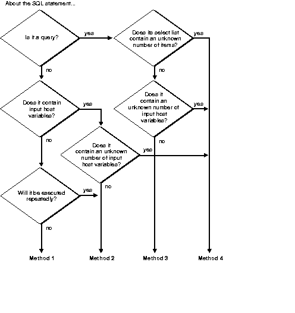

This chapter shows you how to use Oracle Dynamic SQL, an advanced programming technique that adds flexibility and functionality to your applications. You will learn four methods for writing programs that accept and process SQL statements at run time. This chapter contains the following topics:

**Note:**

Oracle Dynamic SQL does not support object types, cursor variables, arrays of structs, DML returning clauses, Unicode variables, and LOBs. Use ANSI Dynamic SQL method 4 instead.

- What is Dynamic SQL?

- Advantages and Disadvantages of Dynamic SQL

- When to Use Dynamic SQL

- Requirements for Dynamic SQL Statements

- How Dynamic SQL Statements are Processed

- Methods for Using Dynamic SQL

- Using Method 1

- Using Method 2

- Using Method 3

- Using Method 4

- About Using the DECLARE STATEMENT Statement

- About Using PL/SQL

- Dynamic SQL Statement Caching

### 13.1 What is Dynamic SQL?

Most database applications do a specific job. For example, a simple program might prompt the user for an employee number, then update rows in the EMP and DEPT tables. In this case, you know the makeup of the UPDATE statement at precompile time. That is, you know which tables might be changed, the constraints defined for each table and column, which columns might be updated, and the datatype of each column.

However, some applications must accept (or build) and process a variety of SQL statements at run time. For example, a general-purpose report writer must build different SELECT statements for the various reports it generates. In this case, the statement's makeup is unknown until run time. Such statements can, and probably will, change from execution to execution. They are aptly called dynamic SQL statements.

Unlike static SQL statements, dynamic SQL statements are not embedded in your source program. Instead, they are stored in character strings input to or built by the program at run time. They can be entered interactively or read from a file.

### 13.2 Advantages and Disadvantages of Dynamic SQL

Host programs that accept and process dynamically defined SQL statements are more versatile than plain embedded SQL programs. Dynamic SQL statements can be built interactively with input from users having little or no knowledge of SQL.

For example, your program might simply prompt users for a search condition to be used in the WHERE clause of a SELECT, UPDATE, or DELETE statement. A more complex program might allow users to choose from menus listing SQL operations, table and view names, column names, and so on. Thus, dynamic SQL lets you write highly flexible applications.

However, some dynamic queries require complex coding, the use of special data structures, and more runtime processing. While you might not notice the added processing time, you might find the coding difficult unless you fully understand dynamic SQL concepts and methods.

### 13.3 When to Use Dynamic SQL

In practice, static SQL will meet nearly all your programming needs. Use dynamic SQL only if you need its open-ended flexibility. Its use is suggested when one of the following items is unknown at precompile time:

- Text of the SQL statement (commands, clauses, and so on)

- The number of host variables

- The datatypes of host variables

- References to database objects such as columns, indexes, sequences, tables, usernames, and views

### 13.4 Requirements for Dynamic SQL Statements

To represent a dynamic SQL statement, a character string must contain the text of a valid SQL statement, but not contain the EXEC SQL clause, or the statement terminator, or any of the following embedded SQL commands:

- ALLOCATE

- CLOSE

- DECLARE

- DESCRIBE

- EXECUTE

- FETCH

- FREE

- GET

- INCLUDE

- OPEN

- PREPARE

- SET

- WHENEVER

In most cases, the character string can contain dummy host variables. They hold places in the SQL statement for actual host variables. Because dummy host variables are just placeholders, you do not declare them and can name them anything you like. For example, Oracle makes no distinction between the following two strings:

    'DELETE FROM EMP WHERE MGR = :mgr_number AND JOB = :job_title'
    'DELETE FROM EMP WHERE MGR = :m AND JOB = :j'

### 13.5 How Dynamic SQL Statements are Processed

Typically, an application program prompts the user for the text of a SQL statement and the values of host variables used in the statement. Oracle then parses the SQL statement to ensure it meets syntax rules.

Next, Oracle binds the host variables to the SQL statement. That is, Oracle gets the addresses of the host variables so that it can read or write their values.

Then Oracle executes the SQL statement. That is, Oracle does what the SQL statement requested, such as deleting rows from a table.

The SQL statement can be executed repeatedly using new values for the host variables.

### 13.6 Methods for Using Dynamic SQL

This section introduces four methods you can use to define dynamic SQL statements. It briefly describes the capabilities and limitations of each method, then offers guidelines for choosing the right method. Later sections show you how to use the methods, and include example programs that you can study.

The four methods are increasingly general. That is, Method 2 encompasses Method 1, Method 3 encompasses Methods 1 and 2, and so on. However, each method is most useful for handling a certain kind of SQL statement, as Table 13-1 shows:

Table 13-1 Methods for Using Dynamic SQL

| Method | Kind of SQL Statement                                                  |
|:-------|:-----------------------------------------------------------------------|
| 1      | non-query without host variables                                       |
| 2      | non-query with known number of input host variables                    |
| 3      | query with known number of select-list items and input host variables  |
| 4      | query with unknown number of select-list items or input host variables |

**Note:**

The term select-list item includes column names and expressions such as SAL \* 1.10 and MAX(SAL).

#### 13.6.1 Method 1

This method lets your program accept or build a dynamic SQL statement, then immediately execute it using the EXECUTE IMMEDIATE command. The SQL statement must not be a query (SELECT statement) and must not contain any placeholders for input host variables. For example, the following host strings qualify:

    'DELETE FROM EMP WHERE DEPTNO = 20'
    'GRANT SELECT ON EMP TO scott'

With Method 1, the SQL statement is parsed every time it is executed.

#### 13.6.2 Method 2

This method lets your program accept or build a dynamic SQL statement, then process it using the PREPARE and EXECUTE commands. The SQL statement must not be a query. The number of placeholders for input host variables and the datatypes of the input host variables must be known at precompile time. For example, the following host strings fall into this category:

    'INSERT INTO EMP (ENAME, JOB) VALUES (:emp_name, :job_title)'
    'DELETE FROM EMP WHERE EMPNO = :emp_number'

With Method 2, the SQL statement is parsed just once, but can be executed many times with different values for the host variables. SQL data definition statements such as CREATE and GRANT are executed when they are PREPAREd.

#### 13.6.3 Method 3

This method lets your program accept or build a dynamic query, then process it using the PREPARE command with the DECLARE, OPEN, FETCH, and CLOSE cursor commands. The number of select-list items, the number of placeholders for input host variables, and the datatypes of the input host variables must be known at precompile time. For example, the following host strings qualify:

    'SELECT DEPTNO, MIN(SAL), MAX(SAL) FROM EMP GROUP BY DEPTNO'
    'SELECT ENAME, EMPNO FROM EMP WHERE DEPTNO = :dept_number'

#### 13.6.4 Method 4

This method lets your program accept or build a dynamic SQL statement, then process it using descriptors. The number of select-list items, the number of placeholders for input host variables, and the datatypes of the input host variables can be unknown until run time. For example, the following host strings fall into this category:

    'INSERT INTO EMP (<unknown>) VALUES (<unknown>)'
    'SELECT <unknown> FROM EMP WHERE DEPTNO = 20'

Method 4 is required for dynamic SQL statements that contain an unknown number of select-list items or input host variables.

**Related Topics**

- Using Method 4

#### 13.6.5 Guidelines

With all four methods, you must store the dynamic SQL statement in a character string, which must be a host variable or quoted literal. When you store the SQL statement in the string, omit the keywords EXEC SQL and the ';' statement terminator.

With Methods 2 and 3, the number of placeholders for input host variables and the datatypes of the input host variables must be known at precompile time.

Each succeeding method imposes fewer constraints on your application, but is more difficult to code. As a rule, use the simplest method you can. However, if a dynamic SQL statement will be executed repeatedly by Method 1, use Method 2 instead to avoid reparsing for each execution.

Method 4 provides maximum flexibility, but requires complex coding and a full understanding of dynamic SQL concepts. In general, use Method 4 only if you cannot use Methods 1, 2, or 3.

The decision logic in Figure 13-1 will help you choose the right method.

##### 13.6.5.1 About Avoiding Common Errors

If you precompile using the command-line option DBMS=V6_CHAR, blank-pad the array before storing the SQL statement. That way, you clear extraneous characters. This is especially important when you reuse the array for different SQL statements. As a rule, always initialize (or re-initialize) the host string before storing the SQL statement. Do not null-terminate the host string. Oracle does not recognize the null terminator as an end-of-string sentinel. Instead, Oracle treats it as part of the SQL statement.

If you precompile with the command-line option DBMS=V8, make sure that the string is null terminated before you execute the PREPARE or EXECUTE IMMEDIATE statement.

Regardless of the value of DBMS, if you use a VARCHAR variable to store the dynamic SQL statement, make sure the length of the VARCHAR is set (or reset) correctly before you execute the PREPARE or EXECUTE IMMEDIATE statement.

Figure 13-1 Choosing the Right Method

[Description of "Figure 13-1 Choosing the Right Method"](img_text/lnpcc009.md)

### 13.7 Using Method 1

The simplest kind of dynamic SQL statement results only in "success" or "failure" and uses no host variables. Some examples follow:

    'DELETE FROM table_name WHERE column_name = constant'
    'CREATE TABLE table_name ...'
    'DROP INDEX index_name'
    'UPDATE table_name SET column_name = constant'
    'GRANT SELECT ON table_name TO username'
    'REVOKE RESOURCE FROM username'

Method 1 parses, then immediately executes the SQL statement using the EXECUTE IMMEDIATE command. The command is followed by a character string (host variable or literal) containing the SQL statement to be executed, which cannot be a query.

The syntax of the EXECUTE IMMEDIATE statement follows:

    EXEC SQL EXECUTE IMMEDIATE { :host_string | string_literal };

In the following example, you use the host variable dyn_stmt to store SQL statements input by the user:

    char dyn_stmt[132];
    ...
    for (;;)
    {
        printf("Enter SQL statement: ");
        gets(dyn_stmt);
        if (*dyn_stmt == '\0')
            break;
        /* dyn_stmt now contains the text of a SQL statement */
        EXEC SQL EXECUTE IMMEDIATE :dyn_stmt;
    }
    ...

You can also use string literals, as the following example shows:

    EXEC SQL EXECUTE IMMEDIATE 'REVOKE RESOURCE FROM MILLER';

Because EXECUTE IMMEDIATE parses the input SQL statement before every execution, Method 1 is best for statements that are executed only once. Data definition language statements usually fall into this category.

#### 13.7.1 Example Program: Dynamic SQL Method 1

The following program uses dynamic SQL Method 1 to create a table, insert a row, commit the insert, then drop the table. This program is available on-line in your demo directory in the file `sample6.pc`.

    /*
     *  sample6.pc: Dynamic SQL Method 1
     *
     *  This program uses dynamic SQL Method 1 to create a table,
     *  insert a row, commit the insert, then drop the table.
     */

    #include <stdio.h>
    #include <string.h>

    /* Include the SQL Communications Area, a structure through
     * which ORACLE makes runtime status information such as error
     * codes, warning flags, and diagnostic text available to the
     * program.
     */
    #include <sqlca.h>

    /* Include the ORACLE Communications Area, a structure through
     * which ORACLE makes additional runtime status information
     * available to the program.
     */
    #include <oraca.h>

    /* The ORACA=YES option must be specified to enable you
     * to use the ORACA.
     */

    EXEC ORACLE OPTION (ORACA=YES);

    /* Specifying the RELEASE_CURSOR=YES option instructs Pro*C
     * to release resources associated with embedded SQL
     * statements after they are executed.  This ensures that
     * ORACLE does not keep parse locks on tables after data
     * manipulation operations, so that subsequent data definition
     * operations on those tables do not result in a parse-lock
     * error.
     */

    EXEC ORACLE OPTION (RELEASE_CURSOR=YES);

    void dyn_error();

    main()
    {
    /* Declare the program host variables. */
        char    *username = "SCOTT";
        char    *password = "TIGER";
        char    *dynstmt1;
        char     dynstmt2[10];
        VARCHAR  dynstmt3[80];

    /* Call routine dyn_error() if an ORACLE error occurs. */

        EXEC SQL WHENEVER SQLERROR DO dyn_error("Oracle error:");

    /* Save text of current SQL statement in the ORACA if an
     * error occurs.
     */
        oraca.orastxtf = ORASTFERR;

    /* Connect to Oracle. */

        EXEC SQL CONNECT :username IDENTIFIED BY :password;
        puts("\nConnected to ORACLE.\n");

    /* Execute a string literal to create the table.  This
     * usage is actually not dynamic because the program does
     * not determine the SQL statement at run time.
     */
        puts("CREATE TABLE dyn1 (col1 VARCHAR2(4))");

        EXEC SQL EXECUTE IMMEDIATE
             "CREATE TABLE dyn1 (col1 VARCHAR2(4))";

    /* Execute a string to insert a row.  The string must
     * be null-terminated.  This usage is dynamic because the
     * SQL statement is a string variable whose contents the
     * program can determine at run time.
     */
        dynstmt1 = "INSERT INTO DYN1 values ('TEST')";
        puts(dynstmt1);

        EXEC SQL EXECUTE IMMEDIATE :dynstmt1;

    /* Execute a SQL statement in a string to commit the insert.
     * Pad the unused trailing portion of the array with spaces.
     * Do NOT null-terminate it.
     */
        strncpy(dynstmt2, "COMMIT    ", 10);
        printf("%.10s\n", dynstmt2);

        EXEC SQL EXECUTE IMMEDIATE :dynstmt2;

    /* Execute a VARCHAR to drop the table.  Set the .len field
     * to the length of the .arr field.
     */
        strcpy(dynstmt3.arr, "DROP TABLE DYN1");
        dynstmt3.len = strlen(dynstmt3.arr);
        puts((char *) dynstmt3.arr);

        EXEC SQL EXECUTE IMMEDIATE :dynstmt3;

    /* Commit any outstanding changes and disconnect from Oracle. */
        EXEC SQL COMMIT RELEASE;

        puts("\nHave a good day!\n");

        return 0;
    }

    void
    dyn_error(msg)
    char *msg;
    {
    /* This is the Oracle error handler.
     * Print diagnostic text containing the error message,
     * current SQL statement, and location of error.
     */
        printf("\n%.*s\n",
           sqlca.sqlerrm.sqlerrml, sqlca.sqlerrm.sqlerrmc);
        printf("in \"%.*s...\'\n",
            oraca.orastxt.orastxtl, oraca.orastxt.orastxtc);
        printf("on line %d of %.*s.\n\n",
            oraca.oraslnr, oraca.orasfnm.orasfnml,
            oraca.orasfnm.orasfnmc);

    /* Disable Oracle error checking to avoid an infinite loop
     * should another error occur within this routine as a
     * result of the rollback.
     */
        EXEC SQL WHENEVER SQLERROR CONTINUE;

    /* Roll back any pending changes and disconnect from Oracle. */
        EXEC SQL ROLLBACK RELEASE;

        exit(1);
    }

### 13.8 Using Method 2

What Method 1 does in one step, Method 2 does in two. The dynamic SQL statement, which cannot be a query, is first PREPAREd (named and parsed), then EXECUTEd.

With Method 2, the SQL statement can contain placeholders for input host variables and indicator variables. You can PREPARE the SQL statement once, then EXECUTE it repeatedly using different values of the host variables. Furthermore, you need not rePREPARE the SQL statement after a COMMIT or ROLLBACK (unless you log off and reconnect).

You can use EXECUTE for non-queries with Method 4.

The syntax of the PREPARE statement follows:

    EXEC SQL PREPARE statement_name
        FROM { :host_string | string_literal };

PREPARE parses the SQL statement and gives it a name.

The statement_name is an identifier used by the precompiler, not a host or program variable, and should not be declared in the Declare Section. It simply designates the PREPAREd statement you want to EXECUTE.

The syntax of the EXECUTE statement is

    EXEC SQL EXECUTE statement_name [USING host_variable_list];

where host_variable_list stands for the following syntax:

    :host_variable1[:indicator1] [, host_variable2[:indicator2], ...]

EXECUTE executes the parsed SQL statement, using the values supplied for each input host variable.

In the following example, the input SQL statement contains the placeholder n:

    ...
    int emp_number    INTEGER;
    char delete_stmt[120], search_cond[40];;
    ...
    strcpy(delete_stmt, "DELETE FROM EMP WHERE EMPNO = :n AND ");
    printf("Complete the following statement's search condition--\n");
    printf("%s\n", delete_stmt);
    gets(search_cond);
    strcat(delete_stmt, search_cond);

    EXEC SQL PREPARE sql_stmt FROM :delete_stmt;
    for (;;)
    {

        printf("Enter employee number: ");
        gets(temp);
        emp_number = atoi(temp);
        if (emp_number == 0)
            break;
        EXEC SQL EXECUTE sql_stmt USING :emp_number;
    }
    ...

With Method 2, you must know the datatypes of input host variables at precompile time. In the last example, emp_number was declared as an int. It could also have been declared as type float, or even a char, because Oracle supports all these datatype conversions to the internal Oracle NUMBER datatype.

#### 13.8.1 The USING Clause

When the SQL statement is EXECUTEd, input host variables in the USING clause replace corresponding placeholders in the PREPAREd dynamic SQL statement.

Every placeholder in the PREPAREd dynamic SQL statement must correspond to a different host variable in the USING clause. So, if the same placeholder appears two or more times in the PREPAREd statement, each appearance must correspond to a host variable in the USING clause.

The names of the placeholders need not match the names of the host variables. However, the order of the placeholders in the PREPAREd dynamic SQL statement must match the order of corresponding host variables in the USING clause.

If one of the host variables in the USING clause is an array, all must be arrays.

To specify NULLs, you can associate indicator variables with host variables in the USING clause.

**Related Topics**

- [Indicator Variables](embedded-SQL.md)

#### 13.8.2 Example Program: Dynamic SQL Method 2

The following program uses dynamic SQL Method 2 to insert two rows into the EMP table, then delete them. This program is available on-line in your demo directory, in the file `sample7.pc`.

    /*
     *  sample7.pc: Dynamic SQL Method 2
     *
     *  This program uses dynamic SQL Method 2 to insert two rows into
     *  the EMP table, then delete them.
     */

    #include <stdio.h>
    #include <string.h>

    #define USERNAME "SCOTT"
    #define PASSWORD "TIGER"

    /* Include the SQL Communications Area, a structure through
     * which ORACLE makes runtime status information such as error
     * codes, warning flags, and diagnostic text available to the
     * program.
     */
    #include <sqlca.h>

    /* Include the ORACLE Communications Area, a structure through
     * which ORACLE makes additional runtime status information
     * available to the program.
     */
    #include <oraca.h>

    /* The ORACA=YES option must be specified to enable use of
     * the ORACA.
     */
    EXEC ORACLE OPTION (ORACA=YES);

    char    *username = USERNAME;
    char    *password = PASSWORD;
    VARCHAR  dynstmt[80];
    int      empno   = 1234;
    int      deptno1 = 97;
    int      deptno2 = 99;

    /* Handle SQL runtime errors. */
    void dyn_error();

    main()
    {
    /* Call dyn_error() whenever an error occurs
     * processing an embedded SQL statement.
     */
        EXEC SQL WHENEVER SQLERROR DO dyn_error("Oracle error");

    /* Save text of current SQL statement in the ORACA if an
     * error occurs.
     */
        oraca.orastxtf = ORASTFERR;

    /* Connect to Oracle. */

        EXEC SQL CONNECT :username IDENTIFIED BY :password;
        puts("\nConnected to Oracle.\n");

    /* Assign a SQL statement to the VARCHAR dynstmt.  Both
     * the array and the length parts must be set properly.
     * Note that the statement contains two host-variable
     * placeholders, v1 and v2, for which actual input
     * host variables must be supplied at EXECUTE time.
     */
        strcpy(dynstmt.arr,
            "INSERT INTO EMP (EMPNO, DEPTNO) VALUES (:v1, :v2)");
        dynstmt.len = strlen(dynstmt.arr);

    /* Display the SQL statement and its current input host
     * variables.
     */
        puts((char *) dynstmt.arr);
        printf("   v1 = %d,  v2 = %d\n", empno, deptno1);

    /* The PREPARE statement associates a statement name with
     * a string containing a SQL statement.  The statement name
     * is a SQL identifier, not a host variable, and therefore
     * does not appear in the Declare Section.

     * A single statement name can be PREPAREd more than once,
     * optionally FROM a different string variable.
     */
        EXEC SQL PREPARE S FROM :dynstmt;

    /* The EXECUTE statement executes a PREPAREd SQL statement
     * USING the specified input host variables, which are
     * substituted positionally for placeholders in the
     * PREPAREd statement.  For each occurrence of a
     * placeholder in the statement there must be a variable
     * in the USING clause.  That is, if a placeholder occurs
     * multiple times in the statement, the corresponding
     * variable must appear multiple times in the USING clause.
     * The USING clause can be omitted only if the statement
     * contains no placeholders.
     *
     * A single PREPAREd statement can be EXECUTEd more
     * than once, optionally USING different input host
     * variables.
     */
        EXEC SQL EXECUTE S USING :empno, :deptno1;

    /* Increment empno and display new input host variables. */

        empno++;
        printf("   v1 = %d,  v2 = %d\n", empno, deptno2);

    /* ReEXECUTE S to insert the new value of empno and a
     * different input host variable, deptno2.
     * A rePREPARE is unnecessary.
     */
        EXEC SQL EXECUTE S USING :empno, :deptno2;

    /* Assign a new value to dynstmt. */

        strcpy(dynstmt.arr,
            "DELETE FROM EMP WHERE DEPTNO = :v1 OR DEPTNO = :v2");
        dynstmt.len = strlen(dynstmt.arr);

    /* Display the new SQL statement and its current input host
     * variables.
     */
        puts((char *) dynstmt.arr);
        printf("   v1 = %d,    v2 = %d\n", deptno1, deptno2);

    /* RePREPARE S FROM the new dynstmt. */

        EXEC SQL PREPARE S FROM :dynstmt;

    /* EXECUTE the new S to delete the two rows previously
     * inserted.
     */
        EXEC SQL EXECUTE S USING :deptno1, :deptno2;

    /* Commit any pending changes and disconnect from Oracle. */

        EXEC SQL COMMIT RELEASE;
        puts("\nHave a good day!\n");
        exit(0);
    }

    void
    dyn_error(msg)
    char *msg;
    {
    /* This is the ORACLE error handler.
     * Print diagnostic text containing error message,
     * current SQL statement, and location of error.
     */
        printf("\n%s", msg);
        printf("\n%.*s\n",
            sqlca.sqlerrm.sqlerrml, sqlca.sqlerrm.sqlerrmc);
        printf("in \"%.*s...\"\n",
            oraca.orastxt.orastxtl, oraca.orastxt.orastxtc);
        printf("on line %d of %.*s.\n\n",
            oraca.oraslnr, oraca.orasfnm.orasfnml,
            oraca.orasfnm.orasfnmc);

    /* Disable ORACLE error checking to avoid an infinite loop
     * should another error occur within this routine.
     */
        EXEC SQL WHENEVER SQLERROR CONTINUE;

    /* Roll back any pending changes and
     * disconnect from Oracle.
     */
        EXEC SQL ROLLBACK RELEASE;
        exit(1);
    }

### 13.9 Using Method 3

Method 3 is similar to Method 2 but combines the PREPARE statement with the statements needed to define and manipulate a cursor. This allows your program to accept and process queries. In fact, if the dynamic SQL statement is a query, you must use Method 3 or 4.

For Method 3, the number of columns in the query select list and the number of placeholders for input host variables must be known at precompile time. However, the names of database objects such as tables and columns need not be specified until run time. Names of database objects cannot be host variables. Clauses that limit, group, and sort query results (such as WHERE, GROUP BY, and ORDER BY) can also be specified at run time.

With Method 3, you use the following sequence of embedded SQL statements:

    PREPARE statement_name FROM { :host_string | string_literal };
    DECLARE cursor_name CURSOR FOR statement_name;
    OPEN cursor_name [USING host_variable_list];
    FETCH cursor_name INTO host_variable_list;
    CLOSE cursor_name;

Scrollable Cursors can also be used with Method 3. The following sequence of embedded SQL statements must be used for scrollable cursors.

    PREPARE statement_name FROM { :host_string | string_literal };
    DECLARE  cursor_name  SCROLL CURSOR FOR statement_name;
    OPEN cursor_name [USING host_variable_list];
    FETCH  [ FIRST| PRIOR|NEXT|LAST|CURRENT | RELATIVE fetch_offset
                   |ABSOLUTE fetch_offset ]  cursor_name INTO host_variable_list;
    CLOSE cursor_name;

Now we look at what each statement does.

#### 13.9.1 PREPARE (Dynamic SQL)

PREPARE parses the dynamic SQL statement and gives it a name. In the following example, PREPARE parses the query stored in the character string select_stmt and gives it the name sql_stmt:

    char select_stmt[132] =
         "SELECT MGR, JOB FROM EMP WHERE SAL < :salary";
    EXEC SQL PREPARE sql_stmt FROM :select_stmt;

Commonly, the query WHERE clause is input from a terminal at run time or is generated by the application.

The identifier sql_stmt is not a host or program variable, but must be unique. It designates a particular dynamic SQL statement.

The following statement is correct also:

    EXEC SQL PREPARE sql_stmt FROM SELECT MGR, JOB FROM EMP WHERE SAL < :salary;

The following prepare statement, which uses the '%' wildcard, is correct also:

    EXEC SQL PREPARE S FROM select ename FROM test WHERE ename LIKE 'SMIT%';

#### 13.9.2 DECLARE (Dynamic SQL)

DECLARE defines a cursor by giving it a name and associating it with a specific query. Continuing our example, DECLARE defines a cursor named emp_cursor and associates it with sql_stmt, as follows:

    EXEC SQL DECLARE emp_cursor CURSOR FOR sql_stmt;

The identifiers sql_stmt and emp_cursor are not host or program variables, but must be unique. If you declare two cursors using the same statement name, the precompiler considers the two cursor names synonymous.

We can define a scrollable cursor named emp_cursor and associate it with sql_stmt as follows:

    EXEC SQL DECLARE emp_cursor SCROLL CURSOR FOR sql_stmt;

For example, if you execute the statements

    EXEC SQL PREPARE sql_stmt FROM :select_stmt;
    EXEC SQL DECLARE emp_cursor FOR sql_stmt;
    EXEC SQL PREPARE sql_stmt FROM :delete_stmt;
    EXEC SQL DECLARE dept_cursor FOR sql_stmt;

when you OPEN emp_cursor, you will process the dynamic SQL statement stored in delete_stmt, not the one stored in select_stmt.

#### 13.9.3 OPEN (Dynamic SQL)

OPEN allocates an Oracle cursor, binds input host variables, and executes the query, identifying its active set. OPEN also positions the cursor on the first row in the active set and zeroes the rows-processed count kept by the third element of sqlerrd in the SQLCA. Input host variables in the USING clause replace corresponding placeholders in the PREPAREd dynamic SQL statement.

In our example, OPEN allocates emp_cursor and assigns the host variable salary to the WHERE clause, as follows:

    EXEC SQL OPEN emp_cursor USING :salary;

#### 13.9.4 FETCH (Dynamic SQL)

FETCH returns a row from the active set, assigns column values in the select list to corresponding host variables in the INTO clause, and advances the cursor to the next row. If there are no more rows, FETCH returns the "no data found" Oracle error code to sqlca.sqlcode.

In our example, FETCH returns a row from the active set and assigns the values of columns MGR and JOB to host variables mgr_number and job_title, as follows:

    EXEC SQL FETCH emp_cursor INTO :mgr_number, :job_title;

If the cursor is declared in SCROLL mode, you can then use the various FETCH orientation modes to randomly access the result set.

#### 13.9.5 CLOSE (Dynamic SQL)

CLOSE disables the cursor. Once you CLOSE a cursor, you can no longer FETCH from it.

In our example, CLOSE disables emp_cursor, as follows:

    EXEC SQL CLOSE emp_cursor;

#### 13.9.6 Example Program: Dynamic SQL Method 3

The following program uses dynamic SQL Method 3 to retrieve the names of all employees in a given department from the EMP table. This program is available on-line in your demo directory, in the file `sample8.pc `

    /*
     *  sample8.pc:  Dynamic SQL Method 3
     *
     *  This program uses dynamic SQL Method 3 to retrieve the names
     *  of all employees in a given department from the EMP table.
     */

    #include <stdio.h>
    #include <string.h>

    #define USERNAME "SCOTT"
    #define PASSWORD "TIGER"

    /* Include the SQL Communications Area, a structure through
     * which ORACLE makes runtime status information such as error
     * codes, warning flags, and diagnostic text available to the
     * program. Also include the ORACA.
     */
    #include <sqlca.h>
    #include <oraca.h>

    /* The ORACA=YES option must be specified to enable use of
     * the ORACA.
     */
    EXEC ORACLE OPTION (ORACA=YES);

    char    *username = USERNAME;
    char    *password = PASSWORD;
    VARCHAR  dynstmt[80];
    VARCHAR  ename[10];
    int      deptno = 10;

    void dyn_error();

    main()
    {
    /* Call dyn_error() function on any error in
     * an embedded SQL statement.
     */
        EXEC SQL WHENEVER SQLERROR DO dyn_error("Oracle error");

    /* Save text of SQL current statement in the ORACA if an
     * error occurs.
     */
        oraca.orastxtf = ORASTFERR;

    /* Connect to Oracle. */

        EXEC SQL CONNECT :username IDENTIFIED BY :password;
        puts("\nConnected to Oracle.\n");

    /* Assign a SQL query to the VARCHAR dynstmt.  Both the
     * array and the length parts must be set properly.  Note
     * that the query contains one host-variable placeholder,
     * v1, for which an actual input host variable must be
     * supplied at OPEN time.
     */
        strcpy(dynstmt.arr,
            "SELECT ename FROM emp WHERE deptno = :v1");
        dynstmt.len = strlen(dynstmt.arr);

    /* Display the SQL statement and its current input host
     * variable.
     */
        puts((char *) dynstmt.arr);
        printf("   v1 = %d\n", deptno);
        printf("\nEmployee\n");
        printf("--------\n");

    /* The PREPARE statement associates a statement name with
     * a string containing a SELECT statement.  The statement
     * name is a SQL identifier, not a host variable, and
     * therefore does not appear in the Declare Section.

     * A single statement name can be PREPAREd more than once,
     * optionally FROM a different string variable.
     */
        EXEC SQL PREPARE S FROM :dynstmt;

    /* The DECLARE statement associates a cursor with a
     * PREPAREd statement.  The cursor name, like the statement
     * name, does not appear in the Declare Section.

     * A single cursor name cannot be DECLAREd more than once.
     */
        EXEC SQL DECLARE C CURSOR FOR S;

    /* The OPEN statement evaluates the active set of the
     * PREPAREd query USING the specified input host variables,
     * which are substituted positionally for placeholders in
     * the PREPAREd query.  For each occurrence of a
     * placeholder in the statement there must be a variable
     * in the USING clause.  That is, if a placeholder occurs
     * multiple times in the statement, the corresponding
     * variable must appear multiple times in the USING clause.

     * The USING clause can be omitted only if the statement
     * contains no placeholders.  OPEN places the cursor at the
     * first row of the active set in preparation for a FETCH.

     * A single DECLAREd cursor can be OPENed more than once,
     * optionally USING different input host variables.
     */
        EXEC SQL OPEN C USING :deptno;

    /* Break the loop when all data have been retrieved. */

        EXEC SQL WHENEVER NOT FOUND DO break;

    /* Loop until the NOT FOUND condition is detected. */

        for (;;)
        {
    /* The FETCH statement places the select list of the
     * current row into the variables specified by the INTO
     * clause, then advances the cursor to the next row.  If
     * there are more select-list fields than output host
     * variables, the extra fields will not be returned.
     * Specifying more output host variables than select-list
     * fields results in an ORACLE error.
     */
            EXEC SQL FETCH C INTO :ename;

    /* Null-terminate the array before output. */
            ename.arr[ename.len] = '\0';
            puts((char *) ename.arr);
            }

    /* Print the cumulative number of rows processed by the
     * current SQL statement.
     */
        printf("\nQuery returned %d row%s.\n\n", sqlca.sqlerrd[2],
            (sqlca.sqlerrd[2] == 1) ? "" : "s");

    /* The CLOSE statement releases resources associated with
     * the cursor.
     */
        EXEC SQL CLOSE C;

    /* Commit any pending changes and disconnect from Oracle. */
        EXEC SQL COMMIT RELEASE;
        puts("Sayonara.\n");
        exit(0);
    }

    void
    dyn_error(msg)
    char *msg;
    {
        printf("\n%s", msg);
        sqlca.sqlerrm.sqlerrmc[sqlca.sqlerrm.sqlerrml] = '\0';
        oraca.orastxt.orastxtc[oraca.orastxt.orastxtl] = '\0';
        oraca.orasfnm.orasfnmc[oraca.orasfnm.orasfnml] = '\0';
        printf("\n%s\n", sqlca.sqlerrm.sqlerrmc);
        printf("in \"%s...\"\n", oraca.orastxt.orastxtc);
        printf("on line %d of %s.\n\n", oraca.oraslnr,
           oraca.orasfnm.orasfnmc);

    /* Disable ORACLE error checking to avoid an infinite loop
     * should another error occur within this routine.
     */
        EXEC SQL WHENEVER SQLERROR CONTINUE;

    /* Release resources associated with the cursor. */
        EXEC SQL CLOSE C;

    /* Roll back any pending changes and disconnect from Oracle. */
        EXEC SQL ROLLBACK RELEASE;
        exit(1);
    }

### 13.10 Using Method 4

This section gives an overview of Oracle Dynamic SQL Method 4. Oracle Dynamic SQL Method 4 does not support object types, results sets, arrays of structs, or LOBs.

ANSI SQL does support all datatypes. Use ANSI SQL for all new applications.

There is a kind of dynamic SQL statement that your program cannot process using Method 3. When the number of select-list items or placeholders for input host variables is unknown until run time, your program must use a descriptor. A descriptor is an area of memory used by your program and Oracle to hold a complete description of the variables in a dynamic SQL statement.

Recall that for a multirow query, you FETCH selected column values INTO a list of declared output host variables. If the select list is unknown, the host-variable list cannot be established at precompile time by the INTO clause. For example, you know the following query returns two column values:

    SELECT ename, empno FROM emp WHERE deptno = :dept_number;

However, if you let the user define the select list, you might not know how many column values the query will return.

**Related Topics**

- [ANSI Dynamic SQL](ANSI-dynamic-SQL.md)
- [Oracle Dynamic SQL: Method 4](Oracle-dynamic-SQL-method-4.md)

#### 13.10.1  Need for the SQLDA

To process this kind of dynamic query, your program must issue the DESCRIBE SELECT LIST command and declare a data structure called the SQL Descriptor Area (SQLDA). Because it holds descriptions of columns in the query select list, this structure is also called a select descriptor.

Likewise, if a dynamic SQL statement contains an unknown number of placeholders for input host variables, the host-variable list cannot be established at precompile time by the USING clause.

To process the dynamic SQL statement, your program must issue the DESCRIBE BIND VARIABLES command and declare another kind of SQLDA called a bind descriptor to hold descriptions of the placeholders for input host variables. (Input host variables are also called bind variables.)

If your program has more than one active SQL statement (it might have OPENed two or more cursors, for example), each statement must have its own SQLDA(s). However, non-concurrent cursors can reuse SQLDAs. There is no set limit on the number of SQLDAs in a program.

#### 13.10.2 The DESCRIBE Statement

DESCRIBE initializes a descriptor to hold descriptions of select-list items or input host variables.

If you supply a select descriptor, the DESCRIBE SELECT LIST statement examines each select-list item in a PREPAREd dynamic query to determine its name, datatype, constraints, length, scale, and precision. It then stores this information in the select descriptor.

If you supply a bind descriptor, the DESCRIBE BIND VARIABLES statement examines each placeholder in a PREPAREd dynamic SQL statement to determine its name, length, and the datatype of its associated input host variable. It then stores this information in the bind descriptor for your use. For example, you might use placeholder names to prompt the user for the values of input host variables.

#### 13.10.3 What is a SQLDA?

A SQLDA is a host-program data structure that holds descriptions of select-list items or input host variables.

SQLDA variables are not defined in the Declare Section.

The select SQLDA contains the following information about a query select list:

- Maximum number of columns that can be DESCRIBEd

- Actual number of columns found by DESCRIBE

- Addresses of buffers to store column values

- Lengths of column values

- Datatypes of column values

- Addresses of indicator-variable values

- Addresses of buffers to store column names

- Sizes of buffers to store column names

- Current lengths of column names

The bind SQLDA contains the following information about the input host variables in a SQL statement:

- Maximum number of placeholders that can be DESCRIBEd

- Actual number of placeholders found by DESCRIBE

- Addresses of input host variables

- Lengths of input host variables

- Datatypes of input host variables

- Addresses of indicator variables

- Addresses of buffers to store placeholder names

- Sizes of buffers to store placeholder names

- Current lengths of placeholder names

- Addresses of buffers to store indicator-variable names

- Sizes of buffers to store indicator-variable names

- Current lengths of indicator-variable names

  **See Also:**

  [Oracle Dynamic SQL: Method 4](Oracle-dynamic-SQL-method-4.md) for information on the SQLDA structure and variable names.

#### 13.10.4 About Implementing Oracle Method 4

With Oracle Method 4, you generally use the following sequence of embedded SQL statements:

    EXEC SQL PREPARE statement_name
        FROM { :host_string | string_literal };
    EXEC SQL DECLARE cursor_name CURSOR FOR statement_name;
    EXEC SQL DESCRIBE BIND VARIABLES FOR statement_name
        INTO bind_descriptor_name;
    EXEC SQL OPEN cursor_name
        [USING DESCRIPTOR bind_descriptor_name];
    EXEC SQL DESCRIBE [SELECT LIST FOR] statement_name
        INTO select_descriptor_name;
    EXEC SQL FETCH cursor_name
        USING DESCRIPTOR select_descriptor_name;
    EXEC SQL CLOSE cursor_name;

However, select and bind descriptors need not work in tandem. So, if the number of columns in a query select list is known, but the number of placeholders for input host variables is unknown, you can use the Method 4 OPEN statement with the following Method 3 FETCH statement:

    EXEC SQL FETCH emp_cursor INTO host_variable_list;

Conversely, if the number of placeholders for input host variables is known, but the number of columns in the select list is unknown, you can use the Method 3 OPEN statement

    EXEC SQL OPEN cursor_name [USING host_variable_list];

with the Method 4 FETCH statement.

EXECUTE can be used for nonqueries with Method 4.

#### 13.10.5 Restriction

In Dynamic SQL Method 4, you cannot bind a host array to a PL/SQL procedure with a parameter of type "table."

### 13.11 About Using the DECLARE STATEMENT Statement

With Methods 2, 3, and 4, you might need to use the statement

    EXEC SQL [AT db_name] DECLARE statement_name STATEMENT;

where db_name and statement_name are identifiers used by the precompiler, not host or program variables.

DECLARE STATEMENT declares the name of a dynamic SQL statement so that the statement can be referenced by PREPARE, EXECUTE, DECLARE CURSOR, and DESCRIBE. It is required if you want to execute the dynamic SQL statement at a nondefault database. An example using Method 2 follows:

    EXEC SQL AT remote_db DECLARE sql_stmt STATEMENT;
    EXEC SQL PREPARE sql_stmt FROM :dyn_string;
    EXEC SQL EXECUTE sql_stmt;

In the example, remote_db tells Oracle where to EXECUTE the SQL statement.

With Methods 3 and 4, DECLARE STATEMENT is also required if the DECLARE CURSOR statement precedes the PREPARE statement, as shown in the following example:

    EXEC SQL DECLARE sql_stmt STATEMENT;
    EXEC SQL DECLARE emp_cursor CURSOR FOR sql_stmt;
    EXEC SQL PREPARE sql_stmt FROM :dyn_string;

The usual sequence of statements is

    EXEC SQL PREPARE sql_stmt FROM :dyn_string;
    EXEC SQL DECLARE emp_cursor CURSOR FOR sql_stmt;

#### 13.11.1 About Using Host Arrays

The use of host arrays in static SQL and dynamic SQL is similar. For example, to use input host arrays with dynamic SQL Method 2, simply use the syntax

    EXEC SQL EXECUTE statement_name USING host_array_list;

where host_array_list contains one or more host arrays.

Similarly, to use input host arrays with Method 3, use the following syntax:

    OPEN cursor_name USING host_array_list;

To use output host arrays with Method 3, use the following syntax:

    FETCH cursor_name INTO host_array_list;

With Method 4, you must use the optional FOR clause to tell Oracle the size of your input or output host array.

**Related Topics**

- [Oracle Dynamic SQL: Method 4](Oracle-dynamic-SQL-method-4.md)

### 13.12 About Using PL/SQL

The Pro\*C/C++ Precompiler treats a PL/SQL block like a single SQL statement. So, like a SQL statement, a PL/SQL block can be stored in a string host variable or literal. When you store the PL/SQL block in the string, omit the keywords EXEC SQL EXECUTE, the keyword END-EXEC, and the ';' statement terminator.

However, there are two differences in the way the precompiler handles SQL and PL/SQL:

- The precompiler treats all PL/SQL host variables as input host variables whether they serve as input or output host variables (or both) inside the PL/SQL block.

- You cannot FETCH from a PL/SQL block because it might contain any number of SQL statements.

#### 13.12.1 With Method 1

If the PL/SQL block contains no host variables, you can use Method 1 to EXECUTE the PL/SQL string in the usual way.

#### 13.12.2 With Method 2

If the PL/SQL block contains a known number of input and output host variables, you can use Method 2 to PREPARE and EXECUTE the PL/SQL string in the usual way.

You must put all host variables in the USING clause. When the PL/SQL string is EXECUTEd, host variables in the USING clause replace corresponding placeholders in the PREPAREd string. Though the precompiler treats all PL/SQL host variables as input host variables, values are assigned correctly. Input (program) values are assigned to input host variables, and output (column) values are assigned to output host variables.

Every placeholder in the PREPAREd PL/SQL string must correspond to a host variable in the USING clause. So, if the same placeholder appears two or more times in the PREPAREd string, each appearance must correspond to a host variable in the USING clause.

#### 13.12.3 With Method 3

Methods 2 and 3 are the same except that Method 3 allows FETCHing. Since you cannot FETCH from a PL/SQL block, just use Method 2 instead.

#### 13.12.4 With Oracle Method 4

If the PL/SQL block contains an unknown number of input or output host variables, you must use Method 4.

To use Method 4, you set up one bind descriptor for all the input and output host variables. Executing DESCRIBE BIND VARIABLES stores information about input and output host variables in the bind descriptor. Because the precompiler treats all PL/SQL host variables as input host variables, executing DESCRIBE SELECT LIST has no effect.

**WARNING:**

In dynamic SQL Method 4, you cannot bind a host array to a PL/SQL procedure with a parameter of type "table."

**WARNING:**

Do not use ANSI-style Comments (- -) in a PL/SQL block that will be processed dynamically because end-of-line characters are ignored. As a result, ANSI-style Comments extend to the end of the block, not just to the end of a line. Instead, use C-style Comments (/\* ... \*/).

**Related Topics**

- [Oracle Dynamic SQL: Method 4](Oracle-dynamic-SQL-method-4.md)

### 13.13 Dynamic SQL Statement Caching

Statement caching refers to the feature that provides and manages a cache of statements for each session. In the server, it means that cursors are ready to be used without the statement being parsed again. Statement caching can be enabled in the precompiler applications, which will help in the performance improvement of all applications that rely on the dynamic SQL statements. Performance improvement is achieved by removing the overhead of parsing the dynamic statements on reuse.

You can obtain this performance improvement by using a new command line option, `stmt_cache` (for the statement cache size), which will enable the statement caching of the dynamic statements. By enabling the new option, the statement cache will be created at session creation time. The caching is only applicable for the dynamic statements and the cursor cache for the static statements co-exists with this feature.

The command line option `stmt_cache` can be given any value in the range of 0 to 65535. Statement caching is disabled by default (value 0). The `stmt_cache` option can be set to hold the anticipated number of distinct dynamic SQL statements in the application.

Example 13-1 Using the stmt_cache Option

This example demonstrates the use of the `stmt_cache` option. In this program, you insert rows into a table and select the inserted rows by using the cursor in the loop. When the stmt_cache option is used to precompile this program, the performance increases compared to a normal precompilation.

    /*
     *  stmtcache.pc
     *
     *  NOTE:
     *  When this program is used to measure the performance with and without
     *  stmt_cache option, do the following changes in the program,
     *  1. Increase ROWSCNT to high value, say 10000.
     *  2. Remove all the print statements, usually which comsumes significant
     *     portion of the total program execution time.
     *
     *  HINT: In Linux, gettimeofday() can be used to measure time.
     */

    #include <stdio.h>
    #include <string.h>
    #include <stdlib.h>
    #include <sqlca.h>
    #include <oraca.h>

    #define ROWSCNT 10

    char    *username = "scott";
    char    *password = "tiger";

    /* Function prototypes */
    void sql_error(char *msg);
    void selectdata();
    void insertdata();

    int main()
    {
      EXEC SQL WHENEVER SQLERROR DO sql_error("Oracle error");

      /* Connect using the default schema scott/tiger */
      EXEC SQL CONNECT :username IDENTIFIED BY :password;

      /* core functions to insert and select the data */
      insertdata();
      selectdata();

    /* Rollback pll the changes and disconnect from Oracle. */
      EXEC SQL ROLLBACK WORK RELEASE;

      exit(0);
    }

    /*Insert the data for ROWSCNT items into tpc2sc01 */
    void insertdata()
    {
      varchar dynstmt[80];
      int i;
      varchar ename[10];
      float comm;
      char *str;

      /* Allocates temporary buffer */
      str = (char *)malloc (11 * sizeof(char));

      strcpy ((char *)dynstmt.arr,
              "INSERT INTO bonus (ename, comm) VALUES (:ename, :comm)");
      dynstmt.len = strlen(dynstmt.arr);
      EXEC SQL PREPARE S FROM :dynstmt;

      printf ("Inserts %d rows into bonus table using dynamic SQL statement\n",
              ROWSCNT);
      for (i=1; i<=ROWSCNT; i++)
      {
        sprintf (str, "EMP_%05d",i);
        strcpy (ename.arr, str);
        comm = i;
        ename.len = strlen (ename.arr);
        EXEC SQL EXECUTE S USING :ename, :comm;
      }

      free(str);
    }

    /* Select the data using the cursor */
    void selectdata()
    {
      varchar dynstmt[80];
      varchar ename[10];
      float comm;
      int i;

      strcpy((char *)dynstmt.arr,
             "SELECT ename, comm FROM bonus WHERE comm = :v1");
      dynstmt.len = (unsigned short)strlen((char *)dynstmt.arr);

      printf ("Fetches the inserted rows using using dynamic SQL statement\n\n");
      printf ("  ENAME      COMMISSION\n\n");

      for (i=1; i<=ROWSCNT; i++)
      {
        /* Do the prepare in the loop so that the advantage of stmt_caching
           is visible*/
        EXEC SQL PREPARE S FROM :dynstmt;

        EXEC SQL DECLARE C CURSOR FOR S;
        EXEC SQL OPEN C USING :i;

        EXEC SQL WHENEVER NOT FOUND DO break;

        /* Loop until the NOT FOUND condition is detected. */
        for (;;)
        {
          EXEC SQL FETCH C INTO :ename, :comm;
          ename.arr[ename.len] = '\0';
          printf ("%10s    %7.2f\n", ename.arr, comm);
        }
        /* Close the cursor so that the reparsing is not required for stmt_cache */
        EXEC SQL CLOSE C;
      }
    }

    void sql_error(char *msg)
    {
        printf("\n%s", msg);
        sqlca.sqlerrm.sqlerrmc[sqlca.sqlerrm.sqlerrml] = '\0';
        oraca.orastxt.orastxtc[oraca.orastxt.orastxtl] = '\0';
        oraca.orasfnm.orasfnmc[oraca.orasfnm.orasfnml] = '\0';
        printf("\n%s\n", sqlca.sqlerrm.sqlerrmc);
        printf("in \"%s...\"\n", oraca.orastxt.orastxtc);
        printf("on line %d of %s.\n\n", oraca.oraslnr,
           oraca.orasfnm.orasfnmc);

       /* Disable ORACLE error checking to avoid an infinite loop
        * should another error occur within this routine.
        */
        EXEC SQL WHENEVER SQLERROR CONTINUE;

        /* Release resources associated with the cursor. */
        EXEC SQL CLOSE C;

        /* Roll back any pending changes and disconnect from Oracle. */
        EXEC SQL ROLLBACK WORK RELEASE;
        exit(1);
    }
