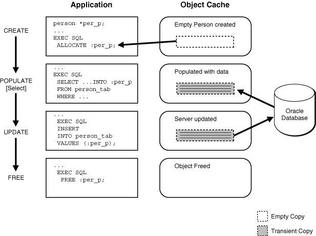
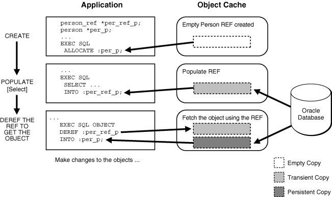
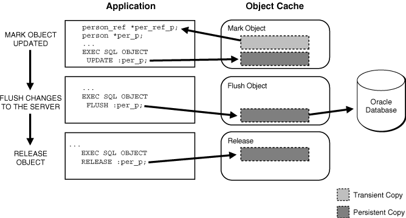

This chapter describes the support in Pro\*C/C++ for user-defined objects. This chapter contains the following topics:

- Introduction to Objects

- About Using Object Types in Pro\*C/C++

- The Object Cache

- Associative Interface

- Navigational Interface

- Converting Object Attributes and C Types

- Object Options Set/Get

- New Precompiler Options for Objects

- An Object Example in Pro\*C/C++

- Example Code for Type Inheritance

- Example Code for Navigational Access

- About Using C Structures

- About Using REFs

- About Using OCIDate\_ OCIString\_ OCINumber\_ and OCIRaw

- Summarizing the New Database Types in Pro\*C/C++

- Restrictions on Using Oracle Datatypes in Dynamic SQL

### 17.1 Introduction to Objects

In addition to the Oracle relational datatypes supported since Oracle8, Pro\*C/C++ supports user-defined datatypes, which are:

- Object types

- REFs to object types

- Collection object types

- Type inheritance

**Related Topics**

- [Collections](about-Collections.md)

#### 17.1.1 Object Types

An object type is a user-defined datatype that has attributes, the variables that form the datatype defined by a CREATE TYPE SQL statement, and methods, functions and procedures that are the set of allowed behaviors of the object type. We consider object types with only attributes in this guide.

For example:

    --Defining an object type...
    CREATE TYPE employee_type AS OBJECT(
        name    VARCHAR2(20),
        id      NUMBER,
        MEMBER FUNCTION get_id(name VARCHAR2) RETURN NUMBER);
    /
    --
    --Creating an object table...
    CREATE TABLE employees OF employee_type;
    --Instantiating an object, using a constructor...
    INSERT INTO employees VALUES (
            employee_type('JONES', 10042));

LONG, LONG RAW, NCLOB, NCHAR and NCHAR Varying are not allowed as datatypes in attributes of objects.

#### 17.1.2 REFs to Object Types

REF (short for "reference") is a reference to an object stored in a database table, instead of the object itself. REF types can occur in relational columns and also as datatypes of an object type. For example, a table employee_tab can have a column that is a REF to an object type employee_t itself:

    CREATE TYPE employee_t AS OBJECT(
       empname         CHAR(20),
       empno           INTEGER,
       manager         REF employee_t);
    /
    CREATE TABLE employee_tab OF employee_t;

#### 17.1.3 Type Inheritance

Oracle supports type inheritance of objects. This enables sharing of attributes and methods between similar object types, as well as extending the characteristics of an object type.

Pro\*C/C++ supports type inheritance of object types with the following SQL operators:

- IS OF type

- TREAT

The IS OF type operator is used to test an object instance for specific type information.

The following code example returns the references to all `p` objects where `p` is of type `Employee_t` and `Student_t`.

    SELECT REF(p)
       FROM person_tab p
       WHERE VALUE(p) IS OF (Employee_t, Student_t);

The following code example returns all rows where `p` is of type `Student_t` only.

    SELECT VALUE(p)
       FROM person_tab p
       WHERE VALUE(p) IS OF (ONLY Student_t);

The TREAT operator is used to modify the declared type of an expression.

The following code example returns all rows where `p` is of type `Student_t`. For all instances of `p` that are not of type `Student_t`, null is returned.

    SELECT TREAT(VALUE(p) AS Student_t)
       FROM person_tab p;

The following code example returns the references to all `p` objects of type `Student_t` and any objects of subtype `PartTimeStudent_t`.

    SELECT TREAT(REP(p) AS REF Student_t)
       FROM person_tab p
       WHERE VALUE(p) IS OF (Student_t);

### 17.2 About Using Object Types in Pro\*C/C++

Declare pointers to C structures generated by the OTT (Object Type Translator) as host and indicator variables in your Pro\*C/C++ application. Use of an indicator variable is optional for an object type, but Oracle recommends it.

Represent object types in a Pro\*C/C++ program as C structures generated from the database objects using OTT. You must

- Include in the Pro\*C/C++ program the OTT-generated header file with structure definitions and the associated NULL indicator structures, and the C type for a REF to the object type.

- Enter the typefile generated by OTT as an INTYPE Pro\*C/C++ command-line option. This typefile encodes the correspondence between the OTT-generated C structures and the associated object types in the database, as well as schema and type version information.

**Related Topics**

- [The Object Type Translator](the-Object-type.md)

#### 17.2.1 NULL Indicators

C structures representing the NULL status of object types are generated by the Object Type Translator. You must use these generated structure types in declaring indicator variables for object types.

Other Oracle types do not require special treatment for NULL indicators.

Because object types have internal structure, NULL indicators for object types also have internal structure. A NULL indicator structure for a non-collection object type provides atomic (single) NULL status for the object type as a whole, as well as the NULL status of every attribute. OTT generates a C structure to represent the NULL indicator structure for the object type. The name of the NULL indicator structure is Object_typename\_ind where Object_typename is the name of the C structure for the user-defined type in the database.

**Related Topics**

- [Datatypes and Host Variables](datatypes-and-host-variables.md)

### 17.3 The Object Cache

The object cache is an area of memory on the client that is allocated for your program's use in interfacing with database objects. There are two interfaces to working with objects. The associative interface manipulates "transient" copies of the objects and the navigational interface manipulates "persistent" objects.

#### 17.3.1 Persistent Versus Transient Copies of Objects

Objects that you allocated in the cache with EXEC SQL ALLOCATE statements in Pro\*C/C++ are transient copies of persistent objects in the Oracle database. As such, you can update these copies in the cache after they are fetched in, but in order to make these changes persistent in the database, you must use explicit SQL commands. This "transient copy" or "value-based" object caching model is an extension of the relational model, in which scalar columns of relational tables can be fetched into host variables, updated in place, and the updates communicated to the server.

### 17.4 Associative Interface

The associative interface manipulates transient copies of objects. Memory is allocated in the object cache with the EXEC SQL ALLOCATE statement.

One object cache is created for each SQLLIB runtime context.

Objects are retrieved by the EXEC SQL SELECT or EXEC SQL FETCH statements. These statements set values for the attributes of the host variable. If a NULL indicator is provided, it is also set.

Objects are inserted, updated, or deleted using EXEC SQL INSERT, EXEC SQL UPDATE, and EXEC SQL DELETE statements. The attributes of the object host variable must be set before the statement is executed.

Transactional statements EXEC SQL COMMIT and EXEC SQL ROLLBACK are used to write the changes permanently on the server or to cancel the changes.

You explicitly free memory in the cache for the objects by use of the EXEC SQL FREE statement. When a connection is terminated, Oracle implicitly frees its allocated memory.

#### 17.4.1 When to Use the Associative Interface

Use in these cases:

- To access large collections of objects where explicit joins between tables are not expensive.

- To access objects that are not referenceable; they do not have object identity. For example, an object type in a relational column.

- When an operation such as UPDATE or INSERT is applied to a set of objects. For example, add a bonus of \$1000 to all employees in a department.

#### 17.4.2 ALLOCATE

You allocate space in the object cache with this statement. The syntax is:

    EXEC SQL [AT [:]database] ALLOCATE :host_ptr [[INDICATOR]:ind_ptr] ;

Variables entered are:

database (IN)

a zero-terminated string containing the name of the database connection, as established previously through the statement:

    EXEC SQL CONNECT :user [AT [:]database];

If the AT clause AT is omitted, or if database is an empty string, the default database connection is assumed.

host_ptr (IN)

a pointer to a host structure generated by OTT for object types, collection object types, or REFs, or a pointer to one of the new C datatypes: OCIDate, OCINumber, OCIRaw, or OCIString.

ind_ptr (IN)

The indicator variable, ind_ptr, is optional, as is the keyword INDICATOR. Only pointers to struct-typed indicators can be used in the ALLOCATE and FREE statements.

host_ptr and ind_ptr can be host arrays.

The duration of allocation is the session. Any instances will be freed when the session (connection) is terminated, even if not explicitly freed by a FREE statement.

**Related Topics**

- [ALLOCATE (Executable Embedded SQL Extension)](embedded-SQL-statements-and-directives.md)
- [FREE (Executable Embedded SQL Extension)](embedded-SQL-statements-and-directives.md)

#### 17.4.3 FREE

    EXEC SQL [AT[:]database] [OBJECT] FREE :host_ptr [[INDICATOR]:ind_ptr];

You de-allocate the space for an object that is placed in the object cache using the FREE statement. Variables used are the same as in the ALLOCATE statement.

**Note:**

Pointers to host and indicator variables are not set to null.

#### 17.4.4 CACHE FREE ALL

    EXEC SQL [AT [:]database] [OBJECT] CACHE FREE ALL;

Use the earlier statement to free all object cache memory for the specified database connection.

**Related Topics**

- [CACHE FREE ALL (Executable Embedded SQL Extension)](embedded-SQL-statements-and-directives.md)

#### 17.4.5 Accessing Objects Using the Associative Interface

When accessing objects using SQL, Pro\*C/C++ applications manipulate transient copies of the persistent objects. This is a direct extension of the relational access interface, which uses SELECT, UPDATE and DELETE statements.

In Figure 17-1, you allocate memory in the cache for a transient copy of the persistent object with the ALLOCATE statement. The allocated object does not contain data, but it has the form of the struct generated by the OTT.

    person *per_p;
    ...
    EXEC SQL ALLOCATE :per_p;

You can execute a SELECT statement to populate the cache. Or, use a FETCH statement or a C assignment to populate the cache with data.

    EXEC SQL SELECT ... INTO :per_p FROM person_tab WHERE ...

Make changes to the server objects with INSERT, UPDATE or DELETE statements, as shown in the illustration. You can insert the data is into the table by the INSERT statement:

    EXEC SQL INSERT INTO person_tab VALUES(:per_p);

Finally, free memory associated with the copy of the object with the FREE statement:

    EXEC SQL FREE :per_p;

Figure 17-1 Accessing Objects Using SQL

[Description of "Figure 17-1 Accessing Objects Using SQL "](img_text/lnpcc069.md)

### 17.5 Navigational Interface

Use the navigational interface to access the same schema as the associative interface. The navigational interface accesses objects, both persistent and transient) by dereferencing REFs to objects and traversing ("navigating") from one object to another. Some definitions follow.

Pinning an object is the term used to mean dereferencing the object, allowing the program to access it.

Unpinning means indicating to the cache that the object is no longer needed.

Dereferencing can be defined as the server using the REF to create a version of the object in the client. While the cache maintains the association between objects in the cache and the corresponding server objects, it does not provide automatic coherency. You have the responsibility to ensure correctness and consistency of the contents of the objects in the cache.

Releasing an object copy indicates to the cache that the object is not currently being used. To free memory, release objects when they are no longer needed to make them eligible for implicit freeing.

Freeing an object copy removes it from the cache and releases its memory area.

Marking an object tells the cache that the object copy has been updated in the cache and the corresponding server object must be updated when the object copy is flushed.

Un-marking an object removes the indication that the object has been updated.

Flushing an object writes local changes made to marked copies in the cache to the corresponding objects in the server. The object copies in the cache are also unmarked at this time.

Refreshing an object copy in the cache replaces it with the latest value of the corresponding object in the server.

The navigational and associative interfaces can be used together.

Use the EXEC SQL OBJECT statements, the navigational interface, to update, delete, and flush cache copies (write changes in the cache to the server).

**See Also:**

"Example Code for Navigational Access" for an illustration of using the navigational and associative interfaces together

#### 17.5.1 When to Use the Navigational Interface

Use the navigational interface:

- To access a single or small set of objects where explicit joins between tables are expensive. When you use dereferencing to navigate between objects, you perform implicit joins which are less expensive than an explicit join across two entire tables.

- To make many small changes to many different objects. It is more convenient to fetch all objects to the client, make changes, mark them as updated, and flush all the changes back to the server.

#### 17.5.2 Rules Used in the Navigational Statements

Embedded SQL OBJECT statements are described later with these assumptions:

- If an AT clause is absent, the default (unnamed) connection is assumed.

- Host variables can be arrays, except where specifically noted.

- Use the FOR clause to explicitly specify the array dimension. If absent, the minimum dimension of the pertinent host variables is used.

- After execution of the statement, if the SQLCA is provided as a status variable, the number of elements processed is returned in sqlca.sqlerrd\[2\].

- Parameters have IN or OUT (or both) specified to signify input or output.

**Related Topics**

- [Embedded SQL Statements and Directives](embedded-SQL-statements-and-directives.md)

#### 17.5.3 OBJECT CREATE

    EXEC SQL [AT [:]database] [FOR [:]count] OBJECT CREATE :obj [INDICATOR]:
    obj_ind [TABLE tab] [RETURNING REF INTO :ref] ;

where tab is:

{:hv \| \[schema.\]table}

Use this statement to create a referenceable object in the object cache. The type of the object corresponds to the host variable obj. When optional type host variables (`:obj_ind,:ref,:ref_ind`) are supplied, they must all correspond to the same type.

The referenceable object can be either persistent (TABLE clause is supplied) or transient (TABLE clause is absent). Persistent objects are implicitly pinned and marked as updated. Transient objects are implicitly pinned.

The host variables are:

obj (OUT)

The object instance host variable, obj, must be a pointer to a structure generated by OTT. This variable is used to determine the referenceable object that is created in the object cache. After a successful execution, obj will point to the newly created object.

obj_ind (OUT)

This variable points to an OTT-generated indicator structure. Its type must match that of the object instance host variable. After a successful execution, obj_ind will be a pointer to the parallel indicator structure for the referenceable object.

tab (IN)

Use the table clause to create persistent objects. The table name can be specified as a host variable, hv, or as an undeclared SQL identifier. It can be qualified with a schema name. Do not use trailing spaces in host variables containing the table name.

hv (IN)

A host variable specifying a table. If a host variable is used, it must not be an array. It must not be blank-padded. It is case-sensitive. When an array of persistent objects is created, they are all associated with the same table.

table (IN)

An undeclared SQL identifier which is case-sensitive.

ref (OUT)

The reference host variable must be a pointer to the OTT-generated reference type. The type of ref must match that of the object instance host variable. After execution, ref contains a pointer to the ref for the newly created object.

Attributes are initially set to null. Creating new objects for object views is not currently supported.

Creating new objects for object views is not currently supported.

#### 17.5.4 OBJECT DEREF

    EXEC SQL [AT [:]database] [FOR [:]count] OBJECT DEREF :ref INTO :obj [[INDICATOR]:obj_ind
    ] [FOR UPDATE [NOWAIT]] ;

Given an object reference, ref, the OBJECT DEREF statement pins the corresponding object or array of objects in the object cache. Pointers to these objects are returned in the variables obj and obj_ind.

The host variables are:

ref (IN)

This is the object reference variable, which must be a pointer to the OTT-generated reference type. This variable (or array of variables) is dereferenced, returning a pointer to the corresponding object in the cache.

obj (OUT)

The object instance host variable, obj, must be a pointer to an OTT-generated structure. Its type must match that of the object reference host variable. After successful execution, obj contains a pointer to the pinned object in the object cache.

obj_ind (OUT)

The object instance indicator variable, obj_ind, must be a pointer to an OTT-generated indicator structure. Its type must match that of the object reference indicator variable. After successful execution, obj_ind contains a pointer to the parallel indicator structure for the referenceable object.

FOR UPDATE

If this clause is present, an exclusive lock is obtained for the corresponding object in the server.

NOWAIT

If this optional keyword is present, an error is immediately returned if another user has already locked the object.

#### 17.5.5 OBJECT RELEASE

    EXEC SQL [AT [:]database] [FOR [:]count] OBJECT RELEASE :obj ;

This statement unpins the object in the object cache. When an object is not pinned and not updated, it is eligible for implicit freeing.

If an object has been dereferenced n times, it must be released n times to be eligible for implicit freeing from the object cache. Oracle advises releasing all objects that are no longer needed.

#### 17.5.6 OBJECT DELETE

    EXEC SQL [AT [:]database] [FOR [:]count] OBJECT DELETE :obj ;

For persistent objects, this statement marks an object or array of objects as deleted in the object cache. The object is deleted in the server when the object is flushed or when the cache is flushed. The memory reserved in the object cache is not freed.

For transient objects, the object is marked as deleted. The memory for the object is not freed.

#### 17.5.7 OBJECT UPDATE

    EXEC SQL [AT [:]database] [FOR [:]count] OBJECT UPDATE :obj ;

For persistent objects, this statement marks them as updated in the object cache. The changes are written to the server when the object is flushed or when the cache is flushed.

For transient objects, this statement is a no-op.

#### 17.5.8 OBJECT FLUSH

    EXEC SQL [AT [:]database] [FOR [:]count] OBJECT FLUSH :obj ;

This statement flushes persistent objects that have been marked as updated, deleted, or created, to the server.

**Note:**

An exclusive lock is implicitly obtained when the object is flushed. After the statement successfully completes, the objects are unmarked. If the object version is LATEST (see next section), then the object will be implicitly refreshed.

#### 17.5.9 Navigational Access to Objects

See Figure 17-2 for an illustration of the navigational interface.

Use the ALLOCATE statement to allocate memory in the object cache for a copy of the REF to the person object. The allocated REF does not contain data.

    person *per_p;
    person_ref *per_ref_p;
    ...
    EXEC SQL ALLOCATE :per_p;

Populate the allocated memory by using a SELECT statement to retrieve the REF of the person object (exact format depends on the application):

    EXEC SQL SELECT ... INTO :per_ref_p;

The DEREF statement is then used to pin the object in the cache, so that changes can be made in the object. The DEREF statement takes the pointer per_ref_p and creates an instance of the person object in the client-side cache. The pointer per_p to the person object is returned.

    EXEC SQL OBJECT DEREF :per_ref_p INTO :per_p;

Figure 17-2 Navigational Access

[Description of "Figure 17-2 Navigational Access"](img_text/lnpcc070.md)

Make changes to the object in the cache by using C assignment statements, or by using data conversions with the OBJECT SET statement.

Then you must mark the object as updated. See Figure 17-3. To mark the object in the cache as updated, and eligible to be flushed to the server:

    EXEC SQL OBJECT UPDATE :per_p;

You send changes to the server by the FLUSH statement:

    EXEC SQL OBJECT FLUSH :per_p;

You release the object:

    EXEC SQL OBJECT RELEASE :per_p;

Figure 17-3 Navigational Access (continued)

[Description of "Figure 17-3 Navigational Access (continued)"](img_text/lnpcc071.md)

The statements in the next section are used to make the conversions between object attributes and C types.

### 17.6 Converting Object Attributes and C Types

This section covers issues relating to attribute and type conversion.

#### 17.6.1 OBJECT SET

    EXEC SQL [AT [:]database]
      OBJECT SET  [ {'*' | {attr[, attr]} } OF]
        :obj [[INDICATOR]:obj_ind]
           TO {:hv [[INDICATOR]:hv_ind]
              [, :hv [INDICATOR]:hv_ind]]} ;

Use this statement with objects created by both the associative and the navigational interfaces. This statement updates the attributes of the object. For persistent objects, the changes will be written to the server when the object is updated and flushed. Flushing the cache writes all changes made to updated objects to the server.

The OFclause is optional. If absent, all the attributes of obj are set. The same result is achieved by writing:

    ... OBJECT SET * OF ...

The host variable list can include structures that are exploded to provide values for the attributes. However, the number of attributes in obj must match the number of elements in the exploded variable list.

Host variables and attributes are:

attr

The attributes are not host variables, but rather simple identifiers that specify which attributes of the object will be updated. The first attribute in the list is paired with the first expression in the list, and so on. The attribute must be one of either OCIString, OCINumber, OCIDate, or OCIRef.

obj (IN/OUT)

obj specifies the object to be updated. The bind variable obj must not be an array. It must be a pointer to an OTT-generated structure.

obj_ind (IN/OUT)

The parallel indicator structure that will be updated. It must be a pointer to an OTT-generated indicator structure.

hv (IN)

This is the bind variable used as input to the OBJECT SET statement. hv must be an int, float, OCIRef \*, a one-dimensional char array, or a structure of these types.

hv_ind (IN)

This is the associated indicator that is used as input to the OBJECT SET statement. hv_ind must be a 2-byte integer scalar or a structure of 2-byte integer scalars.

Using Indicator Variables:

If a host variable indicator is present, then an object indicator must also be present.

If hv_ind is set to -1, the associated field in the obj_ind is set to -1.

The following implicit conversions are permitted:

- \[OCIString \| STRING \| VARCHAR \| CHARZ\] to OCIString

- OCIRef to OCIRef

- \[OCINumber \| int \| float \| double\] to OCINumber

- \[OCIDate \| STRING \| VARCHAR \| CHARZ \] to OCIDate

  **Note:**

  - Nested structures are not allowed.

  - This statement cannot be used to set a referenceable object to be atomically NULL. Set the appropriate field of the NULL indicator instead.

  - Conversions between the OCIDateTime or OCIInterval datatypes and OCIString are not supported.

#### 17.6.2 OBJECT GET

    EXEC SQL [AT [:]database]
       OBJECT GET [ { '*' | {attr[, attr]} } FROM]
         :obj [[INDICATOR]:obj_ind]
            INTO {:hv [[INDICATOR]:hv_ind]
              [, :hv [[INDICATOR]:hv_ind]]} ;

This statement converts the attributes of an object into native C types.

The FROM clause is optional. If absent, all the attributes of obj are converted. The same result is achieved by writing:

    ... OBJECT GET * FROM ...

The host variable list may include structures that are exploded to receive the values of the attributes. However, the number of attributes in obj must match the number of elements in the exploded host variable list.

Host variables and attributes:

attr

The attributes are not host variables, but simple identifiers that specify which attributes of the object will be retrieved. The first attribute in the list is paired with the first host variable in the list, and so on. The attribute must represent a base type. It must be OCIString, OCINumber, OCIRef, or OCIDate.

obj (IN)

This specifies the object that serves as the source for the attribute retrieval. The bind variable obj must not be an array.

hv (OUT)

This is the bind variable used to hold output from the OBJECT GET statement. It can be an int, float, double, a one-dimensional char array, or a structure containing those types. The statement returns the converted attribute value in this host variable.

hv_ind (OUT)

This is the associated indicator variable for the attribute value. It is a 2-byte integer scalar or a structure of 2-byte integer scalars.

Using Indicator Variables:

If no object indicator is specified, it is assumed that the attribute is valid. It is a program error to convert object attributes to C types if the object is atomically NULL or if the requested attribute is NULL and no object indicator variable is supplied. It may not be possible to raise an Oracle error in this situation.

If the object variable is atomically NULL or the requested attribute is NULL, and a host variable indicator (hv_ind) is supplied, then it is set to -1.

If the object is atomically NULL or the requested attribute is NULL, and no host variable indicator is supplied, then an error is raised.

The following implicit conversions are permitted:

- OCIString to \[STRING \| VARCHAR \| CHARZ \| OCIString\]

- OCINumber to \[int \| float \| double \| OCINumber\]

- OCIRef to OCIRef

- OCIDate to \[STRING \| VARCHAR \| CHARZ \| OCIDate\]

  **Note:**

  - Nested structures are not allowed

  - Conversions between the OCIDateTime or OCIInterval datatypes and OCIString are not supported

### 17.7 Object Options Set/Get

The runtime context has options which are set to default values when the runtime context is created and allocated. You can then set these options with this embedded SQL directive:

#### 17.7.1 CONTEXT OBJECT OPTION SET

    EXEC SQL CONTEXT OBJECT OPTION SET {option[, option]} TO {:hv[, :hv]} ;

where the variables are:

:hv(IN) ...

The input bind variables hv ..., are of type STRING, VARCHAR, or CHARZ.

option ...

Simple identifiers that specify which option of the runtime context to update. The first option is paired with the first input bind variable, and so on. Here are the values supported at this time:

Table 17-1 Valid Choices for CONTEXT OBJECT OPTION Values

| Option Value | Specifies                                                       |
|:-------------|:----------------------------------------------------------------|
| DATEFORMAT   | Format for Date attributes and collection elements.             |
| DATELANG     | Globalization Support language for all Date and Datetime types. |

An example is:

    char *new_format = "DD-MM-YYYY";
    char *new_lang = "French";
    char *new_date = "14-07-1789";
    /* One of the attributes of the license type is dateofbirth */
    license *aLicense;
    ...
    /* Declaration and allocation of context ... */
    EXEC SQL CONTEXT OBJECT OPTION SET DATEFORMAT, DATELANG TO :new_format,   :new_lang;
    /* Navigational object obtained  */
    ...
    EXEC SQL OBJECT SET dateofbirth OF :aLicense TO :new_date;
    ...

**Related Topics**

- [Oracle Database SQL Language Reference](../sqlrf/index.md)
- [CONTEXT OBJECT OPTION SET (Executable Embedded SQL Ext)](embedded-SQL-statements-and-directives.md)

#### 17.7.2 CONTEXT OBJECT OPTION GET

The context affected is understood to be the context in use at the time. To determine the values of these options, use this directive:

    EXEC SQL CONTEXT OBJECT OPTION GET {option[, option]} INTO {:hv[, :hv]} ;

Where the values of option are found in Table 17-1.

The bind variables, hv ... are used as output, and are of type STRING, VARCHAR, or CHARZ. The context affected is understood to be the context in use at the time.

**Related Topics**

- [Oracle Database SQL Language Reference](../sqlrf/index.md)
- [CONTEXT OBJECT OPTION GET (Executable Embedded SQL Extension)](embedded-SQL-statements-and-directives.md)

### 17.8 New Precompiler Options for Objects

To support objects, use these precompiler options:

#### 17.8.1 VERSION

This option determines which version of the object is returned by the EXEC SQL OBJECT DEREF statement. This gives you varying levels of consistency between cache objects and server objects.

Use the EXEC ORACLE OPTION statement to set it inline. Permitted values are:

RECENT (default)
If the object has been selected into the object cache in the current transaction, then return that object. If the object has not been selected, it is retrieved from the server. For transactions that are running in serializable mode, this option has the same behavior as VERSION=LATEST without incurring as many network round trips. This value can be safely used with most Pro\*C/C++ applications.

LATEST
If the object does not reside in the object cache, it is retrieved from the database. If it does reside in the object cache, it is refreshed from the server. Use this value with caution because it will incur the greatest number of network round trips. Use it only when it is imperative that the object cache be kept as coherent as possible with the server-side buffer.

ANY
If the object already resides in the object cache, then return that object. If the object does not reside in the object cache, retrieve it from the server. This value will incur the fewest number of network round trips. Use in applications that access read-only objects or when a user will have exclusive access to the objects.

#### 17.8.2 DURATION

Use this precompiler option to set the pin duration used by subsequent EXEC SQL OBJECT CREATE and EXEC SQL OBJECT DEREF statements. Objects in the cache are implicitly unpinned at the end of the duration.

Use with navigational interface only.

You can set this option in the EXEC ORACLE OPTION statement. Permitted values are:

TRANSACTION (default)
Objects are implicitly unpinned when the transaction completes.

SESSION
Objects are implicitly unpinned when the connection is terminated.

#### 17.8.3 OBJECTS

This precompiler option provides the ability to use the object cache.

The OBJECTS default value, for DBMS=NATIVE \| V8, is YES. The default size of the object cache is the same as the OCI default cache size, 8 Mbytes.

**Related Topics**

- [OBJECTS](precompiler-options.md)

#### 17.8.4 INTYPE

If your program uses any object types, collection object types, or REFs, you must give the INTYPE files in this command-line option.

Specify the INTYPEoption using the syntax:

       INTYPE=filename1 INTYPE=filename2 ...

where filename1, and so on., is the name of the typefiles generated by OTT. These files are meant to be a read-only input to Pro\*C/C++. The information in it, though in plain-text form, might be encoded, and might not necessarily be interpretable by you, the user.

You can provide more than one INTYPE file as input to a single Pro\*C/C++ precompilation unit.

This option cannot be used inline in EXEC ORACLE statements.

OTT generates C structure declarations for object types created in the database, and writes type names and version information to a file called the typefile.

An object type may not necessarily have the same name as the C structure type or C++ class type that represents it. This could arise for the following reasons:

- The name of the object type specified in the server includes characters not legal in a C or C++ identifier

- The user asked OTT to use a different name for the structure or class

- The user asked OTT to change the case of names

Under these circumstances, it is impossible to infer from the structure or class declaration which object type it matches. This information, which is required by Pro\*C/C++, is generated by OTT in the type file.

#### 17.8.5 ERRTYPE

       ERRTYPE=filename

Writes errors to the file specified, as well as to the screen. If omitted, errors are directed to the screen only. Only one ERRTYPE is allowed. As is usual with other single-valued command-line options, if you enter multiple values for ERRTYPE on the command line, the last one supersedes the earlier values.

This option cannot be used inline in EXEC ORACLE statements.

#### 17.8.6 SQLCHECK Support for Objects

Object types and their attributes are represented in a C program according to the C binding of Oracle types. If the precompiler command-line option SQLCHECK is set to SEMANTICS or FULL, Pro\*C/C++ verifies during precompilation that host variable types conform to the mandated C bindings for the types in the database schema. In addition, runtime checks are always performed to verify that Oracle types are mapped correctly during program execution.

Relational datatypes are checked in the usual manner.

A relational SQL datatype is compatible with a host variable type if the two types are the same, or if a conversion is permitted between the two. Object types, on the other hand, are compatible only if they are the same type. They must

- Have the same name

- Be in the same schema (if a schema is explicitly specified)

When you specify the option SQLCHECK=SEMANTICS or FULL, during precompilation Pro\*C/C++ logs onto the database using the specified userid and password, and verifies that the object type from which a structure declaration was generated is identical to the object type used in the embedded SQL statement.

#### 17.8.7 Type Checking at Runtime

Pro\*C/C++ gathers the type name, version, and possibly schema information for Object, collection Object, and REF host variables, for a type from the input INTYPE file, and stores this information in the code that it generates. This enables access to the type information for Object and REF bind variables at runtime. Appropriate errors are returned for type mismatches.

### 17.9 An Object Example in Pro\*C/C++

Let us examine a simple object example. You create a type person and a table person_tab, which has a column that is also an object type, address:

    create type person as object (
            lastname        varchar2(20),
            firstname       char(20),
            age             int,
            addr            address
    )
    /
    create table person_tab of person;

Insert data in the table, and proceed.

#### 17.9.1 Associative Access

Consider the case of how to change a lastname value from "Smith" to "Smythe", using Pro\*C/C++.

Run the OTT to generate C structures which map to person. In your Pro\*C/C++ program you must include the header file generated by OTT.

In your application, declare a pointer, person_p, to the persistent memory in the client-side cache. Then allocate memory and use the returned pointer:

    char *new_name = "Smythe";
    person *person_p;
    ...
    EXEC SQL ALLOCATE :person_p;

Memory is now allocated for a copy of the persistent object. The allocated object does not yet contain data.

Populate data in the cache either by C assignment statements or by using SELECT or FETCH to retrieve an existing object:

    EXEC SQL SELECT VALUE(p) INTO :person_p FROM person_tab p WHERE lastname = 'Smith';

Changes made to the copy in the cache are transmitted to the server database by use of INSERT, UPDATE, and DELETE statements:

    EXEC SQL OBJECT SET lastname OF :person_p TO :new_name;
    EXEC SQL INSERT INTO person_tab VALUES(:person_p);

Free cache memory in this way:

    EXEC SQL FREE :person_p;

#### 17.9.2 Navigational Access

Allocate memory in the object cache for a copy of the REF to the object person. The ALLOCATE statement returns a pointer to the REF:

    person *person_p;
    person_ref *per_ref_p;
    ...
    EXEC SQL ALLOCATE :per_ref_p;

The allocated REF contains no data. To populate it with data, retrieve the REF of the object:

    EXEC SQL SELECT ... INTO :per_ref_p;

Then dereference the REF to put an instance of object in the client-side cache. The dereference command takes the per_ref_p and creates an instance of the corresponding object in the cache:

    EXEC SQL OBJECT DEREF :per_ref_p INTO :person_p;

Make changes to data in the cache by using C assignments, or by using OBJECT GET statements:

    /* lname is a C variable to hold the result */
    EXEC SQL OBJECT GET lastname FROM :person_p INTO :lname;
    ...
    EXEC SQL OBJECT SET lastname OF :person_p TO :new_name;
    /* Mark the changed object as changed with OBJECT UPDATE command */;
    EXEC SQL OBJECT UPDATE :person_p;
    EXEC SQL FREE :per_ref_p;

To make the changes permanent in the database, use FLUSH:

    EXEC SQL OBJECT FLUSH :person_p;

Changes have been made to the server; the object can now be released. Objects that are released are not necessarily freed from the object cache memory immediately. They are placed on a least-recently used stack. When the cache is full, the objects are swapped out of memory.

Only the object is released; the REF to the object remains in the cache. To release the REF, use the RELEASE statement. for the REF. To release the object pointed to by `person_p`:

    EXEC SQL OBJECT RELEASE :person_p;

Or, issue a transaction commit and all objects in the cache are released, provided the pin duration has been set appropriately.

### 17.10 Example Code for Type Inheritance

The following code example creates four object types:

- Person_t

- `Employee_t` as a subtype of `Person_t`

- `Student_t` as a subtype of `Person_t`

- `PartTimeStudent_t` as a subtype of `Student_t`

and one table:

- `person_tab` to hold `Person_t` and its subtype objects

The SQL file, `inhdemo1.sql`, that creates the object types and table, and then inserts values into the table, is:

    connect scott/tiger;

    rem ** Always drop your objects in reverse dependency order
    drop table person_tab;
    drop type PartTimeStudent_t;
    drop type Student_t;
    drop type Employee_t;
    drop type Person_t;

    rem ** Create the TYPES, TYPED TABLES and TABLES we need

    rem ** Create a Person_t ADT
    CREATE TYPE Person_t AS OBJECT
    ( ssn NUMBER,
      name VARCHAR2(30),
      address VARCHAR2(100)) NOT FINAL;
    /

    rem ** Create a Person_t subtype Employee_t
    CREATE TYPE Employee_t UNDER Person_t
    ( empid NUMBER,
      mgr VARCHAR2(30));
    /

    rem ** Create a Person_t subtype Student_t
    CREATE TYPE Student_t UNDER Person_t
    ( deptid NUMBER,
       major VARCHAR2(30)) NOT FINAL;
    /

    rem ** Create a Student_t subtype PartTimeStudent_t
    CREATE TYPE PartTimeStudent_t UNDER Student_t
    ( numhours NUMBER);
    /

    rem ** Create a typed table for person_t objects
    CREATE table person_tab of person_t;

    rem ** Insert 2 Employee_t objects into the person_t typed table
    insert into person_tab values
      (Employee_t(123456, 'Alison Laurence', '100 Geary Street, San Francisco, CA 94013',
    1001, 'CEO'));
    insert into person_tab values
      (Employee_t(234567, 'William Bates', '123 Main Street, Anytown, WA 97818',
    1002,'CFO'));

    rem ** Insert 2 Student_t objects into the person_t typed table
    insert into person_tab values
      (Student_t(20001, 'Van Gates', '1825 Aikido Way, Los Angeles, CA, 45300', 20,
    'English'));
    insert into person_tab values
      (Student_t(20002, 'Bill Wallace', '12 Shugyo Blvd, Los Angeles, CA, 95100', 30,
    'Computer Science'));

    rem ** Insert 1 PartTimeStudent_t object into the person_t typed table
    insert into person_tab values
      (PartTimeStudent_t(20003, 'Jean Claude', '874 Richmond Street, New York, NY 45100',
    40, 'Music',20));

    commit;

Here is the listing of the intype file for our example, `inhdemo1.typ`:

    case=same
    type person_t
    type employee_t
    type student_t
    type parttimestudent_t

Here is the listing of the precompiler file, `inhdemo1.pc`:

    /*****************************************************************************
     *
     * This is a simple Pro*C/C++ program designed to illustrate how to
     * access type inheritance objects.
     *
     * To build the executable:
     *
     *   1. Execute the SQL script, inhdemo1.sql in SQL*Plus to create:
     *   - 4 object types person_t, employee_t as a subtype of person_t,
     *              student_t as a subtype of person_t and parttimestudent_t as
     *              a subtype of student_t.
     *   - 1 typed table person_tab to hold "person_t" and its subtype objects
     *
     *   2. Run OTT: (The following command should appear on one line)
     *        ott intype=inhdemo1.typ hfile=inhdemo1.h outtype=out.typ
     *            code=c userid=scott/tiger
     *
     *   3. Precompile using Pro*C/C++:
     *        proc inhdemo1 intype=out.typ
     *   4. Compile/Link (This step is platform specific)
     *
     ****************************************************************************/

    /* Include files */

    #include <stdio.h>
    #include <stdlib.h>
    #include <string.h>
    #include <sqlda.h>

    #include <sqlca.h>                                /* SQL Communications Area */
    #include <sql2oci.h>         /* SQLLIB interoperability routines for OCI8 */
    #include "inhdemo1.h"        /* OTT-generated header with C typedefs for the */
                                        /* database types "person" and "address" */
    /* Macros */
    #define ARRAY_SIZE 10
    #define NAME_LENGTH 31
    #define ADDR_LENGTH 101

    /* Global variables */

      char *uid="scott/tiger";
      int i;
      int count;
      VARCHAR  dynstmt[100];

    main()
    {

      printf("\n*** STARTING OBJECT TYPE INHERITANCE DEMO ***\n");

      EXEC SQL WHENEVER SQLERROR DO sql_error("ORACLE error--\n");

      EXEC SQL connect :uid;
      printf("Connected successfully.\n");

      exec sql select count(*) into :count from person_tab;
      printf("\nThere are %d entries in table person_tab.\n", count);

      do_fetch_all();                                  /* Fetch person_t objects */
      do_fetch_employee();                           /* Fetch employee_t objects */
      do_fetch_student();                        /* Fetch only student_t objects */
      do_fetch_parttimestudent();              /* Fetch parttimestuden_t objects */
      do_fetch_student_employee();     /* Fetch student_t and employee_t objects */

      printf("\nFetching only student_t objects with dynamic sql:\n");
      strcpy((char *)dynstmt.arr,
       "SELECT value(p) from person_tab p where value(p) is of (only student_t)");
      do_dynamic_fetch();             /* Fetch student_t object with dynamic sql */

      printf("\nFetching student_t and its subtype objects with dynamic sql:\n");
      strcpy((char *)dynstmt.arr,
       "SELECT treat(value(p) as student_t) from person_tab p where value(p) is
    of(student_t)");
      do_dynamic_fetch();             /* Fetch student_t object with dynamic sql */

      printf("\n*** END OF OBJECT TYPE INHERITANCE DEMO ***\n");
      exit(EXIT_SUCCESS);

    }

    void printPerson(person)
      person_t *person;
    {
      int writtenSSN=-1;
      text writtenName[NAME_LENGTH];
      text writtenAddr[ADDR_LENGTH];

      EXEC SQL OBJECT GET SSN, NAME, ADDRESS FROM :person INTO
         :writtenSSN, :writtenName, :writtenAddr;
      printf("\nSSN=%10d\nNAME=%s\nAddr=%s\n", writtenSSN, writtenName,
              writtenAddr);
    }

    void printEmployee(employee)
      employee_t *employee;
    {
      int writtenID=-1;
      text writtenMgr[NAME_LENGTH];

      printPerson(employee);
      EXEC SQL OBJECT GET EMPID, MGR FROM :employee INTO :writtenID, :writtenMgr;
      printf("EMPID=%10d\nMGR=%s\n", writtenID, writtenMgr);
    }

    void printStudent(student)
      student_t *student;
    {
      int writtendeptid=-1;
      text writtenMajor[NAME_LENGTH];

      printPerson(student);
      EXEC SQL OBJECT GET DEPTID, MAJOR FROM :student INTO :writtendeptid, :writtenMajor;
      printf("DEPTID=%10d\nMAJOR=%s\n", writtendeptid, writtenMajor);
    }

    void printPartTimeStudent(parttimes)
      parttimestudent_t *parttimes;
    {
      int written_numhours=-1;

      printStudent(parttimes);
      EXEC SQL OBJECT GET NUMHOURS FROM :parttimes INTO :written_numhours;
      printf("NUMHOURS=%10d\n", written_numhours);
    }

    /* Declare error handling function. */
    sql_error(msg)
        char *msg;
    {
        char err_msg[128];
        size_t buf_len, msg_len;

        EXEC SQL WHENEVER SQLERROR CONTINUE;

        printf("\n%s\n", msg);
        buf_len = sizeof (err_msg);
        sqlglm(err_msg, &buf_len, &msg_len);
        printf("%.*s\n", msg_len, err_msg);

        EXEC SQL ROLLBACK RELEASE;
        exit(EXIT_FAILURE);
    }

    /*****************************************************************************
     * The following function shows how to select person_t objects
     ****************************************************************************/

    do_fetch_all()
    {
    person_t *personArray[ARRAY_SIZE];
    person_t_ind *personArray_ind[ARRAY_SIZE];

      printf("\nFetching person_t objects:\n");

      exec sql declare c1 cursor for
        select value(p) from person_tab p;

      exec sql allocate :personArray:personArray_ind;

      exec sql open c1;

      exec sql whenever not found goto :done;
      while(sqlca.sqlcode==0)
        {
          exec sql fetch c1 into :personArray:personArray_ind;
          if (sqlca.sqlcode == 1403) goto done;
          for (i=0; i < ARRAY_SIZE; i++ )
            printPerson(personArray[i]);
        }

     done:
      for (i=0; i < sqlca.sqlerrd[2] % ARRAY_SIZE; i++)
        printPerson(personArray[i]);

      printf("Total number of person_t objects fetched: %d.\n",
              sqlca.sqlerrd[2]);

      exec sql close c1;
      exec sql free :personArray:personArray_ind;
    }

    /*****************************************************************************
     * The following function shows how to select person_t subtype employee_t
     * objects
     ****************************************************************************/

    do_fetch_employee()
    {
    employee_t *empArray[ARRAY_SIZE];
    employee_t_ind *empArray_ind[ARRAY_SIZE];

      printf("\nFetching employee_t objects:\n");

      exec sql allocate :empArray:empArray_ind;

      exec sql declare c2 cursor for
        select value(p) from person_tab p
          where value(p) is of (employee_t);

      exec sql open c2;

      exec sql whenever not found goto :done_emp;
      while(sqlca.sqlcode==0)
        {
          exec sql fetch c2 into :empArray:empArray_ind;
          for (i=0; i < ARRAY_SIZE; i++ )
            printEmployee(empArray[i]);
        }

     done_emp:
       for (i=0; i < sqlca.sqlerrd[2] % ARRAY_SIZE; i++)
         printEmployee(empArray[i]);

       printf("Total number of employee_t objects fetched: %d.\n",
              sqlca.sqlerrd[2]);

      exec sql close c2;
      exec sql free :empArray:empArray_ind;
    }

    /*****************************************************************************
     * The following function shows how to select person_t subtype student_t
     * objects
     ****************************************************************************/

    do_fetch_student()
    {
    student_t *studentArray[ARRAY_SIZE];
    student_t_ind *studentArray_ind[ARRAY_SIZE];

      printf("\nFetching student_t objects:\n");

      exec sql declare c3 cursor for
        select value(p) from person_tab p
          where value(p) is of (student_t);

      exec sql allocate :studentArray:studentArray_ind;

      exec sql open c3;

      exec sql whenever not found goto :done_student;
      for (;;)
        {
          exec sql fetch c3 into :studentArray:studentArray_ind;
          for (i=0; i < ARRAY_SIZE; i++ )
            printStudent(studentArray[i]);
        }

     done_student:
      for (i=0; i < sqlca.sqlerrd[2] % ARRAY_SIZE; i++)
        printStudent(studentArray[i]);

      printf("Total number of student_t objects fetched: %d.\n",
              sqlca.sqlerrd[2]);

      exec sql close c3;
      exec sql free :studentArray:studentArray_ind;
    }

    /*****************************************************************************
     * The following function shows how to select student_t subtype
     * parttimestudent objects
     ****************************************************************************/

    do_fetch_parttimestudent()
    {
    parttimestudent_t *parttimestudentArrayArray[ARRAY_SIZE];
    parttimestudent_t_ind *parttimestudentArrayArray_ind[ARRAY_SIZE];

      printf("\nFetching parttimestudent_t objects:\n");

      exec sql declare c4 cursor for
        select value(p) from person_tab p
          where value(p) is of (parttimestudent_t);

      exec sql allocate :parttimestudentArrayArray:parttimestudentArrayArray_ind;

      exec sql open c4;

      exec sql whenever not found goto :done_parttimestudent;
      while(sqlca.sqlcode==0)
        {
          exec sql fetch c4 into :parttimestudentArrayArray:parttimestudentArrayArray_ind;
          for (i=0; i < ARRAY_SIZE; i++ )
            printPartTimeStudent(parttimestudentArrayArray[i]);
        }

     done_parttimestudent:
      for (i=0; i < sqlca.sqlerrd[2] % ARRAY_SIZE; i++)
        printPartTimeStudent(parttimestudentArrayArray[i]);

      printf("Total number of parttimestudent_t objects fetched: %d.\n",
              sqlca.sqlerrd[2]);

      exec sql close c4;
      exec sql free :parttimestudentArrayArray:parttimestudentArrayArray_ind;
    }

    /*****************************************************************************
     * The following function shows how to select person_t subtypes student_t
     * and employee_t objects
     ****************************************************************************/

    do_fetch_student_employee()
    {
    person_t *personArray[ARRAY_SIZE];
    person_t_ind *personArray_ind[ARRAY_SIZE];

      printf("\nFetching only student_t and employee_t objects:\n");

      exec sql declare c5 cursor for
        select value(p) from person_tab p
          where value(p) is of (only student_t, employee_t);

      exec sql allocate :personArray:personArray_ind;

      exec sql open c5;

      exec sql whenever not found goto :done_student_employee;
      while(sqlca.sqlcode==0)
        {
          exec sql fetch c5 into :personArray:personArray_ind;
          for (i=0; i < ARRAY_SIZE; i++ )
            printPerson(personArray[i]);
        }

     done_student_employee:
      for (i=0; i < sqlca.sqlerrd[2] % ARRAY_SIZE; i++)
            printPerson(personArray[i]);

      printf("Total number of stuent_t and employee_t objects fetched: %d.\n",
    sqlca.sqlerrd[2]);

      exec sql close c5;
      exec sql free :personArray:personArray_ind;
    }

    /*****************************************************************************
     * The following function shows how to select person_t subtype student_t
     * objects using dynamic sql.
     ****************************************************************************/

    do_dynamic_fetch()
    {
    student_t *student;
    student_t_ind  *student_ind;

      exec sql allocate :student:student_ind;

      dynstmt.len = (unsigned short)strlen((char *)dynstmt.arr);
      EXEC SQL PREPARE S FROM :dynstmt;
      EXEC SQL DECLARE C CURSOR FOR S;
      EXEC SQL OPEN C;

      exec sql whenever not found do break;
      for (;;)
      {
         EXEC SQL FETCH C INTO :student:student_ind;
         printStudent(student);
      }

      printf("\nQuery returned %d row%s.\n", sqlca.sqlerrd[2],
             (sqlca.sqlerrd[2] == 1) ? "" : "s");

      EXEC SQL CLOSE C;
      exec sql free :student:student_ind;
    }

### 17.11 Example Code for Navigational Access

The example object code creates three object types; budoka is a martial arts expert:

- Customer

- Budoka

- Location

and two tables:

- `person_tab`

- `customer_tab`

The SQL file, `navdemo1.sql`, which creates the types and tables, and then inserts values into the tables, is:

    connect scott/tiger

    drop table customer_tab;
    drop type customer;
    drop table person_tab;
    drop type budoka;
    drop type location;

    create type location as object (
            num     number,
            street  varchar2(60),
            city    varchar2(30),
            state   char(2),
            zip     char(10)
    );
    /

    create type budoka as object (
            lastname        varchar2(20),
            firstname       varchar(20),
            birthdate       date,
            age             int,
            addr            location
    );
    /

    create table person_tab of budoka;

    create type customer as object (
            account_number varchar(20),
            aperson ref budoka
    );
    /

    create table customer_tab of customer;

    insert into person_tab values (
            budoka('Seagal', 'Steven', '14-FEB-1963', 34,
                    location(1825, 'Aikido Way', 'Los Angeles', 'CA', 45300)));
    insert into person_tab values (
            budoka('Norris', 'Chuck', '25-DEC-1952', 45,
                    location(291, 'Grant Avenue', 'Hollywood', 'CA', 21003)));
    insert into person_tab values (
            budoka('Wallace', 'Bill', '29-FEB-1944', 53,
                    location(874, 'Richmond Street', 'New York', 'NY', 45100)));
    insert into person_tab values (
            budoka('Van Damme', 'Jean Claude', '12-DEC-1964', 32,
                    location(12, 'Shugyo Blvd', 'Los Angeles', 'CA', 95100)));

    insert into customer_tab
            select 'AB123', ref(p)
              from person_tab p where p.lastname = 'Seagal';
    insert into customer_tab
            select 'DD492', ref(p)
              from person_tab p where p.lastname = 'Norris';
    insert into customer_tab
            select 'SM493', ref(p)
              from person_tab p where p.lastname = 'Wallace';
    insert into customer_tab
            select 'AC493', ref(p)
              from person_tab p where p.lastname = 'Van Damme';

    commit work;

Here is a listing of the intype file for our example, `navdemo1.typ`:

    case=lower
    type location
    type budoka
    type customer

The header file produced by the OTT, `navdemo1.h`, is included in the precompiler code with the `#include` preprocessor directive.

Read the comments throughout the precompiler code. The program adds one new budoka object (for Jackie Chan), then prints out all the customers in the customer_tab table.

Here is a listing of the precompiler file, `navdemo1.pc`:

    /*************************************************************************
     *
     * This is a simple Pro*C/C++ program designed to illustrate the
     * Navigational access to objects in the object cache.
     *
     * To build the executable:
     *
     *   1. Execute the SQL script, navdemo1.sql in SQL*Plus
     *   2. Run OTT: (The following command should appear on one line)
     *        ott intype=navdemo1.typ hfile=navdemo1.h outtype=navdemo1_o.typ
     *            code=c user=scott/tiger
     *   3. Precompile using Pro*C/C++:
     *        proc navdemo1 intype=navdemo1_o.typ
     *   4. Compile/Link (This step is platform specific)
     *
     *************************************************************************/

    #include "navdemo1.h"
    #include <stdio.h>
    #include <stdlib.h>
    #include <string.h>
    #include <sqlca.h>

    void whoops(errcode, errtext, errtextlen)
      int   errcode;
      char *errtext;
      int   errtextlen;
    {
      printf("ERROR! sqlcode=%d: text = %.*s", errcode, errtextlen, errtext);
      EXEC SQL WHENEVER SQLERROR CONTINUE;
      EXEC SQL ROLLBACK WORK RELEASE;
      exit(EXIT_FAILURE);
    }

    void main()
    {
      char *uid = "scott/tiger";

           /* The following types are generated by OTT and defined in navdemo1.h */
      customer *cust_p;                            /* Pointer to customer object */
      customer_ind *cust_ind;        /* Pointer to indicator struct for customer */
      customer_ref *cust_ref;            /* Pointer to customer object reference */
      budoka *budo_p;                                /* Pointer to budoka object */
      budoka_ref *budo_ref;                /* Pointer to budoka object reference */
      budoka_ind *budo_ind;            /* Pointer to indicator struct for budoka */

        /* These are data declarations to be used to insert/retrieve object data */
      VARCHAR acct[21];
      struct { char lname[21], fname[21]; int age; } pers;
      struct { int num; char street[61], city[31], state[3], zip[11]; } addr;

      EXEC SQL WHENEVER SQLERROR DO whoops(
        sqlca.sqlcode, sqlca.sqlerrm.sqlerrmc, sqlca.sqlerrm.sqlerrml);

      EXEC SQL CONNECT :uid;

      EXEC SQL ALLOCATE :budo_ref;

      /* Create a new budoka object with an associated indicator
       * variable returning a REF to that budoka as well.
       */
      EXEC SQL OBJECT CREATE :budo_p:budo_ind TABLE PERSON_TAB
                  RETURNING REF INTO :budo_ref;

      /* Create a new customer object with an associated indicator */
      EXEC SQL OBJECT CREATE :cust_p:cust_ind TABLE CUSTOMER_TAB;

      /* Set all budoka indicators to NOT NULL.  We
       * will be setting all attributes of the budoka.
       */
      budo_ind->_atomic = budo_ind->lastname = budo_ind->firstname =
        budo_ind->age = OCI_IND_NOTNULL;

      /* We will also set all address attributes of the budoka */
      budo_ind->addr._atomic = budo_ind->addr.num = budo_ind->addr.street =
        budo_ind->addr.city = budo_ind->addr.state = budo_ind->addr.zip =
          OCI_IND_NOTNULL;

      /* All customer attributes will likewise be set */
      cust_ind->_atomic = cust_ind->account_number = cust_ind->aperson =
        OCI_IND_NOTNULL;

      /* Set the default CHAR semantics to type 5 (STRING) */
      EXEC ORACLE OPTION (char_map=string);

      strcpy((char *)pers.lname, (char *)"Chan");
      strcpy((char *)pers.fname, (char *)"Jackie");
      pers.age = 38;

      /* Convert native C types to OTS types */
      EXEC SQL OBJECT SET lastname, firstname, age OF :budo_p TO :pers;

      addr.num = 1893;
      strcpy((char *)addr.street, (char *)"Rumble Street");
      strcpy((char *)addr.city, (char *)"Bronx");
      strcpy((char *)addr.state, (char *)"NY");
      strcpy((char *)addr.zip, (char *)"92510");

      /* Convert native C types to OTS types */
      EXEC SQL OBJECT SET :budo_p->addr TO :addr;

      acct.len = strlen(strcpy((char *)acct.arr, (char *)"FS926"));

      /* Convert native C types to OTS types - Note also the REF type */
      EXEC SQL OBJECT SET account_number, aperson OF :cust_p TO :acct, :budo_ref;

      /* Mark as updated both the new customer and the budoka */
      EXEC SQL OBJECT UPDATE :cust_p;
      EXEC SQL OBJECT UPDATE :budo_p;

      /* Now flush the changes to the server, effectively
       * inserting the data into the respective tables.
       */
      EXEC SQL OBJECT FLUSH :budo_p;
      EXEC SQL OBJECT FLUSH :cust_p;

      /* Associative access to the REFs from CUSTOMER_TAB */
      EXEC SQL DECLARE ref_cur CURSOR FOR
        SELECT REF(c) FROM customer_tab c;

      EXEC SQL OPEN ref_cur;

      printf("\n");

      /* Allocate a REF to a customer for use in the following */
      EXEC SQL ALLOCATE :cust_ref;

      EXEC SQL WHENEVER NOT FOUND DO break;
      while (1)
      {
        EXEC SQL FETCH ref_cur INTO :cust_ref;

        /* Pin the customer REF, returning a pointer to a customer object */
        EXEC SQL OBJECT DEREF :cust_ref INTO :cust_p:cust_ind;

        /* Convert the OTS types to native C types */
        EXEC SQL OBJECT GET account_number FROM :cust_p INTO :acct;
        printf("Customer Account is %.*s\n", acct.len, (char *)acct.arr);

        /* Pin the budoka REF, returning a pointer to a budoka object */
        EXEC SQL OBJECT DEREF :cust_p->aperson INTO :budo_p:budo_ind;

        /* Convert the OTS types to native C types */
        EXEC SQL OBJECT GET lastname, firstname, age FROM :budo_p INTO :pers;
        printf("Last Name: %s\nFirst Name: %s\nAge: %d\n",
           pers.lname, pers.fname, pers.age);

        /* Do the same for the address attributes as well */
        EXEC SQL OBJECT GET :budo_p->addr INTO :addr;
        printf("Address:\n");
        printf("  Street: %d %s\n  City: %s\n  State: %s\n  Zip: %s\n\n",
           addr.num, addr.street, addr.city, addr.state, addr.zip);

        /* Unpin the customer object and budoka objects */
        EXEC SQL OBJECT RELEASE :cust_p;
        EXEC SQL OBJECT RELEASE :budo_p;
      }

      EXEC SQL CLOSE ref_cur;

      EXEC SQL WHENEVER NOT FOUND DO whoops(
        sqlca.sqlcode, sqlca.sqlerrm.sqlerrmc, sqlca.sqlerrm.sqlerrml);

      /* Associatively select the newly created customer object */
      EXEC SQL SELECT VALUE(c) INTO :cust_p FROM customer_tab c
                WHERE c.account_number = 'FS926';

      /* Mark as deleted the new customer object */
      EXEC SQL OBJECT DELETE :cust_p;

      /* Flush the changes, effectively deleting the customer object */
      EXEC SQL OBJECT FLUSH :cust_p;

      /* Associatively select a REF to the newly created budoka object */
      EXEC SQL SELECT REF(p) INTO :budo_ref FROM person_tab p
                WHERE p.lastname = 'Chan';

      /* Pin the budoka REF, returning a pointer to the budoka object */
      EXEC SQL OBJECT DEREF :budo_ref INTO :budo_p;

      /* Mark the new budoka object as deleted in the object cache */
      EXEC SQL OBJECT DELETE :budo_p;

      /* Flush the changes, effectively deleting the budoka object */
      EXEC SQL OBJECT FLUSH :budo_p;

      /* Finally, free all object cache memory and log off */
      EXEC SQL OBJECT CACHE FREE ALL;

      EXEC SQL COMMIT WORK RELEASE;

      exit(EXIT_SUCCESS);
    }

When the program is executed, the result is:

    Customer Account is AB123
    Last Name: Seagal
    First Name: Steven
    Birthdate: 02-14-1963
    Age: 34
    Address:
      Street: 1825 Aikido Way
      City: Los Angeles
      State: CA
      Zip: 45300

    Customer Account is DD492
    Last Name: Norris
    First Name: Chuck
    Birthdate: 12-25-1952
    Age: 45
    Address:
      Street: 291 Grant Avenue
      City: Hollywood
      State: CA
      Zip: 21003

    Customer Account is SM493
    Last Name: Wallace
    First Name: Bill
    Birthdate: 02-29-1944
    Age: 53
    Address:
      Street: 874 Richmond Street
      City: New York
      State: NY
      Zip: 45100

    Customer Account is AC493
    Last Name: Van Damme
    First Name: Jean Claude
    Birthdate: 12-12-1965
    Age: 32
    Address:
      Street: 12 Shugyo Blvd
      City: Los Angeles
      State: CA
      Zip: 95100

    Customer Account is FS926
    Last Name: Chan
    First Name: Jackie
    Birthdate: 10-10-1959
    Age: 38
    Address:
      Street: 1893 Rumble Street
      City: Bronx
      State: NY
      Zip: 92510

**See Also:**

"[The OTT Command Line](the-Object-type.md)" for a description of the format for the intype file

### 17.12 About Using C Structures

Before Oracle8, Pro\*C/C++ allowed you to specify a C structure as a single host variable in a SQL SELECT statement. In such cases, each member of the structure is taken to correspond to a single database column in a relational table; that is, each member represents a single item in the select list returned by the query.

In Oracle8i and later versions, an object type in the database is a single entity and can be selected as a single item. This introduces an ambiguity with the Oracle7 notation: is the structure for a group of scalar variables, or for an object?

Pro\*C/C++ uses the following rule to resolve the ambiguity:

A host variable that is a C structure is considered to represent an object type only if its C declaration was generated using OTT, and therefore its type description appears in a typefile specified in an INTYPE option to Pro\*C/C++. All other host structures are assumed to be uses of the Oracle7 syntax, even if a datatype of the same name resides in the database.

Thus, if you use new object types that have the same names as existing structure host variable types, be aware that Pro\*C/C++ uses the object type definitions in the INTYPE file. This can lead to compilation errors. To correct this, you might rename the existing host variable types, or use OTT to choose a new name for the object type.

The preceding rule extends transitively to user-defined datatypes that are aliased to OTT-generated datatypes. To illustrate, let emptype be a structure generated by OTT in a header file `dbtypes.h` and you have the following statements in your Pro\*C/C++ program:

    #include <dbtypes.h>
    typedef emptype myemp;
    myemp *employee;

The typename myemp for the variable employee is aliased to the OTT-generated typename emptype for some object type defined in the database. Therefore, Pro\*C/C++ considers the variable employee to represent an object type.

The preceding rules do not imply that a C structure having or aliased to an OTT-generated type cannot be used for fetches of non-object type data. The only implication is that Pro\*C/C++ will not automatically expand such a structure -- the user is free to employ the "longhand syntax" and use individual fields of the structure for selecting or updating single database columns.

### 17.13 About Using REFs

The REF type denotes a reference to an object, instead of the object itself. REF types may occur in relational columns and also in attributes of an object type.

#### 17.13.1 Generating a C Structure for a REF

The C representation for a REF to an object type is generated by OTT during type translation. For example, a reference to a user-defined PERSON type in the database may be represented in C as the type "Person_ref". The exact type name is determined by the OTT options in effect during type translation. The OTT-generated typefile must be specified in the INTYPE option to Pro\*C/C++ and the OTT-generated header \#included in the Pro\*C/C++ program. This scheme ensures that the proper type-checking for the REF can be performed by Pro\*C/C++ during precompilation.

A REF type does not require a special indicator structure to be generated by OTT; a scalar signed 2-byte indicator is used instead.

#### 17.13.2 Declaring REFs

A host variable representing a REF in Pro\*C/C++ must be declared as a pointer to the appropriate OTT-generated type.

Unlike object types, the indicator variable for a REF is declared as the signed 2-byte scalar type `OCIInd`. As always, the indicator variable is optional, but it is a good programming practice to use one for each host variable declared.

#### 17.13.3 Using REFs in Embedded SQL

REFs reside in the object cache. However, indicators for REFs are scalars and cannot be allocated in the cache. They generally reside in the user stack.

Prior to using the host structure for a REF in embedded SQL, allocate space for it in the object cache by using the EXEC SQL ALLOCATE command. After use, free using the EXEC SQL FREE or EXEC SQL CACHE FREE ALL commands.

Memory for scalar indicator variables is not allocated in the object cache, and hence indicators are not permitted to appear in the ALLOCATE and FREE commands for REF types. Scalar indicators declared as `OCIInd` reside on the program stack. At runtime, the ALLOCATE statement causes space to be allocated in the object cache for the specified host variable. For the navigational interface, use EXEC SQL GET and EXEC SQL SET, not C assignments.

Pro\*C/C++ supports REF host variables in associative SQL statements and in embedded PL/SQL blocks.

**Related Topics**

- Navigational Interface

### 17.14 About Using OCIDate, OCIString, OCINumber, and OCIRaw

These OCI types are new C representations for a date, a varying-length zero-terminated string, an Oracle number, and varying-length binary data respectively. In certain cases, these types provide more functionality than earlier C representations of these quantities. For example, the OCIDate type provides client-side routines to perform DATE arithmetic, which in earlier releases required SQL statements at the server.

#### 17.14.1 Declaring OCIDate, OCIString, OCINumber, OCIRaw

The OCI\* types appear as object type attributes in OTT-generated structures, and you use them as part of object types in Pro\*C/C++ programs. Other than their use in object types, Oracle recommends that the beginner-level C and Pro\*C/C++ user avoid declaring individual host variables of these types. An experienced Pro\*C/C++ user may wish to declare C host variables of these types to take advantage of the advanced functionality these types provide. The host variables must be declared as pointers to these types, for example, `OCIString *s`. The associated (optional) indicators are scalar signed 2-byte quantities, declared, for example, `OCIInd s_ind`.

#### 17.14.2 Use of the OCI Types in Embedded SQL

Space for host variables of these types may be allocated in the object cache using EXEC SQL ALLOCATE. Scalar indicator variables are not permitted to appear in the ALLOCATE and FREE commands for these types. You allocate such indicators statically on the stack, or dynamically on the heap. De-allocation of space can be done using the statement EXEC SQL FREE, EXEC SQL CACHE FREE ALL, or automatically at the end of the session.

**Related Topics**

- Navigational Interface

#### 17.14.3 Manipulating the OCI Types

Except for `OCIDate`, which is a structure type with individual fields for various date components: year, month, day, hour and so on., the other OCI types are encapsulated, and are meant to be opaque to an external user. In contrast to the way existing C types like VARCHAR are currently handled in Pro\*C/C++, you include the OCI header file `oci.h` and employ its functions to perform DATE arithmetic, and to convert these types to and from native C types such as int, char, and so on.

### 17.15 Summarizing the New Database Types in Pro\*C/C++

Table 17-2 lists the new database types for Object support:

Table 17-2 Using New Database Types in Pro\*C/C++

| Operations Database Type                                                                                        | DECLARE                                                                                         | ALLOCATE                                                                                                                                                                                     | FREE                                                                                                                                               | MANIPULATE                                                                                                                                             |
|:----------------------------------------------------------------------------------------------------------------|:------------------------------------------------------------------------------------------------|:---------------------------------------------------------------------------------------------------------------------------------------------------------------------------------------------|:---------------------------------------------------------------------------------------------------------------------------------------------------|:-------------------------------------------------------------------------------------------------------------------------------------------------------|
| Object type                                                                                                     | Host: Pointer to OTT-generated C struct Indicator: Pointer to OTT-generated indicator struct | Associative interface: EXEC SQL ALLOCATE Navigational interface: EXEC SQL OBJECT CREATE ... EXEC SQL OBJECT DEREF allocates memory for host var and indicator in object cache | Freed by EXEC SQL FREE, or EXEC SQL CACHE FREE ALL, or automatically at end of session.                                                            | Dereference the C pointer to get each attribute. Manipulation method depends on type of attribute (see later).                                         |
| COLLECTION Object type (NESTED TABLE AND VARYING ARRAY)                                                      | Host: Pointer to OTT-generated C struct Indicator: OCIInd                                    | EXEC SQL ALLOCATE allocates memory for host var in object cache.                                                                                                                          | Freed by EXEC SQL FREE, or EXEC SQL CACHE FREE ALL, or automatically at end of session.                                                            | Use OCIColl\* functions (defined in oci.h) to get/set elements. See also [Collections](about-Collections.md).                                          |
| REF                                                                                                             | Host: Pointer to OTT-generated C struct Indicator: OCIInd                                    | EXEC SQL ALLOCATE allocates memory for host var in object cache.                                                                                                                          | Freed by EXEC SQL FREE, or EXEC SQL CACHE FREE ALL, or automatically at end of session.                                                            | Use EXEC SQL OBJECT DEREF Use EXEC SQL OBJECT SET/GET for navigational interface.                                                                   |
| LOB                                                                                                             | Host: OCIBlobLocator \*, OCIClobLocator \*, or OCIBfileLocator \*. Indicator: OCIInd      | EXEC SQL ALLOCATE allocates memory for the host var in user heap using malloc().                                                                                                       | Freed by EXEC SQL FREE, or automatically when all Pro\*C/C++ connections are closed. EXEC SQL CACHE FREE ALL frees only LOB attributes of objects. | Or use embedded PL/SQL stored procedures in the dbms_lob package, or Use OCILob\* functions defined in oci.h. See also " [LOBs](about-LOBs.md)". |
| Note: Host arrays of these types may be declared and used in bulk fetch/insert SQL operations in Pro\*C/C++. | \-                                                                                              | \-                                                                                                                                                                                           | \-                                                                                                                                                 | \-                                                                                                                                                     |

Table 17-3 shows how to use the new C datatypes in Pro\*C/C++:

Table 17-3 Using New C Datatypes in Pro\*C/C++

| OperationsC Type                                                                                       | DECLARE                                 | ALLOCATE                                                           | FREE                                                                                    | MANIPULATE                                                                                                                                |
|:-------------------------------------------------------------------------------------------------------|:----------------------------------------|:-------------------------------------------------------------------|:----------------------------------------------------------------------------------------|:------------------------------------------------------------------------------------------------------------------------------------------|
| OCIDate                                                                                                | Host: OCIDate \* Indicator: OCIInd   | EXEC SQL ALLOCATE allocates memory for host var in object cache | Freed by EXEC SQL FREE, or EXEC SQL CACHE FREE ALL, or automatically at end of session. | \(1\) Use OCIDate\* functions defined in oci.h. (2) Use EXEC SQL OBJECT GET/SET, or (3) Use OCINumber\* functions defined in oci.h. |
| OCINumber                                                                                              | Host: OCINumber \* Indicator: OCIInd | EXEC SQL ALLOCATE allocates memory for host var in object cache | Freed by EXEC SQL FREE, or EXEC SQL CACHE FREE ALL, or automatically at end of session. | \(1\) Use EXEC SQL OBJECT GET/SET, or (2) Use OCINumber\* functions defined in oci.h.                                                  |
| OCIRaw                                                                                                 | Host: OCIRaw \* Indicator: OCIInd    | EXEC SQL ALLOCATE allocates memory for host var in object cache | Freed by EXEC SQL FREE, or EXEC SQL CACHE FREE ALL, or automatically at end of session. | Use OCIRaw\* functions defined in oci.h.                                                                                                  |
| OCIString                                                                                              | Host: OCIString \* Indicator: OCIInd | EXEC SQL ALLOCATE allocates memory for host var in object cache | EXEC SQL FREE, or EXEC SQL CACHE FREE ALL, or automatically at end of session.          | \(1\) Use EXEC SQL OBJECT GET/SET, or (2) use OCIString\* functions defined in oci.h.                                                  |
| Note: Host arrays of these types may not be used in bulk fetch/insert SQL operations in Pro\*C/C++. | \-                                      | \-                                                                 | \-                                                                                      | \-                                                                                                                                        |

The new datatypes for Oracle8 were Ref, BLOB, NCLOB, CLOB, and BFILE. These types may be used in objects or in relational columns. In either case, they are mapped to host variables according to the C bindings.

**See Also:**

"Summarizing the New Database Types in Pro\*C/C++" for a description of the C bindings

### 17.16 Restrictions on Using Oracle Datatypes in Dynamic SQL

Pro\*C/C++ currently supports these different types of dynamic SQL methods: methods 1, 2, 3, and 4 (ANSI and Oracle).

The dynamic methods 1, 2, and 3 will handle all Pro\*C/C++ extensions mentioned earlier, including the new object types, REF, Nested Table, Varying Array, NCHAR, NCHAR Varying and LOB types.

The older Dynamic SQL method 4 is generally restricted to the Oracle types supported by Pro\*C/C++ prior to release 8.0. It does allow host variables of the NCHAR, NCHAR Varying and LOB datatypes. Dynamic method 4 is not available for object types, Nested Table, Varying Array, and REF types.

Instead, use ANSI Dynamic SQL Method 4 for all new applications, because it supports all datatypes introduced in Oracle8i.

**Related Topics**

- [Oracle Dynamic SQL](Oracle-dynamic-SQL.md)
- [ANSI Dynamic SQL](ANSI-dynamic-SQL.md)
- [Oracle Dynamic SQL: Method 4](Oracle-dynamic-SQL-method-4.md)
