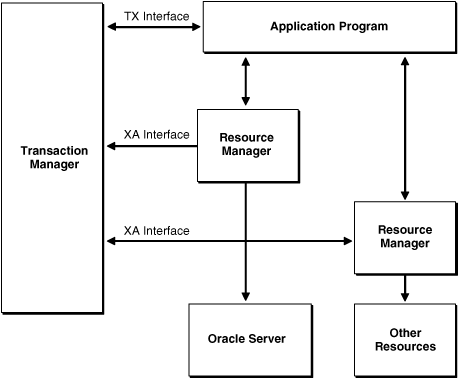

This chapter discusses advanced techniques in Pro\*C/C++ and contains the following topics:

- Character Data

- Datatype Conversion

- Datatype Equivalencing

- The C Preprocessor

- Precompiled Header Files

- The Oracle Preprocessor

- Evaluation of Numeric Constants

- SQLLIB Extensions for OCI Release 8 Interoperability

- Interface to OCI Release 8

- Embedded OCI Release 7 Calls

- New Names for SQLLIB Public Functions

- X/Open Application Development

### 5.1 Character Data

This section explains how the Pro\*C/C++ Precompiler handles character host variables. There are four host variable character types:

- Character arrays

- Pointers to strings

- VARCHAR variables

- Pointers to VARCHARs

Do not confuse VARCHAR (a host variable data structure supplied by the precompiler) with VARCHAR2 (an Oracle internal datatype for variable-length character strings).

#### 5.1.1 Precompiler Option CHAR_MAP

The CHAR_MAP precompiler option is available to specify the default mapping of char\[n\] and char host variables. Oracle maps them to CHARZ. CHARZ implements the ANSI Fixed Character format. Strings are fixed-length, blank-padded and null-terminated. VARCHAR2 values (including nulls) are always fixed-length and blank-padded. Table 5-1 shows the possible settings of CHAR_MAP:

Table 5-1 CHAR_MAP Settings

| CHAR_MAP Setting | Is Default for                                     | Description                                                                                 |
|:-----------------|:---------------------------------------------------|:--------------------------------------------------------------------------------------------|
| VARCHAR2         | \-                                                 | All values (including null) are fixed-length blank-padded.                                  |
| CHARZ            | DBMS=V7, DBMS=V8                                   | Fixed-length blank-padded, then null-terminated. Conforms to the ANSI Fixed Character type. |
| STRING           | New format                                         | null-terminated. Conforms to ASCII format used in C programs.                               |
| CHARF            | Previously, only through VAR or TYPE declarations. | Fixed-length blank-padded. null is left unpadded.                                           |

The default mapping is CHAR_MAP=CHARZ, which was the case in previous versions of Pro\*C/C++.

Use CHAR_MAP=VARCHAR2 instead of the old DBMS=V6_CHAR, which is obsolete.

#### 5.1.2 Inline Usage of the CHAR_MAP Option

Unless you declared a char or char\[n\] variable otherwise, the inline CHAR_MAP option determines its mapping. The following code fragment illustrates the results of setting this option inline in Pro\*C/C++:

    char ch_array[5];

    strncpy(ch_array, "12345", 5);
    /* char_map=charz is the default in Oracle7 and Oracle8 */
    EXEC ORACLE OPTION (char_map=charz);
    /* Select retrieves a string "AB" from the database */
    SQL SELECT ... INTO :ch_array FROM ... WHERE ... ;
    /* ch_array == { 'A', 'B', ' ', ' ', '\0' } */

    strncpy (ch_array, "12345", 5);
    EXEC ORACLE OPTION (char_map=string) ;
    /* Select retrieves a string "AB" from the database */
    EXEC SQL SELECT ... INTO :ch_array FROM ... WHERE ... ;
    /* ch_array == { 'A', 'B', '\0', '4', '5' } */

    strncpy( ch_array, "12345", 5);
    EXEC ORACLE OPTION (char_map=charf);
    /* Select retrieves a string "AB" from the database */
    EXEC SQL SELECT ... INTO :ch_array FROM ... WHERE ... ;
    /* ch_array == { 'A', 'B', ' ', ' ', ' ' } */

#### 5.1.3 Effect of the DBMS and CHAR_MAP Options

The DBMS and CHAR_MAP options determine how Pro\*C/C++ treats data in character arrays and strings. These options allow your program to observe compatibility with ANSI fixed-length strings, or to maintain compatibility with previous releases of Oracle and Pro\*C/C++ that use variable-length strings.

The DBMS option affects character data both on input (from your host variables to the Oracle table) and on output (from an Oracle table to your host variables).

Character Array and the CHAR_MAP Option

The mapping of character arrays can also be set by the CHAR_MAP option independent of the DBMS option. DBMS=V7 or DBMS=V8 both use CHAR_MAP=CHARZ, which can be overridden by specifying either CHAR_MAP=VARCHAR2 or STRING or CHARF.

**Related Topics**

- [Precompiler Options](precompiler-options.md)

##### 5.1.3.1 On Input

##### Character Array

On input, the DBMS option determines the format that a host variable character array must have in your program. When the CHAR_MAP=VARCHAR2, host variable character arrays must be blank padded, and should not be null-terminated. When the DBMS=V7 or V8, character arrays must be null-terminated ('\0').

When the CHAR_MAP option is set to VARCHAR2 trailing blanks are removed up to the first non-blank character before the value is sent to the database. An un-initialized character array can contain null characters. To make sure that the nulls are not inserted into the table, you must blank-pad the character array to its length. For example, if you execute the statements:

    char emp_name[10];
    ...
    strcpy(emp_name, "MILLER");     /* WRONG! Note no blank-padding */
    EXEC SQL INSERT INTO emp (empno, ename, deptno) VALUES
        (1234, :emp_name, 20);

you will find that the string "MILLER" was inserted as "MILLER\0\0\0\0" (with four null bytes appended to it). This value does not meet the following search condition:

    . . . WHERE ename = 'MILLER';

To INSERT the character array when CHAR_MAP is set to VARCHAR2, you should execute the statements

    strncpy(emp_name, "MILLER    ", 10); /* 4 trailing blanks */
    EXEC SQL INSERT INTO emp (empno, ename, deptno) VALUES
        (1234, :emp_name, 20);

When DBMS=V7 or V8, input data in a character array must be null-terminated. So, make sure that your data ends with a null.

    char emp_name[11];  /* Note: one greater than column size of 10 */
    ...
    strcpy(emp_name, "MILLER");        /* No blank-padding required */
    EXEC SQL INSERT INTO emp (empno, ename, deptno) VALUES
        (1234, :emp_name, 20);

##### Character Pointer

The pointer must address a null-terminated buffer that is large enough to hold the input data. Your program must allocate enough memory to do this.

##### 5.1.3.2 On Input

The following example illustrates all possible combinations of the effects of the CHAR_MAP option settings on the value retrieved from a database into a character array.

Assume a database

    TABLE strdbase ( ..., strval VARCHAR2(6));

which contains the following strings in the column strval:

    ""        -- string of length 0
    "AB"      -- string of length 2
    "KING"    -- string of length 4
    "QUEEN"   -- string of length 5
    "MILLER"  -- string of length 6

In a Pro\*C/C++ program, initialize the 5-character host array str with 'X' characters and use for the retrieval of all the values in column strval:

    char  str[5] = {'X', 'X', 'X','X', 'X'} ;
    short str_ind;
    ...
    EXEC SQL SELECT strval INTO :str:str_ind WHERE ... ;

with the following results for the array, str, and the indicator variable, str_ind, as CHAR_MAP is set to VARCHAR2, CHARF, CHARZ and STRING:

    strval = ""         "AB"       "KING"     "QUEEN"    "MILLER"
    ---------------------------------------------------------------
    VARCHAR2 "     " -1 "AB   " 0  "KING "  0 "QUEEN"  0 "MILLE"  6
    CHARF    "XXXXX" -1 "AB   " 0  "KING "  0 "QUEEN"  0 "MILLE"  6
    CHARZ    "    0" -1 "AB  0" 0  "KING0"  0 "QUEE0"  5 "MILL0"  6
    STRING   "0XXXX" -1 "AB0XX" 0  "KING0"  0 "QUEE0"  5 "MILL0"  6

where 0 stands for the null character, '\0'.

##### 5.1.3.3 On Output

##### Character Array

On output, the DBMS and CHAR_MAP options determines the format that a host variable character array will have in your program. When CHAR_MAP=VARCHAR2, host variable character arrays are blank padded up to the length of the array, but never null-terminated. When DBMS=V7 or V8 (or CHAR_MAP=CHARZ), character arrays are blank padded, then null-terminated in the final position in the array.

Consider the following example of character output:

    CREATE TABLE test_char (C_col CHAR(10), V_col VARCHAR2(10));

    INSERT INTO test_char VALUES ('MILLER', 'KING');

A precompiler program to select from this table contains the following embedded SQL:

    ...
    char name1[10];
    char name2[10];
    ...
    EXEC SQL SELECT C_col, V_col INTO :name1, :name2
        FROM test_char;

If you precompile the program with CHAR_MAP=VARCHAR2, name1 will contain:

    "MILLER####"

that is, the name "MILLER" followed by 4 blanks, with no null-termination. (If name1 had been declared with a size of 15, there are 9 blanks following the name.)

name2 will contain:

    "KING######"      /* 6 trailing blanks */

If you precompile the program with DBMS=V7 or V8, name1 will contain:

    "MILLER###\0" /* 3 trailing blanks, then a null-terminator */

that is, a string containing the name, blank-padded to the length of the column, followed by a null terminator. name2 will contain:

    "KING#####\0"

In summary, if CHAR_MAP=VARCHAR2, the output from either a CHARACTER column or a VARCHAR2 column is blank-padded to the length of the host variable array. If DBMS=V7 or V8, the output string is always null-terminated.

##### Character Pointer

The DBMS and CHAR_MAP options do not affect the way character data are output to a pointer host variable.

When you output data to a character pointer host variable, the pointer must point to a buffer large enough to hold the output from the table, plus one extra byte to hold a null terminator.

The precompiler runtime environment calls `strlen()` to determine the size of the output buffer, so make sure that the buffer does not contain any embedded nulls ('\0'). Fill allocated buffers with some value other than '\0', then null-terminate the buffer, before fetching the data.

**Note:**

C pointers can be used in a Pro\*C/C++ program that is precompiled with DBMS=V7 or V8 and MODE=ANSI. However, pointers are not legal host variable types in a SQL standard compliant program. The FIPS flagger warns you if you use pointers as host variables.

The following code fragment uses the columns and table defined in the previous section, and shows how to declare and SELECT into character pointer host variables:

    ...
    char *p_name1;
    char *p_name2;
    ...
    p_name1 = (char *) malloc(11);
    p_name2 = (char *) malloc(11);
    strcpy(p_name1, "          ");
    strcpy(p_name2, "0123456789");

    EXEC SQL SELECT C_col, V_col INTO :p_name1, :p_name2
        FROM test_char;

When the SELECT statement mentioned earlier is executed with any DBMS or CHAR_MAP setting, the value fetched is:

    "MILLER####\0"     /* 4 trailing blanks and a null terminator */

    "KING######\0"    /* 6 blanks and null */

#### 5.1.4 VARCHAR Variables and Pointers

The following example shows how VARCHAR host variables are declared:

    VARCHAR   emp_name1[10];   /* VARCHAR variable   */
    VARCHAR  *emp_name2;       /* pointer to VARCHAR */

##### 5.1.4.1 On Input

##### VARCHAR Variables

When you use a VARCHAR variable as an input host variable, your program need only place the desired string in the array member of the expanded VARCHAR declaration (emp_name1.arr in our example) and set the length member (emp_name1.len). There is no need to blank-pad the array. Exactly emp_name1.len characters are sent to Oracle, counting any blanks and nulls. In the following example, you set emp_name1.len to 8:

    strcpy((char *)emp_name1.arr, "VAN HORN");
    emp_name1.len = strlen((char *)emp_name1.arr);

##### Pointer to a VARCHAR

When you use a pointer to a VARCHAR as an input host variable, you must allocate enough memory for the expanded VARCHAR declaration. Then, you must place the desired string in the array member and set the length member, as shown in the following example:

    emp_name2 = malloc(sizeof(short) + 10)   /* len + arr */
    strcpy((char *)emp_name2->arr, "MILLER");
    emp_name2->len = strlen((char *)emp_name2->arr);

Or, to make emp_name2 point to an existing VARCHAR (emp_name1 in this case), you could code the assignment

    emp_name2 = &emp_name1;

then use the VARCHAR pointer in the usual way, as in

    EXEC SQL INSERT INTO EMP (EMPNO, ENAME, DEPTNO)
        VALUES (:emp_number, :emp_name2, :dept_number);

##### 5.1.4.2 On Output

##### VARCHAR Variables

When you use a VARCHAR variable as an output host variable, the program interface sets the length member but does not null-terminate the array member. As with character arrays, your program can null-terminate the arr member of a VARCHAR variable before passing it to a function such as `printf()` or `strlen()`. An example follows:

    emp_name1.arr[emp_name1.len] = '\0';
    printf("%s", emp_name1.arr);

Or, you can use the length member to limit the printing of the string, as in:

    printf("%.*s", emp_name1.len, emp_name1.arr);

An advantage of VARCHAR variables over character arrays is that the length of the value returned by Oracle is available immediately. With character arrays, you might need to strip the trailing blanks yourself to get the actual length of the character string.

##### VARCHAR Pointers

When you use a pointer to a VARCHAR as an output host variable, the program interface determines the variable's maximum length by checking the length member (emp_name2-\>len in our example). So, your program must set this member before every fetch. The fetch then sets the length member to the actual number of characters returned, as the following example shows:

    emp_name2->len = 10;  /* Set maximum length of buffer. */
    EXEC SQL SELECT ENAME INTO :emp_name2 WHERE EMPNO = 7934;
    printf("%d characters returned to emp_name2", emp_name2->len);

#### 5.1.5 Unicode Variables

Pro\*C/C++ allows fixed-width Unicode data (character set Unicode Standard Version 3.0, known simply as UCS-16) in host `char` variables. UCS-16 uses 2 bytes for each character, so it is an unsigned 2-byte datatype. SQL statement text in UCS-16 is not supported yet.

In the following example code a host variable, `employee`, of the Unicode type utext is declared to be 20 Unicode characters long. A table `emp` is created containing the column `ename`, which is 60 bytes long, so that database character sets in Asian languages, where multibyte characters are up to three bytes long, will be supported.

    utext employee[20] ;                               /* Unicode host variable   */
    EXEC SQL CREATE TABLE emp (ename CHAR(60));
    /* ename is in the current database character set  */
    EXEC SQL INSERT INTO emp (ename) VALUES ('test') ;
    /* 'test' in NLS_LANG encoding converted to database character set */
    EXEC SQL SELECT * INTO :employee FROM emp ;
    /* Database character set converted to Unicode */

A public header file, sqlucs2.h, must be included in your application code. It does the following:

- Contains the statement:

<!-- -->

        #include <oratypes.h>

- Defines a "Unicode varchar", uvarchar, as:

<!-- -->

        struct uvarchar
        {
           ub2 len;
           utext arr[1] ;
        };
        typedef struct uvarchar uvarchar ;

- Defines a "Unicode long varchar", ulong_varchar, as:

<!-- -->

        struct ulong_varchar
        {
           ub4 len ;
           utext arr[1] ;
        }
        typedef struct ulong_varchar ulong_varchar ;

The default datatype of utext is the same as the default for any character variables, CHARZ, which is blank-padded and null-terminated.

Use the CHAR_MAP precompiler option to change the default datatype, as follows:

    #include <sqlca.h>
    #include <sqlucs2.h>

    main()
    {
       utext employee1[20] ;

    /* Change to STRING datatype:    */
       EXEC ORACLE OPTION (CHAR_MAP=STRING) ;
       utext employee2[20] ;

       EXEC SQL CREATE TABLE emp (ename CHAR(60)) ;
       ...
    /***********************************************************
      Initializing employee1 or employee2 is compiler-dependent.
     **********************************************************/
       EXEC SQL INSERT INTO emp (ename) VALUES (:employee1) ;
       ...
       EXEC SQL SELECT ename INTO :employee2 FROM emp;
    /* employee2 is now not blank-padded and is null-terminated  */
       ...

##### 5.1.5.1 Restrictions on Unicode Variable Usage

- Static and dynamic SQL cannot contain Unicode in the SQL statement text. The following is not permitted:

<!-- -->

    #include oratypes.h
    utext sqlstmt[100] ;
    ...
    /* If sqlstmt contains a SQL statement: */
    EXEC SQL PREPARE s1 FROM :sqlstmt ;
    EXEC SQL EXECUTE IMMEDIATE :sqlstmt ;
    ...

- You cannot use type equivalencing for utext variables. The following code is not permitted:

<!-- -->

        typedef utext utext_5 ;
        EXEC SQL TYPE utext_5 IS STRING ;

- CONVBUFSZ cannot be used as a conversion buffer size. Use the CHAR_MAP option instead.

- Oracle dynamic SQL method 4 does not support Unicode.

- Object types do not support Unicode.

**Related Topics**

- [CONVBUFSZ Clause in VAR](datatypes-and-host-variables.md)
- [ANSI Dynamic SQL](ANSI-dynamic-SQL.md)
- [Objects](about-Objects.md)

### 5.2 Datatype Conversion

At precompile time, a default external datatype is assigned to each host variable. For example, the precompiler assigns the INTEGER external datatype to host variables of type short int and int.

At run time, the datatype code of every host variable used in a SQL statement is passed to Oracle. Oracle uses the codes to convert between internal and external datatypes.

Before assigning a SELECTed column (or pseudocolumn) value to an output host variable, Oracle must convert the internal datatype of the source column to the datatype of the host variable. Likewise, before assigning or comparing the value of an input host variable to a column, Oracle must convert the external datatype of the host variable to the internal datatype of the target column.

Conversions between internal and external datatypes follow the usual data conversion rules. For example, you can convert a CHAR value of "1234" to a C short value. You cannot convert a CHAR value of "65543" (number too large) or "10F" (number not decimal) to a C short value. Likewise, you cannot convert a `char[n]` value that contains any alphabetic characters to a NUMBER value.

### 5.3 Datatype Equivalencing

Datatype equivalencing lets you control the way Oracle interprets input data, and the way Oracle formats output data. It provides the ability to override the default external datatypes that the precompiler assigns. On a variable-by-variable basis, you can map (or make equivalent) supported C host variable datatypes to Oracle external datatypes. You can also map user-defined datatypes to Oracle external datatypes.

#### 5.3.1 Host Variable Equivalencing

By default, the Pro\*C/C++ Precompiler assigns a specific external datatype to every host variable.

Table 5-2 lists the default assignments:

Table 5-2 Default Type Assignments

| C Type, or Pseudotype       | Oracle External Type                 | Notes                                                                                 |
|:----------------------------|:-------------------------------------|:--------------------------------------------------------------------------------------|
| char char\[n\] char\* | VARCHAR2 CHARZ STRING CHARF | (CHAR_MAP=VARCHAR2) (DBMS=V7, V8 default) (CHAR_MAP=STRING) (CHAR_MAP=CHARF) |
| int, int\*                  | INTEGER                              | \-                                                                                    |
| short, short\*              | INTEGER                              | \-                                                                                    |
| long, long\*                | INTEGER                              | \-                                                                                    |
| long long, long long\*      | INTEGER                              | \-                                                                                    |
| float, float\*              | FLOAT                                | \-                                                                                    |
| double, double\*            | FLOAT                                | \-                                                                                    |
| VARCHAR\*, VARCHAR\[n\]     | VARCHAR                              | \-                                                                                    |

With the VAR statement, you can override the default assignments by equivalencing host variables to Oracle external datatypes. The syntax you use is

    EXEC SQL VAR host_variable IS type_name [ (length) ];

where host_variable is an input or output host variable (or host array) declared earlier, type_name is the name of a valid external datatype, and length is an integer literal specifying a valid length in bytes.

Host variable equivalencing is useful in several ways. For example, suppose you want to SELECT employee names from the EMP table, then pass them to a routine that expects null-terminated strings. You need not explicitly null-terminate the names. Simply equivalence a host variable to the STRING external datatype, as follows:

    ...
    char  emp_name[11];
    EXEC SQL VAR emp_name IS STRING(11);

The length of the ENAME column in the EMP table is 10 characters, so you allot the new emp_name 11 characters to accommodate the null terminator. When you SELECT a value from the ENAME column into emp_name, the program interface null-terminates the value for you.

You can use any external datatypes except NUMBER (for example, VARNUM).

**Related Topics**

- [External Datatypes](datatypes-and-host-variables.md)

#### 5.3.2 User-Defined Type Equivalencing

You can also map (or make equivalent) user-defined datatypes to Oracle external datatypes. First, define a new datatype structured like the external datatype that suits your needs. Then, map your new datatype to the external datatype using the TYPE statement.

With the TYPE statement, you can assign an Oracle external datatype to a whole class of host variables. The syntax you use is:

    EXEC SQL TYPE user_type IS type_name [ (length) ] [REFERENCE];

Suppose you need a variable-length string datatype to hold graphics characters. First, declare a struct with a short length component followed by a 65533-byte data component. Second, use typedef to define a new datatype based on the struct. Then, equivalence your new user-defined datatype to the VARRAW external datatype, as shown in the following example:

    struct  screen
    {
        short  len;
        char   buff[4000];
    };
    typedef struct screen graphics;

    EXEC SQL TYPE graphics IS VARRAW(4000);
    graphics  crt;  — host variable of type graphics
        ...

You specify a length of 4000 bytes for the new graphics type because that is the maximum length of the data component in your struct. The precompiler allows for the len component (and any padding) when it sends the length to the Oracle server.

##### 5.3.2.1 REFERENCE Clause

You can declare a user-defined type to be a pointer, either explicitly, as a pointer to a scalar or struct type, or implicitly, as an array, and use this type in an EXEC SQL TYPE statement. In this case, you must use the REFERENCE clause at the end of the statement, as shown in the following example:

    typedef unsigned char *my_raw;

    EXEC SQL TYPE my_raw IS VARRAW(4000) REFERENCE;
    my_raw    graphics_buffer;
    ...
    graphics_buffer = (my_raw) malloc(4004);

In this example, you allocated additional memory over the type length (4000). This is necessary because the precompiler also returns the length (the size of a short), and can add padding after the length due to word alignment restrictions on your system. If you do not know the alignment practices on your system, make sure to allocate sufficient extra bytes for the length and padding (9 should usually be sufficient).

**Related Topics**

- [Example Program: Using sqlvcp()](datatypes-and-host-variables.md)

#### 5.3.3 CHARF External Datatype

CHARF is a fixed-length character string. You can use this datatype in VAR and TYPE statements to equivalence C datatypes to the fixed-length SQL standard datatype CHAR, regardless of the setting of the DBMS or CHAR_MAP option.

When DBMS=V7 or V8, specifying the external datatype CHARACTER in a VAR or TYPE statement equivalences the C datatype to the fixed-length datatype CHAR (datatype code 96). However, when CHAR_MAP=VARCHAR2, the C datatype is equivalenced to the variable-length datatype VARCHAR2 (code 1).

Now, you can always equivalence C datatypes to the fixed-length SQL standard type CHARACTER by using the CHARF datatype in the VAR or TYPE statement. When you use CHARF, the equivalence is always made to the fixed-length character type, regardless of the setting of the DBMS or CHAR_MAP option.

#### 5.3.4 The EXEC SQL VAR and TYPE Directives

You can code an EXEC SQL VAR ... or EXEC SQL TYPE ... statement anywhere in your program. These statements are treated as executable statements that change the datatype of any variable affected by them from the point that the TYPE or VAR statement was made to the end of the scope of the variable. If you precompile with MODE=ANSI, you must use Declare Sections. In this case, the TYPE or VAR statement must be in a Declare Section.

**Related Topics**

- [TYPE (Oracle Embedded SQL Directive)](embedded-SQL-statements-and-directives.md)
- [VAR (Oracle Embedded SQL Directive)](embedded-SQL-statements-and-directives.md)

#### 5.3.5 Example: Datatype Equivalencing (sample4.pc):

The demonstration program in this section shows you how you can use datatype equivalencing in your Pro\*C/C++ programs. This program is available as `sample4.pc` in the `dem`o directory.It demonstrates the use of type equivalencing using the LONG VARRAW external datatype. In order to provide a useful example that is portable across different systems, the program inserts binary files into and retrieves them from the database.

This program uses LOB embedded SQL statements.

Please read the introductory comments for an explanation of the program's purpose.

    /***************************************************************
    sample4.pc
    This program demonstrates the use of type equivalencing using the
    LONG VARRAW external datatype. In order to provide a useful example
    that is portable across different systems, the program inserts
    binary files into and retrieves them from the database.  For
    example, suppose you have a file called 'hello' in the current
    directory.  You can create this file by compiling the following
    source code:

    #include <stdio.h>

    int main()
    {
      printf("Hello World!\n");
    }

    When this program is run, we get:

    $hello
    Hello World!

    Here is some sample output from a run of sample4:

    $sample4
    Connected.
    Do you want to create (or re-create) the EXECUTABLES table (y/n)? y
    EXECUTABLES table successfully dropped.  Now creating new table...
    EXECUTABLES table created.

    Sample 4 Menu.  Would you like to:
    (I)nsert a new executable into the database
    (R)etrieve an executable from the database
    (L)ist the executables stored in the database
    (D)elete an executable from the database
    (Q)uit the program

    Enter i, r, l, or q: l

    Executables           Length (bytes)
    --------------------  --------------

    Total Executables: 0

    Sample 4 Menu.  Would you like to:
    (I)nsert a new executable into the database
    (R)etrieve an executable from the database
    (L)ist the executables stored in the database
    (D)elete an executable from the database
    (Q)uit the program

    Enter i, r, l, or q: i
    Enter the key under which you will insert this executable: hello
    Enter the filename to insert under key 'hello'.
    If the file is not in the current directory, enter the full
    path: hello
    Inserting file 'hello' under key 'hello'...
    Inserted.

    Sample 4 Menu.  Would you like to:
    (I)nsert a new executable into the database
    (R)etrieve an executable from the database
    (L)ist the executables stored in the database
    (D)elete an executable from the database
    (Q)uit the program

    Enter i, r, l, or q: l

    Executables           Length (bytes)
    --------------------  --------------
    hello                           5508

    Total Executables: 1

    Sample 4 Menu.  Would you like to:
    (I)nsert a new executable into the database
    (R)etrieve an executable from the database
    (L)ist the executables stored in the database
    (D)elete an executable from the database
    (Q)uit the program

    Enter i, r, l, or q: r
    Enter the key for the executable you wish to retrieve: hello
    Enter the file to write the executable stored under key hello into.  If you
    don't want the file in the current directory, enter the
    full path: h1
    Retrieving executable stored under key 'hello' to file 'h1'...
    Retrieved.

    Sample 4 Menu.  Would you like to:
    (I)nsert a new executable into the database
    (R)etrieve an executable from the database
    (L)ist the executables stored in the database
    (D)elete an executable from the database
    (Q)uit the program

    Enter i, r, l, or q: q

    We now have the binary file 'h1' created, and we can run it:

    $h1
    Hello World!
    ***************************************************************/

    #include <oci.h>
    #include <string.h>
    #include <stdio.h>
    #include <sqlca.h>
    #include <stdlib.h>
    #include <sqlcpr.h>

    /* Oracle error code for 'table or view does not exist'. */
    #define NON_EXISTENT  -942
    #define NOT_FOUND     1403

    /* This is the definition of the long varraw structure.
     * Note that the first field, len, is a long instead
     * of a short.  This is becuase the first 4
     * bytes contain the length, not the first 2 bytes.
     */
    typedef struct long_varraw {
      ub4  len;
      text buf[1];
    } long_varraw;

    /* Type Equivalence long_varraw to LONG VARRAW.
     * All variables of type long_varraw from this point
     * on in the file will have external type 95 (LONG VARRAW)
     * associated with them.
     */
    EXEC SQL TYPE long_varraw IS LONG VARRAW REFERENCE;

    /* This program's functions declared. */
    #if defined(__STDC__)
      void do_connect(void);
      void create_table(void);
      void sql_error(char *);
      void list_executables(void);
      void print_menu(void);
      void do_insert(varchar *, char *);
      void do_retrieve(varchar *, char *);
      void do_delete(varchar *);
      ub4  read_file(char *, OCIBlobLocator *);
      void write_file(char *, OCIBlobLocator *);
    #else
      void do_connect(/*_ void _*/);
      void create_table(/*_ void _*/);
      void sql_error(/*_ char * _*/);
      void list_executables(/*_ void _*/);
      void print_menu(/*_ void _*/);
      void do_insert(/*_ varchar *, char * _*/);
      void do_retrieve(/*_ varchar *, char * _*/);
      void do_delete(/*_ varchar * _*/);
      ub4  read_file(/*_ char *, OCIBlobLocator * _*/);
      void write_file(/*_ char *, OCIBlobLocator * _*/);
    #endif

    void main()
    {
      char reply[20], filename[100];
      varchar key[20];
      short ok = 1;

      /* Connect to the database. */
      do_connect();

      printf("Do you want to create (or re-create) the EXECUTABLES table (y/n)? ");
      gets(reply);

      if ((reply[0] == 'y') || (reply[0] == 'Y'))
        create_table();

      /* Print the menu, and read in the user's selection. */
      print_menu();
      gets(reply);

      while (ok)
      {
        switch(reply[0]) {
        case 'I': case 'i':
          /* User selected insert - get the key and file name. */
          printf("Enter the key under which you will insert this executable: ");
          key.len = strlen(gets((char *)key.arr));
          printf("Enter the filename to insert under key '%.*s'.\n",
                 key.len, key.arr);
          printf("If the file is not in the current directory, enter the full\n");
          printf("path: ");
          gets(filename);
          do_insert((varchar *)&key, filename);
          break;
        case 'R': case 'r':
          /* User selected retrieve - get the key and file name. */
          printf("Enter the key for the executable you wish to retrieve: ");
          key.len = strlen(gets((char *)key.arr));
          printf("Enter the file to write the executable stored under key ");
          printf("%.*s into.  If you\n", key.len, key.arr);
          printf("don't want the file in the current directory, enter the\n");
          printf("full path: ");
          gets(filename);
          do_retrieve((varchar *)&key, filename);
          break;
        case 'L': case 'l':
          /* User selected list - just call the list routine. */
          list_executables();
          break;
        case 'D': case 'd':
          /* User selected delete - get the key for the executable to delete. */
          printf("Enter the key for the executable you wish to delete: ");
          key.len = strlen(gets((char *)key.arr));
          do_delete((varchar *)&key);
          break;
        case 'Q': case 'q':
          /* User selected quit - just end the loop. */
          ok = 0;
          break;
        default:
          /* Invalid selection. */
          printf("Invalid selection.\n");
          break;
        }

        if (ok)
        {
          /* Print the menu again. */
          print_menu();
          gets(reply);
        }
      }

      EXEC SQL COMMIT WORK RELEASE;
    }

    /* Connect to the database. */
    void do_connect()
    {
      /* Note this declaration: uid is a char * pointer, so Oracle
         will do a strlen() on it at runtime to determine the length.
       */
      char *uid = "scott/tiger";

      EXEC SQL WHENEVER SQLERROR DO sql_error("do_connect():CONNECT");
      EXEC SQL CONNECT :uid;

      printf("Connected.\n");
    }

    /* Creates the executables table. */
    void create_table()
    {
      /* We are going to check for errors ourselves for this statement. */
      EXEC SQL WHENEVER SQLERROR CONTINUE;

      EXEC SQL DROP TABLE EXECUTABLES;
      if (sqlca.sqlcode == 0)
        {
          printf("EXECUTABLES table successfully dropped.  ");
          printf("Now creating new table...\n");
        }
      else if (sqlca.sqlcode == NON_EXISTENT)
        {
          printf("EXECUTABLES table does not exist.  ");
          printf("Now creating new table...\n");
        }
      else
        sql_error("create_table()");

      /* Reset error handler. */
      EXEC SQL WHENEVER SQLERROR DO sql_error("create_table():CREATE TABLE");

      EXEC SQL CREATE TABLE EXECUTABLES
        ( name VARCHAR2(30), length NUMBER(10), binary BLOB ) ;

      printf("EXECUTABLES table created.\n");
    }

    /* Opens the binary file identified by 'filename' for reading, and writes
       it into into a Binary LOB.  Returns the actual length of the file read.
     */
    ub4 read_file(filename, blob)
      char *filename;
      OCIBlobLocator *blob;
    {
      long_varraw *lvr;
      ub4      bufsize;
      ub4      amt;
      ub4      filelen, remainder, nbytes;
      ub4      offset = 1;
      boolean  last = FALSE;
      FILE    *in_fd;

      /* Open the file for reading. */
      in_fd = fopen(filename, "r");
      if (in_fd == (FILE *)0)
        return (ub4)0;

      /* Determine Total File Length - Total Amount to Write to BLOB */
      (void) fseek(in_fd, 0L, SEEK_END);
      amt = filelen = (ub4)ftell(in_fd);

      /* Determine the Buffer Size and Allocate the LONG VARRAW Object */
      bufsize = 2048;
      lvr = (long_varraw *)malloc(sizeof(ub4) + bufsize);

      nbytes = (filelen > bufsize) ? bufsize : filelen;

      /* Reset the File Pointer and Perform the Initial Read */
      (void) fseek(in_fd, 0L, SEEK_SET);
      lvr->len = fread((void *)lvr->buf, (size_t)1, (size_t)nbytes, in_fd);
      remainder = filelen - nbytes;

      EXEC SQL WHENEVER SQLERROR DO sql_error("read_file():WRITE");

      if (remainder == 0)
        {
          /* Write the BLOB in a Single Piece */
          EXEC SQL LOB WRITE ONE :amt
             FROM :lvr WITH LENGTH :nbytes INTO :blob AT :offset;
        }
      else
        {
          /* Write the BLOB in Multiple Pieces using Standard Polling */
          EXEC SQL LOB WRITE FIRST :amt
             FROM :lvr WITH LENGTH :nbytes INTO :blob AT :offset;

          do {

            if (remainder > bufsize)
              nbytes = bufsize;
            else
              {
                nbytes = remainder;
                last = TRUE;
              }

            if ((lvr->len = fread(
                  (void *)lvr->buf, (size_t)1, (size_t)nbytes, in_fd)) != nbytes)
              last = TRUE;

            if (last)
              {
                /* Write the Final Piece */
                EXEC SQL LOB WRITE LAST :amt
                   FROM :lvr WITH LENGTH :nbytes INTO :blob;
              }
            else
              {
                /* Write an Interim Piece - Still More to Write */
                EXEC SQL LOB WRITE NEXT :amt
                   FROM :lvr WITH LENGTH :nbytes INTO :blob;
              }

            remainder -= nbytes;

          } while (!last && !feof(in_fd));
        }

      /* Close the file, and return the total file size. */
      fclose(in_fd);
      free(lvr);
      return filelen;
    }

    /* Generic error handler.  The 'routine' parameter should contain the name
       of the routine executing when the error occured.  This would be specified
       in the 'EXEC SQL WHENEVER SQLERROR DO sql_error()' statement.
     */
    void sql_error(routine)
      char *routine;
    {
      char message_buffer[512];
      size_t buffer_size;
      size_t message_length;

      /* Turn off the call to sql_error() to avoid a possible infinite loop */
      EXEC SQL WHENEVER SQLERROR CONTINUE;

      printf("\nOracle error while executing %s!\n", routine);

      /* Use sqlglm() to get the full text of the error message. */
      buffer_size = sizeof(message_buffer);
      sqlglm(message_buffer, &buffer_size, &message_length);
      printf("%.*s\n", message_length, message_buffer);

      EXEC SQL ROLLBACK WORK RELEASE;
      exit(1);
    }

    /* Opens the binary file identified by 'filename' for writing, and copies
       the contents of the Binary LOB into it.
     */
    void write_file(filename, blob)
      char *filename;
      OCIBlobLocator *blob;
    {
      FILE        *out_fd;       /* File descriptor for the output file */
      ub4          amt;
      ub4          bufsize;
      long_varraw *lvr;

      /* Determine the Buffer Size and Allocate the LONG VARRAW Object */
      bufsize = 2048;
      lvr = (long_varraw *)malloc(sizeof(ub4) + bufsize);

      /* Open the output file for Writing */
      out_fd = fopen(filename, "w");
      if (out_fd == (FILE *)0)
        return;

      amt = 0;             /* Initialize for Standard Polling (Possibly) */
      lvr->len = bufsize;                       /* Set the Buffer Length */

      EXEC SQL WHENEVER SQLERROR DO sql_error("write_file():READ");

      /* READ the BLOB using a Standard Polling Loop */
      EXEC SQL WHENEVER NOT FOUND DO break;
      while (TRUE)
        {
          EXEC SQL LOB READ :amt FROM :blob INTO :lvr WITH LENGTH :bufsize;
          (void) fwrite((void *)lvr->buf, (size_t)1, (size_t)lvr->len, out_fd);
        }

      EXEC SQL WHENEVER NOT FOUND CONTINUE;

      /* Write the Final Piece (or First and Only Piece if not Polling) */
      (void) fwrite((void *)lvr->buf, (size_t)lvr->len, (size_t)1, out_fd);

      /* Close the Output File and Return */
      fclose(out_fd);
      free(lvr);
      return;
    }

    /* Inserts the binary file identified by file into the
     * executables table identified by key.
     */
    void do_insert(key, file)
      varchar *key;
      char *file;
    {
      OCIBlobLocator *blob;
      ub4 loblen, fillen;

      EXEC SQL ALLOCATE :blob;

      EXEC SQL WHENEVER SQLERROR DO sql_error("do_insert():INSERT/SELECT");

      EXEC SQL SAVEPOINT PREINSERT;
      EXEC SQL INSERT
        INTO executables (name, length, binary) VALUES (:key, 0, empty_blob());

      EXEC SQL SELECT binary INTO :blob
                 FROM executables WHERE name = :key FOR UPDATE;

      printf(
        "Inserting file '%s' under key '%.*s'...\n", file, key->len, key->arr);

      fillen = read_file(file, blob);
      EXEC SQL LOB DESCRIBE :blob GET LENGTH INTO :loblen;

      if ((fillen == 0) || (fillen != loblen))
        {
          printf("Problem reading file '%s'\n", file);
          EXEC SQL ROLLBACK TO SAVEPOINT PREINSERT;
          EXEC SQL FREE :blob;
          return;
        }

      EXEC SQL WHENEVER SQLERROR DO sql_error("do_insert():UPDATE");
      EXEC SQL UPDATE executables
        SET length = :loblen, binary = :blob WHERE name = :key;

      EXEC SQL COMMIT WORK;

      EXEC SQL FREE :blob;
      EXEC SQL COMMIT;
      printf("Inserted.\n");
    }

    /* Retrieves the executable identified by key into file */
    void do_retrieve(key, file)
      varchar *key;
      char *file;
    {
      OCIBlobLocator *blob;

      printf("Retrieving executable stored under key '%.*s' to file '%s'...\n",
             key->len, key->arr, file);

      EXEC SQL ALLOCATE :blob;

      EXEC SQL WHENEVER NOT FOUND continue;
      EXEC SQL SELECT binary INTO :blob FROM executables WHERE name = :key;

      if (sqlca.sqlcode == NOT_FOUND)
        printf("Key '%.*s' not found!\n", key->len, key->arr);
      else
        {
          write_file(file, blob);
          printf("Retrieved.\n");
        }

      EXEC SQL FREE :blob;
    }

    /* Delete an executable from the database */
    void do_delete(key)
      varchar *key;
    {
      EXEC SQL WHENEVER SQLERROR DO sql_error("do_delete():DELETE");
      EXEC SQL DELETE FROM executables WHERE name = :key;

      if (sqlca.sqlcode == NOT_FOUND)
        printf("Key '%.*s' not found!\n", key->len, key->arr);
      else
        printf("Deleted.\n");
    }

    /* List all executables currently stored in the database */
    void list_executables()
    {
      char key[21];
      ub4  length;

      EXEC SQL WHENEVER SQLERROR DO sql_error("list_executables");

      EXEC SQL DECLARE key_cursor CURSOR FOR
        SELECT name, length FROM executables;

      EXEC SQL OPEN key_cursor;

      printf("\nExecutables           Length (bytes)\n");
      printf("--------------------  --------------\n");

      EXEC SQL WHENEVER NOT FOUND DO break;
      while (1)
      {
        EXEC SQL FETCH key_cursor INTO :key, :length;
        printf("%s      %10d\n", key, length);
      }

      EXEC SQL WHENEVER NOT FOUND CONTINUE;
      EXEC SQL CLOSE key_cursor;

      printf("\nTotal Executables: %d\n", sqlca.sqlerrd[2]);
    }

    /* Prints the menu selections. */
    void print_menu()
    {
      printf("\nSample 4 Menu.  Would you like to:\n");
      printf("(I)nsert a new executable into the database\n");
      printf("(R)etrieve an executable from the database\n");
      printf("(L)ist the executables stored in the database\n");
      printf("(D)elete an executable from the database\n");
      printf("(Q)uit the program\n\n");
      printf("Enter i, r, l, or q: ");
    }

**Related Topics**

- [LOBs](about-LOBs.md)

### 5.4 The C Preprocessor

Pro\*C/C++ supports most C preprocessor directives. Some of the things that you can do using the Pro\*C/C++ preprocessor are:

- Define constants and macros using the \#define directive, and use the defined entities to parameterize Pro\*C/C++ datatype declarations, such as VARCHAR

- Read files required by the precompiler, such as `sqlca.h`, using the \#include directive

- Define constants and macros in a separate file, and have the precompiler read this file using the \#include directive

#### 5.4.1 How the Pro\*C/C++ Preprocessor Works

The Pro\*C/C++ preprocessor recognizes most C preprocessor commands, and effectively performs the required macro substitutions, file inclusions, and conditional source text inclusions or exclusions. The Pro\*C/C++ preprocessor uses the values obtained from preprocessing, and alters the source output text (the generated `.c` output file).

An example should clarify this point. Consider the following program fragment:

    #include "my_header.h"
    ...
    VARCHAR name[VC_LEN];              /* a Pro*C-supplied datatype */
    char    another_name[VC_LEN];              /* a pure C datatype */
    ...

Suppose the file `my_header.h` in the current directory contains, among other things, the line

    #define VC_LEN   20

The precompiler reads the file `my_header.h`, and uses the defined value of VC_LEN (20), declares the structure of name as VARCHAR\[20\].

char is a native type. The precompiler does not substitute 20 in the declaration of another_name\[VC_LEN\].

This does not matter, since the precompiler does not need to process declarations of C datatypes, even when they are used as host variables. It is left up to the C compiler's preprocessor to actually include the file `my_header.h`, and perform the substitution of 20 for VC_LEN in the declaration of another_name.

#### 5.4.2 Preprocessor Directives

The preprocessor directives that Pro\*C/C++ supports are:

- \#define, to create macros for use by the precompiler and the C or C++ compiler

- \#include, to read other source files for use by the precompiler

- \#if, to precompile and compile source text based on evaluation of a constant expression to 0

- \#ifdef, to precompile and compile source text conditionally, depending on the existence of a defined constant

- \#ifndef, to exclude source text conditionally

- \#endif, to end an \#if or \#ifdef or \#ifndef command

- \#else, to select an alternative body of source text to be precompiled and compiled, in case an \#if or \#ifdef or \#ifndef condition is not satisfied

- \#elif, to select an alternative body of source text to be precompiled and compiled, depending on the value of a constant or a macro argument

##### 5.4.2.1 Directives Ignored

Some C preprocessor directives are not used by the Pro\*C/C++ preprocessor. Most of these directives are not relevant for the precompiler. For example, \#pragma is a directive for the C compiler—the precompiler does not process it. The C preprocessor directives not processed by the precompiler are:

- \#, to convert a preprocessor macro parameter to a string constant

- \##, to merge two preprocessor tokens in a macro definition

- \#error, to produce a compile-time error message

- \#pragma, to pass implementation-dependent information to the C compiler

- \#line, to supply a line number for C compiler messages

While your C compiler preprocessor may support these directives, Pro\*C/C++ does not use them. Most of these directives are not used by the precompiler. You can use these directives in your Pro\*C/C++ program if your compiler supports them, but only in C or C++ code, not in embedded SQL statements or declarations of variables using datatypes supplied by the precompiler, such as VARCHAR.

#### 5.4.3 ORA_PROC Macro

Pro\*C/C++ predefines a C preprocessor macro called ORA_PROC that you can use to avoid having the precompiler process unnecessary or irrelevant sections of code. Some applications include large header files, which provide information that is unnecessary when precompiling. By conditionally excluding such header files based on the ORA_PROC macro, the precompiler never reads the file.

The following example uses the ORA_PROC macro to exclude the `irrelevant.h` file:

    #ifndef  ORA_PROC
    #include <irrelevant.h>
    #endif

Because ORA_PROC is defined during precompilation, the `irrelevant.h` file is never included.

The ORA_PROC macro is available only for C preprocessor directives, such as \#ifdef or \#ifndef. The EXEC ORACLE conditional statements do not share the same namespaces as the C preprocessor macros. Therefore, the condition in the following example does not use the predefined ORA_PROC macro:

    EXEC ORACLE IFNDEF ORA_PROC;

    EXEC ORACLE ENDIF;

ORA_PROC, in this case, must be set using either the DEFINE option or an EXEC ORACLE DEFINE statement for this conditional code fragment to work properly.

#### 5.4.4 Location of Header File Specification

The Pro\*C/C++ Precompiler for each system assumes a standard location for header files to be read by the preprocessor, such as `sqlca.h`, `oraca.h`, and `sqlda.h`. For example, on most UNIX systems, the standard location is` $ORACLE_HOME/precomp/public`. For the default location on your system, see your system-specific Oracle documentation. If header files that you need to include are not in the default location, you must use the INCLUDE= option, on the command line or as an EXEC ORACLE option.

To specify the location of system header files, such as `stdio.h` or `iostream.h`, where the location might be different from that hard-coded into Pro\*C/C++ use the SYS_INCLUDE precompiler option.

**Related Topics**

- [Precompiler Options](precompiler-options.md)

#### 5.4.5 Some Preprocessor Examples

You can use the \#define command to create named constants, and use them in place of "magic numbers" in your source code. You can use \#defined constants for declarations that the precompiler requires, such as VARCHAR\[const\]. For example, instead of code with bugs, such as:

    ...
    VARCHAR  emp_name[10];
    VARCHAR  dept_loc[14];
    ...
    ...
    /* much later in the code ... */
    f42()
    {
        /* did you remember the correct size? */
        VARCHAR new_dept_loc[10];
       ...
    }

you can code:

    #define ENAME_LEN     10
    #define LOCATION_LEN  14
    VARCHAR  new_emp_name[ENAME_LEN];
       ...
    /* much later in the code ... */
    f42()
    {
        VARCHAR new_dept_loc[LOCATION_LEN];
       ...
    }

You can use preprocessor macros with arguments for objects that the precompiler must process, just as you can for C objects. For example:

    #define ENAME_LEN    10
    #define LOCATION_LEN 14
    #define MAX(A,B)  ((A) > (B) ? (A) : (B))

       ...
    f43()
    {
        /* need to declare a temporary variable to hold either an
           employee name or a department location */
        VARCHAR  name_loc_temp[MAX(ENAME_LEN, LOCATION_LEN)];
       ...
    }

You can use the \#include, \#ifdef and \#endif preprocessor directives to conditionally include a file that the precompiler requires. For example:

    #ifdef ORACLE_MODE
    #include <sqlca.h>
    #else
        long SQLCODE;
    #endif

##### 5.4.5.1 About Using \#define

There are restrictions on the use of the \#define preprocessor directive in Pro\*C/C++ You cannot use the \#define directive to create symbolic constants for use in executable SQL statements. The following invalid example demonstrates this:

    #define RESEARCH_DEPT   40
    ...
    EXEC SQL SELECT empno, sal
        INTO :emp_number, :salary /* host arrays */
        FROM emp
        WHERE deptno = RESEARCH_DEPT;  /* INVALID! */

The only declarative SQL statements where you can legally use a \#defined macro are TYPE and VAR statements. So, for example, the following uses of a macro are legal in Pro\*C/C++

    #define STR_LEN      40
    ...
    typedef char asciiz[STR_LEN];
    ...
    EXEC SQL TYPE asciiz IS STRING(STR_LEN) REFERENCE;
    ...
    EXEC SQL VAR password IS STRING(STR_LEN);

##### 5.4.5.2 Other Preprocessor Restrictions

The preprocessor ignores directives \# and \## to create tokens that the precompiler must recognize. You can use these commands (if your compiler supports them) in pure C code that the precompiler does not have to process. Using the preprocessor command \## is not valid in this example:

    #define MAKE_COL_NAME(A)    col ## A
    ...
    EXEC SQL SELECT MAKE_COL_NAME(1), MAKE_COL_NAME(2)
        INTO :x, :y
        FROM table1;

The example is incorrect because the precompiler ignores \##.

#### 5.4.6 SQL Statements Not Allowed in \#include

Because of the way the Pro\*C/C++ preprocessor handles the \#include directive, as described in the previous section, you cannot use the \#include directive to include files that contain embedded SQL statements. You use \#include to include files that contain purely declarative statements and directives; for example, \#defines, and declarations of variables and structures required by the precompiler, such as in `sqlca.h`.

#### 5.4.7 Include the SQLCA, ORACA, and SQLDA

You can include the `sqlca.h`, `oraca.h`, and `sqlda.h` declaration header files in your Pro\*C/C++ program using either the C/C++ preprocessor \#include command, or the precompiler EXEC SQL INCLUDE command. For example, you use the following statement to include the SQL Communications Area structure (SQLCA) in your program with the EXEC SQL option:

    EXEC SQL INCLUDE sqlca;

To include the SQLCA using the C/C++ preprocessor directive, add the following code:

    #include <sqlca.h>

When you use the preprocessor \#include directive, you must specify the file extension (such as `.h`).

**Note:**

If you need to include the SQLCA in multiple places, using the \#include directive, you should precede the \#include with the directive \#undef SQLCA. This is because `sqlca.h` starts with the lines

          #ifndef SQLCA
          #define SQLCA 1

and then declares the SQLCA struct only in the case that SQLCA is not defined.

When you precompile a file that contains a \#include directive or an EXEC SQL INCLUDE statement, you have to tell the precompiler the location of all files to be included. You can use the INCLUDE= option, either in the command line, or in the system configuration file, or in the user configuration file.

The default location for standard preprocessor header files, such as `sqlca.h`, `oraca.h`, and `sqlda.h`, is preset in the precompiler. The location varies from system to system. See your system-specific Oracle documentation for the default location on your system.

When you compile the `.c` output file that Pro\*C/C++ generates, you must use the option provided by your compiler and operating system to identify the location of included files.

For example, on most UNIX systems, you can compile the generated C source file using the command

    cc -o progname -I$ORACLE_HOME/sqllib/public ... filename.c ...

On VAX/OPENVMS systems, you pre-pend the include directory path to the value in the logical VAXC\$INCLUDE.

**Related Topics**

- [Handling Runtime Errors](handling-run-time-errors.md)
- [Precompiler Options](precompiler-options.md)

#### 5.4.8 EXEC SQL INCLUDE and \#include Summary

When you use an EXEC SQL INCLUDE statement in your program, the precompiler includes the source text in the output (`.c`) file. Therefore, you can have declarative and executable embedded SQL statements in a file that is included using EXEC SQL INCLUDE.

When you include a file using \#include, the precompiler merely reads the file, and keeps track of \#defined macros.

**Note:**

VARCHAR declarations and SQL statements are not allowed in included (`#include`) files. For this reason, you cannot use SQL statements in files included using the Pro\*C/C++ preprocessor `#include` directive.

#### 5.4.9 Defined Macros

If you define macros on the C compiler's command line, you might also have to define these macros on the precompiler command line, depending on the requirements of your application. For example, if you compile with a UNIX command line such as

    cc -DDEBUG ...

you should precompile using the DEFINE= option, namely

    proc DEFINE=DEBUG ...

#### 5.4.10 Include Files

The location of all included files that need to be precompiled must be specified on the command line, or in a configuration file.

For example, if you are developing under UNIX, and your application includes files in the directory `/home/project42/include`, you must specify this directory both on the Pro\*C/C++ command line and on the `cc` command line. You use commands like these:

    proc iname=my_app.pc include=/home/project42/include ...
    cc -I/home/project42/include ... my_app.c

or you include the appropriate macros in a makefile. For complete information about compiling and linking your Pro\*C/C++ application, see your system-specific Oracle documentation.

**Related Topics**

- [INCLUDE](precompiler-options.md)

### 5.5 Precompiled Header Files

Precompiled header files save time and resources by precompiling header files that contain many `#include` statements. The two steps in using this feature are:

- The precompiled header file is created first,

- The precompiled header is then automatically used in subsequent precompilation of your application.

Use this capability with large applications that have many modules.

The precompiler option, HEADER=`hdr`, specifies

- That precompiled headers are to be used,

- That the file extension for the output file to be generated is `hdr`.

This option can only be entered in a configuration file or on the command line. There is no default value for HEADER, but the input header must have a `.h `extension.

#### 5.5.1 Precompiled Header File Creation

Assume that you have a header file called `top.h.`Then you can precompile it, specifying that HEADER=`hdr`:

    proc HEADER=hdr INAME=top.h

**Note:**

You must provide the '.h' extension. You cannot use an absolute path element or relative path elements such as '/', '..', and so on., in the INAME value.

Pro\*C/C++ precompiles the given input file, `top.h`, and generates a new precompiled header file, `top.hdr`, in the same directory. The output file, `top.hdr`, can be moved to a directory that the `#include` statement will cause to be searched.

**Note:**

Do not use the ONAME option to name the output file; it is ignored when used with HEADER.

#### 5.5.2 Use of the Precompiled Header Files

Use the same value of the HEADER option with an application file that is to be precompiled. If simple.pc contains:

    #include <top.h>
    ...

and top.h contains:

    #include
    #include <b.h>
    #include <c.h>
    ...

then precompile this way:

    proc HEADER=hdr INAME=simple.pc

When Pro\*C/C++ reads the `#include top.h` statement, it will search for a corresponding 'top.hdr' file and instantiate the data from that file instead of precompiling 'top.h' again.

**Note:**

A precompiled header file will always be used instead of its input header file even if the input (`.h`) file appears first in the standard search hierarchy of the include directories.

#### 5.5.3 Examples

This section includes examples demonstrating several different cases.

##### 5.5.3.1 Redundant File Inclusion

The following two cases illustrate two possibilities for redundant file inclusion.

###### 5.5.3.1.1 Case 1: Top-Level Header File Inclusion

A precompiled header file will only be instantiated once regardless of how many times the file is included using a \#include directive.

Suppose we precompile a top-level header file, top.h, with the value of HEADER set to 'hdr' as before. Next, we code multiple \#include directives for that header file in a program:

    #include <top.h>
    #include <top.h>
    main(){}

When the first \#include for top.h is encountered, the precompiled header file, top.hdr, will be instantiated. The second inclusion of that same header file will be redundant and thus, will be ignored.

###### 5.5.3.1.2 Case 2: Nested Header File Inclusion

Suppose the file a.h contains the following statement:

    #include <b.h>

and that we precompile that header file specifying HEADER as before. Pro\*C/C++ will precompile both a.h and b.h generating a.hdr as a result.

Now suppose we precompile this Pro\*C/C++ program:

    #include
    #include <b.h>
    main(){}

When the \#include for a.h is encountered, the a.hdr precompiled header file will be instantiated instead of precompiling a.h again. This instantiation will also contain the entire contents of b.h.

Now, because b.h was included in the precompilation of a.h, and a.hdr was instantiated, the subsequent \#include of b.h in our program is redundant and thus, will be ignored.

##### 5.5.3.2 Multiple Precompiled Header Files

Pro\*C/C++ is capable of instantiating more than one different precompiled header file in a single precompilation. However, one pitfall to avoid occurs when two or more precompiled header files share common header files.

For example, suppose topA.h contains the following lines:

    #include
    #include <c.h>

and that topB.h contains the following lines:

    #include <b.h>
    #include <c.h>

Notice how topA.h and topB.h both include the same common header file, c.h. Precompiling topA.h and topB.h with the same HEADER value will yield topA.hdr and topB.hdr. Both, however, will contain the entire contents of c.h.

Now suppose we have a Pro\*C/C++ program:

    #include <topA.h>
    #include <topB.h>
    main(){}

Both precompiled header files, topA.hdr and topB.hdr will be instantiated as before. However, because each shares the common header file, c.h, the contents of that file will be instantiated twice.

Pro\*C/C++ cannot determine when such commonality is occurring among precompiled header files. Try to have each precompiled header file contain a unique set of included headers. Sharing headers should be avoided as much as possible because it will ultimately slow down precompilation and utilize more memory, thus undermining the basic intent of using precompiled header files.

#### 5.5.4 List of Header Files

The `ORACLE_BASE\ORACLE_HOME``\precomp\public` directory contains the Pro\*C/C++ header files. Table 5-3 lists and describes the header files.

Table 5-3 Header Files

| Header Files | Description                                                                                                                                                                                                                                                                                                |
|:-------------|:-----------------------------------------------------------------------------------------------------------------------------------------------------------------------------------------------------------------------------------------------------------------------------------------------------------|
| `oraca.h`    | Contains the Oracle Communications Area (ORACA), which helps you to diagnose runtime errors and to monitor your program's use of various Oracle Database 10g resources.                                                                                                                                    |
| `sql2oci.h`  | Contains SQLLIB functions that enable the Oracle Call Interface (OCI) environment handle and OCI service context to be obtained in a Pro\*C/C++ application.                                                                                                                                               |
| `sqlapr.h`   | Contains ANSI prototypes for externalized functions that can be used in conjunction with OCI.                                                                                                                                                                                                              |
| `sqlca.h`    | Contains the SQL Communications Area (SQLCA), which helps you to diagnose runtime errors. The SQLCA is updated after every executable SQL statement.                                                                                                                                                       |
| `sqlcpr.h`   | Contains platform-specific ANSI prototypes for SQLLIB functions that are generated by Pro\*C/C++. By default, Pro\*C/C++ does not support full-function prototyping of SQL programming calls. If you need this feature, include `sqlcpr.h` before any EXEC SQL statements in your application source file. |
| `oraca.h`    | Contains the Oracle Communications Area (ORACA), which helps you to diagnose runtime errors and to monitor your program's use of various Oracle Database 10g resources.                                                                                                                                    |
| `sql2oci.h`  | Contains SQLLIB functions that enable the Oracle Call Interface (OCI) environment handle and OCI service context to be obtained in a Pro\*C/C++ application.                                                                                                                                               |
| `sqlapr.h`   | Contains ANSI prototypes for externalized functions that can be used in conjunction with OCI.                                                                                                                                                                                                              |

#### 5.5.5 Effects of Options

The following precompiler options are used with the precompilation of the application.

##### 5.5.5.1 DEFINE and INCLUDE Options

During any precompilation using precompiled headers, you must use the same values for DEFINE and INCLUDE as when you created the precompiled header files. If the values of DEFINE or INCLUDE change, you must re-create the precompiled header files.

If development environments change, you must also re-create the precompiled header files.

###### 5.5.5.1.1 Single User Scenario

Consider a single user. If the values of either the DEFINE or the INCLUDE options were to change, then the contents of the precompiled header files may no longer be suitable for use in subsequent Pro\*C/C++ precompilations.

Because the values of the DEFINE and INCLUDE; DEFINE or INCLUDE options have changed, the contents of the precompiled header file may no longer be consistent with what a standard precompilation would result in had the corresponding .h file in the \#include directive been processed normally.

In short, if the values of the DEFINE and INCLUDE; DEFINE or INCLUDE options change, any precompiled header files must be re-created and Pro\*C/C++ programs which use them re-precompiled.

**Related Topics**

- [DEFINE](precompiler-options.md)
- [INCLUDE](precompiler-options.md)

###### 5.5.5.1.2 Multiple User Scenario

Consider two users, A and B, who develop in totally separate environments, thus having completely different values for their DEFINE and INCLUDE options.

User A precompiles a common header file, common.h, creating a precompiled header file common.hdrA. User B also precompiles the same header file creating common.hdrB. However, given that the two environments are different, specifically with respect to the values of the DEFINE and INCLUDE options used by both users, it is not guaranteed that both user A's and B's versions of common.hdr will be the same.

To summarize

    A> proc HEADER=hdrA DEFINE=<A macros> INCLUDE=<A dirs> common.h

    B> proc HEADER=hdrB DEFINE=<B macros> INCLUDE=<B dirs> common.h

The generated precompiled header files common.hdrA may not equal common.hdrB because of the different environments in which they where created. This means that neither user A nor user B would be guaranteed that using the common.hdr created by the other user would result in correct precompilation of the Pro\*C/C++ programs in their respective development environments.

Therefore, care should be taken when sharing or exchanging precompiled header files between different users and different users' development environments.

##### 5.5.5.2 CODE and PARSE Options

Pro\*C/C++ does not search for C++ header files with extensions such as `hpp` or `h++`. So do not use CODE=CPP when precompiling header files. You may use the CPP value when precompiling the application, as long as the source code only includes `.h` header files.

You can only use the values FULL or PARTIAL for the option PARSE when creating the precompiled header files, or when precompiling the modules. The value FULL is considered to be of higher value than PARTIAL. The value of PARSE used should be the same or lower when precompiling modules as when you created the precompiled header files.

**Note:**

Precompiling the precompiled header file with PARSE=FULL and then precompiling modules with PARSE=PARTIAL requires that the host variables be declared inside a Declare Section. C++ code will only be understood when PARSE=PARTIAL.

Suppose we precompile a header file with PARSE set to PARTIAL as follows:

    proc HEADER=hdr PARSE=PARTIAL file.h

and then try to precompile a program that includes that header file using PARSE set to FULL:

    proc HEADER=hdr PARSE=FULL program.pc

Because file.h was precompiled using a PARTIAL setting for the PARSE option, not all of the header file would have been processed. It would therefore be possible for an error to occur during the precompilation of the Pro\*C/C++ program if a reference was made to something in the unprocessed portion.

To illustrate, suppose that file.h contained the following code:

    #define LENGTH 10
    typedef int myint;

and that our program.pc contained the following short program:

    #include <file.h>
    main()
    {
         VARCHAR ename[LENGTH];
         myint empno = ...;
         EXEC SQL SELECT ename INTO :ename WHERE JOB = :empno;
    }

Because PARSE was set to PARTIAL when precompiling file.h, only the LENGTH macro would have been processed leaving the typedef unseen.

The VARCHAR declaration and subsequent use as a host variable would succeed. However, the use of the empno host variable would not because the `myint` type declaration would never have been processed by Pro\*C/C++.

Precompiling the header file with the PARSE option set to FULL and then precompiling the program with PARSE set to PARTIAL would work. However, the host variables would have to be declared inside an explicit DECLARE SECTION.

**Related Topics**

- [About Parsing Code](C-Plus-Plus-Applications.md)
- [CODE](precompiler-options.md)
- [PARSE](precompiler-options.md)

#### 5.5.6 Usage Notes

The file format of the generated output file of a precompiled header is not guaranteed to remain fixed from one release to the next. Pro\*C/C++ has no way of determining which version of the precompiler was used to generate the precompiled header file output.

Because of this, it is strongly recommended that, in order to avoid the possibility of errors or other strange behavior during a precompilation that uses precompiled header files, those files be regenerated by re-precompiling the corresponding header files when upgrading to newer releases of Pro\*C/C++.

The generated output from the precompilation of a header file is completely non-portable. This means that you cannot transfer the output file from the precompilation of a header file from one platform to another and use that file during the subsequent precompilation of another header file or Pro\*C/C++ program.

### 5.6 The Oracle Preprocessor

Conditional sections of code are marked by EXEC ORACLE directives that define the environment and actions to take. You can code C statements as well as embedded SQL statements and directives in these sections. The following EXEC ORACLE directives let you exercise conditional control over precompilation:

    EXEC ORACLE DEFINE symbol;    -- define a symbol
    EXEC ORACLE IFDEF symbol;     -- if symbol is defined
    EXEC ORACLE IFNDEF symbol;    -- if symbol is not defined
    EXEC ORACLE ELSE;             -- otherwise
    EXEC ORACLE ENDIF;            -- end this block

All EXEC ORACLE statements must be terminated with a semi-colon.

#### 5.6.1 Symbol Definition

You can define a symbol in two ways. Either include the statement:

    EXEC ORACLE DEFINE symbol;

in your host program or define the symbol on the command line using the syntax

    ... INAME=filename ... DEFINE=symbol

where symbol is not case-sensitive.

**Note:**

The `#define` preprocessor directive is not the same as the EXEC ORACLE DEFINE command.

Some port-specific symbols are predefined for you when the Pro\*C/C++ precompiler is installed on your system.

#### 5.6.2 An Oracle Preprocessor Example

In the following example, the SELECT statement is precompiled only when the symbol site2 is defined:

    EXEC ORACLE IFDEF site2;
        EXEC SQL SELECT DNAME
            INTO :dept_name
            FROM DEPT
            WHERE DEPTNO = :dept_number;
    EXEC ORACLE ENDIF;

Blocks of conditions can be nested as shown in the following example:

    EXEC ORACLE IFDEF outer;
        EXEC ORACLE IFDEF inner;
        ...
        EXEC ORACLE ENDIF;
    EXEC ORACLE ENDIF;

You can "Comment out" C or embedded SQL code by placing it between IFDEF and ENDIF and not defining the symbol.

### 5.7 Evaluation of Numeric Constants

Previously, Pro\*C/C++ allowed only numeric literals and simple constant expressions involving numeric literals to be used when declaring the sizes of host variables (such as `char` or `VARCHAR`), as in the following examples:

       #define LENGTH 10
       VARCHAR v[LENGTH];
       char c[LENGTH + 1];

You can now also use numeric constant declarations such as:

       const int length = 10;
       VARCHAR v[length];
       char c[length + 1];

This is highly desirable, especially for programmers who use ANSI or C++ compilers that support such constant declarations.

Pro\*C/C++ has always determined the values of constant expressions that can be evaluated, but it has never allowed the use of a numeric constant declaration in any constant expression.

Pro\*C/C++ supports the use of numeric constant declarations anywhere that an ordinary numeric literal or macro is used, given the macro expands to some numeric literal.

This is used primarily for declaring the sizes of arrays for bind variables to be used in a SQL statement.

#### 5.7.1 Numeric Constants in Pro\*C/C++

In Pro\*C/C++, normal C scoping rules are used to find and locate the declaration of a numeric constant declaration.

         const int g = 30;     /* Global declaration to both function_1()
                                                      and function_2() */
         void function_1()
         {
           const int a = 10;  /* Local declaration only to function_1() */
           char x[a];
           exec sql select ename into :x from emp where job = 'PRESIDENT';
         }

         void function_2()
         {
           const int a = 20;  /* Local declaration only to function_2() */
           VARCHAR v[a];
           exec sql select ename into :v from emp where job = 'PRESIDENT';
         }

         void main()
         {
           char m[g];                                   /* The global g */
           exec sql select ename into :m from emp where job = 'PRESIDENT';
         }

#### 5.7.2 Numeric Constant Rules and Examples

Variables which are of specific static types need to be defined with static and initialized. The following rules must be kept in mind when declaring numeric constants in Pro\*C/C++:

- The const qualifier must be used when declaring the constant

- An initializer must be used to initialize the value of the constant. This initializer must be precompile-time evaluable.

Any attempt to use an identifier that does not resolve to a constant declaration with a valid initializer is considered an error.

The following shows examples of what is not permitted and why:

    int a;
    int b = 10;
    volatile c;
    volatile d = 10;
    const e;
    const f = b;

    VARCHAR v1[a]; /* No const qualifier, missing initializer */
    VARCHAR v2[b];                      /* No const qualifier */
    VARCHAR v3[c];     /* Not a constant, missing initializer */
    VARCHAR v4[d];                          /* Not a constant */
    VARCHAR v5[e];                     /* Missing initializer */
    VARCHAR v6[f];   /* Bad initializer.. b is not a constant */

### 5.8 SQLLIB Extensions for OCI Release 8 Interoperability

An OCI environment handle will be tied to the Pro\*C/C++ runtime context, which is of the sql_context type. That is, one Pro\*C/C++ runtime context maintained by SQLLIB during application execution will be associated with at most one OCI environment handle. Multiple database connections are allowed for each Pro\*C/C++ runtime context, which will be associated to the OCI environment handle for the runtime context.

**Note:**

Precompiler applications can extract OCI handles and call OCI functions directly. However, non-blocking mode is not supported because the precompilers are unable to handle the "still executing" error that might be returned.

#### 5.8.1 Runtime Context in the OCI Release 8 Environment

An EXEC SQL CONTEXT USE statement specifies a runtime context to be used in a Pro\*C/C++ program. This context applies to all executable SQL statements that positionally follow it in a given Pro\*C/C++ file until another EXEC SQL CONTEXT USE statement occurs. If no EXEC SQL CONTEXT USE appears in a source file, the default "global" context is assumed. Thus, the current runtime context, and therefore the current OCI environment handle, is known at any point in the program.

The runtime context and its associated OCI environment handle are initialized when a database logon is performed using EXEC SQL CONNECT in Pro\*C/C++.

When a Pro\*C/C++ runtime context is freed using the EXEC SQL CONTEXT FREE statement, the associated OCI environment handle is terminated and all of its resources, such as space allocated for the various OCI handles and LOB locators, are de-allocated. This command releases all other memory associated with the Pro\*C/C++ runtime context. An OCI environment handle that is established for the default "global" runtime remains allocated until the Pro\*C/C++ program terminates.

#### 5.8.2 Parameters in the OCI Release 8 Environment Handle

An OCI environment established through Pro\*C/C++ will use the following parameters:

- The callback functions used by the environment for allocating memory, freeing memory, writing to a text file, and flushing the output buffer will be trivial functions that call malloc(), free(), fprintf(stderr, ...), and fflush(stderr) respectively.

- The language will be obtained from the Globalization Support variable NLS_LANG.

- The error message buffer will be allocated in thread-specific storage.

### 5.9 Interface to OCI Release 8

SQLLIB library provides routines to obtain the OCI environment and service context handles for database connections established through a Pro\*C/C++ program. Once the OCI handles are obtained, the user can call various OCI routines, for example, to perform client-side DATE arithmetic, execute navigational operations on objects and so on. These SQLLIB functions are described later, and their prototypes are available in the public header file `sql2oci.h`.

A Pro\*C/C++ user who mixes embedded SQL and calls in the other Oracle programmatic interfaces must exercise reasonable care. For example, if a user terminates a connection directly using the OCI interface, SQLLIB state is out-of-sync; the behavior for subsequent SQL statements in the Pro\*C/C++ program is undefined in such cases.

**Note:**

Pro\*C/C++, the Oracle Call Interface (OCI) release 8, and XA are not compatible.

The new SQLLIB functions that provide interoperability with the Oracle OCI are declared in header file `sql2oci.h`:

- `SQLEnvGet()`, to return a pointer to an OCI environment handle associated with a given SQLLIB runtime context. Used for both single and shared server environments.

- `SQLSvcCtxGet()`, to return an OCI service context handle for a Pro\*C/C++ database connection. Used for both single and shared server environments.

- Pass the constant `SQL_SINGLE_RCTX`, defined as `(dvoid *)0`, when you include sql2oci.h, as the first parameter in either function, when using single threaded runtime contexts.

**Related Topics**

- [Objects](about-Objects.md)

#### 5.9.1 SQLEnvGet()

The SQLLIB library function `SQLEnvGet()` (SQLLIB OCI Environment Get) returns the pointer to the OCI environment handle associated with a given SQLLIB runtime context. The prototype for this function is:

    sword SQLEnvGet(dvoid *rctx, OCIEnv **oeh);

where:

| Terms       | Description                                                                                                               |
|:------------|:--------------------------------------------------------------------------------------------------------------------------|
| Description | Sets oeh to the OCIEnv corresponding to the runtime context                                                               |
| Parameters  | rctx (IN) pointer to a SQLLIB runtime context oeh (OUT) pointer to OCIEnv                                              |
| Returns     | SQL_SUCCESS on success SQL_ERROR on failure                                                                            |
| Notes       | The usual error status variables in Pro\*C/C++ such as SQLCA and SQLSTATE will not be affected by a call to this function |

#### 5.9.2 SQLSvcCtxGet()

The SQLLIB library function `SQLSvcCtxGet()` (SQLLIB OCI Service Context Get) returns the OCI service context for the Pro\*C/C++ database connection. The OCI service context can then be used in direct calls to OCI functions. The prototype for this function is:

    sword SQLSvcCtxGet(dvoid *rctx, text *dbname,
           sb4 dbnamelen, OCISvcCtx **svc);

where:

| Terms       | Description                                                                                                                                                                                                                                                                                                                                                                                                                                                        |
|:------------|:-------------------------------------------------------------------------------------------------------------------------------------------------------------------------------------------------------------------------------------------------------------------------------------------------------------------------------------------------------------------------------------------------------------------------------------------------------------------|
| Description | Sets svc to the OCI Service Context corresponding to the runtime context                                                                                                                                                                                                                                                                                                                                                                                           |
| Parameters  | rctx (IN) = pointer to a SQLLIB runtime context dbname (IN) = buffer containing the "logical" name for this connection dbnamelen (IN) = length of the dbname buffer svc (OUT) = address of an OCISvcCtx pointer                                                                                                                                                                                                                                           |
| Returns     | SQL_SUCCESS on success SQL_ERROR on failure                                                                                                                                                                                                                                                                                                                                                                                                                     |
| Notes       | 1\. The usual error status variables in Pro\*C/C++ such as SQLCA and SQLSTATE will not be affected by a call to this function 2. dbname is the same identifier used in an AT clause in an embedded SQL statement. 3. If dbname is a null pointer or dbnamelen is 0, then the default database connection is assumed, as in a SQL statement with no AT clause. 4. A value of -1 for dbnamelen is used to indicate that dbname is a zero-terminated string. |

#### 5.9.3 Embedded OCI Release 8 Calls

To embed OCI release 8 calls in your Pro\*C/C++ program:

1\. Include the public header sql2oci.h

2\. Declare an environment handle (type OCIEnv \*) in your Pro\*C/C++ program:

    OCIEnv *oeh;

3\. Optionally, declare a service context handle (type OCISvcCtx \*) in your Pro\*C/C++ program if the OCI function you wish to call requires the Service Context handle.

    OCISvcCtx *svc;

4\. Declare an error handle (type OCIError \*) in your Pro\*C/C++ program:

    OCIError *err;

5\. Connect to Oracle using the embedded SQL statement CONNECT. Do not connect using OCI.

    EXEC SQL CONNECT ...

6\. Obtain the OCI Environment handle that is associated with the desired runtime context using the SQLEnvGet function.

For single threaded applications:

    retcode = SQLEnvGet(SQL_SINGLE_RCTX, &oeh);

or for shared server applications:

    sql_context ctx1;
    ...
    EXEC SQL CONTEXT ALLOCATE :ctx1;
    EXEC SQL CONTEXT USE :ctx1;
    ...
    EXEC SQL CONNECT :uid IDENTIFIED BY :pwd;
    ...
    retcode = SQLEnvGet(ctx1, &oeh);

7\. Allocate an OCI error handle using the retrieved environment handle:

    retcode = OCIHandleAlloc((dvoid *)oeh, (dvoid **)&err,
                        (ub4)OCI_HTYPE_ERROR, (ub4)0, (dvoid **)0);

8\. Optionally, if needed by the OCI call you use, obtain the OCIServiceContext handle using the SQLSvcCtxGet call:

For single threaded applications:

    retcode = SQLSvcCtxGet(SQL_SINGLE_RCTX, (text *)dbname, (ub4)dbnlen, &svc);

or, for shared server environment applications:

    sql_context ctx1;
    ...
    EXEC SQL ALLOCATE :ctx1;
    EXEC SQL CONTEXT USE :ctx1;
    ...
    EXEC SQL CONNECT :uid IDENTIFIED BY :pwd AT :dbname
         USING :hst;
    ...
    retcode = SQLSvcCtxGet(ctx1, (text *)dbname, (ub4)strlen(dbname), &svc);

**Note:**

A null pointer may be passed as the dbname if the Pro\*C/C++ connection is not named with an AT clause.

### 5.10 Embedded OCI Release 7 Calls

**Note:**

The Logon Data Area (LDA) is no longer supported. The ability to embed OCI Release 7 calls in your Pro\*C/C++ program is not supported.

To embed OCI release 7 calls in your Pro\*C/C++ program, take the following steps:

- Declare an OCI Logon Data Area (LDA) in your Pro\*C/C++ program (outside the Declare Section if you precompile with MODE=ANSI). The LDA is a structure defined in the OCI header file `oci.h`. For details, see the Oracle Call Interface programmer's Guide for Release 7.

- Connect to Oracle using the embedded SQL statement CONNECT, not the OCI `orlon()` or `onblon()` calls.

- Call the SQLLIB runtime library function `sqllda(`) to set up the LDA.SQLLIB function

That way, the Pro\*C/C++ Precompiler and the OCI "know" that they are working together. However, there is no sharing of Oracle cursors.

You need not worry about declaring the OCI Host Data Area (HDA) because the Oracle runtime library manages connections and maintains the HDA for you.

#### 5.10.1 Set Up the LDA

You set up the LDA by issuing the OCI call

    sqllda(&lda);

where lda identifies the LDA data structure.

If the setup fails, the lda_rc field in the lda is set to 1012 to indicate the error.

#### 5.10.2 Remote and Multiple Connections

A call to `sqllda()` sets up an LDA for the connection used by the most recently executed SQL statement. To set up the different LDAs needed for additional connections, you must call `sqllda()` with a different LDA immediately after each CONNECT. In the following example, you connect to two nondefault databases concurrently:

    #include <ocidfn.h>
    Lda_Def lda1;
    Lda_Def lda2;

    char username[10], password[10], db_string1[20], dbstring2[20];
    ...
    strcpy(username, "scott");
    strcpy(password, "tiger");
    strcpy(db_string1, "NYNON");
    strcpy(db_string2, "CHINON");
    /* give each database connection a unique name */
    EXEC SQL DECLARE DB_NAME1 DATABASE;
    EXEC SQL DECLARE DB_NAME2 DATABASE;
    /* connect to first nondefault database */
    EXEC SQL CONNECT :username IDENTIFIED BY :password;
        AT DB_NAME1 USING :db_string1;
    /* set up first LDA */
    sqllda(&lda1);
    /* connect to second nondefault database */
    EXEC SQL CONNECT :username IDENTIFIED BY :password;
        AT DB_NAME2 USING :db_string2;
    /* set up second LDA */
    sqllda(&lda2);

DB_NAME1 and DB_NAME2 are not C variables; they are SQL identifiers. You use them only to name the default databases at the two nondefault nodes, so that later SQL statements can refer to the databases by name.

### 5.11 New Names for SQLLIB Public Functions

The names of SQLLIB functions are listed in Table 5-4. You can use these SQLLIB functions for both threaded and nonthreaded applications. Previously, for example, `sqlglm()` was documented as the nonthreaded or default context version of this function, while `sqlglmt()` was the threaded or nondefault context version, with context as the first argument. The names `sqlglm()` and `sqlglmt()` are still available. The new function `SQLErrorGetText()` requires the same arguments as `sqlglmt()`. For nonthreaded or default context applications, pass the defined constant SQL_SINGLE_RCTX as the context.

Each standard SQLLIB public function is thread-safe and accepts the runtime context as the first argument. For example, the syntax for `SQLErrorGetText()` is:

    void SQLErrorGetText(dvoid *context,  char   *message_buffer,
                size_t *buffer_size,
                size_t *message_length);

In summary, the old function names will continue to work in your existing applications. You can use the new function names in the new applications that you will write.

Table 5-4 lists all the SQLLIB public functions and their corresponding syntax. Cross-references to the nonthreaded or default-context usages are provided to help you find more complete descriptions.

Table 5-4 SQLLIB Public Functions -- New Names

| Old Name    | New Function Prototype                                                                                                                                                            | Cross-reference                                                                                   |
|:------------|:----------------------------------------------------------------------------------------------------------------------------------------------------------------------------------|:--------------------------------------------------------------------------------------------------|
| `sqlaldt()` | `struct SQLDA *SQLSQLDAAlloc(dvoid *context,` `unsigned int     maximum_variables,` `unsigned int     maximum_name_length,` `unsigned int     maximum_ind_name_length);` | See also "[Allocating a SQLDA](Oracle-dynamic-SQL-method-4.md) " .                                |
| `sqlcdat()` | `void SQLCDAFromResultSetCursor(dvoid *context,` `Cda_Def *cda,` `void    *cursor,` `sword   *return_value);`                                                            | See also "[Cursor Variables with the OCI (Release 7 Only)](datatypes-and-host-variables.md)".     |
| `sqlclut()` | `void SQLSQLDAFree(dvoid  *context, ` `struct SQLDA             *descriptor_name);`                                                                                            | See also"[Deallocate Storage](Oracle-dynamic-SQL-method-4.md) " .                                 |
| `sqlcurt()` | `void SQLCDAToResultSetCursor(dvoid  *context,` `void    *cursor, ` `Cda_Def *cda, ` `sword   *return_value)`                                                            | See also "[Cursor Variables with the OCI (Release 7 Only)](datatypes-and-host-variables.md)" .    |
| `sqlglmt()` | `void SQLErrorGetText(dvoid  *context,` `unsigned char *message_buffer, ` `size_t  *buffer_size,` `size_t  *message_length);`                                            | See also "[About Getting the Full Text of Error Messages](handling-run-time-errors.md) ".         |
| `sqlglst()` | `void SQLStmtGetText(dvoid   *context, ` `char    *statement_buffer, ` `size_t  *statement_length, ` `size_t  *sqlfc);`                                                  | See also "[About Obtaining the Text of SQL Statements](handling-run-time-errors.md) ".            |
| `sqlld2t()` | `void SQLLDAGetName(dvoid   *context, ` `Lda_Def *lda,` `text    *cname,` `int     *cname_length);`                                                                      | See also "OCI Calls (Release 7 Only)"                                                             |
| `sqlldat()` | `void SQLLDAGetCurrent(dvoid *context, ` `Lda_Def   *lda);`                                                                                                                    | See also "Remote and Multiple Connections ".                                                      |
| `sqlnult()` | `void SQLColumnNullCheck(dvoid *context, ` `unsigned short *value_type, ` `unsigned short *type_code, ` `int            *null_status);`                                  | See also "[Handling NULL/Not NULL Datatypes](Oracle-dynamic-SQL-method-4.md) ".                   |
| `sqlprct()` | `void SQLNumberPrecV6(dvoid  *context, ` `unsigned long   *length, ` `int             *precision, ` `int             *scale);`                                           | See also "[Extracting Precision and Scale](Oracle-dynamic-SQL-method-4.md) ".                     |
| `sqlpr2t()` | `void SQLNumberPrecV7(dvoid  *context, ` `unsigned long   *length, ` `int             *precision, ` `int             *scale);`                                           | See also "[Extracting Precision and Scale](Oracle-dynamic-SQL-method-4.md) ".                     |
| `sqlvcpt()` | `void SQLVarcharGetLength(dvoid  *context, ` `unsigned long   *data_length, ` `unsigned long   *total_length);`                                                             | See also "[Find the Length of the VARCHAR Array Component](datatypes-and-host-variables.md) ".    |
| `N/A`       | `sword SQLEnvGet(dvoid *context,` `OCIEnv          **oeh);`                                                                                                                    | See "SQLEnvGet()".                                                                                |
| `N/A`       | `sword SQLSvcCtxGet(dvoid *context,` `text            *dbname,` `int             dbnamelen,` `OCISvcCtx       **svc);`                                                   | See "SQLSvcCtxGet()".                                                                             |
| `N/A`       | `void SQLRowidGet(dvoid *context,` `OCIRowid        **urid);`                                                                                                                  | See "[SQLRowidGet()](datatypes-and-host-variables.md)".                                           |
| `N/A`       | `void SQLExtProcError(dvoid *context,` `char            *msg,` `size_t          msglen);`                                                                                   | See "[SQLExtProcError()](embedded-PL-SQL.md)" for a discussion of its use in external procedures. |

**Note:**

For the specific datatypes used in the argument lists for these functions, refer to your platform-specific version of the `sqlcpr.h` header file.

**Related Topics**

- Interface to OCI Release 8

### 5.12 X/Open Application Development

X/Open applications run in a distributed transaction processing (DTP) environment. In an abstract model, an X/Open application calls on resource managers (RMs) to provide a variety of services. For example, a database resource manager provides access to data in a database. Resource managers interact with a transaction manager (TM), which controls all transactions for the application.

Figure 5-1 Hypothetical DTP Model

[Description of "Figure 5-1 Hypothetical DTP Model"](img_text/lnpcc005.md)

Figure 5-1 shows one way that components of the DTP model can interact to provide efficient access to data in an Oracle database. The DTP model specifies the XA interface between resource managers and the transaction manager. Oracle supplies an XA-compliant library, which you must link to your X/Open application. Also, you must specify the native interface between your application program and the resource managers.

The DTP model that specifies how a transaction manager and resource managers interact with an application program is described in the X/Open guide Distributed Transaction Processing Reference Model and related publications, which you can obtain by writing to

- The Open Group
- 1010 El Camino Real, Suite 380
- Menlo Park, CA 94025-4345 USA
-
- <http://www.opennc.org/>
-

For instructions on using the XA interface, see your Transaction Processing (TP) Monitor user's guide.

#### 5.12.1 Oracle-Specific Issues

You can use the precompiler to develop applications that comply with the X/Open standards. However, you must meet the following requirements.

##### 5.12.1.1 Connecting to Oracle

The X/Open application does not establish and maintain connections to a database. Instead, the transaction manager and the XA interface, which is supplied by Oracle, handle database connections and disconnections transparently. So, normally an X/Open-compliant application does not execute CONNECT statements.

##### 5.12.1.2 Transaction Control

The X/Open application must not execute statements such as COMMIT, ROLLBACK, SAVEPOINT, and SET TRANSACTION that affect the state of global transactions. For example, the application must not execute the COMMIT statement because the transaction manager handles commits. Also, the application must not execute SQL data definition statements such as CREATE, ALTER, and RENAME because they issue an implicit COMMIT.

The application can execute an internal ROLLBACK statement if it detects an error that prevents further SQL operations. However, this might change in later releases of the XA interface.

##### 5.12.1.3 OCI Calls (Release 7 Only)

OCI Calls Release 7 are no longer supported.

**Note:**

The Logon Data Area (LDA) is no longer supported in Oracle9i. The ability to embed OCI Release 7 calls in your Pro\*C/C++ program will be phased out by the next major Oracle release.

If you want your X/Open application to issue OCI calls, you must use the runtime library routine `sqlld2()`, which sets up an LDA for a specified connection established through the XA interface. For a description of the `sqlld2()` call, see the Oracle Call Interface Programmer's Guide for Release 7.

The following OCI calls cannot be issued by an X/Open application: OCOM, OCON, OCOF, ONBLON, ORLON, OLON, OLOGOF.

**Related Topics**

- Interface to OCI Release 8

##### 5.12.1.4 Linking

To get XA functionality, you must link the XA library to your X/Open application object modules. For instructions, see your system-specific Oracle documentation.
