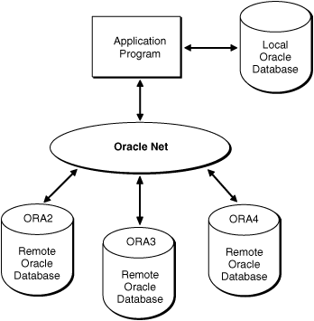

This chapter explains some basic database concepts and how to perform transaction processing. You learn the basic techniques that safeguard the consistency of your database, including how to control if changes to Oracle data are made permanent or undone.

This chapter contains the following topics:

- Connect to the Database

- Advanced Connection Options

- Definitions of Transactions Terms

- How Transactions Guard Your Database

- How to Begin and End Transactions

- Using the COMMIT Statement

- Using the SAVEPOINT Statement

- The ROLLBACK Statement

- The RELEASE Option

- The SET TRANSACTION Statement

- Override Default Locking

- Fetch Across COMMITs

- Distributed Transactions Handling

- Guidelines

### 3.1 Connect to the Database

The complete syntax of the CONNECT statement will be discussed in the next few sections. Here it is:

    EXEC SQL CONNECT { :user IDENTIFIED BY :oldpswd | :usr_psw }
       [[ AT { dbname | :host_variable }] USING :connect_string ]
          [ {ALTER AUTHORIZATION :newpswd  |  IN { SYSDBA | SYSOPER } MODE} ] ;

Your Pro\*C/C++ program must connect to the database before querying or manipulating data. To log on, simply use the CONNECT statement

    EXEC SQL CONNECT :username IDENTIFIED BY :password ;

where username and password are char or VARCHAR host variables.

Or, you can use the statement

    EXEC SQL CONNECT :usr_pwd;

where the host variable usr_pwd contains your username and password separated by a slash character (/).

These are simplified subsets of the CONNECT statement.

The CONNECT statement must be the first SQL statement executed by the program. That is, other SQL statements can physically but not logically precede the CONNECT statement in the precompilation unit.

To supply the Oracle username and password separately, you define two host variables as character strings or VARCHARs. (If you supply a username containing both username and password, only one host variable is needed.)

Make sure to set the username and password variables before the CONNECT is executed, or it will fail. Your program can prompt for the values, or you can hard-code them as follows:

    char *username = "SCOTT";
    char *password = "TIGER";
    ...
    EXEC SQL WHENEVER SQLERROR ...
    EXEC SQL CONNECT :username IDENTIFIED BY :password;

However, you cannot hard-code a username and password into the CONNECT statement. You also cannot use quoted literals. For example, both of the following statements are invalid:

    EXEC SQL CONNECT SCOTT IDENTIFIED BY TIGER;
    EXEC SQL CONNECT 'SCOTT' IDENTIFIED BY 'TIGER';

Hard coding usernames and passwords is not recommended practise.

**Related Topics**

- [CONNECT (Executable Embedded SQL Extension)](embedded-SQL-statements-and-directives.md)

#### 3.1.1 Using the ALTER AUTHORIZATION Clause to Change Passwords

Pro\*C/C++ provides client applications with a convenient way to change a user password at runtime through a simple extension to the EXEC SQL CONNECT statement.

This section describes the possible outcomes of different variations of the ALTER AUTHORIZATION clause.

##### 3.1.1.1 Standard CONNECT

If an application issues the following statement

    EXEC SQL CONNECT ..;   /* No ALTER AUTHORIZATION clause */

it performs a normal connection attempt. The possible results include the following:

- The application will connect without issue.

- The application will connect, but will receive a password warning. The warning indicates that the password has expired but is in a grace period which will allow Logons. At this point, the user is encouraged to change the password before the account becomes locked.

- The application will fail to connect. Possible causes include the following:

  - The password is incorrect.

  - The account has expired, and is possibly in a locked state.

##### 3.1.1.2 Change Password on CONNECT

The following CONNECT statement

    EXEC SQL CONNECT .. ALTER AUTHORIZATION :newpswd;

indicates that the application wants to change the account password to the value indicated by `newpswd`. After the change is made, an attempt is made to connect as `user`/`newpswd`. This can have the following results:

- The application will connect without issue

- The application will fail to connect. This could be due to either of the following:

  - Password verification failed for some reason. In this case the password remains unchanged.

  - The account is locked. Changes to the password are not permitted.

#### 3.1.2 Connecting Using Oracle Net Services

To connect using an Oracle Net Services driver, substitute a service name, as defined in your `tnsnames.ora` configuration file or in Oracle Names.

If you are using Oracle Names, the name server obtains the service name from the network definition database.

See Oracle Net Services Administrator's Guide for more information about Oracle Net Services.

#### 3.1.3 Automatic Connects

You can automatically connect to Oracle with the username

    CLUSTER$username

where username is the current operating system username, and CLUSTER\$username is a valid Oracle database username. (The actual value for CLUSTER\$ is defined in the INIT.ORA parameter file.) You simply pass to the Pro\*C/C++ Precompiler a slash character, as follows:

    ...
    char  *oracleid = "/";
    ...
    EXEC SQL CONNECT :oracleid;

This automatically connects you as user CLUSTER\$username. For example, if your operating system username is RHILL, and CLUSTER\$RHILL is a valid Oracle username, connecting with '/' automatically logs you on to Oracle as user CLUSTER\$RHILL.

You can also pass a '/' in a string to the precompiler. However, the string cannot contain trailing blanks. For example, the following CONNECT statement will fail:

    ...
    char oracleid[10] = "/    ";
    ...
    EXEC SQL CONNECT :oracleid;

##### 3.1.3.1 The AUTO_CONNECT Precompiler Option

If AUTO_CONNECT=YES, and the application is not already connected to a database when it processes the first executable SQL statement, it attempts to connect using the userid

    CLUSTER$<username>

where username is your current operating system user or task name and CLUSTER\$username is a valid Oracle userid. The default value of AUTO_CONNECT is NO.

When AUTO_CONNECT=NO, you must use the CONNECT statement in your program to connect to Oracle.

##### 3.1.3.2 SYSDBA or SYSOPER System Privileges

Append the following optional string after all other clauses to log on with either SYSDBA or SYSOPER system privileges:

    [IN { SYSDBA | SYSOPER } MODE]

For example:

    EXEC SQL CONNECT ... IN SYSDBA MODE ;

Here are the restrictions that apply to this option:

- This option is not permitted when using the AUTO_CONNECT=YES precompiler option setting.

- This option is not permitted when using the ALTER AUTHORIZATION keywords in the CONNECT statement.

**Related Topics**

- Using the ALTER AUTHORIZATION Clause to Change Passwords

### 3.2 Advanced Connection Options

This section describes the available options for advanced connections.

#### 3.2.1 Some Preliminaries

The communicating points in a network are called nodes. Oracle Net lets you transmit information (SQL statements, data, and status codes) over the network from one node to another.

A protocol is a set of rules for accessing a network. The rules establish such things as procedures for recovering after a failure and formats for transmitting data and checking errors.

The Oracle Net syntax for connecting to the default database in the local domain is simply to use the service name for the database.

If the service name is not in the default (local) domain, you must use a global specification (all domains specified). For example:

    HR.XX.ORACLE.COM

#### 3.2.2 Concurrent Logons

Pro\*C/C++ supports distributed processing through Oracle Net. Your application can concurrently access any combination of local and remote databases or make multiple connections to the same database. In Figure 3-1, an application program communicates with one local and three remote Oracle databases. ORA2, ORA3, and ORA4 are simply logical names used in CONNECT statements.

Figure 3-1 Connecting through Oracle Net

[Description of "Figure 3-1 Connecting through Oracle Net"](img_text/lnpcc004.md)

By eliminating the boundaries in a network between different machines and operating systems, Oracle Net provides a distributed processing environment for Oracle tools. This section shows you how Pro\*C/C++ supports distributed processing through Oracle Net. You learn how your application can

- Directly or indirectly access other databases

- Concurrently access any combination of local and remote databases

- Make multiple connections to the same database

For details on installing Oracle Net and identifying available databases, see [Identifying and Accessing the Database](../netag/identifying-and-accessing-database.md) and your system-specific Oracle documentation.

#### 3.2.3 Default Databases and Connections

Each node has a default database. If you specify a database name, but no domain in your CONNECT statement, you connect to the default database on the named local or remote node.

A default connection is made by a CONNECT statement that has no AT clause. The connection can be to any default or nondefault database at any local or remote node. SQL statements without an AT clause are executed against the default connection. Conversely, a nondefault connection is made by a CONNECT statement that has an AT clause. SQL statements with an AT clause are executed against the nondefault connection.

All database names must be unique, but two or more database names can specify the same connection. That is, you can have multiple connections to any database on any node.

#### 3.2.4 Explicit Connections

Usually, you establish a connection to Oracle as follows:

    EXEC SQL CONNECT :username IDENTIFIED BY :password;

You can also use

    EXEC SQL CONNECT :usr_pwd;

where usr_pwd contains username/password.

You can automatically connect to Oracle with the userid

    CLUSTER$username

where username is your current operating system user or task name and CLUSTER\$username is a valid Oracle userid. You simply pass to the precompiler a slash (/) character, as follows:

    char oracleid = '/';
    ...
    EXEC SQL CONNECT :oracleid;

This automatically connects you as user CLUSTER\$username.

If you do not specify a database and node, you are connected to the default database at the current node. If you want to connect to a different database, you must explicitly identify that database.

With explicit connections, you connect to another database directly, giving the connection a name that will be referenced in SQL statements. You can connect to several databases at the same time and to the same database multiple times.

##### 3.2.4.1 Single Explicit Connection

In the following example, you connect to a single nondefault database at a remote node:

    /* declare needed host variables */
    char  username[10]  = "scott";
    char  password[10]  = "tiger";
    char  db_string[20] = "NYNON";

    /* give the database connection a unique name */
    EXEC SQL DECLARE DB_NAME DATABASE;

    /* connect to the nondefault database  */
    EXEC SQL CONNECT :username IDENTIFIED BY :password
       AT DB_NAME USING :db_string;

The identifiers in this example serve the following purposes:

- The host variables username and password identify a valid user.

- The host variable db_string contains the Oracle Net syntax for connecting to a nondefault database at a remote node.

- The undeclared identifier DB_NAME names a nondefault connection; it is an identifier used by Oracle, not a host or program variable.

The USING clause specifies the network, machine, and database associated with DB_NAME. Later, SQL statements using the AT clause (with DB_NAME) are executed at the database specified by db_string.

Alternatively, you can use a character host variable in the AT clause, as the following example shows:

    /* declare needed host variables */
    char  username[10]  = "scott";
    char  password[10]  = "tiger";
    char  db_name[10]   = "oracle1";
    char  db_string[20] = "NYNON";

    /* connect to the nondefault database using db_name */
    EXEC SQL CONNECT :username IDENTIFIED BY :password
       AT :db_name USING :db_string;
    ...

If db_name is a host variable, the DECLARE DATABASE statement is not needed. Only if DB_NAME is an undeclared identifier must you execute a DECLARE DB_NAME DATABASE statement before executing a CONNECT ... AT DB_NAME statement.

###### 3.2.4.1.1 SQL Operations

If granted the privilege, you can execute any SQL data manipulation statement at the nondefault connection. For example, you might execute the following sequence of statements:

    EXEC SQL AT DB_NAME SELECT ...
    EXEC SQL AT DB_NAME INSERT ...
    EXEC SQL AT DB_NAME UPDATE ...

In the next example, db_name is a host variable:

    EXEC SQL AT :db_name DELETE ...

If db_name is a host variable, all database tables referenced by the SQL statement must be defined in DECLARE TABLE statements. Otherwise, the precompiler issues a warning.

**Related Topics**

- [About Using DECLARE TABLE](syntactic-and-semantic-checking.md)
- [DECLARE TABLE (Oracle Embedded SQL Directive)](embedded-SQL-statements-and-directives.md)

###### 3.2.4.1.2 PL/SQL Blocks

You can execute a PL/SQL block using the AT clause. The following example shows the syntax:

    EXEC SQL AT :db_name EXECUTE
        begin
            /* PL/SQL block here */
        end;
    END-EXEC;

###### 3.2.4.1.3 Cursor Control

Cursor control statements such as OPEN, FETCH, and CLOSE are exceptions—they never use an AT clause. If you want to associate a cursor with an explicitly identified database, use the AT clause in the DECLARE CURSOR statement, as follows:

    EXEC SQL AT :db_name DECLARE emp_cursor CURSOR FOR ...
    EXEC SQL OPEN emp_cursor ...
    EXEC SQL FETCH emp_cursor ...
    EXEC SQL CLOSE emp_cursor;

If db_name is a host variable, its declaration must be within the scope of all SQL statements that refer to the DECLAREd cursor. For example, if you OPEN the cursor in one subprogram, then FETCH from it in another subprogram, you must declare db_name globally.

When OPENing, CLOSing, or FETCHing from the cursor, you do not use the AT clause. The SQL statements are executed at the database named in the AT clause of the DECLARE CURSOR statement or at the default database if no AT clause is used in the cursor declaration.

The AT :host_variable clause provides the ability to change the connection associated with a cursor. However, you cannot change the association while the cursor is open. Consider the following example:

    EXEC SQL AT :db_name DECLARE emp_cursor CURSOR FOR ...
    strcpy(db_name, "oracle1");
    EXEC SQL OPEN emp_cursor;
    EXEC SQL FETCH emp_cursor INTO ...
    strcpy(db_name, "oracle2");
    EXEC SQL OPEN emp_cursor;   /*  illegal, cursor still open */
    EXEC SQL FETCH emp_cursor INTO ...

This is illegal because emp_cursor is still open when you try to execute the second OPEN statement. Separate cursors are not maintained for different connections; there is only one emp_cursor, which must be closed before it can be reopened for another connection. To debug the last example, simply close the cursor before reopening it, as follows:

    ...
    EXEC SQL CLOSE emp_cursor;  -- close cursor first
    strcpy(db_name, "oracle2");
    EXEC SQL OPEN emp_cursor;
    EXEC SQL FETCH emp_cursor INTO ...

###### 3.2.4.1.4 Dynamic SQL

Dynamic SQL statements are similar to cursor control statements in that some never use the AT clause.

For dynamic SQL Method 1, you must use the AT clause if you want to execute the statement at a nondefault connection. An example follows:

    EXEC SQL AT :db_name EXECUTE IMMEDIATE :sql_stmt;

For Methods 2, 3, and 4, you use the AT clause only in the DECLARE STATEMENT statement if you want to execute the statement at a nondefault connection. All other dynamic SQL statements such as PREPARE, DESCRIBE, OPEN, FETCH, and CLOSE never use the AT clause. The next example shows Method 2:

    EXEC SQL AT :db_name DECLARE sql_stmt STATEMENT;
    EXEC SQL PREPARE sql_stmt FROM :sql_string;
    EXEC SQL EXECUTE sql_stmt;

The following example shows Method 3:

    EXEC SQL AT :db_name DECLARE sql_stmt STATEMENT;
    EXEC SQL PREPARE sql_stmt FROM :sql_string;
    EXEC SQL DECLARE emp_cursor CURSOR FOR sql_stmt;
    EXEC SQL OPEN emp_cursor ...
    EXEC SQL FETCH emp_cursor INTO ...
    EXEC SQL CLOSE emp_cursor;

##### 3.2.4.2 Multiple Explicit Connections

You can use the AT db_name clause for multiple explicit connections, just as you can for a single explicit connection. In the following example, you connect to two nondefault databases concurrently:

    /* declare needed host variables */
    char  username[10]   = "scott";
    char  password[10]   = "tiger";
    char  db_string1[20] = "NYNON1";
    char  db_string2[20] = "CHINON";
    ...
    /* give each database connection a unique name */
    EXEC SQL DECLARE DB_NAME1 DATABASE;
    EXEC SQL DECLARE DB_NAME2 DATABASE;
    /* connect to the two nondefault databases */
    EXEC SQL CONNECT :username IDENTIFIED BY :password
       AT DB_NAME1 USING :db_string1;
    EXEC SQL CONNECT :username IDENTIFIED BY :password
       AT DB_NAME2 USING :db_string2;

The identifiers DB_NAME1 and DB_NAME2 are declared and then used to name the default databases at the two nondefault nodes so that later SQL statements can refer to the databases by name.

Alternatively, you can use a host variable in the AT clause, as the following example shows:

    /* declare needed host variables */
    char  username[10]   = "scott";
    char  password[10]   = "tiger";
    char  db_name[20];
    char  db_string[20];
    int   n_defs = 3;    /* number of connections to make */
    ...
    for (i = 0; i < n_defs; i++)
    {
        /* get next database name and OracleNet string */
        printf("Database name: ");
        gets(db_name);
        printf("OracleNet) string: ");
        gets(db_string);
        /* do the connect */
        EXEC SQL CONNECT :username IDENTIFIED BY :password
            AT :db_name USING :db_string;
    }

You can also use this method to make multiple connections to the same database, as the following example shows:

    strcpy(db_string, "NYNON");
    for (i = 0; i < ndefs; i++)
    {
        /* connect to the nondefault database */
        printf("Database name: ");
        gets(db_name);
        EXEC SQL CONNECT :username IDENTIFIED BY :password
           AT :db_name USING :db_string;
    }
    ...

You must use different database names for the connections, even though they use the same OracleNet string. However, you can connect twice to the same database using just one database name because that name identifies both the default and nondefault databases.

##### 3.2.4.3 Ensuring Data Integrity

Your application program must ensure the integrity of transactions that manipulate data at two or more remote databases. That is, the program must commit or roll back all SQL statements in the transactions. This might be impossible if the network fails or one of the systems crashes.

For example, suppose you are working with two accounting databases. You debit an account on one database and credit an account on the other database, then issue a COMMIT at each database. It is up to your program to ensure that both transactions are committed or rolled back.

#### 3.2.5 Implicit Connections

Implicit connections are supported through the Oracle distributed query facility, which does not require explicit connections, but only supports the SELECT statement. A distributed query allows a single SELECT statement to access data on one or more nondefault databases.

The distributed query facility depends on database links, which assign a name to a CONNECT statement rather than to the connection itself. At run time, the embedded SELECT statement is executed by the specified Oracle Server, which implicitly connects to the nondefault database(s) to get the required data.

##### 3.2.5.1 Single Implicit Connections

In the next example, you connect to a single nondefault database. First, your program executes the following statement to define a database link (database links are usually established interactively by the DBA or user):

    EXEC SQL CREATE DATABASE LINK db_link
        CONNECT TO username IDENTIFIED BY password
        USING 'NYNON';

Then, the program can query the nondefault EMP table using the database link, as follows:

    EXEC SQL SELECT ENAME, JOB INTO :emp_name, :job_title
        FROM emp@db_link
        WHERE DEPTNO = :dept_number;

The database link is not related to the database name used in the AT clause of an embedded SQL statement. It simply tells Oracle where the nondefault database is located, the path to it, and what Oracle username and password to use. The database link is stored in the data dictionary until it is explicitly dropped.

In our example, the default Oracle Server logs on to the nondefault database through Oracle Net using the database link db_link. The query is submitted to the default Server, but is "forwarded" to the nondefault database for execution.

To make referencing the database link easier, you can interactively create a synonym as follows:

    EXEC SQL CREATE SYNONYM emp FOR emp@db_link;

Then, your program can query the nondefault EMP table, as follows:

    EXEC SQL SELECT ENAME, JOB INTO :emp_name, :job_title
        FROM emp
        WHERE DEPTNO = :dept_number;

This provides location transparency for emp.

##### 3.2.5.2 Multiple Implicit Connections

In the following example, you connect to two nondefault databases concurrently. First, you execute the following sequence of statements to define two database links and create two synonyms:

    EXEC SQL CREATE DATABASE LINK db_link1
        CONNECT TO username1 IDENTIFIED BY password1
            USING 'NYNON';
    EXEC SQL CREATE DATABASE LINK db_link2
        CONNECT TO username2 IDENTIFIED BY password2
            USING 'CHINON';
    EXEC SQL CREATE SYNONYM emp FOR emp@db_link1;
    EXEC SQL CREATE SYNONYM dept FOR dept@db_link2;

Then, your program can query the nondefault EMP and DEPT tables, as follows:

    EXEC SQL SELECT ENAME, JOB, SAL, LOC
        FROM emp, dept
        WHERE emp.DEPTNO = dept.DEPTNO AND DEPTNO = :dept_number;

Oracle executes the query by performing a join between the nondefault EMP table at db_link1 and the nondefault DEPT table at db_link2.

### 3.3 Definitions of Transactions Terms

Before delving into the subject of transactions, you should know the terms defined in this section.

The jobs or tasks that Oracle manages are called sessions. A user session is invoked when you run an application program or a tool such as SQL\*Forms, and connect to the database.

Oracle allows user sessions to work simultaneously and share computer resources. To do this, Oracle must control concurrency, the accessing of the same data by many users. Without adequate concurrency controls, there might be a loss of data integrity. That is, changes to data or structures might be made in the wrong order.

Oracle uses locks (sometimes called enqueues) to control concurrent access to data. A lock gives you temporary ownership of a database resource such as a table or row of data. Thus, data cannot be changed by other users until you finish with it.

You need never explicitly lock a resource, because default locking mechanisms protect Oracle data and structures. However, you can request data locks on tables or rows when it is to your advantage to override default locking. You can choose from several modes of locking such as row share and exclusive.

A deadlock can occur when two or more users try to access the same database object. For example, two users updating the same table might wait if each tries to update a row currently locked by the other. Because each user is waiting for resources held by another user, neither can continue until Oracle breaks the deadlock. Oracle signals an error to the participating transaction that had completed the least amount of work, and the "deadlock detected while waiting for resource" Oracle error code is returned to sqlcode in the SQLCA.

When a table is being queried by one user and updated by another at the same time, Oracle generates a read-consistent view of the table's data for the query. That is, once a query begins and as it proceeds, the data read by the query does not change. As update activity continues, Oracle takes snapshots of the table's data and records changes in a rollback segment. Oracle uses information in the rollback segment to build read-consistent query results and to undo changes if necessary.

### 3.4 How Data Integrity Is Ensured

Oracle is transaction oriented. That is, Oracle uses transactions to ensure data integrity. A transaction is a series of one or more logically related SQL statements you define to accomplish some task. Oracle treats the series of SQL statements as a unit so that all the changes brought about by the statements are either committed (made permanent) or rolled back (undone) at the same time. If your application program fails in the middle of a transaction, the database is automatically restored to its former (pre-transaction) state.

The coming sections show you how to define and control transactions. Specifically, you learn how to:

- Connect to the database.

- Make concurrent connections.

- Begin and end transactions.

- Use the COMMIT statement to make transactions permanent.

- Use the SAVEPOINT statement with the ROLLBACK TO statement to undo parts of transactions.

- Use the ROLLBACK statement to undo whole transactions.

- Specify the RELEASE option to free resources and log off the database.

- Use the SET TRANSACTION statement to set read-only transactions.

- Use the FOR UPDATE clause or LOCK TABLE statement to override default locking.

For details about the SQL statements discussed in this chapter, see [Oracle Database SQL Language Reference](../sqlrf/index.md).

### 3.5 How to Begin and End Transactions

You begin a transaction with the first executable SQL statement (other than CONNECT) in your program. When one transaction ends, the next executable SQL statement automatically begins another transaction. Thus, every executable statement is part of a transaction. Because they cannot be rolled back and need not be committed, declarative SQL statements are not considered part of a transaction.

You end a transaction in one of the following ways:

- Code a COMMIT or ROLLBACK statement, with or without the RELEASE option. This explicitly makes permanent or undoes changes to the database.

- Code a data definition statement (ALTER, CREATE, or GRANT, for example), which issues an automatic COMMIT before and after executing. This implicitly makes permanent changes to the database.

A transaction also ends when there is a system failure or your user session stops unexpectedly because of software problems, hardware problems, or a forced interrupt. Oracle rolls back the transaction.

If your program fails in the middle of a transaction, Oracle detects the error and rolls back the transaction. If your operating system fails, Oracle restores the database to its former (pre-transaction) state.

### 3.6 Using the COMMIT Statement

If you do not subdivide your program with the COMMIT or ROLLBACK statement, Oracle treats the whole program as a single transaction (unless the program contains data definition statements, which issue automatic COMMITS).

You use the COMMIT statement to make changes to the database permanent. Until changes are COMMITted, other users cannot access the changed data; they see it as it was before your transaction began. Specifically, the COMMIT statement

- Makes permanent all changes made to the database during the current transaction

- Makes these changes visible to other users

- Erases all savepoints (see the next section)

- Releases all row and table locks, but not parse locks

- Closes cursors referenced in a CURRENT OF clause or, when MODE=ANSI, closes all explicit cursors for the connection specified in the COMMIT statement

- Ends the transaction

The COMMIT statement has no effect on the values of host variables or on the flow of control in your program.

When MODE=ORACLE, explicit cursors that are not referenced in a CURRENT OF clause remain open across COMMITs. This can boost performance.

Because they are part of normal processing, COMMIT statements should be placed inline, on the main path through your program. Before your program terminates, it must explicitly COMMIT pending changes. Otherwise, Oracle rolls them back. In the following example, you commit your transaction and disconnect from Oracle:

    EXEC SQL COMMIT WORK RELEASE;

The optional keyword WORK provides ANSI compatibility. The RELEASE option frees all Oracle resources (locks and cursors) held by your program and logs off the database.

You need not follow a data definition statement with a COMMIT statement because data definition statements issue an automatic COMMIT before and after executing. So, whether they succeed or fail, the prior transaction is committed.

**Related Topics**

- Fetch Across COMMITs

#### 3.6.1 WITH HOLD Clause in DECLARE CURSOR Statements

Any cursor that has been declared with the clause WITH HOLD after the word CURSOR remains open after a COMMIT. The following example shows how to use this clause:

         EXEC SQL
             DECLARE C1 CURSOR WITH HOLD
             FOR SELECT ENAME FROM EMP
             WHERE EMPNO BETWEEN 7600 AND 7700
         END-EXEC.

The cursor must not be declared for UPDATE. The WITH HOLD clause is used in DB2 to override the default, which is to close all cursors on commit. Pro\*COBOL provides this clause in order to ease migrations of applications from DB2 to Oracle. When MODE=ANSI, Oracle uses the DB2 default, but all host variables must be declared in a Declare Section. To avoid having a Declare Section, use the precompiler option CLOSE_ON_COMMIT described next.

**Related Topics**

- [DECLARE CURSOR (Embedded SQL Directive)](embedded-SQL-statements-and-directives.md)

#### 3.6.2 CLOSE_ON_COMMIT Precompiler Option

The precompiler option CLOSE_ON_COMMITis available to override the default behavior of MODE=ANSI (if you specify MODE=ANSI on the command line, any cursors not declared with the WITH HOLD clause are closed on commit):

    CLOSE_ON_COMMIT = {YES | NO}

The default is NO. This option must be entered only on the command line or in a configuration file.

**Note:**

Use this option carefully; applications may be slowed if cursors are opened and closed many times because of the need to re-parse for each OPEN statement.

**Related Topics**

- [CLOSE_ON_COMMIT](precompiler-options.md)
- [Macro and Micro Options](precompiler-options.md)

### 3.7 Using the SAVEPOINT Statement

You use the SAVEPOINT statement to mark and name the current point in the processing of a transaction. Each marked point is called a savepoint. For example, the following statement marks a savepoint named start_delete:

    EXEC SQL SAVEPOINT start_delete;

Savepoints let you divide long transactions, giving you more control over complex procedures. For example, if a transaction performs several functions, you can mark a savepoint before each function. Then, if a function fails, you can easily restore the Oracle data to its former state, recover, then reexecute the function.

To undo part of a transaction, you use savepoints with the ROLLBACK statement and its TO SAVEPOINT clause. In the following example, you access the table MAIL_LIST to insert new listings, update old listings, and delete (a few) inactive listings. After the delete, you check the third element of sqlerrd in the SQLCA for the number of rows deleted. If the number is unexpectedly large, you roll back to the savepoint start_delete, undoing just the delete.

    ...
    for (;;)
    {
       printf("Customer number? ");
       gets(temp);
       cust_number = atoi(temp);
       printf("Customer name? ");
       gets(cust_name);
      EXEC SQL INSERT INTO mail_list (custno, cname, stat)
         VALUES (:cust_number, :cust_name, 'ACTIVE');
    ...
    }

    for (;;)
    {
       printf("Customer number? ");
       gets(temp);
       cust_number = atoi(temp);
       printf("New status? ");
       gets(new_status);
       EXEC SQL UPDATE mail_list
         SET stat = :new_status
         WHERE custno = :cust_number;
    }
    /* mark savepoint */
    EXEC SQL SAVEPOINT start_delete;

    EXEC SQL DELETE FROM mail_list
        WHERE stat = 'INACTIVE';
    if (sqlca.sqlerrd[2] < 25)  /* check number of rows deleted */
        printf("Number of rows deleted is  %d\n", sqlca.sqlerrd[2]);
    else
    {
        printf("Undoing deletion of %d rows\n", sqlca.sqlerrd[2]);
        EXEC SQL WHENEVER SQLERROR GOTO sql_error;
        EXEC SQL ROLLBACK TO SAVEPOINT start_delete;
    }

    EXEC SQL WHENEVER SQLERROR CONTINUE;
    EXEC SQL COMMIT WORK RELEASE;
    exit(0);
    sql_error:
    EXEC SQL WHENEVER SQLERROR CONTINUE;
    EXEC SQL ROLLBACK WORK RELEASE;
    printf("Processing error\n");
    exit(1);

Rolling back to a savepoint erases any savepoints marked after that savepoint. The savepoint to which you roll back, however, is not erased. For example, if you mark five savepoints, then roll back to the third, only the fourth and fifth are erased.

If you give two savepoints the same name, the earlier savepoint is erased. A COMMIT or ROLLBACK statement erases all savepoints.

**Related Topics**

- [About Using the WHENEVER Directive](handling-run-time-errors.md)

### 3.8 The ROLLBACK Statement

You use the ROLLBACK statement to undo pending changes made to the database. For example, if you make a mistake, such as deleting the wrong row from a table, you can use ROLLBACK to restore the original data. The TO SAVEPOINT clause lets you roll back to an intermediate statement in the current transaction, so you do not have to undo all your changes.

If you start a transaction that does not complete (a SQL statement might not execute successfully, for example), ROLLBACK lets you return to the starting point, so that the database is not left in an inconsistent state. Specifically, the ROLLBACK statement

- Undoes all changes made to the database during the current transaction

- Erases all savepoints

- Ends the transaction

- Releases all row and table locks, but not parse locks

- Closes cursors referenced in a CURRENT OF clause or, when MODE=ANSI, closes all explicit cursors

The ROLLBACK statement has no effect on the values of host variables or on the flow of control in your program.

When MODE=ORACLE, explicit cursors not referenced in a CURRENT OF clause remain open across ROLLBACKs.

Specifically, the ROLLBACK TO SAVEPOINT statement

- Undoes changes made to the database since the specified savepoint was marked

- Erases all savepoints marked after the specified savepoint

- Releases all row and table locks acquired since the specified savepoint was marked

  **Note:**

  You cannot specify the RELEASE option in a ROLLBACK TO SAVEPOINT statement.

Because they are part of exception processing, ROLLBACK statements should be placed in error handling routines, off the main path through your program. In the following example, you roll back your transaction and disconnect from Oracle:

    EXEC SQL ROLLBACK WORK RELEASE;

The optional keyword WORK provides ANSI compatibility. The RELEASE option frees all resources held by your program and disconnects from the database.

If a WHENEVER SQLERROR GOTO statement branches to an error handling routine that includes a ROLLBACK statement, your program might enter an infinite loop if the ROLLBACK fails with an error. You can avoid this by coding WHENEVER SQLERROR CONTINUE before the ROLLBACK statement, as shown in the following example:

    EXEC SQL WHENEVER SQLERROR GOTO sql_error;

    for (;;)
    {
       printf("Employee number? ");
        gets(temp);
        emp_number = atoi(temp);
       printf("Employee name? ");
       gets(emp_name);
       EXEC SQL INSERT INTO emp (empno, ename)
           VALUES (:emp_number, :emp_name);
    ...
    }
    ...
    sql_error:
    EXEC SQL WHENEVER SQLERROR CONTINUE;
    EXEC SQL ROLLBACK WORK RELEASE;
    printf("Processing error\n");
    exit(1);

Oracle automatically rolls back transactions if your program terminates abnormally.

**Related Topics**

- The RELEASE Option

#### 3.8.1 Statement-Level Rollbacks

Before executing any SQL statement, Oracle marks an implicit savepoint (not available to you). Then, if the statement fails, Oracle automatically rolls it back and returns the applicable error code to sqlcode in the SQLCA. For example, if an INSERT statement causes an error by trying to insert a duplicate value in a unique index, the statement is rolled back.

Oracle can also roll back single SQL statements to break deadlocks. Oracle signals an error to one of the participating transactions and rolls back the current statement in that transaction.

Only work started by the failed SQL statement is lost; work done before that statement in the current transaction is saved. Thus, if a data definition statement fails, the automatic commit that precedes it is not undone.

Before executing a SQL statement, Oracle must parse it, that is, examine it to make sure it follows syntax rules and refers to valid database objects. Errors detected while executing a SQL statement cause a rollback, but errors detected while parsing the statement do not.

### 3.9 The RELEASE Option

Oracle automatically rolls back changes if your program terminates abnormally. Abnormal termination occurs when your program does not explicitly commit or roll back work and disconnect from Oracle using the RELEASE option. Normal termination occurs when your program runs its course, closes open cursors, explicitly commits or rolls back work, disconnects from Oracle, and returns control to the user.

Your program will exit gracefully if the last SQL statement it executes is either

    EXEC SQL COMMIT WORK RELEASE;

or

    EXEC SQL ROLLBACK WORK RELEASE;

where the token WORK is optional. Otherwise, locks and cursors acquired by your user session are held after program termination until Oracle recognizes that the user session is no longer active. This might cause other users in a multiuser environment to wait longer than necessary for the locked resources.

### 3.10 The SET TRANSACTION Statement

You use the SET TRANSACTION statement to begin a read-only transaction. Because they allow "repeatable reads," read-only transactions are useful for running multiple queries against one or more tables while other users update the same tables. An example of the SET TRANSACTION statement follows:

    EXEC SQL SET TRANSACTION READ ONLY;

The SET TRANSACTION statement must be the first SQL statement in a read-only transaction and can appear only once in a transaction. The READ ONLY parameter is required. Its use does not affect other transactions.

Only the SELECT, COMMIT, and ROLLBACK statements are allowed in a read-only transaction. For example, including an INSERT, DELETE, or SELECT FOR UPDATE OF statement causes an error.

During a read-only transaction, all queries refer to the same snapshot of the database, providing a multitable, multiquery, read-consistent view. Other users can continue to query or update data as usual.

A COMMIT, ROLLBACK, or data definition statement ends a read-only transaction. (Recall that data definition statements issue an implicit COMMIT.)

In the following example, as a store manager, you check sales activity for the day, the past week, and the past month by using a read-only transaction to generate a summary report. The report is unaffected by other users updating the database during the transaction.

    EXEC SQL SET TRANSACTION READ ONLY;
    EXEC SQL SELECT sum(saleamt) INTO :daily FROM sales
        WHERE saledate = SYSDATE;
    EXEC SQL SELECT sum(saleamt) INTO :weekly FROM sales
        WHERE saledate > SYSDATE - 7;
    EXEC SQL SELECT sum(saleamt) INTO :monthly FROM sales
        WHERE saledate > SYSDATE - 30;
    EXEC SQL COMMIT WORK;
        /* simply ends the transaction since there are no changes
           to make permanent */
    /* format and print report */

### 3.11 Override Default Locking

By default, Oracle automatically locks many data structures for you. However, you can request specific data locks on rows or tables when it is to your advantage to override default locking. Explicit locking lets you share or deny access to a table for the duration of a transaction or ensure multitable and multiquery read consistency.

With the SELECT FOR UPDATE OF statement, you can explicitly lock specific rows of a table to make sure they do not change before an UPDATE or DELETE is executed. However, Oracle automatically obtains row-level locks at UPDATE or DELETE time. So, use the FOR UPDATE OF clause only if you want to lock the rows before the UPDATE or DELETE.

You can explicitly lock entire tables using the LOCK TABLE statement.

#### 3.11.1 Using FOR UPDATE OF

When you DECLARE a cursor that is referenced in the CURRENT OF clause of an UPDATE or DELETE statement, you use the FOR UPDATE OF clause to acquire exclusive row locks. SELECT FOR UPDATE OF identifies the rows that will be updated or deleted, then locks each row in the active set. This is useful, for example, when you want to base an update on the existing values in a row. You must make sure the row is not changed by another user before your update.

The FOR UPDATE OF clause is optional. For example, instead of coding

    EXEC SQL DECLARE emp_cursor CURSOR FOR
        SELECT ename, job, sal FROM emp WHERE deptno = 20
            FOR UPDATE OF sal;

you can drop the FOR UPDATE OF clause and simply code

    EXEC SQL DECLARE emp_cursor CURSOR FOR
        SELECT ename, job, sal FROM emp WHERE deptno = 20;

The CURRENT OF clause signals the precompiler to add a FOR UPDATE clause if necessary. You use the CURRENT OF clause to refer to the latest row FETCHed from a cursor.

**Related Topics**

- [The CURRENT OF Clause](embedded-SQL.md)

##### 3.11.1.1 Restrictions

If you use the FOR UPDATE OF clause, you cannot reference multiple tables.

An explicit FOR UPDATE OF or an implicit FOR UPDATE acquires exclusive row locks. All rows are locked at the OPEN, not as they are FETCHed. Row locks are released when you COMMIT or ROLLBACK (except when you ROLLBACK to a savepoint). Therefore, you cannot FETCH from a FOR UPDATE cursor after a COMMIT.

#### 3.11.2 Using LOCK TABLE

You use the LOCK TABLE statement to lock one or more tables in a specified lock mode. For example, the statement in the following section, locks the EMP table in row share mode. Row share locks allow concurrent access to a table; they prevent other users from locking the entire table for exclusive use.

    EXEC SQL LOCK TABLE EMP IN ROW SHARE MODE NOWAIT;

The lock mode determines what other locks can be placed on the table. For example, many users can acquire row share locks on a table at the same time, but only one user at a time can acquire an exclusive lock. While one user has an exclusive lock on a table, no other users can INSERT, UPDATE, or DELETE rows in that table.

The optional keyword NOWAIT tells Oracle not to wait for a table if it has been locked by another user. Control is immediately returned to your program, so it can do other work before trying again to acquire the lock. (You can check sqlcode in the SQLCA to see if the LOCK TABLE failed.) If you omit NOWAIT, Oracle waits until the table is available; the wait has no set limit.

A table lock never keeps other users from querying a table, and a query never acquires a table lock. So, a query never blocks another query or an update, and an update never blocks a query. Only if two different transactions try to update the same row will one transaction wait for the other to complete.

Any LOCK TABLE statement implicitly closes all cursors.

Table locks are released when your transaction issues a COMMIT or ROLLBACK.

**Related Topics**

- [Lock Modes](../cncpt/data-concurrency-and-consistency.md)

### 3.12 Fetch Across COMMITs

If you want to intermix COMMITs and FETCHes, do not use the CURRENT OF clause. Instead, SELECT the ROWID of each row, then use that value to identify the current row during the update or delete. An example follows:

    ...
    EXEC SQL DECLARE emp_cursor CURSOR FOR
        SELECT ename, sal, ROWID FROM emp WHERE job = 'CLERK';
    ...
    EXEC SQL OPEN emp_cursor;
    EXEC SQL WHENEVER NOT FOUND GOTO ...
    for (;;)
    {
        EXEC SQL FETCH emp_cursor INTO :emp_name, :salary, :row_id;
        ...
        EXEC SQL UPDATE emp SET sal = :new_salary
            WHERE ROWID = :row_id;
        EXEC SQL COMMIT;
    ...
    }

Note, however, that the FETCHed rows are not locked. So, you might get inconsistent results if another user modifies a row after you read it but before you update or delete it.

### 3.13 Distributed Transactions Handling

A distributed database is a single logical database comprising multiple physical databases at different nodes. A distributed statement is any SQL statement that accesses a remote node using a database link. A distributed transaction includes at least one distributed statement that updates data at multiple nodes of a distributed database. If the update affects only one node, the transaction is non-distributed.

When you issue a COMMIT, changes to each database affected by the distributed transaction are made permanent. If instead you issue a ROLLBACK, all the changes are undone. However, if a network or machine fails during the commit or rollback, the state of the distributed transaction might be unknown or in doubt. In such cases, if you have FORCE TRANSACTION system privileges, you can manually commit or roll back the transaction at your local database by using the FORCE clause. The transaction must be identified by a quoted literal containing the transaction ID, which can be found in the data dictionary view DBA_2PC_PENDING. Some examples follow:

    EXEC SQL COMMIT FORCE '22.31.83';
    ...
    EXEC SQL ROLLBACK FORCE '25.33.86';

FORCE commits or rolls back only the specified transaction and does not affect your current transaction. You cannot manually roll back in-doubt transactions to a savepoint.

The COMMENT clause in the COMMIT statement lets you specify a Comment to be associated with a distributed transaction. If ever the transaction is in doubt, Oracle stores the text specified by COMMENT in the data dictionary view DBA_2PC_PENDING along with the transaction ID. The text must be a quoted literal 50 characters in length. An example follows:

    EXEC SQL COMMIT COMMENT 'In-doubt trans; notify Order Entry';

**Note:**

The COMMENT clause will be deprecated in a future release. Oracle recommends that you use transaction naming instead.

**Related Topics**

- [Transactions](../cncpt/transactions.md)

### 3.14 Guidelines

The following guidelines will help you avoid some common problems.

#### 3.14.1 Designing Applications

When designing your application, group logically related actions together in one transaction. A well-designed transaction includes all the steps necessary to accomplish a given task—no more and no less.

Data in the tables you reference must be left in a consistent state. So, the SQL statements in a transaction should change the data in a consistent way. For example, a transfer of funds between two bank accounts should include a debit to one account and a credit to another. Both updates should either succeed or fail together. An unrelated update, such as a new deposit to one account, should not be included in the transaction.

#### 3.14.2 Obtaining Locks

If your application programs include SQL locking statements, make sure the Oracle users requesting locks have the privileges needed to obtain the locks. Your DBA can lock any table. Other users can lock tables they own or tables for which they have a privilege, such as ALTER, SELECT, INSERT, UPDATE, or DELETE.

#### 3.14.3 Using PL/SQL

If a PL/SQL block is part of a transaction, COMMITs and ROLLBACKs inside the block affect the whole transaction. In the following example, the ROLLBACK undoes changes made by the UPDATE and the INSERT:

    EXEC SQL INSERT INTO EMP ...
    EXEC SQL EXECUTE
        BEGIN
            UPDATE emp ...
            ...
        EXCEPTION
            WHEN DUP_VAL_ON_INDEX THEN
                ROLLBACK;
            ...
        END;
    END-EXEC;
    ...
