This appendix contains descriptions of both the SQL standard embedded statements and directives, as well as the Oracle embedded SQL extensions.

**Note:**

Only statements which differ in syntax from non-embedded SQL are described in this appendix. For details of the non-embedded SQL statements, see [Types of SQL Statements](../sqlrf/Types-of-SQL-Statements.md)

This appendix contains the following topics:

- Summary of Precompiler Directives and Embedded SQL Statements

- About The Statement Descriptions

- How to Read Syntax Diagrams

- ALLOCATE (Executable Embedded SQL Extension)

- ALLOCATE DESCRIPTOR (Executable Embedded SQL)

- CACHE FREE ALL (Executable Embedded SQL Extension)

- CALL (Executable Embedded SQL)

- CLOSE (Executable Embedded SQL)

- COLLECTION APPEND (Executable Embedded SQL Extension)

- COLLECTION DESCRIBE (Executable Embedded SQL Extension)

- COLLECTION GET (Executable Embedded SQL Extension)

- COLLECTION RESET (Executable Embedded SQL Extension)

- COLLECTION SET (Executable Embedded SQL Extension)

- COLLECTION TRIM (Executable Embedded SQL Extension)

- COMMIT (Executable Embedded SQL)

- CONNECT (Executable Embedded SQL Extension)

- CONTEXT ALLOCATE (Executable Embedded SQL Extension)

- CONTEXT FREE (Executable Embedded SQL Extension)

- CONTEXT OBJECT OPTION GET (Executable Embedded SQL Extension)

- CONTEXT OBJECT OPTION SET (Executable Embedded SQL Ext)

- CONTEXT USE (Oracle Embedded SQL Directive)

- DEALLOCATE DESCRIPTOR (Embedded SQL Statement)

- DECLARE CURSOR (Embedded SQL Directive)

- DECLARE DATABASE (Oracle Embedded SQL Directive)

- DECLARE STATEMENT (Embedded SQL Directive)

- DECLARE TABLE (Oracle Embedded SQL Directive)

- DECLARE TYPE (Oracle Embedded SQL Directive)

- DELETE (Executable Embedded SQL)

- DESCRIBE (Executable Embedded SQL Extension)

- DESCRIBE DESCRIPTOR (Executable Embedded SQL)

- ENABLE THREADS (Executable Embedded SQL Extension)

- EXECUTE ... END-EXEC (Executable Embedded SQL Extension)

- EXECUTE (Executable Embedded SQL)

- EXECUTE DESCRIPTOR (Executable Embedded SQL)

- EXECUTE IMMEDIATE (Executable Embedded SQL)

- FETCH (Executable Embedded SQL)

- FETCH DESCRIPTOR (Executable Embedded SQL)

- FREE (Executable Embedded SQL Extension)

- GET DESCRIPTOR (Executable Embedded SQL)

- INSERT (Executable Embedded SQL)

- LOB APPEND (Executable Embedded SQL Extension)

- LOB ASSIGN (Executable Embedded SQL Extension)

- LOB CLOSE (Executable Embedded SQL Extension)

- LOB COPY (Executable Embedded SQL Extension)

- LOB CREATE TEMPORARY (Executable Embedded SQL Extension)

- LOB DESCRIBE (Executable Embedded SQL Extension)

- LOB DISABLE BUFFERING (Executable Embedded SQL Extension)

- LOB ENABLE BUFFERING (Executable Embedded SQL Extension)

- LOB ERASE (Executable Embedded SQL Extension)

- LOB FILE CLOSE ALL (Executable Embedded SQL Extension)

- LOB FILE SET (Executable Embedded SQL Extension)

- LOB FLUSH BUFFER (Executable Embedded SQL Extension)

- LOB FREE TEMPORARY (Executable Embedded SQL Extension)

- LOB LOAD (Executable Embedded SQL Extension)

- LOB OPEN (Executable Embedded SQL Extension)

- LOB READ (Executable Embedded SQL Extension)

- LOB TRIM (Executable Embedded SQL Extension)

- LOB WRITE (Executable Embedded SQL Extension)

- OBJECT CREATE (Executable Embedded SQL Extension)

- OBJECT DELETE (Executable Embedded SQL Extension)

- OBJECT DEREF (Executable Embedded SQL Extension)

- OBJECT FLUSH (Executable Embedded SQL Extension)

- OBJECT GET (Executable Embedded SQL Extension)

- OBJECT RELEASE (Executable Embedded SQL Extension)

- OBJECT SET (Executable Embedded SQL Extension)

- OBJECT UPDATE (Executable Embedded SQL Extension)

- OPEN (Executable Embedded SQL)

- OPEN DESCRIPTOR (Executable Embedded SQL)

- PREPARE (Executable Embedded SQL)

- REGISTER CONNECT (Executable Embedded SQL Extension)

- ROLLBACK (Executable Embedded SQL)

- SAVEPOINT (Executable Embedded SQL)

- SELECT (Executable Embedded SQL)

- SET DESCRIPTOR (Executable Embedded SQL)

- TYPE (Oracle Embedded SQL Directive)

- UPDATE (Executable Embedded SQL)

- VAR (Oracle Embedded SQL Directive)

- WHENEVER (Embedded SQL Directive)

### E.1 Summary of Precompiler Directives and Embedded SQL Statements

Embedded SQL statements place DDL, DML, and Transaction Control statements within a Pro\*C/C++ program. Table E-1 provides a functional summary of the embedded SQL statements and directives.

The Source/Type column in Table E-2 is displayed in the format:

Table E-1 Functional Summary of the Embedded SQL Statements and Directives

| Source/Type | Description                                               |
|:------------|:----------------------------------------------------------|
| Source      | Is either standard SQL (S) or an Oracle extension (O).    |
| Type        | Is either an executable (E) statement or a directive (D). |

Table E-2 Precompiler Directives and Embedded SQL Statements and Clauses

| EXEC SQL Statement        | Source/Type | Purpose                                                                                                                                                                |
|:--------------------------|:------------|:-----------------------------------------------------------------------------------------------------------------------------------------------------------------------|
| ALLOCATE                  | O/E         | To allocate memory for a cursor variable or an Object type.                                                                                                            |
| ALLOCATE DESCRIPTOR       | S/E         | Allocate a descriptor for ANSI dynamic SQL.                                                                                                                            |
| CACHE FREE ALL            | O/E         | Frees all allocated object cache memory.                                                                                                                               |
| CALL                      | S/E         | Call a stored procedure.                                                                                                                                               |
| CLOSE                     | S/E         | To disable a cursor, releasing the resources it holds.                                                                                                                 |
| COLLECTION APPEND         | O/E         | To append elements of one collection to the end of another collection.                                                                                                 |
| COLLECTION DESCRIBE       | O/E         | To obtain information about a collection.                                                                                                                              |
| COLLECTION GET            | O/E         | To retrieve the elements of a collection.                                                                                                                              |
| COLLECTION RESET          | O/E         | To reset the collection slice endpoints back to the beginning of the collection.                                                                                       |
| COLLECTION SET            | O/E         | To update values of a collection.                                                                                                                                      |
| COLLECTION TRIM           | O/E         | To remove elements from the end of a collection.                                                                                                                       |
| COMMIT                    | S/E         | To end the current transaction, making all database change permanent (optionally frees resources and disconnects from the database)                                    |
| CONNECT                   | O/E         | To log on to an instance.                                                                                                                                              |
| CONTEXT ALLOCATE          | O/E         | To allocate memory for a SQLLIB runtime context.                                                                                                                       |
| CONTEXT FREE              | O/E         | To free memory for a SQLLIB runtime context.                                                                                                                           |
| CONTEXT OBJECT OPTION GET | O/E         | To determine how options are set.                                                                                                                                      |
| CONTEXT OBJECT OPTION SET | O/E         | To set options.                                                                                                                                                        |
| CONTEXT USE               | O/D         | To specify which SQLLIB runtime context to use for subsequent executable SQL statements.                                                                               |
| DEALLOCATE DESCRIPTOR     | S/E         | To deallocate a descriptor area to free memory.                                                                                                                        |
| DECLARE CURSOR            | S/D         | To declare a cursor, associating it with a query.                                                                                                                      |
| DECLARE DATABASE          | O/D         | To declare an identifier for a nondefault database to be accessed in subsequent embedded SQL statements.                                                               |
| DECLARE STATEMENT         | S/D         | To assign a SQL variable name to a SQL statement.                                                                                                                      |
| DECLARE TABLE             | O/D         | To declare the table structure for semantic checking of embedded SQL statements by Pro\*C/C++.                                                                         |
| DECLARE TYPE              | O/D         | To declare the type structure for semantic checking of embedded SQL statements by Pro\*C/C++.                                                                          |
| DELETE                    | S/E         | To remove rows from a table or from a view's base table.                                                                                                               |
| DESCRIBE                  | S/E         | To initialize a descriptor, a structure holding host variable descriptions.                                                                                            |
| DESCRIBE DESCRIPTOR       | S/E         | Obtain information about the variables in an ANSI SQL statement.                                                                                                       |
| ENABLE THREADS            | O/E         | To initialize a process that supports multiple threads.                                                                                                                |
| EXECUTE...END-EXEC        | O/E         | To execute an anonymous PL/SQL block.                                                                                                                                  |
| EXECUTE                   | S/E         | To execute a prepared dynamic SQL statement.                                                                                                                           |
| EXECUTE DESCRIPTOR        | S/E         | To execute an ANSI Method 4 dynamic SQL statement.                                                                                                                     |
| EXECUTE IMMEDIATE         | S/E         | To prepare and execute a SQL statement with no host variables.                                                                                                         |
| FETCH                     | S/E         | To retrieve rows selected by a query.                                                                                                                                  |
| FETCH DESCRIPTOR          | S/E         | To retrieve rows selected using ANSI Method 4 Dynamic SQL.                                                                                                             |
| FREE                      | O/E         | To free memory allocated in the object cache, or cursor.                                                                                                               |
| GET DESCRIPTOR            | S/E         | To move information from an ANSI SQL descriptor area into host variables.                                                                                              |
| INSERT                    | S/E         | To add rows to a table or to a view's base table.                                                                                                                      |
| LOB APPEND                | O/E         | To append a LOB to the end of another lOB.                                                                                                                             |
| LOB ASSIGN                | O/E         | To assign a LOB or BFILE locator to another locator.                                                                                                                   |
| LOB CLOSE                 | O/E         | To close an open LOB or BFILE.                                                                                                                                         |
| LOB COPY                  | O/E         | To copy all or part of a LOB value into another LOB.                                                                                                                   |
| LOB CREATE TEMPORARY      | O/E         | To create a temporary LOB.                                                                                                                                             |
| LOB DESCRIBE              | O/E         | To retrieve attributes from a LOB.                                                                                                                                     |
| LOB DISABLE BUFFERING     | O/E         | To disable LOB buffering.                                                                                                                                              |
| LOB ENABLE BUFFERING      | O/E         | To enable LOB buffering.                                                                                                                                               |
| LOB ERASE                 | O/E         | To erase a given amount of LOB data starting from a given offset.                                                                                                      |
| LOB FILE CLOSE ALL        | O/E         | To close all open BFILEs.                                                                                                                                              |
| LOB FILE SET              | O/E         | To set DIRECTORY and FILENAME in a BFILE locator.                                                                                                                      |
| LOB FLUSH BUFFER          | O/E         | To write the LOB buffers to the database server.                                                                                                                       |
| LOB FREE TEMPORARY        | O/E         | To free temporary space for the LOB locator.                                                                                                                           |
| LOB LOAD                  | O/E         | To copy all or part of a BFILE into an internal LOB.                                                                                                                   |
| LOB OPEN                  | O/E         | To open a LOB or BFILE to read or read/write access.                                                                                                                   |
| LOB READ                  | O/E         | To read all or part of a LOB or BFILE into a buffer.                                                                                                                   |
| LOB TRIM                  | O/E         | To truncate a lob value.                                                                                                                                               |
| LOB WRITE                 | O/E         | To write the contents of a buffer to a LOB.                                                                                                                            |
| OBJECT CREATE             | O/E         | To create a referenceable object in the cache.                                                                                                                         |
| OBJECT DELETE             | O/E         | To mark an object as deleted.                                                                                                                                          |
| OBJECT DEREF              | O/E         | To dereference an object.                                                                                                                                              |
| OBJECT FLUSH              | O/E         | To transmit persistent objects to server.                                                                                                                              |
| OBJECT GET                | O/E         | To convert an object attribute to a C type.                                                                                                                            |
| OBJECT RELEASE            | O/E         | To "unpin" an object in the cache.                                                                                                                                     |
| OBJECT SET                | O/E         | To update object attributes in the cache.                                                                                                                              |
| OBJECT UPDATE             | O/E         | To mark an object in the cache as updated.                                                                                                                             |
| OPEN                      | S/E         | To execute the query associated with a cursor.                                                                                                                         |
| OPEN DESCRIPTOR           | S/E         | To execute the query associated with a cursor (ANSI Dynamic SQL Method 4).                                                                                             |
| PREPARE                   | S/E         | To parse a dynamic SQL statement.                                                                                                                                      |
| REGISTER CONNECT          | O/E         | To enable a call to an external procedure.                                                                                                                             |
| ROLLBACK                  | S/E         | To end the current transaction, discard all changes in the current transaction, and release all locks (optionally release resources and disconnect from the database). |
| SAVEPOINT                 | S/E         | To identify a point in a transaction to which you can later roll back.                                                                                                 |
| SELECT                    | S/E         | To retrieve data from one or more tables, views, or snapshots, assigning the selected values to host variables.                                                        |
| SET DESCRIPTOR            | S/E         | To set information in the descriptor area from host variables.                                                                                                         |
| TYPE                      | O/D         | To assign an external datatype to a whole class of host variables by equivalencing the external datatype to a user-defined datatype.                                   |
| UPDATE                    | S/E         | To change existing values in a table or in a view's base table.                                                                                                        |
| VAR                       | O/D         | To override the default datatype and assign a specific external datatype to a host variable.                                                                           |
| WHENEVER                  | S/D         | To specify handling for error and warning conditions.                                                                                                                  |

### E.2 About The Statement Descriptions

The directives and statements appear alphabetically. The description of each contains the following sections:

| Directives and Statements | Description                                                                                                                                                                              |
|:--------------------------|:-----------------------------------------------------------------------------------------------------------------------------------------------------------------------------------------|
| Purpose                   | Describes the basic uses of the statement.                                                                                                                                               |
| Prerequisites             | Lists privileges you must have and steps that you must take before using the statement. Unless otherwise noted, most statements also require that the database be open by your instance. |
| Syntax                    | Shows the keywords and parameters of the statement.                                                                                                                                      |
| Keywords and Parameters   | Describes the purpose of each keyword and parameter.                                                                                                                                     |
| Usage Notes               | Discusses how and when to use the statement.                                                                                                                                             |
| Examples                  | Shows example statements of the statement.                                                                                                                                               |
| Related Topics            | Lists related statements, clauses, and sections of this manual.                                                                                                                          |

### E.3 How to Read Syntax Diagrams

Syntax diagrams are used to illustrate embedded SQL syntax. They are drawings that depict valid syntax paths.

Trace each diagram from left to right, in the direction shown by the arrows.

Statements and other keywords appear in UPPER CASE inside rectangles. Type them exactly as shown in the rectangles. Parameters appear in lower case inside ovals. Substitute variables for the parameters in statements you write. Operators, delimiters, and terminators appear in circles. Following the conventions defined in the Preface, a semicolon terminates statements.

If the syntax diagram has more than one path, you can choose any path to travel. If you have the choice of more than one keyword, operator, or parameter, your options appear in a vertical list. In the following example, you can travel down the vertical line as far as you like, then continue along any horizontal line:

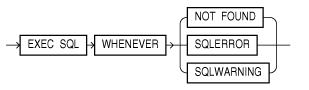
[Description of the illustration first.eps](img_text/first.md)

According to the diagram, all of the following statements are valid:

    EXEC SQL WHENEVER NOT FOUND ...
    EXEC SQL WHENEVER SQLERROR ...
    EXEC SQL WHENEVER SQLWARNING ...

#### E.3.1 Required Keywords and Parameters

Required keywords and parameters can appear singly or in a vertical list of alternatives. Single required keywords and parameters appear on the main path, that is, on the horizontal line you are currently traveling. In the following example, cursor is a required parameter:

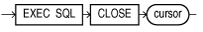
[Description of the illustration reqp.eps](img_text/reqp.md)

If there is a cursor named emp_cursor, then, according to the diagram, the following statement is valid:

    EXEC SQL CLOSE emp_cursor;

If any of the keywords or parameters in a vertical list appears on the main path, one of them is required. That is, you must choose one of the keywords or parameters, but not necessarily the one that appears on the main path. In the following example, you must choose one of the four actions:

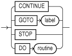
[Description of the illustration reqp1.eps](img_text/reqp1.md)

#### E.3.2 Optional Keywords and Parameters

If keywords and parameters appear in a vertical list in the main path, they are optional. In the following example, AT :db_name and WORK are optional:

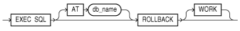
[Description of the illustration optional.eps](img_text/optional.md)

If there is a database named oracle2, then, according to the diagram, all of the following statements are valid:

    EXEC SQL ROLLBACK;
    EXEC SQL ROLLBACK WORK;
    EXEC SQL AT oracle2 ROLLBACK;

#### E.3.3 Syntax Loops

Loops let you repeat the syntax within them as many times as you like. In the following example, column_name is inside a loop. So, after choosing one column name, you can go back repeatedly to choose another, separating the column names by a comma.

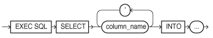
[Description of the illustration syntax.eps](img_text/syntax.md)

If DEBIT, CREDIT, and BALANCE are column names, then, according to the diagram, all of the following statements are valid:

    EXEC SQL SELECT DEBIT INTO ...
    EXEC SQL SELECT CREDIT, BALANCE INTO ...
    EXEC SQL SELECT DEBIT, CREDIT, BALANCE INTO ...

#### E.3.4 Multipart Diagrams

Read a multipart diagram as if all the main paths were joined end-to-end. The following example is a two-part diagram:

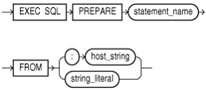
[Description of the illustration part.eps](img_text/part.md)

According to the diagram, the following statement is valid:

    EXEC SQL PREPARE statement_name FROM string_literal;

#### E.3.5 Oracle Names

The names of Oracle database objects, such as tables and columns, must not exceed 30 characters in length. The first character must be a letter, but the rest can be any combination of letters, numerals, dollar signs (\$), pound signs (#), and underscores (\_).

However, if a name is enclosed by quotation marks ("), it can contain any combination of legal characters, including spaces but excluding quotation marks.

Oracle names are not case-sensitive except when enclosed by quotation marks.

#### E.3.6 Statement Terminator

In all embedded SQL diagrams, each statement is understood to end with the statement terminator ";".

### E.4 ALLOCATE (Executable Embedded SQL Extension)

#### Purpose

To allocate a cursor variable to be referenced in a PL/SQL block, or to allocate space in the object cache.

#### Prerequisites

A cursor variable of type `sql_cursor` must be declared before allocating memory for the cursor variable.

Pointers to a host struct and, optionally, an indicator struct must be declared before allocating memory in the object cache.

An active connection to a database is required.

#### Syntax

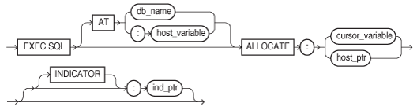
[Description of the illustration allocat.eps](img_text/allocat.md)

#### Keywords and Parameters

| Keywords and Parameters | Description                                                                                                                                                                                                         |
|:------------------------|:--------------------------------------------------------------------------------------------------------------------------------------------------------------------------------------------------------------------|
| db_name                 | A null-terminated string containing the database connection name, as established previously in a CONNECT statement. If it is omitted, or if it is an empty string, the default database connection is assumed.      |
| host_variable           | A host variable containing the name of the database connection.                                                                                                                                                     |
| cursor_variable         | A cursor variable to be allocated.                                                                                                                                                                                  |
| host_ptr                | A pointer to a host struct generated by OTT for object types, a context variable of type `sql_context`, a ROWID variable of type pointer to `OCIRowid, `or a LOB locator variable corresponding to the type of LOB. |
| ind_ptr                 | An optional pointer to an indicator struct.                                                                                                                                                                         |

#### Usage Notes

While a cursor is static, a cursor variable is dynamic because it is not tied to a specific query. You can open a cursor variable for any type-compatible query.

#### Example

This partial example illustrates the use of the ALLOCATE statement in a Pro\*C/C++ program:

    EXEC SQL BEGIN DECLARE SECTION;
       SQL_CURSOR emp_cv;
       struct{ ... } emp_rec;
    EXEC SQL END DECLARE SECTION;
    EXEC SQL ALLOCATE :emp_cv;
    EXEC SQL EXECUTE
       BEGIN
          OPEN :emp_cv FOR SELECT * FROM emp;
       END;
    END-EXEC;
    for (;;)
       {
       EXEC SQL FETCH :emp_cv INTO :emp_rec;
       ...
       }

#### Related Topics

CACHE FREE ALL (Executable Embedded SQL Extension).

CLOSE (Executable Embedded SQL) .

EXECUTE (Executable Embedded SQL) .

FETCH (Executable Embedded SQL) .

FETCH DESCRIPTOR (Executable Embedded SQL) .

FREE (Executable Embedded SQL Extension).

### E.5 ALLOCATE DESCRIPTOR (Executable Embedded SQL)

#### Purpose

An ANSI dynamic SQL statement that allocates a descriptor.

#### Prerequisites

None.

#### Syntax

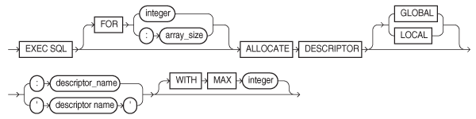
[Description of the illustration alldesc.eps](img_text/alldesc.md)

#### Keywords and Parameters

| Keywords and Parameters            | Description                                                                                |
|:-----------------------------------|:-------------------------------------------------------------------------------------------|
| array_size integer              | Host variable containing number of rows to be processed. Number of rows to be processed |
| descriptor_name descriptor name | Host variable containing the name of the ANSI descriptor. Name of the ANSI descriptor.  |
| GLOBAL \| LOCAL                    | LOCAL (the default) means file scope, as opposed to GLOBAL, which means application scope. |
| WITH MAX integer                   | Maximum number of host variables. The default is 100.                                      |

#### Usage Notes

Use DYNAMIC=ANSI precompiler option. For information on using this statement, see "[ALLOCATE DESCRIPTOR](ANSI-dynamic-SQL.md)".

#### Example

    EXEC SQL FOR :batch ALLOCATE DESCRIPTOR GLOBAL :binddes WITH MAX 25 ;

#### Related Topics

DESCRIBE DESCRIPTOR (Executable Embedded SQL) .

DEALLOCATE DESCRIPTOR (Embedded SQL Statement)

GET DESCRIPTOR (Executable Embedded SQL).

SET DESCRIPTOR (Executable Embedded SQL).

### E.6 CACHE FREE ALL (Executable Embedded SQL Extension)

#### Purpose

To free all memory in the object cache.

#### Prerequisites

An active database connection must exist.

#### Syntax

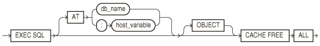
[Description of the illustration cache.eps](img_text/cache.md)

#### Keywords and Parameters

| Keywords and Parameters | Description                                                                                                                                                                                                    |
|:------------------------|:---------------------------------------------------------------------------------------------------------------------------------------------------------------------------------------------------------------|
| db_name                 | A null-terminated string containing the database connection name, as established previously in a CONNECT statement. If it is omitted, or if it is an empty string, the default database connection is assumed. |
| host_variable           | A host variable containing the name of the database connection.                                                                                                                                                |

#### Usage Notes

When the connection count drops to zero, SQLLIB automatically frees all object cache memory. For more information, see "[CACHE FREE ALL](about-Objects.md)".

#### Example

    EXEC SQL AT mydb CACHE FREE ALL ;

#### Related Topics

ALLOCATE (Executable Embedded SQL Extension).

FREE (Executable Embedded SQL Extension).

### E.7 CALL (Executable Embedded SQL)

#### Purpose

To call a stored procedure.

#### Prerequisites

An active database connection must exist.

#### Syntax

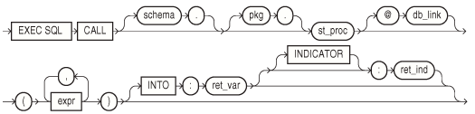
[Description of the illustration call.eps](img_text/call.md)

#### Keywords and Parameters

| Keywords and Parameters | Description                                                                                                                                                                                                               |
|:------------------------|:--------------------------------------------------------------------------------------------------------------------------------------------------------------------------------------------------------------------------|
| schema                  | Is the schema containing the procedure. If you omit schema, Oracle assumes the procedure is in your own schema.                                                                                                           |
| pkg                     | The package where the procedure is stored.                                                                                                                                                                                |
| st_proc                 | The stored procedure to be called.                                                                                                                                                                                        |
| db_link                 | The complete or partial name of a database link to a remote database where the procedure is located. For information on referring to database links, see the [Oracle Database SQL Language Reference](../sqlrf/index.md). |
| expr                    | The list of expressions that are the parameters of the procedure.                                                                                                                                                         |
| ret_var                 | The host variable that receives the returned value of a function.                                                                                                                                                         |
| ret_ind                 | The indicator variable for ret_var.                                                                                                                                                                                       |

#### Usage Notes

For more about this statement, see "[About Calling a Stored PL/SQL or Java Subprogram](embedded-PL-SQL.md)".

#### Example

    int emp_no;
    char emp_name[10];
    float salary;
    char dept_name[20];
    ...
    emp_no = 1325;
    EXEC SQL CALL get_sal(:emp_no, :emp_name, :salary) INTO :dept_name ;
    /* Print emp_name, salary, dept_name */
    ...

#### Related Topics

None

### E.8 CLOSE (Executable Embedded SQL)

#### Purpose

To disable a cursor, freeing the resources acquired by opening the cursor, and releasing parse locks.

#### Prerequisites

The cursor or cursor variable be open if MODE=ANSI.

#### Syntax

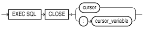
[Description of the illustration close.eps](img_text/close.md)

#### Keywords and Parameters

| Keywords and Parameters | Description                     |
|:------------------------|:--------------------------------|
| cursor                  | A cursor to be closed.          |
| cursor_variable         | A cursor variable to be closed. |

#### Usage Notes

Rows cannot be fetched from a closed cursor. A cursor need not be closed to be reopened. The HOLD_CURSOR and RELEASE_CURSOR precompiler options alter the effect of the CLOSE statement. For information on these options, see [Precompiler Options](precompiler-options.md).

#### Example

This example illustrates the use of the CLOSE statement:

    EXEC SQL CLOSE emp_cursor;

#### Related Topics

PREPARE (Executable Embedded SQL).

DECLARE CURSOR (Embedded SQL Directive).

OPEN (Executable Embedded SQL) .

### E.9 COLLECTION APPEND (Executable Embedded SQL Extension)

#### Purpose

To append elements of one collection to the end of another collection.

#### Prerequisites

You cannot append to a NULL collection, or append beyond the upper bound of a collection.

#### Syntax

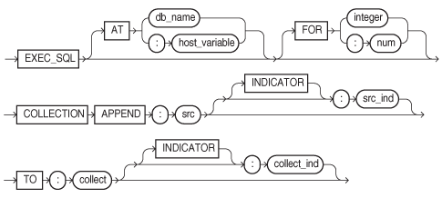
[Description of the illustration collapp.eps](img_text/collapp.md)

#### Usage Notes

For usage notes as well as keywords, parameters, and examples, see "[COLLECTION APPEND](about-Collections.md)".

#### Related Topics

See the other COLLECTION statements.

### E.10 COLLECTION DESCRIBE (Executable Embedded SQL Extension)

#### Purpose

To obtain information about a collection.

#### Prerequisites

Use the ALLOCATE and OBJECT GET statements to allocate a descriptor and to store collection attributes in the descriptor.

#### Syntax

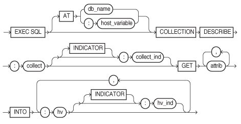
[Description of the illustration colldes.eps](img_text/colldes.md)

where `attrib` is:

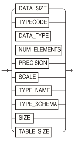
[Description of the illustration collatt.eps](img_text/collatt.md)

#### Usage Notes

For usage notes as well as keywords, parameters, and examples, see "[COLLECTION DESCRIBE](about-Collections.md)".

#### Related Topics

See the other COLLECTION statements.

### E.11 COLLECTION GET (Executable Embedded SQL Extension)

#### Purpose

To retrieve the elements of a collection.

#### Syntax

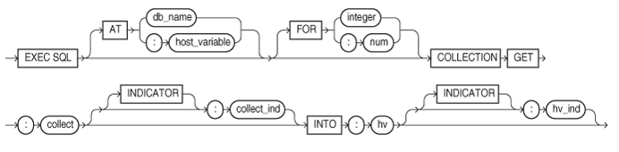
[Description of the illustration collget.eps](img_text/collget.md)

#### Usage Notes

For usage notes as well as keywords, parameters, and examples, see "[Collection Statements](about-Collections.md)".

#### Related Topics

See the other COLLECTION statements.

### E.12 COLLECTION RESET (Executable Embedded SQL Extension)

#### Purpose

To reset the collection slice endpoints back to the beginning of the collection.

#### Syntax

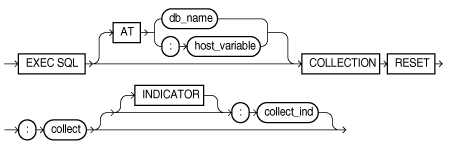
[Description of the illustration collres.eps](img_text/collres.md)

#### Usage Notes

For usage notes as well as keywords, parameters, and examples, see "[COLLECTION RESET](about-Collections.md)".

#### Related Topics

See the other COLLECTION statements.

### E.13 COLLECTION SET (Executable Embedded SQL Extension)

#### Purpose

To update element values in the current slice of a collection.

#### Syntax

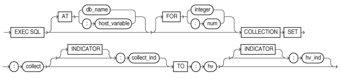
[Description of the illustration collset.eps](img_text/collset.md)

#### Usage Notes

For usage notes as well as keywords, parameters, and examples, see "[COLLECTION SET](about-Collections.md)".

#### Related Topics

See the other COLLECTION statements.

### E.14 COLLECTION TRIM (Executable Embedded SQL Extension)

#### Purpose

To remove elements from the end of collection.

#### Syntax

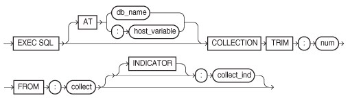
[Description of the illustration colltr.eps](img_text/colltr.md)

#### Usage Notes

For usage notes as well as keywords, parameters, and examples, see "[COLLECTION TRIM](about-Collections.md)".

#### Related Topics

See the other COLLECTION statements.

### E.15 COMMIT (Executable Embedded SQL)

#### Purpose

To end your current transaction, making permanent all its changes to the database and optionally freeing all resources and disconnecting.

#### Prerequisites

To commit your current transaction, no privileges are necessary.

To manually commit a distributed in-doubt transaction that you originally committed, you must have FORCE TRANSACTION system privilege. To manually commit a distributed in-doubt transaction that was originally committed by another user, you must have FORCE ANY TRANSACTION system privilege.

#### Syntax

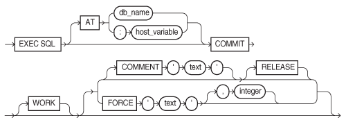
[Description of the illustration commit.eps](img_text/commit.md)

#### Keywords and Parameters

| Keywords and Parameters | Description                                                                                                                                                                                                                                                                                                                                                                                                                  |
|:------------------------|:-----------------------------------------------------------------------------------------------------------------------------------------------------------------------------------------------------------------------------------------------------------------------------------------------------------------------------------------------------------------------------------------------------------------------------|
| AT                      | Identifies the database to which the COMMIT statement is issued. The database can be identified by either: db_name: is a database identifier declared in a previous DECLARE DATABASE statement. host_variable: is a host variable whose value is a db_name. If you omit this clause, Oracle issues the statement to your default database.                                                                             |
| WORK                    | Is supported only for compliance with standard SQL. The statements COMMIT and COMMIT WORK are equivalent.                                                                                                                                                                                                                                                                                                                    |
| COMMENT                 | Specifies a Comment to be associated with the current transaction. The 'text' is a quoted literal of up to 50 characters that Oracle stores in the data dictionary view DBA_2PC_PENDING along with the transaction ID if the transaction becomes in-doubt.                                                                                                                                                                   |
| RELEASE                 | Frees all resources and disconnects the application from the server.                                                                                                                                                                                                                                                                                                                                                         |
| FORCE                   | Manually commits an in-doubt distributed transaction. The transaction is identified by the 'text' containing its local or global transaction ID. To find the IDs of such transactions, query the data dictionary view DBA_2PC_PENDING. You can also use the optional integer to explicitly assign the transaction a system change number (SCN). If you omit the integer, the transaction is committed using the current SCN. |

#### Usage Notes

Always explicitly commit or rollback the last transaction in your program by using the COMMIT or ROLLBACK statement and the RELEASE option. Oracle automatically rolls back changes if the program terminates abnormally.

The COMMIT statement has no effect on host variables or on the flow of control in the program. For more information on this statement, see [Database Concepts](database-concepts.md).

#### Example

This example illustrates the use of the embedded SQL COMMIT statement:

    EXEC SQL AT sales_db COMMIT RELEASE;

#### Related Topics

ROLLBACK (Executable Embedded SQL) .

SAVEPOINT (Executable Embedded SQL) .

### E.16 CONNECT (Executable Embedded SQL Extension)

#### Purpose

To log on to a database.

#### Prerequisites

You must have CREATE SESSION system privilege in the specified database.

#### Syntax

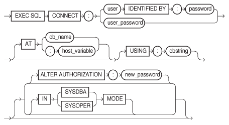
[Description of the illustration connect.eps](img_text/connect.md)

#### Keywords and Parameters

| Keywords and Parameters           | Description                                                                                                                                                                                                                                                                                                                              |
|:----------------------------------|:-----------------------------------------------------------------------------------------------------------------------------------------------------------------------------------------------------------------------------------------------------------------------------------------------------------------------------------------|
| user password                     | Specifies your username and password separately.                                                                                                                                                                                                                                                                                         |
| user_password                     | A single host variable containing the username and password separated by a slash (/). To allow Oracle to verify your connection through your operating system, specify "/" as the :user_password value.                                                                                                                               |
| AT                                | Identifies the database to which the connection is made. The database can be identified by either: db_name: is a database identifier declared in a previous DECLARE DATABASE statement. host_variable: is a host variable whose value is a db_name. If you omit this clause, Oracle issues the statement to your default database. |
| USING                             | Uses the Oracle Net database specification string used to connect to a nondefault database. If you omit this clause, you are connected to your default database.                                                                                                                                                                         |
| ALTER AUTHORIZATION               | Change password to the following string.                                                                                                                                                                                                                                                                                                 |
| new_password                      | The new password.                                                                                                                                                                                                                                                                                                                        |
| IN SYSDBA MODE IN SYSOPER MODE | Connect with SYSDBA or SYSOPER system privileges. Not allowed when ALTER AUTHORIZATION is used, or precompiler option AUTO_CONNECT is set to YES.                                                                                                                                                                                        |

#### Usage Notes

A program can have multiple connections, but can only connect once to your default database. For more information on this statement, see "[Embedded OCI Release 7 Calls](advanced-topics.md) ".

#### Example

The following example illustrate the use of CONNECT:

    EXEC SQL CONNECT :username
        IDENTIFIED BY :password ;

You can also use this statement in which the value of userid is the value of username and the value of password separated by a "/", such as 'SCOTT/TIGER':

    EXEC SQL CONNECT :userid ;

#### Related Topics

COMMIT (Executable Embedded SQL) .

DECLARE DATABASE (Oracle Embedded SQL Directive).

ROLLBACK (Executable Embedded SQL) .

### E.17 CONTEXT ALLOCATE (Executable Embedded SQL Extension)

#### Purpose

To initialize a SQLLIB runtime context that is referenced in an EXEC SQL CONTEXT USE statement.

#### Prerequisites

The runtime context must be declared of type `sql_context`.

#### Syntax

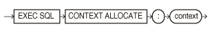
[Description of the illustration conall.eps](img_text/conall.md)

#### Keyword and Parameters

| Keywords and Parameters | Description                                                        |
|:------------------------|:-------------------------------------------------------------------|
| context                 | Is the SQLLIB runtime context for which memory is to be allocated. |

#### Usage Notes

In a multithreaded application, execute this function once for each runtime context.

For more information on this statement, see "[SQLLIB Extensions for OCI Release 8 Interoperability](advanced-topics.md)".

#### Example

This example illustrates the use of a CONTEXT ALLOCATE statement in a Pro\*C/C++ program:

    EXEC SQL CONTEXT ALLOCATE :ctx1;

#### Related Topics

CONTEXT FREE (Executable Embedded SQL Extension).

CONTEXT USE (Oracle Embedded SQL Directive).

ENABLE THREADS (Executable Embedded SQL Extension).

### E.18 CONTEXT FREE (Executable Embedded SQL Extension)

#### Purpose

To free all memory associated with a runtime context and place a null pointer in the host program variable.

#### Prerequisites

The CONTEXT ALLOCATE statement must be used to allocate memory for the specified runtime context before the CONTEXT FREE statement can free the memory allocated for it.

#### Syntax

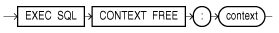
[Description of the illustration confree.eps](img_text/confree.md)

#### Keyword and Parameter

| Keyword and Parameter | Description                                                              |
|:----------------------|:-------------------------------------------------------------------------|
| :context              | The allocated runtime context for which the memory is to be deallocated. |

#### Usage Notes

For more information on this statement, see "[SQLLIB Extensions for OCI Release 8 Interoperability](advanced-topics.md)".

#### Example

This example illustrates the use of a CONTEXT FREE statement in a Pro\*C/C++ program:

    EXEC SQL CONTEXT FREE :ctx1;

#### Related Topics

CONTEXT ALLOCATE (Executable Embedded SQL Extension).

CONTEXT USE (Oracle Embedded SQL Directive).

ENABLE THREADS (Executable Embedded SQL Extension).

### E.19 CONTEXT OBJECT OPTION GET (Executable Embedded SQL Extension)

#### Purpose

To determine the values of options set by CONTEXT OBJECT OPTION SET for the context in use.

#### Prerequisites

Precompiler option OBJECTS must be set to YES.

#### Syntax

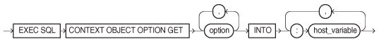
[Description of the illustration conobget.eps](img_text/conobget.md)

#### Keywords and Parameters

| Keywords and Parameters | Description                                                                              |
|:------------------------|:-----------------------------------------------------------------------------------------|
| option                  | Option values are described in [CONTEXT OBJECT OPTION SET](about-Objects.md).            |
| host_variable           | Output variable of type STRING, VARCHAR, or CHARZ, in the same order as the option list. |

#### Usage Notes

See "[CONTEXT OBJECT OPTION SET](about-Objects.md)".

#### Example

    char EuroFormat[50];
    ...
    EXEC SQL CONTEXT OBJECT OPTION GET DATEFORMAT INTO :EuroFormat ;
    printf("Date format is %s\n", EuroFormat);

#### Related Topics

CONTEXT ALLOCATE (Executable Embedded SQL Extension).

CONTEXT FREE (Executable Embedded SQL Extension).

CONTEXT OBJECT OPTION SET (Executable Embedded SQL Ext) .

CONTEXT USE (Oracle Embedded SQL Directive).

### E.20 CONTEXT OBJECT OPTION SET (Executable Embedded SQL Ext)

#### Purpose

To set options to specified values of Date attributes: DATEFORMAT, DATELANG for the context in use.

#### Prerequisites

Precompiler option OBJECTS must be set to YES.

#### Syntax

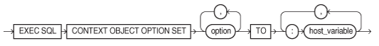
[Description of the illustration conobset.eps](img_text/conobset.md)

#### Keywords and Parameters

| Keywords and Parameters | Description                                                                             |
|:------------------------|:----------------------------------------------------------------------------------------|
| option                  | Option values are described in [CONTEXT OBJECT OPTION SET](about-Objects.md).           |
| host_variable           | Input variable of type STRING, VARCHAR, or CHARZ. In the same order as the option list. |

#### Usage Notes

See "[CONTEXT OBJECT OPTION GET](about-Objects.md)".

#### Example

    char *new_format = "DD-MM-YYY";
    char *new_lang = "French";
    ...
    EXEC SQL CONTEXT OBJECT OPTION SET DATEFORMAT, DATELANG TO :new_format, :new_lang;

#### Related Topics

CONTEXT ALLOCATE (Executable Embedded SQL Extension).

CONTEXT FREE (Executable Embedded SQL Extension).

CONTEXT USE (Oracle Embedded SQL Directive).

CONTEXT OBJECT OPTION SET (Executable Embedded SQL Ext) .

### E.21 CONTEXT USE (Oracle Embedded SQL Directive)

#### Purpose

To instruct the precompiler to use the specified SQLLIB runtime context on subsequent executable SQL statements.

#### Prerequisites

The runtime context specified by the CONTEXT USE directive must be previously declared.

#### Syntax

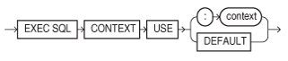
[Description of the illustration conuse.eps](img_text/conuse.md)

#### Keywords and Parameters

| Keywords and Parameters | Description                                                                                                                                                                                                                                                                                                                                                                                     |
|:------------------------|:------------------------------------------------------------------------------------------------------------------------------------------------------------------------------------------------------------------------------------------------------------------------------------------------------------------------------------------------------------------------------------------------|
| context                 | The allocated runtime context to use for subsequent executable SQL statements that follow it. For example, after specifying in your source code which context to use (multiple contexts can be allocated), you can connect to the Oracle Server and perform database operations within the scope of that context. DEFAULT indicates that the global context that you worked with is to be used. |
| DEFAULT                 | Indicates that the global context is to be used.                                                                                                                                                                                                                                                                                                                                                |

#### Usage Notes

This statement has no effect on declarative statements such as EXEC SQL INCLUDE or EXEC ORACLE OPTION. It works similarly to the EXEC SQL WHENEVER directive in that it affects all executable SQL statements which positionally follow it in a given source file without regard to standard C scope rules.

For more information on this statement, see "[SQLLIB Extensions for OCI Release 8 Interoperability](advanced-topics.md)".

#### Example

This example illustrates the use of a CONTEXT USE directive in a Pro\*C/C++ embedded SQL program:

    EXEC SQL CONTEXT USE :ctx1;

#### Related Topics

CONTEXT ALLOCATE (Executable Embedded SQL Extension).

CONTEXT FREE (Executable Embedded SQL Extension).

ENABLE THREADS (Executable Embedded SQL Extension).

### E.22 DEALLOCATE DESCRIPTOR (Embedded SQL Statement)

#### Purpose

An ANSI dynamic SQL statement that deallocates a descriptor area to free memory.

#### Prerequisites

The descriptor specified by the DEALLOCATE DESCRIPTOR statement must be previously allocated using the ALLOCATE DESCRIPTOR statement.

#### Syntax

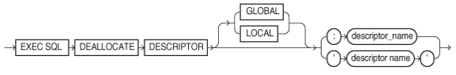
[Description of the illustration dealdesc.eps](img_text/dealdesc.md)

#### Keywords and Parameters

| Keywords and Parameters              | Description                                                                                                   |
|:-------------------------------------|:--------------------------------------------------------------------------------------------------------------|
| GLOBAL \| LOCAL                      | LOCAL (the default) means file scope, as opposed to GLOBAL, which means application scope.                    |
| descriptor_name 'descriptor name' | Host variable containing the name of the allocated ANSI descriptor. Name of the allocated ANSI descriptor. |

#### Usage Notes

Use DYNAMIC=ANSI precompiler option.

For more information on this statement, see "[DEALLOCATE DESCRIPTOR](ANSI-dynamic-SQL.md)".

#### Example

    EXEC SQL DEALLOCATE DESCRIPTOR GLOBAL 'SELDES' ;

#### Related Topics

ALLOCATE DESCRIPTOR (Executable Embedded SQL).

DESCRIBE (Executable Embedded SQL Extension) .

GET DESCRIPTOR (Executable Embedded SQL).

PREPARE (Executable Embedded SQL).

SET DESCRIPTOR (Executable Embedded SQL).

### E.23 DECLARE CURSOR (Embedded SQL Directive)

#### Purpose

To declare a cursor, giving it a name and associating it with a SQL statement or a PL/SQL block.

#### Prerequisites

If you associate the cursor with an identifier for a SQL statement or PL/SQL block, you must have declared this identifier in a previous DECLARE STATEMENT statement.

#### Syntax

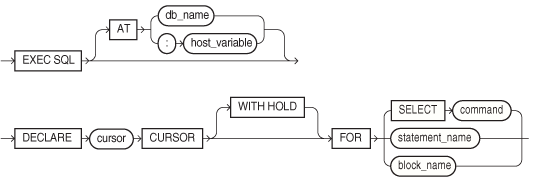
[Description of the illustration appedclco1.eps](img_text/appedclco1.md)

#### Keywords and Parameters

| Keywords and Parameters | Description                                                                                                                                                                 |
|:------------------------|:----------------------------------------------------------------------------------------------------------------------------------------------------------------------------|
| AT                      | Identifies the database on which the cursor is declared. The database can be identified by either:                                                                          |
| db_name                 | Database identifier declared in a previous DECLARE DATABASE statement.                                                                                                      |
| host_variable           | Host variable whose value is a previously declared db_name. If you omit this clause, Oracle declares the cursor on your default database.                                |
| cursor                  | Name of the cursor to be declared.                                                                                                                                          |
| WITH HOLD               | Cursor remains open after a COMMIT. The cursor must not be declared for UPDATE.                                                                                             |
| SELECT statement        | Is a SELECT statement to be associated with the cursor. The following statement cannot contain an INTO clause.                                                              |
| statement_name          | Identifies a SQL statement or PL/SQL block to be associated with the cursor. The statement_name or block_name must be previously declared in a DECLARE STATEMENT statement. |

#### Usage Notes

You must declare a cursor before referencing it in other embedded SQL statements. The scope of a cursor declaration is global within its precompilation unit and the name of each cursor must be unique in its scope. You cannot declare two cursors with the same name in a single precompilation unit.

You can reference the cursor in the WHERE clause of an UPDATE or DELETE statement using the CURRENT OF syntax if the cursor has been opened with an OPEN statement and positioned on a row with a FETCH statement. For more information on this statement, see "[Cursor Usage in Embedded PL/SQL](embedded-PL-SQL.md)".

#### Example

This example illustrates the use of a DECLARE CURSOR statement:

    EXEC SQL DECLARE emp_cursor CURSOR
        FOR SELECT ename, empno, job, sal
            FROM emp
            WHERE deptno = :deptno
            FOR UPDATE OF sal;

#### Related Topics

CLOSE (Executable Embedded SQL) .

DECLARE DATABASE (Oracle Embedded SQL Directive).

DECLARE STATEMENT (Embedded SQL Directive) .

DELETE (Executable Embedded SQL) .

FETCH (Executable Embedded SQL) .

OPEN DESCRIPTOR (Executable Embedded SQL) .

PREPARE (Executable Embedded SQL).

SELECT (Executable Embedded SQL).

UPDATE (Executable Embedded SQL) .

### E.24 DECLARE DATABASE (Oracle Embedded SQL Directive)

#### Purpose

To declare an identifier for a nondefault database to be accessed in subsequent embedded SQL statements.

#### Prerequisites

You must have access to a username on the nondefaultnondefault database.

#### Syntax

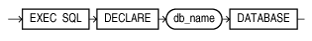
[Description of the illustration dcldbase.eps](img_text/dcldbase.md)

#### Keywords and Parameters

| Keyword and Parameter | Description                                                |
|:----------------------|:-----------------------------------------------------------|
| db_name               | Is the identifier established for the nondefault database. |

#### Usage Notes

You declare a db_name for a nondefault database so that other embedded SQL statements can refer to that database using the AT clause. Before issuing a CONNECT statement with an AT clause, you must declare a db_name for the nondefault database with a DECLARE DATABASE statement.

For more information on this statement, see "[Single Explicit Connection](database-concepts.md) ".

#### Example

This example illustrates the use of a DECLARE DATABASE directive:

    EXEC SQL DECLARE oracle3 DATABASE ;

#### Related Topics

COMMIT (Executable Embedded SQL) .

CONNECT (Executable Embedded SQL Extension) .

DECLARE CURSOR (Embedded SQL Directive).

DECLARE STATEMENT (Embedded SQL Directive) .

DELETE (Executable Embedded SQL) .

EXECUTE ... END-EXEC (Executable Embedded SQL Extension) .

EXECUTE IMMEDIATE (Executable Embedded SQL).

INSERT (Executable Embedded SQL) .

SELECT (Executable Embedded SQL).

UPDATE (Executable Embedded SQL) .

### E.25 DECLARE STATEMENT (Embedded SQL Directive)

#### Purpose

To declare an identifier for a SQL statement or PL/SQL block to be used in other embedded SQL statements.

#### Prerequisites

None.

#### Syntax

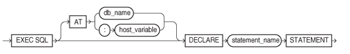
[Description of the illustration dcl_stmt.eps](img_text/dcl_stmt.md)

#### Keywords and Parameters

| Keywords and Parameters | Description                                                                                                                                                                                                                                                                                                                                                                           |
|:------------------------|:--------------------------------------------------------------------------------------------------------------------------------------------------------------------------------------------------------------------------------------------------------------------------------------------------------------------------------------------------------------------------------------|
| AT                      | Identifies the database on which the SQL statement or PL/SQL block is declared. The database can be identified by either: db_name: Is a database identifier declared in a previous DECLARE DATABASE statement. host_variable: Is a host variable whose value is a db_name. If you omit this clause, Oracle declares the SQL statement or PL/SQL block to your default database. |
| statement_name          | Is the declared identifier for the statement.                                                                                                                                                                                                                                                                                                                                         |

#### Usage Notes

You must declare an identifier for a SQL statement or PL/SQL block with a DECLARE STATEMENT statement only if a DECLARE CURSOR statement referencing the identifier appears physically (not logically) in the embedded SQL program before the PREPARE statement that parses the statement or block and associates it with its identifier.

The scope of a statement declaration is global within its precompilation unit, like a cursor declaration. For more information on this statement, see [Datatypes and Host Variables](datatypes-and-host-variables.md) and [Oracle Dynamic SQL](Oracle-dynamic-SQL.md).

#### Example I

This example illustrates the use of the DECLARE STATEMENT statement:

    EXEC SQL AT remote_db DECLARE my_statement STATEMENT;
    EXEC SQL PREPARE my_statement FROM :my_string;
    EXEC SQL EXECUTE my_statement;

#### Example II

In this example from a Pro\*C/C++ embedded SQL program, the DECLARE STATEMENT statement is required because the DECLARE CURSOR statement precedes the PREPARE statement:

    EXEC SQL DECLARE my_statement STATEMENT;
    EXEC SQL DECLARE emp_cursor CURSOR FOR my_statement;
    EXEC SQL PREPARE my_statement FROM :my_string;
    ...

#### Related Topics

CLOSE (Executable Embedded SQL) .

DECLARE DATABASE (Oracle Embedded SQL Directive).

FETCH (Executable Embedded SQL) .

OPEN DESCRIPTOR (Executable Embedded SQL) .

PREPARE (Executable Embedded SQL).

### E.26 DECLARE TABLE (Oracle Embedded SQL Directive)

#### Purpose

To define the structure of a table or view, including each column's datatype, default value, and NULL or NOT NULL specification for semantic checking by the Oracle Precompilers.

#### Prerequisites

None.

#### Syntax

For relational tables, the syntax is:

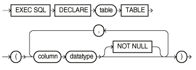
[Description of the illustration dcltab.eps](img_text/dcltab.md)

For object tables, the syntax is:.

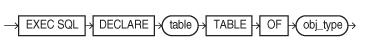
[Description of the illustration dcltabob.eps](img_text/dcltabob.md)

#### Keywords and Parameters

| Keywords and Parameters | Description                                                                                                                                                                                                                                                                                            |
|:------------------------|:-------------------------------------------------------------------------------------------------------------------------------------------------------------------------------------------------------------------------------------------------------------------------------------------------------|
| table                   | Is the name of the declared table.                                                                                                                                                                                                                                                                     |
| column                  | Is a column of the table.                                                                                                                                                                                                                                                                              |
| datatype                | Is the datatype of a column. For information on datatypes, see "[Oracle Datatypes](datatypes-and-host-variables.md) ". If the datatype is a user-defined object, a size may be entered in parentheses. The size cannot be a macro or a complex C expression. The size can be omitted. See examples. |
| NOT NULL                | Specifies that a column cannot contain NULLs.                                                                                                                                                                                                                                                          |
| obj_type                | Is an object type.                                                                                                                                                                                                                                                                                     |

#### Usage Notes

For information on using this statement, see "[About Using DECLARE TABLE](syntactic-and-semantic-checking.md)".

#### Examples

The following statement declares the PARTS table with the PARTNO, BIN, and QTY columns:

    EXEC SQL DECLARE parts TABLE
         (partno NUMBER  NOT NULL,
          bin    NUMBER,
          qty    NUMBER);

Use of an object type:

    EXEC SQL DECLARE person TYPE AS OBJECT (name VARCHAR2(20), age INT);
    EXEC SQL DECLARE odjtab1 TABLE OF person;

#### Related Topics

DECLARE TYPE (Oracle Embedded SQL Directive).

### E.27 DECLARE TYPE (Oracle Embedded SQL Directive)

#### Purpose

To define the attributes of a type for a semantics check by the precompiler.

#### Prerequisites

None.

#### Syntax

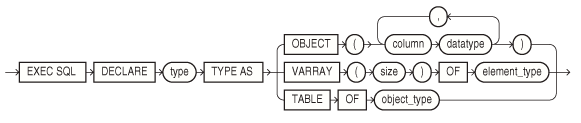
[Description of the illustration dcltype.eps](img_text/dcltype.md)

#### Keywords and Parameters

| Keywords and Parameters | Description                                         |
|:------------------------|:----------------------------------------------------|
| column                  | Name of column.                                     |
| datatype                | The datatype of the column                          |
| size                    | Number of elements in the VARRAY.                   |
| element_type            | Type of element in the VARRAY. It can be an object. |
| object_type             | A previously declared object type.                  |

#### Usage Notes

For information on using this statement, see "[About Using DECLARE TYPE](syntactic-and-semantic-checking.md)".

#### Example

    EXEC SQL DECLARE project_type TYPE AS OBJECT(
                  pno           CHAR(5),
                  pname         CHAR(20),
                  budget        NUMBER);
    EXEC SQL DECLARE project_array TYPE as VARRAY(20) OF project_type ;
    EXEC SQL DECLARE employees TYPE AS TABLE OF emp_objects ;

#### Related Topics

DECLARE TABLE (Oracle Embedded SQL Directive) .

### E.28 DELETE (Executable Embedded SQL)

#### Purpose

To remove rows from a table or from a view's base table.

#### Prerequisites

For you to delete rows from a table, the table must be in your own schema or you must have DELETE privilege on the table.

For you to delete rows from the base table of a view, the owner of the schema containing the view must have DELETE privilege on the base table. Also, if the view is in a schema other than your own, you must be granted DELETE privilege on the view.

The DELETE ANY TABLE system privilege also provides the ability to delete rows from any table or any view's base table.

#### Syntax

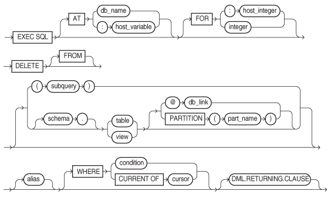
[Description of the illustration delete.eps](img_text/delete.md)

Where the DML returning clause is:

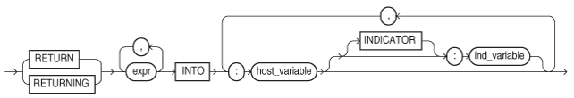
[Description of the illustration return.eps](img_text/return.md)

#### Keywords and Parameters

| Keywords and Parameters | Description                                                                                                                                                                                                                                                                                                                                                          |
|:------------------------|:---------------------------------------------------------------------------------------------------------------------------------------------------------------------------------------------------------------------------------------------------------------------------------------------------------------------------------------------------------------------|
| AT                      | Identifies the database to which the DELETE statement is issued. The database can be identified by either: db_name:a database identifier declared in a previous DECLARE DATABASE statement. host_variable: a host variable whose value is a previously declared db_name.  If you omit this clause, the DELETE statement is issued to your default database. |
| FOR :host_integer       | Limits the number of times the statement is executed if the WHERE clause contains array host variables. If you omit this clause, the database executes the statement once for each component of the smallest array.                                                                                                                                                  |
| subquery                | Is a subquery that returns new values that are assigned to the corresponding columns. For the syntax of a subquery, see [SELECT](../sqlrf/SELECT.md).                                                                                                                                                                                                                |
| schema                  | Is the schema containing the table or view. If you omit schema, the database assumes the table or view is in your own schema.                                                                                                                                                                                                                                        |
| table                   | The name of a table from which the rows are to be deleted.                                                                                                                                                                                                                                                                                                           |
| view                    | The name of a view. the database deletes rows from the view's base table.                                                                                                                                                                                                                                                                                            |
| FOR :host_integer       | Limits the number of times the statement is executed if the WHERE clause contains array host variables. If you omit this clause, the database executes the statement once for each component of the smallest array.                                                                                                                                                  |
| subquery                | Is a subquery that returns new values that are assigned to the corresponding columns. For the syntax of a subquery, see [SELECT](../sqlrf/SELECT.md).                                                                                                                                                                                                                |
| schema                  | Is the schema containing the table or view. If you omit schema, the database assumes the table or view is in your own schema.                                                                                                                                                                                                                                        |
| table                   | The name of a table from which the rows are to be deleted.                                                                                                                                                                                                                                                                                                           |
| view                    | The name of a view. The database deletes rows from the view's base table.                                                                                                                                                                                                                                                                                            |

#### Usage Notes

The host variables in the WHERE clause must be either all scalars or all arrays. If they are scalars, the database executes the DELETE statement only once. If they are arrays, the database executes the statement once for each set of array components. Each execution may delete zero, one, or multiple rows.

Array host variables in the WHERE clause can have different sizes. In this case, the number of times the database executes the statement is determined by the smaller of the following values:

- The size of the smallest array

- The value of the :host_integer in the optional FOR clause

If no rows satisfy the condition, no rows are deleted and the SQLCODE returns a NOT_FOUND condition.

The cumulative number of rows deleted is returned through the SQLCA. If the WHERE clause contains array host variables, this value reflects the total number of rows deleted for all components of the array processed by the DELETE statement.

If no rows satisfy the condition, the database returns an error through the SQLCODE of the SQLCA. If you omit the WHERE clause, the database raises a warning flag in the fifth component of SQLWARN in the SQLCA. For more information on this statement and the SQLCA, see [Handling Runtime Errors](handling-run-time-errors.md).

You can use Comments in a DELETE statement to pass instructions, or hints, to the optimizer. The optimizer uses hints to choose an execution plan for the statement.

#### Example

This example illustrates the use of the DELETE statement within a Pro\*C/C++ embedded SQL program:

    EXEC SQL DELETE FROM emp
        WHERE deptno = :deptno
        AND job = :job;

    EXEC SQL DECLARE emp_cursor CURSOR
        FOR SELECT empno, comm
            FROM emp;
    EXEC SQL OPEN emp_cursor;
    EXEC SQL FETCH c1
        INTO :emp_number, :commission;
    EXEC SQL DELETE FROM emp
        WHERE CURRENT OF emp_cursor;

#### Related Topics

DECLARE DATABASE (Oracle Embedded SQL Directive) .

DECLARE STATEMENT (Embedded SQL Directive) .

### E.29 DESCRIBE (Executable Embedded SQL Extension)

#### Purpose

To populate an Oracle descriptor with information about a dynamic SQL statement or PL/SQL block.

#### Prerequisites

You must have prepared the SQL statement or PL/SQL block in a previous embedded SQL PREPARE statement.

#### Syntax

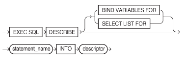
[Description of the illustration describe.eps](img_text/describe.md)

#### Keywords and Parameters

| Keywords and Parameters | Description                                                                                                                    |
|:------------------------|:-------------------------------------------------------------------------------------------------------------------------------|
| BIND VARIABLES FOR      | Initializes the descriptor to hold information about the input variables for the SQL statement or PL/SQL block.                |
| SELECT LIST FOR         | Initializes the descriptor to hold information about the select list of a SELECT statement. The default is SELECT LIST FOR. |
| statement_name          | Identifies a SQL statement or PL/SQL block previously prepared with a PREPARE statement.                                       |
| descriptor              | Is the name of the descriptor to be populated.                                                                                 |

#### Usage Notes

You must issue a DESCRIBE statement before manipulating the bind or select descriptor within an embedded SQL program.

You cannot describe both input variables and output variables into the same descriptor.

The number of variables found by a DESCRIBE statement is the total number of place-holders in the prepare SQL statement or PL/SQL block, rather than the total number of uniquely named place-holders. For more information on this statement, see [Oracle Dynamic SQL](Oracle-dynamic-SQL.md).

#### Example

This example illustrates the use of the DESCRIBE statement in a Pro\*C/C++ embedded SQL program:

    EXEC SQL PREPARE my_statement FROM :my_string;
    EXEC SQL DECLARE emp_cursor
        FOR SELECT empno, ename, sal, comm
                FROM emp
                WHERE deptno = :dept_number;
    EXEC SQL DESCRIBE BIND VARIABLES FOR my_statement
        INTO bind_descriptor;
    EXEC SQL OPEN emp_cursor
        USING bind_descriptor;
    EXEC SQL DESCRIBE SELECT LIST FOR my_statement
        INTO select_descriptor;
    EXEC SQL FETCH emp_cursor
        INTO select_descriptor;

#### Related Topics

PREPARE (Executable Embedded SQL).

### E.30 DESCRIBE DESCRIPTOR (Executable Embedded SQL)

#### Purpose

An ANSI dynamic SQL statement used to obtain information about a SQL statement, and to store it in a descriptor.

#### Prerequisites

You must have prepared the SQL statement in a previous embedded SQL PREPARE statement.

#### Syntax

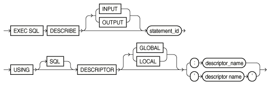
[Description of the illustration descans.eps](img_text/descans.md)

#### Keywords and Parameters

| Keywords and Parameters | Description                                                                                             |
|:------------------------|:--------------------------------------------------------------------------------------------------------|
| statement_id            | The name of the previously prepared SQL statement or PL/SQL block. OUTPUT is the default.               |
| desc_name               | Host variable containing the name of the descriptor that will hold information about the SQL statement. |
| 'descriptor name'       | The name of the descriptor.                                                                             |
| GLOBAL \| LOCAL         | LOCAL (the default) means file scope, as opposed to GLOBAL, which means application scope.              |

#### Usage Notes

Use DYNAMIC=ANSI precompiler option.

Only COUNT and NAME are implemented for the INPUT descriptor.

The number of variables found by a DESCRIBE statement is the total number of place-holders in the prepare SQL statement or PL/SQL block, rather than the total number of uniquely named place-holders. For more information on this statement, see "[DESCRIBE INPUT](ANSI-dynamic-SQL.md)" , and "[DESCRIBE OUTPUT](ANSI-dynamic-SQL.md)".

#### Example

    EXEC SQL PREPARE s FROM :my_stament;
    EXEC SQL DESCRIBE INPUT s USING DESCRIPTOR 'in' ;

#### Related Topics

ALLOCATE DESCRIPTOR (Executable Embedded SQL).

DEALLOCATE DESCRIPTOR (Embedded SQL Statement).

GET DESCRIPTOR (Executable Embedded SQL).

PREPARE (Executable Embedded SQL).

SET DESCRIPTOR (Executable Embedded SQL).

### E.31 ENABLE THREADS (Executable Embedded SQL Extension)

#### Purpose

To initialize a process that supports multiple threads.

#### Prerequisites

You must be developing a precompiler application for and compiling it on a platform that supports multithreaded applications, and THREADS=YES must be specified on the command line.

**Note:**

When using XA with the Pro\*C/C++ Precompiler, you must use multithreaded processing provided by XA. Use of multithreaded processing provided by Pro\*C/C++ using the statement `EXEC SQL ENABLE THREADS` will result in an error.

#### Syntax

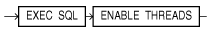
[Description of the illustration enable_t.eps](img_text/enable_t.md)

#### Keywords and Parameters

None.

#### Usage Notes

The ENABLE THREADS statement must be executed before any other executable SQL statement and before spawning any thread. This statement does not require a host-variable specification.

For more information on this statement, see "[SQLLIB Extensions for OCI Release 8 Interoperability](advanced-topics.md)".

#### Example

This example illustrates the use of the ENABLE THREADS statement in a Pro\*C/C++ program:

    EXEC SQL ENABLE THREADS;

#### Related Topics

CONTEXT ALLOCATE (Executable Embedded SQL Extension).

CONTEXT FREE (Executable Embedded SQL Extension).

CONTEXT USE (Oracle Embedded SQL Directive).

### E.32 EXECUTE ... END-EXEC (Executable Embedded SQL Extension)

#### Purpose

To embed an anonymous PL/SQL block into a Pro\*C/C++ program.

#### Prerequisites

None.

#### Syntax

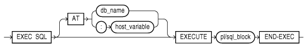
[Description of the illustration execeex.eps](img_text/execeex.md)

#### Keywords and Parameters

| Keywords and Parameters | Description                                                                                                                                                                                                                                                                                                                                                        |
|:------------------------|:-------------------------------------------------------------------------------------------------------------------------------------------------------------------------------------------------------------------------------------------------------------------------------------------------------------------------------------------------------------------|
| AT                      | Identifies the database on which the PL/SQL block is executed. The database can be identified by either: db_name: Is a database identifier declared in a previous DECLARE DATABASE statement. host_variable: Is a host variable whose value is a previously declared db_name. If you omit this clause, the PL/SQL block is executed on your default database |
| pl/sql_block            | For information on PL/SQL, including how to write PL/SQL blocks, see the [Oracle Database PL/SQL Language Reference](../lnpls/index.md).                                                                                                                                                                                                                           |
| END-EXEC                | This keyword must appear after the embedded PL/SQL block, regardless of which programming language your Oracle Precompiler program uses. The keyword END-EXEC must be followed by the C/C++ statement terminator, ";".                                                                                                                                             |

#### Usage Notes

Since the Pro\*C/C++ treats an embedded PL/SQL block like a single embedded SQL statement, you can embed a PL/SQL block anywhere in a program that you can embed a SQL statement. For more information on embedding PL/SQL blocks in Oracle Precompiler programs, see [Embedded PL/SQL](embedded-PL-SQL.md).

#### Example

Placing this EXECUTE statement in a Pro\*C/C++ program embeds a PL/SQL block in the program:

    EXEC SQL EXECUTE
        BEGIN
            SELECT ename, job, sal
                INTO :emp_name:ind_name, :job_title, :salary
                FROM emp
                WHERE empno = :emp_number;
            IF :emp_name:ind_name IS NULL
                THEN RAISE name_missing;
            END IF;
        END;
    END-EXEC;

#### Related Topics

EXECUTE IMMEDIATE (Executable Embedded SQL).

### E.33 EXECUTE (Executable Embedded SQL)

#### Purpose

In Oracle dynamic SQL, to execute a DELETE, INSERT, or UPDATE statement or a PL/SQL block that has been previously prepared with an embedded SQL PREPARE statement. For ANSI Dynamic SQL Method 4 see "EXECUTE DESCRIPTOR (Executable Embedded SQL)".

#### Prerequisites

You must first prepare the SQL statement or PL/SQL block with an embedded SQL PREPARE statement.

#### Syntax

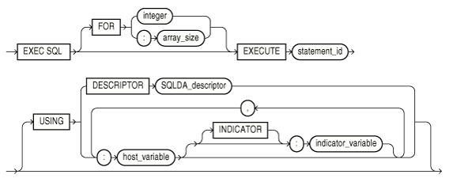
[Description of the illustration execo.eps](img_text/execo.md)

#### Keywords and Parameters

| Keywords and Parameters           | Description                                                                                                                                                                                                                   |
|:----------------------------------|:------------------------------------------------------------------------------------------------------------------------------------------------------------------------------------------------------------------------------|
| FOR :array_size                   | Host variable containing the number of rows to be processed. Number of rows to be processed.                                                                                                                               |
| FOR integer                       | Limits the number of times the statement is executed when the USING clause contains array host variables If you omit this clause, Oracle executes the statement once for each component of the smallest array.                |
| statement_id                      | A precompiler identifier associated with the SQL statement or PL/SQL block to be executed. Use the embedded SQL PREPARE statement to associate the precompiler identifier with the statement or PL/SQL block.                 |
| USING DESCRIPTOR SQLDA_descriptor | Uses an Oracle descriptor. CANNOT be used together with an ANSI descriptor (INTO clause).                                                                                                                                     |
| USING                             | Specifies a list of host variables with optional indicator variables that Oracle substitutes as input variables into the statement to be executed. The host and indicator variables must be either all scalars or all arrays. |
| host_variable                     | Host variables.                                                                                                                                                                                                               |
| indicator_variable                | Indicator variables.                                                                                                                                                                                                          |

#### Usage Notes

For more information on this statement, see [Oracle Dynamic SQL](Oracle-dynamic-SQL.md) for the Oracle version.

#### Example

This example illustrates the use of the EXECUTE statement in a Pro\*C/C++ program:

    EXEC SQL PREPARE my_statement
        FROM :my_string;
    EXEC SQL EXECUTE my_statement
        USING :my_var;

#### Related Topics

DECLARE DATABASE (Oracle Embedded SQL Directive).

PREPARE (Executable Embedded SQL).

### E.34 EXECUTE DESCRIPTOR (Executable Embedded SQL)

#### Purpose

In ANSI SQL Method 4, to execute a DELETE, INSERT, or UPDATE statement or a PL/SQL block that has been previously prepared with an embedded SQL PREPARE statement.

#### Prerequisites

You must first prepare the SQL statement or PL/SQL block with an embedded SQL PREPARE statement.

#### Syntax

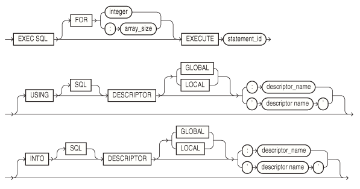
[Description of the illustration execa.eps](img_text/execa.md)

#### Keywords and Parameters

| Keywords and Parameters | Description                                                                                                                                                                                                   |
|:------------------------|:--------------------------------------------------------------------------------------------------------------------------------------------------------------------------------------------------------------|
| FOR :array_size         | Host variable containing the number of rows to be processed. Number of rows to be processed.                                                                                                               |
| FOR integer             | Limits the number of times the statement is executed. Oracle executes the statement once for each component of the smallest array.                                                                            |
| statement_id            | A precompiler identifier associated with the SQL statement or PL/SQL block to be executed. Use the embedded SQL PREPARE statement to associate the precompiler identifier with the statement or PL/SQL block. |
| GLOBAL \| LOCAL         | LOCAL (the default) means file scope, as opposed to GLOBAL, which means application scope.                                                                                                                    |
| USING                   | An ANSI descriptor.                                                                                                                                                                                           |
| descriptor_name         | Host variable containing name of the input descriptor.                                                                                                                                                        |
| 'descriptor name'       | Name of the input descriptor.                                                                                                                                                                                 |
| INTO                    | An ANSI descriptor.                                                                                                                                                                                           |
| descriptor_name         | Host variable containing name of the output descriptor.                                                                                                                                                       |
| 'descriptor name'       | Name of the output descriptor.                                                                                                                                                                                |
| GLOBAL \| LOCAL         | LOCAL (the default) means file scope, as opposed to GLOBAL, which means application scope.                                                                                                                    |

#### Usage Notes

For more information on this statement, see [ANSI Dynamic SQL](ANSI-dynamic-SQL.md).

#### Examples

The ANSI dynamic SQL Method 4 allows DML Returning clauses in a SELECT to be supported by the INTO clause in EXECUTE:

    EXEC SQL EXECUTE S2 USING DESCRIPTOR :bv1 INTO DESCRIPTOR 'SELDES' ;

#### Related Topics

DECLARE DATABASE (Oracle Embedded SQL Directive).

PREPARE (Executable Embedded SQL).

### E.35 EXECUTE IMMEDIATE (Executable Embedded SQL)

#### Purpose

To prepare and execute a DELETE, INSERT, or UPDATE statement or a PL/SQL block containing no host variables.

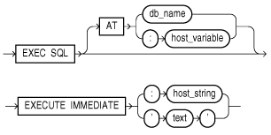
[Description of the illustration execi.eps](img_text/execi.md)

#### Prerequisites

None.

#### Keywords and Parameters

| Keywords and Parameters | Description                                                                                                                                                                                                                                                                                                                                                                                |
|:------------------------|:-------------------------------------------------------------------------------------------------------------------------------------------------------------------------------------------------------------------------------------------------------------------------------------------------------------------------------------------------------------------------------------------|
| AT                      | Identifies the database on which the SQL statement or PL/SQL block is executed. The database can be identified by either: db_name: Is a database identifier declared in a previous DECLARE DATABASE statement. host_variable: Is a host variable whose value is a previously declared db_name. If you omit this clause, the statement or block is executed on your default database. |
| text                    | Is a quoted text literal (or a text literal without quotes) containing the SQL statement or PL/SQL block to be executed. The SQL statement can only be a DELETE, INSERT, or UPDATE statement.                                                                                                                                                                                           |
| host_string             | A host variable containing a SQL statement.                                                                                                                                                                                                                                                                                                                                                |

#### Usage Notes

When you issue an EXECUTE IMMEDIATE statement, Oracle parses the specified SQL statement or PL/SQL block, checking for errors, and executes it. If any errors are encountered, they are returned in the SQLCODE component of the SQLCA.

For more information on this statement, see [Oracle Dynamic SQL](Oracle-dynamic-SQL.md) and [ANSI Dynamic SQL](ANSI-dynamic-SQL.md).

#### Example

This example illustrates the use of the EXECUTE IMMEDIATE statement:

    EXEC SQL EXECUTE IMMEDIATE 'DELETE FROM emp WHERE empno = 9460' ;

#### Related Topics

EXECUTE (Executable Embedded SQL).

PREPARE (Executable Embedded SQL).

### E.36 FETCH (Executable Embedded SQL)

#### Purpose

In Oracle dynamic SQL, to retrieve one or more rows returned by a query, assigning the select list values to host variables. For ANSI Dynamic SQL Method 4 see "FETCH DESCRIPTOR (Executable Embedded SQL) ".

#### Prerequisites

You must first open the cursor with an OPEN statement.

#### Syntax

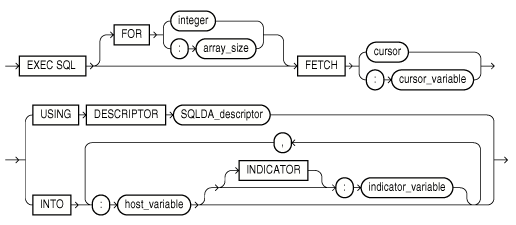
[Description of the illustration fetcho.eps](img_text/fetcho.md)

#### Keywords and Parameters

| Keywords and Parameters | Description                                                                                                                                                                                            |
|:------------------------|:-------------------------------------------------------------------------------------------------------------------------------------------------------------------------------------------------------|
| FOR :array_size         | Host variable containing the number of rows to be processed. Number of rows to be processed.                                                                                                        |
| FOR integer             | Limits the number of rows fetched if you are using array host variables. If you omit this clause, Oracle fetches enough rows to fill the smallest array.                                               |
| cursor                  | A cursor that is declared by a DECLARE CURSOR statement. The FETCH statement returns one of the rows selected by the query associated with the cursor.                                                 |
| cursor_variable         | A cursor variable is allocated an ALLOCATE statement. The FETCH statement returns one of the rows selected by the query associated with the cursor variable.                                           |
| INTO                    | Specifies a list of host variables and optional indicator variables into which data is fetched. These host variables and indicator variables must be declared within the program.                      |
| host_variable           | Host variables to receive data,                                                                                                                                                                        |
| indicator_variables     | Host indicator variables.                                                                                                                                                                              |
| USING SQLDA_variable    | Specifies the Oracle descriptor referenced in a previous DESCRIBE statement. Only use this clause with dynamic embedded SQL, method 4. The USING clause does not apply when a cursor variable is used. |

#### Usage Notes

The FETCH statement reads the rows of the active set and names the output variables which contain the results. Indicator values are set to -1 if their associated host variable is NULL. The first FETCH statement for a cursor also sorts the rows of the active set, if necessary.

The number of rows retrieved is specified by the size of the output host variables and the value specified in the FOR clause. The host variables to receive the data must be either all scalars or all arrays. If they are scalars, Oracle fetches only one row. If they are arrays, Oracle fetches enough rows to fill the arrays.

Array host variables can have different sizes. In this case, the number of rows Oracle fetches is determined by the smaller of the following values:

- The size of the smallest array

- The value of the :array_size in the optional FOR clause

Of course, the number of rows fetched can be further limited by the number of rows that actually satisfy the query.

If a FETCH statement does not retrieve all rows returned by the query, the cursor is positioned on the next returned row. When the last row returned by the query has been retrieved, the next FETCH statement results in an error code returned in the SQLCODE element of the SQLCA.

The FETCH statement does not contain an AT clause. You must specify the database accessed by the cursor in the DECLARE CURSOR statement.

You can only move forward through the active set with FETCH statements. If you want to revisit any of the previously fetched rows, you must reopen the cursor and fetch each row in turn. If you want to change the active set, you must assign new values to the input host variables in the cursor's query and reopen the cursor.

For more information, see "[The FETCH Statement](embedded-SQL.md) " for the Oracle descriptor.

#### Example

This example illustrates the FETCH statement:

    EXEC SQL DECLARE emp_cursor CURSOR FOR
        SELECT job, sal FROM emp WHERE deptno = 30;
    EXEC SQL OPEN emp_cursor;
    ...
    EXEC SQL WHENEVER NOT FOUND GOTO ...
    for(;;)
        {
        EXEC SQL FETCH emp_cursor INTO :job_title1, :salary1;
        ...
        }

#### Related Topics

CLOSE (Executable Embedded SQL) .

DECLARE CURSOR (Embedded SQL Directive).

OPEN (Executable Embedded SQL) .

PREPARE (Executable Embedded SQL).

### E.37 FETCH DESCRIPTOR (Executable Embedded SQL)

#### Purpose

To retrieve one or more rows returned by a query, assigning the select list values to host variables. Used in ANSI Dynamic SQL Method 4.

#### Prerequisites

You must first open the cursor with an the OPEN statement.

#### Syntax

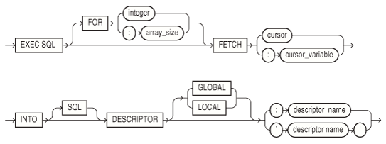
[Description of the illustration fetcha.eps](img_text/fetcha.md)

#### Keywords and Parameters

| Keywords and Parameters              | Description                                                                                                                                                                       |
|:-------------------------------------|:----------------------------------------------------------------------------------------------------------------------------------------------------------------------------------|
| array_size                           | Host variable containing the number of rows to be processed. Number of rows to be processed.                                                                                   |
| integer                              | Limits the number of rows fetched if you are using array host variables. If you omit this clause, Oracle fetches enough rows to fill the smallest array.                          |
| cursor                               | A cursor that has been declared by a DECLARE CURSOR statement. The FETCH statement returns one of the rows selected by the query associated with the cursor.                      |
| cursor_variable                      | A cursor variable is allocated an ALLOCATE statement. The FETCH statement returns one of the rows selected by the query associated with the cursor variable.                      |
| GLOBAL \| LOCAL                      | LOCAL (the default) means file scope, as opposed to GLOBAL, which means application scope.                                                                                        |
| INTO                                 | Specifies a list of host variables and optional indicator variables into which data is fetched. These host variables and indicator variables must be declared within the program. |
| descriptor name' :descriptor_name | Name of the output ANSI descriptor. Host variable containing the name of the output descriptor.                                                                                |

#### Usage Notes

The number of rows retrieved is specified by the size of the output host variables and the value specified in the FOR clause. The host variables to receive the data must be either all scalars or all arrays. If they are scalars, Oracle fetches only one row. If they are arrays, Oracle fetches enough rows to fill the arrays.

Array host variables can have different sizes. In this case, the number of rows Oracle fetches is determined by the smaller of the following values:

- The size of the smallest array.

- The value of the :array_size in the optional FOR clause.

Of course, the number of rows fetched can be further limited by the number of rows that actually satisfy the query.

If a FETCH statement does not retrieve all rows returned by the query, the cursor is positioned on the next returned row. When the last row returned by the query has been retrieved, the next FETCH statement results in an error code returned in the SQLCODE element of the SQLCA.

The FETCH statement does not contain an AT clause. You must specify the database accessed by the cursor in the DECLARE CURSOR statement.

You can only move forward through the active set with FETCH statements. If you want to revisit any of the previously fetched rows, you must reopen the cursor and fetch each row in turn. If you want to change the active set, you must assign new values to the input host variables in the cursor's query and reopen the cursor.

Use DYNAMIC=ANSI precompiler option for the ANSI SQL Method 4 application. For more information, see "[FETCH](ANSI-dynamic-SQL.md)" for the ANSI SQL Method 4 application.

#### Example

    ...
    EXEC SQL ALLOCATE DESCRIPTOR 'output_descriptor' ;
    ...
    EXEC SQL PREPARE S FROM :dyn_statement ;
    EXEC SQL DECLARE mycursor CURSOR FOR S ;
    ...
    EXEC SQL FETCH mycursor INTO DESCRIPTOR 'output_descriptor' ;
    ...

#### Related Topics

CLOSE (Executable Embedded SQL) .

DECLARE CURSOR (Embedded SQL Directive).

OPEN DESCRIPTOR (Executable Embedded SQL) .

PREPARE (Executable Embedded SQL).

### E.38 FREE (Executable Embedded SQL Extension)

#### Purpose

To free memory in the object cache.

#### Prerequisites

The memory has to have been already allocated.

An active database connection must exist.

#### Syntax

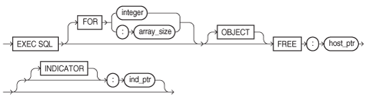
[Description of the illustration free.eps](img_text/free.md)

#### Keywords and Parameters

| Keywords and Parameters | Description                                                                                                                                                                                        |
|:------------------------|:---------------------------------------------------------------------------------------------------------------------------------------------------------------------------------------------------|
| dbname                  | A null-terminated string containing the database connection name, as established previously in a CONNECT statement. If omitted, or if an empty string, the default database connection is assumed. |
| host_ptr                | A host-variable pointer that was previously ALLOCATED.                                                                                                                                             |
| ind_ptr                 | An indicator pointer.                                                                                                                                                                              |

#### Usage Notes

Any memory in the object cache will be freed automatically when the connection is terminated. See "[FREE](about-Objects.md)" for more information.

#### Example

    EXEC SQL FREE :ptr ;

#### Related Topics

ALLOCATE (Executable Embedded SQL Extension).

CACHE FREE ALL (Executable Embedded SQL Extension).

### E.39 GET DESCRIPTOR (Executable Embedded SQL)

#### Purpose

To obtain information about host variables from a SQL descriptor area.

#### Prerequisites

Use only with value semantics.

#### Syntax

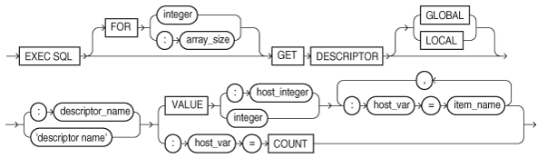
[Description of the illustration getdesc.eps](img_text/getdesc.md)

where `item_name` can be one of these choices:

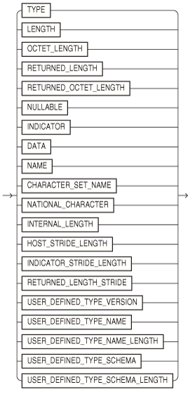
[Description of the illustration getdnc.eps](img_text/getdnc.md)

#### Keywords and Parameters

| Keywords and Parameters              | Description                                                                                                   |
|:-------------------------------------|:--------------------------------------------------------------------------------------------------------------|
| array_size                           | Host variable containing the number of rows to be processed.                                                  |
| integer                              | Number of rows to be processed.                                                                               |
| descriptor_name 'descriptor name' | Host variable containing the name of the allocated ANSI descriptor. Name of the allocated ANSI descriptor. |
| GLOBAL \| LOCAL                      | LOCAL (the default) means file scope, as opposed to GLOBAL, which means application scope.                    |
| host_var = COUNT                     | Host variable containing the total number of input or output variables.                                       |
| integer                              | Total number of input or output variables.                                                                    |
| VALUE :host_integer                  | Host variable containing the position of the referenced input or output variable.                             |
| VALUE integer                        | The position of the referenced input or output variable.                                                      |
| host_var                             | Host variable which will receive the item's value.                                                            |
| item_name                            | The item_name is found in Table 10-4, and Table 10-5, under the "Descriptor Item Name" column heading.        |

#### Usage Notes

Use DYNAMIC=ANSI precompiler option. The array size clause can be used with DATA, RETURNED_LENGTH, and INDICATOR item names. See [GET DESCRIPTOR](ANSI-dynamic-SQL.md).

#### Example

    EXEC SQL GET DESCRIPTOR GLOBAL 'mydesc' :mydesc_num_vars = COUNT ;

#### Related Topics

ALLOCATE DESCRIPTOR (Executable Embedded SQL).

DEALLOCATE DESCRIPTOR (Embedded SQL Statement).

SET DESCRIPTOR (Executable Embedded SQL).

### E.40 INSERT (Executable Embedded SQL)

#### Purpose

To add rows to a table or to a view's base table.

#### Prerequisites

For you to insert rows into a table, the table must be in your own schema or you must have INSERT privilege on the table.

For you to insert rows into the base table of a view, the owner of the schema containing the view must have INSERT privilege on the base table. Also, if the view is in a schema other than your own, you must have INSERT privilege on the view.

The INSERT ANY TABLE system privilege also provides the ability to insert rows into any table or any view's base table.

#### Syntax

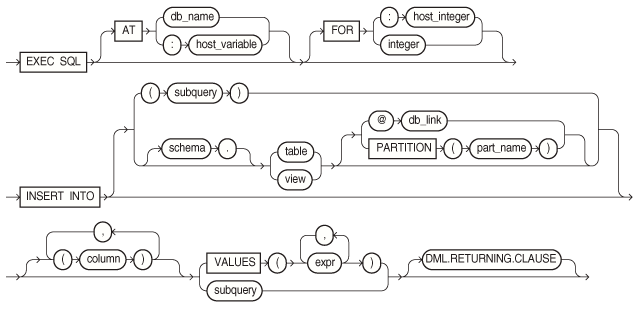
[Description of the illustration insert.eps](img_text/insert.md)

Where the DML returning clause is:

[Description of the illustration return.eps](img_text/return.md)

#### Keywords and Parameters

| Keywords and Parameters      | Description                                                                                                                                                                                                                                                                                                                                             |
|:-----------------------------|:--------------------------------------------------------------------------------------------------------------------------------------------------------------------------------------------------------------------------------------------------------------------------------------------------------------------------------------------------------|
| AT                           | Identifies the database on which the INSERT statement is executed. The database can be identified by either: db_name: Is a database identifier declared in a previous DECLARE DATABASE statement. host_variable: Is a host variable whose value is a db_name. If you omit this clause, the INSERT statement is executed on your default database. |
| FOR :host_integer integer | Limits the number of times the statement is executed if the VALUES clause contains array host variables. If you omit this clause, Oracle executes the statement once for each component in the smallest array.                                                                                                                                       |
| schema                       | The schema containing the table or view. If you omit schema, Oracle assumes the table or view is in your own schema.                                                                                                                                                                                                                                    |
| table  view               | The name of the table into which rows are to be inserted. If you specify view, Oracle inserts rows into the view's base table.                                                                                                                                                                                                                       |
| db_link                      | A complete or partial name of a database link to a remote database where the table or view is located. You can only insert rows into a remote table or view if you are using Oracle with the distributed option. If you omit `dblink,` Oracle assumes that the table or view is on the local database.                                            |
| part_name                    | Is the name of a partition of the table.                                                                                                                                                                                                                                                                                                                |
| column                       | If you omit one of the table's columns from this list, the column's value for the inserted row is the column's default value as specified when the table was created. If you omit the column list altogether, the VALUES clause or query must specify values for all columns in the table.                                                              |
| VALUES                       | Specifies a row of values to be inserted into the table or view. See the syntax description in [Oracle Database SQL Language Reference](../sqlrf/index.md). The expressions can be host variables with optional indicator variables. You must specify an expression in the VALUES clause for each column in the column list.                            |
| subquery                     | Is a subquery that returns rows that are inserted into the table. The select list of this subquery must have the same number of columns as the column list of the INSERT statement. For the syntax description of a subquery, see [SELECT](../sqlrf/SELECT.md).                                                                                         |
| DML returning clause         | See "[The DML Returning Clause](embedded-SQL.md)".                                                                                                                                                                                                                                                                                                      |

#### Usage Notes

Any host variables that appear in the WHERE clause must be either all scalars or all arrays. If they are scalars, Oracle executes the INSERT statement once. If they are arrays, Oracle executes the INSERT statement once for each set of array components, inserting one row each time.

Array host variables in the WHERE clause can have different sizes. In this case, the number of times Oracle executes the statement is determined by the smaller of the following values:

- Size of the smallest array

- The value of the :host_integer in the optional FOR clause.

For more information on this statement, see "[The INSERT Statement](embedded-SQL.md) ".

#### Example I

This example illustrates the use of the embedded SQL INSERT statement:

    EXEC SQL
         INSERT INTO emp (ename, empno, sal)
         VALUES (:ename, :empno, :sal) ;

#### Example II

This example shows an embedded SQL INSERT statement with a subquery:

    EXEC SQL
       INSERT INTO new_emp (ename, empno, sal)
       SELECT ename, empno, sal FROM emp
       WHERE deptno = :deptno ;

#### Related Topics

DECLARE DATABASE (Oracle Embedded SQL Directive).

### E.41 LOB APPEND (Executable Embedded SQL Extension)

#### Purpose

To append a LOB to the end of another LOB.

#### Prerequisites

LOB buffering must not be enabled.The destination LOB must have been initialized.

#### Syntax

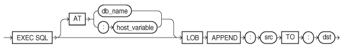
[Description of the illustration lobapp.eps](img_text/lobapp.md)

#### Usage Notes

For usage notes as well as keywords, parameters, and examples, see "[APPEND](about-LOBs.md)".

#### Related Topics

See the other LOB statements.

### E.42 LOB ASSIGN (Executable Embedded SQL Extension)

#### Purpose

To assign a LOB or BFILE locator to another locator.

#### Syntax

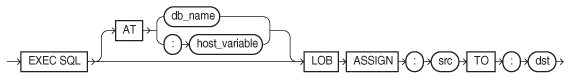
[Description of the illustration lobass.eps](img_text/lobass.md)

#### Usage Notes

For usage notes as well as keywords, parameters, and examples, see "[ASSIGN](about-LOBs.md)".

#### Related Topics

See the other LOB statements.

### E.43 LOB CLOSE (Executable Embedded SQL Extension)

#### Purpose

To close an open LOB or BFILE.

#### Syntax

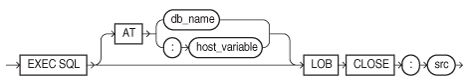
[Description of the illustration lobclose.eps](img_text/lobclose.md)

#### Usage Notes

For usage notes as well as keywords, parameters, and examples, see "[CLOSE (for LOBs)](about-LOBs.md)".

#### Related Topics

See the other LOB statements.

### E.44 LOB COPY (Executable Embedded SQL Extension)

#### Purpose

To copy all or part of a LOB value into another LOB.

#### Syntax

[Description of the illustration lobcop.eps](img_text/lobcop.md)

#### Usage Notes

For usage notes as well as keywords, parameters, and examples, see "[COPY](about-LOBs.md)".

#### Related Topics

See the other LOB statements.

### E.45 LOB CREATE TEMPORARY (Executable Embedded SQL Extension)

#### Purpose

To create a temporary LOB.

#### Syntax

[Description of the illustration lobcreat.eps](img_text/lobcreat.md)

#### Usage Notes

For usage notes as well as keywords, parameters, and examples, see "[CREATE TEMPORARY](about-LOBs.md)".

#### Related Topics

See the other LOB statements.

### E.46 LOB DESCRIBE (Executable Embedded SQL Extension)

#### Purpose

To retrieve attributes from a LOB.

#### Syntax

[Description of the illustration lobdesc.eps](img_text/lobdesc.md)

where `attrib` is:

[Description of the illustration lobatt.eps](img_text/lobatt.md)

#### Usage Notes

For usage notes as well as keywords, parameters, and examples, see "[DESCRIBE](about-LOBs.md)".

#### Related Topics

See the other LOB statements.

### E.47 LOB DISABLE BUFFERING (Executable Embedded SQL Extension)

#### Purpose

To disable LOB buffering.

#### Syntax

[Description of the illustration lobdisab.eps](img_text/lobdisab.md)

#### Usage Notes

For usage notes as well as keywords, parameters, and examples, see "[DISABLE BUFFERING](about-LOBs.md)".

#### Related Topics

See the other LOB statements.

### E.48 LOB ENABLE BUFFERING (Executable Embedded SQL Extension)

#### Purpose

To enable LOB buffering.

#### Syntax

[Description of the illustration lobenab.eps](img_text/lobenab.md)

#### Usage Notes

For usage notes as well as keywords, parameters, and examples, see "[ENABLE BUFFERING](about-LOBs.md)"

#### Related Topics

See the other LOB statements.

### E.49 LOB ERASE (Executable Embedded SQL Extension)

#### Purpose

To erase a given amount of LOB data starting from a given offset.

#### Syntax

[Description of the illustration loberas.eps](img_text/loberas.md)

#### Usage Notes

For usage notes as well as keywords, parameters, and examples, see "[ERASE](about-LOBs.md)".

#### Related Topics

See the other LOB statements.

### E.50 LOB FILE CLOSE ALL (Executable Embedded SQL Extension)

#### Purpose

To close all open BFILEs in the current session.

#### Syntax

[Description of the illustration lobficl.eps](img_text/lobficl.md)

#### Usage Notes

For usage notes as well as keywords, parameters, and examples, see "[FILE CLOSE ALL](about-LOBs.md)".

#### Related Topics

See the other LOB statements.

### E.51 LOB FILE SET (Executable Embedded SQL Extension)

#### Purpose

To set DIRECTORY and FILENAME in a BFILE locator.

#### Syntax

[Description of the illustration lobfise.eps](img_text/lobfise.md)

#### Usage Notes

For usage notes as well as keywords, parameters, and examples, see "[FILE SET](about-LOBs.md)".

#### Related Topics

See the other LOB statements.

### E.52 LOB FLUSH BUFFER (Executable Embedded SQL Extension)

#### Purpose

To write the LOB buffers to the database server.

#### Syntax

[Description of the illustration lobflbuf.eps](img_text/lobflbuf.md)

#### Usage Notes

For usage notes as well as keywords, parameters, and examples, see "[FLUSH BUFFER](about-LOBs.md)".

#### Related Topics

See the other LOB statements.

### E.53 LOB FREE TEMPORARY (Executable Embedded SQL Extension)

#### Purpose

To free temporary space for the LOB locator.

#### Syntax

[Description of the illustration lobfrtem.eps](img_text/lobfrtem.md)

#### Usage Notes

For usage notes as well as keywords, parameters, and examples, see "[FREE TEMPORARY](about-LOBs.md)".

#### Related Topics

See the other LOB statements.

### E.54 LOB LOAD (Executable Embedded SQL Extension)

#### Purpose

To copy all or part of a BFILE into an internal LOB.

#### Syntax

[Description of the illustration loblofr.eps](img_text/loblofr.md)

#### Usage Notes

For usage notes as well as keywords, parameters, and examples, see "[LOAD FROM FILE](about-LOBs.md)".

#### Related Topics

See the other LOB statements.

### E.55 LOB OPEN (Executable Embedded SQL Extension)

#### Purpose

To open a LOB or BFILE for read or read/write access.

#### Syntax

[Description of the illustration lobopen.eps](img_text/lobopen.md)

#### Usage Notes

For usage notes as well as keywords, parameters, and examples, see "[OPEN (for LOBs)](about-LOBs.md)".

#### Related Topics

See the other LOB statements.

### E.56 LOB READ (Executable Embedded SQL Extension)

#### Purpose

To read all or part of a LOB or BFILE into a buffer.

#### Syntax

[Description of the illustration lobread.eps](img_text/lobread.md)

#### Usage Notes

For usage notes as well as keywords, parameters, and examples, see "[READ](about-LOBs.md)".

#### Related Topics

See the other LOB statements.

### E.57 LOB TRIM (Executable Embedded SQL Extension)

#### Purpose

To truncate a LOB value.

#### Syntax

[Description of the illustration lobtrim.eps](img_text/lobtrim.md)

#### Usage Notes

For usage notes as well as keywords, parameters, and examples, see "[TRIM](about-LOBs.md)".

#### Related Topics

See the other LOB statements.

### E.58 LOB WRITE (Executable Embedded SQL Extension)

#### Purpose

To write the contents of a buffer to a LOB.

#### Syntax

[Description of the illustration lobwri.eps](img_text/lobwri.md)

#### Usage Notes

For usage notes as well as keywords, parameters, and examples, see "[WRITE](about-LOBs.md)".

#### Related Topics

See the other LOB statements.

### E.59 OBJECT CREATE (Executable Embedded SQL Extension)

#### Purpose

To create a referenceable object in the object cache.

#### Prerequisites

Precompiler option OBJECTS must be set to YES. The INTYPE option must specify the OTT-generated type files. Include OTT-generated header files in your program.

#### Syntax

[Description of the illustration objcrea.eps](img_text/objcrea.md)

where tab is:

[Description of the illustration objtab.eps](img_text/objtab.md)

#### Usage Notes

For usage notes as well as keywords and parameters, see "[OBJECT CREATE](about-Objects.md)".

#### Example

    person *pers_p;
    person_ind *pers_ind;
    person_ref *pers_ref;
    ...
    EXEC SQL OBJECT CREATE :pers_p:pers_ind TABLE PERSON_TAB
              RETURNING REF INTO :pers_ref ;

#### Related Topics

See all other OBJECT statements in this appendix.

### E.60 OBJECT DELETE (Executable Embedded SQL Extension)

#### Purpose

To mark a persistent object or array of objects as deleted in the object cache.

#### Prerequisites

Precompiler option OBJECTS must be set to YES. The INTYPE option must specify the OTT-generated type files. Include OTT-generated header files in your program.

#### Syntax

[Description of the illustration objdel.eps](img_text/objdel.md)

#### Usage Notes

For usage notes as well as keywords and parameters, see "[OBJECT DELETE](about-Objects.md)".

#### Example

    customer *cust_p;
    ...
    EXEC SQL OBJECT DELETE :cust_p;

#### Related Topics

See all other OBJECT statements in this Appendix.For persistent objects, this statement marks an object or array of objects as deleted in the object cache.

### E.61 OBJECT DEREF (Executable Embedded SQL Extension)

#### Purpose

To pin an object or array of objects in the object cache.

#### Prerequisites

Precompiler option OBJECTS must be set to YES. The INTYPE option must specify the OTT-generated type files. Include OTT-generated header files in your program.

#### Syntax

[Description of the illustration objder.eps](img_text/objder.md)

#### Usage Notes

For usage notes as well as keywords and parameters, see "[OBJECT DEREF](about-Objects.md)".

#### Example

    person *pers_p;
    person_ref *pers_ref;
    ...
    /* Pin the person REF, returning a pointer to the person object */
    EXEC SQL OBJECT DEREF :pers_ref INTO :pers_p;

#### Related Topics

See all other OBJECT statements in this Appendix. See "ALLOCATE (Executable Embedded SQL Extension)".

### E.62 OBJECT FLUSH (Executable Embedded SQL Extension)

#### Purpose

To flush persistent objects that have been marked as updated, deleted, or created, to the server.

#### Prerequisites

Precompiler option OBJECTS must be set to YES. The INTYPE option must specify the OTT-generated type files. Include OTT-generated header files in your program.

#### Syntax

[Description of the illustration objflu.eps](img_text/objflu.md)

#### Usage Notes

For usage notes as well as keywords and parameters, see "[OBJECT FLUSH](about-Objects.md)".

#### Example

    person *pers_p;
    ...
    EXEC SQL OBJECT DELETE :pers_p;
    /* Flush the changes, effectively deleting the person object */
    EXEC SQL OBJECT FLUSH :pers_p;
    /* Finally, free all object cache memory and logoff */
    EXEC SQL OBJECT CACHE FREE ALL;
    EXEC SQL COMMIT WORK RELEASE;

#### Related Topics

See all other OBJECT statements in this Appendix.

### E.63 OBJECT GET (Executable Embedded SQL Extension)

#### Purpose

To convert attributes of an object type to native C types

#### Prerequisites

Precompiler option OBJECTS must be set to YES. The INTYPE option must specify the OTT-generated type files. Include OTT-generated header files in your program.

#### Syntax

[Description of the illustration objget.eps](img_text/objget.md)

#### Usage Notes

For usage notes as well as keywords and parameters, see "[OBJECT GET](about-Objects.md)".

#### Example

    person *pers_p;
    struct { char lname[21], fname[21]; int age; } pers;
    ...
    /* Convert object types to native C types */
    EXEC SQL OBJECT GET lastname, firstname, age FROM :pers_p INTO :pers;
    printf("Last Name: %s\nFirstName: %s\nAge: %d\n",
            pers.lname, pers.fname, pers.age );

#### Related Topics

See all other OBJECT statements in this Appendix.

### E.64 OBJECT RELEASE (Executable Embedded SQL Extension)

#### Purpose

To unpin an object in the object cache. When an object is not pinned and not updated, it is eligible for implicit freeing.

#### Prerequisites

Precompiler option OBJECTS must be set to YES. The INTYPE option must specify the OTT-generated type files. Include OTT-generated header files in your program.

#### Syntax

[Description of the illustration objrel.eps](img_text/objrel.md)

#### Usage Notes

For usage notes as well as keywords and parameters, see "[OBJECT RELEASE](about-Objects.md)".

#### Example

    person *pers_p;
    ...
    EXEC SQL OBJECT RELEASE :pers_p;

#### Related Topics

See all other OBJECT statements in this Appendix.

### E.65 OBJECT SET (Executable Embedded SQL Extension)

#### Purpose

To update attributes of persistent objects, marking them eligible for writing to the server when the object is flushed or the cache is flushed.

To update the attributes of a transient object.

#### Prerequisites

Precompiler option OBJECTS must be set to YES. The INTYPE option must specify the OTT-generated type files. Include OTT-generated header files in your program.

#### Syntax

[Description of the illustration objset.eps](img_text/objset.md)

#### Usage Notes

For usage notes as well as keywords and parameters, see "[OBJECT FLUSH](about-Objects.md)".

#### Example

    person *pers_p;
    struct {int num; char street[61], city[31], state[3], zip[11];} addr1;
    ...
    addr1.num = 500;
    strcpy((char *)addr1.street , (char *)"Oracle Parkway");
    strcpy((char *)addr1.city,    (char *)"Redwood Shores");
    strcpy((char *)addr1.state,   (char *)"CA");
    strcpy((char *)addr1.zip,     (char *)"94065");

    /* Convert native C types to object types */
    EXEC SQL OBJECT SET :pers_p->addr TO :addr1;

#### Related Topics

See all other OBJECT statements in this Appendix.

### E.66 OBJECT UPDATE (Executable Embedded SQL Extension)

#### Purpose

To mark a persistent object or array of objects as updated in the object cache.

#### Prerequisites

Precompiler option OBJECTS must be set to YES. The INTYPE option must specify the OTT-generated type files. Include OTT-generated header files in your program.

#### Syntax

[Description of the illustration objupd.eps](img_text/objupd.md)

#### Usage Notes

For usage notes as well as keywords and parameters, see "[OBJECT UPDATE](about-Objects.md)".

#### Example

    person *pers_p;
    ...
    /* Mark as updated */
    EXEC SQL OBJECT UPDATE :pers_p;

#### Related Topics

See all other OBJECT statements in this Appendix.

### E.67 OPEN (Executable Embedded SQL)

#### Purpose

To open a cursor, evaluating the associated query and substituting the host variable names supplied by the USING clause into the WHERE clause of the query. For the ANSI Dynamic SQL Method 4 version, see "OPEN DESCRIPTOR (Executable Embedded SQL) ".

#### Prerequisites

You must declare the cursor with a DECLARE CURSOR embedded SQL statement before opening it.

#### Syntax

[Description of the illustration openo.eps](img_text/openo.md)

#### Keywords and Parameters

| Keywords and Parameters     | Description                                                                                                                                                                                                                                                                                                                                                                                                                           |
|:----------------------------|:--------------------------------------------------------------------------------------------------------------------------------------------------------------------------------------------------------------------------------------------------------------------------------------------------------------------------------------------------------------------------------------------------------------------------------------|
| array_size integer       | Host variable containing the number of rows to be processed. Number of rows to be processed.                                                                                                                                                                                                                                                                                                                                       |
| cursor                      | The (previously declared) cursor to be opened.                                                                                                                                                                                                                                                                                                                                                                                        |
| host_variable               | Specifies a host variable with an optional indicator variable to be substituted into the statement associated with the cursor. CANNOT be used together with an ANSI descriptor (INTO clause).                                                                                                                                                                                                                                      |
| DESCRIPTOR SQLDA_descriptor | Specifies an Oracle descriptor that describes the host variables to be substituted into the WHERE clause of the associated query. The descriptor must be initialized in a previous DESCRIBE statement. The substitution is based on position. The host variable names specified in this statement can be different from the variable names in the associated query. CANNOT be used together with an ANSI descriptor (INTO clause). |

#### Usage Notes

The OPEN statement defines the active set of rows and initializes the cursor just before the first row of the active set. The values of the host variables at the time of the OPEN are substituted in the statement. This statement does not actually retrieve rows; rows are retrieved by the FETCH statement.

Once you have opened a cursor, its input host variables are not reexamined until you reopen the cursor. To change any input host variables and therefore the active set, you must reopen the cursor.

All cursors in a program are in a closed state when the program is initiated or when they have been explicitly closed using the CLOSE statement.

You can reopen a cursor without first closing it. For more information on this statement, see "[The INSERT Statement](embedded-SQL.md) ".

#### Example

This example illustrates the use of the OPEN statement in a Pro\*C/C++ program:

    EXEC SQL DECLARE emp_cursor CURSOR FOR
        SELECT ename, empno, job, sal
        FROM emp
        WHERE deptno = :deptno;
    EXEC SQL OPEN emp_cursor;

#### Related Topics

CLOSE (Executable Embedded SQL) .

DECLARE STATEMENT (Embedded SQL Directive) .

FETCH (Executable Embedded SQL) .

PREPARE (Executable Embedded SQL).

### E.68 OPEN DESCRIPTOR (Executable Embedded SQL)

#### Purpose

To open a cursor (for ANSI Dynamic SQL Method 4), evaluating the associated query and substituting the input host variable names supplied by the USING clause into the WHERE clause of the query. The INTO clause denotes the output descriptor.

#### Prerequisites

You must declare the cursor with a DECLARE CURSOR embedded SQL statement before opening it.

#### Syntax

[Description of the illustration opena.eps](img_text/opena.md)

#### Keywords and Parameters

| Keywords and Parameters | Description                                                                                     |
|:------------------------|:------------------------------------------------------------------------------------------------|
| array_size integer   | Host variable containing the number of rows to be processed. Number of rows to be processed. |
| cursor                  | The (previously declared) cursor to be opened.                                                  |
| USING DESCRIPTOR        | Specifies an ANSI input descriptor.                                                             |
| descriptor_name         | The host variable containing the name of the ANSI descriptor,                                   |
| 'descriptor name'       | The name of the ANSI descriptor.                                                                |
| INTO DESCRIPTOR         | Specifies an ANSI output descriptor.                                                            |
| descriptor_name         | The host variable containing the name of the ANSI descriptor,                                   |
| 'descriptor name'       | The name of the ANSI descriptor.                                                                |
| GLOBAL \| LOCAL         | LOCAL (the default) means file scope, as opposed to GLOBAL, which means application scope.      |

#### Usage Notes

Set the precompiler option DYNAMIC to ANSI.

The OPEN statement defines the active set of rows and initializes the cursor just before the first row of the active set. The values of the host variables at the time of the OPEN are substituted in the SQL statement. This statement does not actually retrieve rows; rows are retrieved by the FETCH statement.

Once you have opened a cursor, its input host variables are not reexamined until you reopen the cursor. To change any input host variables and therefore the active set, you must reopen the cursor.

All cursors in a program are in a closed state when the program is initiated or when they have been explicitly closed using the CLOSE statement.

You can reopen a cursor without first closing it. For more information on this statement, see "[The INSERT Statement](embedded-SQL.md) ".

#### Example

    char dyn_statement[1024] ;
    ...
    EXEC SQL ALLOCATE DESCRIPTOR 'input_descriptor' ;
    EXEC SQL ALLOCATE DESCRIPTOR 'output descriptor'
    ...
    EXEC SQL PREPARE S FROM :dyn_statement ;
    EXEC SQL DECLARE C CURSOR FOR S ;
    ...
    EXEC SQL OPEN C USING DESCRIPTOR 'input_descriptor' ;
    ...

#### Related Topics

CLOSE (Executable Embedded SQL) .

DECLARE CURSOR (Embedded SQL Directive).

FETCH DESCRIPTOR (Executable Embedded SQL) .

PREPARE (Executable Embedded SQL).

### E.69 PREPARE (Executable Embedded SQL)

#### Purpose

To parse a SQL statement or PL/SQL block specified by a host variable and associate it with an identifier.

#### Prerequisites

None.

#### Syntax

[Description of the illustration prepare.eps](img_text/prepare.md)

#### Keywords and Parameters

| Keywords and Parameters | Description                                                                                                                                                                                                    |
|:------------------------|:---------------------------------------------------------------------------------------------------------------------------------------------------------------------------------------------------------------|
| statement_id            | Is the identifier to be associated with the prepared SQL statement or PL/SQL block. If this identifier was previously assigned to another statement or block, the prior assignment is superseded.              |
| db_name                 | A null-terminated string containing the database connection name, as established previously in a CONNECT statement. If it is omitted, or if it is an empty string, the default database connection is assumed. |
| host_variable           | A host variable containing the name of the database connection.                                                                                                                                                |
| text                    | Is a string literal containing a SQL statement or PL/SQL block to be prepared.                                                                                                                                 |
| select_command          | Is a select statement                                                                                                                                                                                          |

#### Usage Notes

Any variables that appear in the host_string or text are placeholders. The actual host variable names are assigned in the USING clause of the OPEN statement (input host variables) or in the INTO clause of the FETCH statement (output host variables).

A SQL statement is prepared only once, but can be executed any number of times. For more information, see "[PREPARE (Dynamic SQL)](Oracle-dynamic-SQL.md)".

#### Example

This example illustrates the use of a PREPARE statement in a Pro\*C/C++ embedded SQL program:

    EXEC SQL PREPARE my_statement FROM :my_string;
    EXEC SQL EXECUTE my_statement;

#### Related Topics

CLOSE (Executable Embedded SQL) .

DECLARE CURSOR (Embedded SQL Directive).

FETCH DESCRIPTOR (Executable Embedded SQL) .

OPEN (Executable Embedded SQL) .

### E.70 REGISTER CONNECT (Executable Embedded SQL Extension)

#### Purpose

To allow an external C procedure to be called from a Pro\*C/C++ application.

#### Prerequisites

None.

#### Syntax

[Description of the illustration regconn.eps](img_text/regconn.md)

#### Keywords and Parameters

| Keywords and Parameters | Description                                                                                                   |
|:------------------------|:--------------------------------------------------------------------------------------------------------------|
| ext_proc_ctxt           | The external procedure context passed to the procedure by PL/SQL. It is of type pointer to OCIExtProcContext. |
| context                 | The runtime context returned. It is of type sql_context. Currently, it is the default (global) context        |

#### Usage Notes

For a complete discussion of how to write an external procedure, and the restrictions that are in effect, see [External Procedures](embedded-PL-SQL.md).

#### Example

    void myfunction(epctx)
    OCIExtProcContext *epctx;
    sql_context context;
    ...
    {
    EXEC SQL REGISTER CONNECT USING :epctx ;
    EXEC SQL USE :context;
    ...

#### Related Topics

None

### E.71 ROLLBACK (Executable Embedded SQL)

#### Purpose

To undo work done in the current transaction.

You can also use this statement to manually undo the work done by an in-doubt distributed transaction.

#### Prerequisites

To roll back your current transaction, no privileges are necessary.

To manually roll back an in-doubt distributed transaction that you originally committed, you must have FORCE TRANSACTION system privilege. To manually roll back an in-doubt distributed transaction originally committed by another user, you must have FORCE ANY TRANSACTION system privilege.

#### Syntax

[Description of the illustration rollb.eps](img_text/rollb.md)

#### Keywords and Parameters

| Keywords and Parameters | Description                                                                                                                                                                                                                                                                                                                                                                                                                                                                                   |
|:------------------------|:----------------------------------------------------------------------------------------------------------------------------------------------------------------------------------------------------------------------------------------------------------------------------------------------------------------------------------------------------------------------------------------------------------------------------------------------------------------------------------------------|
| AT                      | Identifies the database on which the savepoint is created. The database can be identified by either: db_name: A null-terminated string containing the database connection name, as established previously in a CONNECT statement. If it is omitted, or if it is an empty string, the default database connection is assumed. host_variable: A host variable containing the name of the database connection. If you omit this clause, the savepoint is created on your default database. |
| WORK                    | Is optional and is provided for ANSI compatibility.                                                                                                                                                                                                                                                                                                                                                                                                                                           |
| TO                      | Rolls back the current transaction to the specified savepoint. If you omit this clause, the ROLLBACK statement rolls back the entire transaction.                                                                                                                                                                                                                                                                                                                                             |
| FORCE                   | Manually rolls back an in-doubt distributed transaction. The transaction is identified by the text containing its local or global transaction ID. To find the IDs of such transactions, query the data dictionary view DBA_2PC_PENDING. ROLLBACK statements with the FORCE clause are not supported in PL/SQL.                                                                                                                                                                             |
| RELEASE                 | Frees all resources and disconnects the application from the database. The RELEASE clause is not allowed with SAVEPOINT and FORCE clauses.                                                                                                                                                                                                                                                                                                                                                    |
| savepoint               | savepoint to which you roll back                                                                                                                                                                                                                                                                                                                                                                                                                                                              |

#### Usage Notes

A transaction (or a logical unit of work) is a sequence of SQL statements that Oracle treats as a single unit. A transaction begins with the first executable SQL statement after a COMMIT, ROLLBACK or connection to the database. A transaction ends with a COMMIT statement, a ROLLBACK statement, or disconnection (intentional or unintentional) from the database. Oracle issues an implicit COMMIT statement before and after processing any data definition language statement.

Using the ROLLBACK statement without the TO SAVEPOINT clause performs the following operations:

- Ends the transaction

- Undoes all changes in the current transaction

- Erases all savepoints in the transaction

- Releases the transaction's locks

Using the ROLLBACK statement with the TO SAVEPOINT clause performs the following operations:

- Rolls back just the portion of the transaction after the savepoint.

- Loses all savepoints created after that savepoint. The named savepoint is retained, so you can roll back to the same savepoint multiple times. Prior savepoints are also retained.

- Releases all table and row locks acquired since the savepoint. Other transactions that have requested access to rows locked after the savepoint must continue to wait until the transaction is committed or rolled back. Other transactions that have not already requested the rows can request and access the rows immediately.

It is recommended that you explicitly end transactions in application programs using either a COMMIT or ROLLBACK statement. If you do not explicitly commit the transaction and the program terminates abnormally, Oracle rolls back the last uncommitted transaction.

#### Example 1

The following statement rolls back your entire current transaction:

    EXEC SQL ROLLBACK;

#### Example 2

The following statement rolls back your current transaction to savepoint SP5:

    EXEC SQL ROLLBACK TO SAVEPOINT sp5;

#### Distributed Transactions

Oracle with the distributed option provides the ability to perform distributed transactions, or transactions that modify data on multiple databases. To commit or roll back a distributed transaction, you need only issue a COMMIT or ROLLBACK statement as you would any other transaction.

If there is a network failure during the commit process for a distributed transaction, the state of the transaction may be unknown, or in-doubt. After consultation with the administrators of the other databases involved in the transaction, you may decide to manually commit or roll back the transaction on your local database. You can manually roll back the transaction on your local database by issuing a ROLLBACK statement with the FORCE clause.

You cannot manually roll back an in-doubt transaction to a savepoint.

A ROLLBACK statement with a FORCE clause only rolls back the specified transaction. Such a statement does not affect your current transaction.

#### Example III

The following statement manually rolls back an in-doubt distributed transaction:

    EXEC SQL
        ROLLBACK WORK
        FORCE '25.32.87' ;

#### Related Topics

COMMIT (Executable Embedded SQL) .

SAVEPOINT (Executable Embedded SQL) .

### E.72 SAVEPOINT (Executable Embedded SQL)

#### Purpose

To identify a point in a transaction to which you can later roll back.

#### Prerequisites

None.

#### Syntax

[Description of the illustration savep.eps](img_text/savep.md)

#### Keywords and Parameters

| Keywords and Parameters | Description                                                                                                                                                                                                                                                                                                                                                    |
|:------------------------|:---------------------------------------------------------------------------------------------------------------------------------------------------------------------------------------------------------------------------------------------------------------------------------------------------------------------------------------------------------------|
| AT                      | Identifies the database on which the savepoint is created. The database can be identified by either: db_name: Is a database identifier declared in a previous DECLARE DATABASE statement. host_variable: Is a host variable whose value is a previously declared db_name. If you omit this clause, the savepoint is created on your default database. |
| savepoint               | Is the name of the savepoint to be created.                                                                                                                                                                                                                                                                                                                    |

#### Usage Notes

For more information on this statement, see "[Using the SAVEPOINT Statement](database-concepts.md) ".

#### Example

This example illustrates the use of the embedded SQL SAVEPOINT statement:

    EXEC SQL SAVEPOINT save3;

#### Related Topics

COMMIT (Executable Embedded SQL) .

ROLLBACK (Executable Embedded SQL) .

### E.73 SELECT (Executable Embedded SQL)

#### Purpose

To retrieve data from one or more tables, views, or snapshots, assigning the selected values to host variables.

#### Prerequisites

For you to select data from a table or snapshot, the table or snapshot must be in your own schema or you must have SELECT privilege on the table or snapshot.

For you to select rows from the base tables of a view, the owner of the schema containing the view must have SELECT privilege on the base tables. Also, if the view is in a schema other than your own, you must have SELECT privilege on the view.

The SELECT ANY TABLE system privilege also provides the ability to select data from any table or any snapshot or any view's base table.

#### Syntax

[Description of the illustration select.eps](img_text/select.md)

[Description of the illustration select_b.eps](img_text/select_b.md)

#### Keywords and Parameters

| Keywords and Parameters | Description                                                                                                                                                                                                                                                                                                                                                                                                                                                |
|:------------------------|:-----------------------------------------------------------------------------------------------------------------------------------------------------------------------------------------------------------------------------------------------------------------------------------------------------------------------------------------------------------------------------------------------------------------------------------------------------------|
| AT                      | Identifies the database to which the SELECT statement is issued. The database can be identified by either: db_name: A database identifier declared in a previous DECLARE DATABASE statement. host_variable: Host variable whose value is a previously declared db_name. If you omit this clause, the SELECT statement is issued to your default database.                                                                                            |
| select_list             | Identical to the non-embedded SELECT statement except that a host variables can be used in place of literals.                                                                                                                                                                                                                                                                                                                                              |
| INTO                    | Specifies output host variables and optional indicator variables to receive the data returned by the SELECT statement. These variables must be either all scalars or all arrays, but arrays need not have the same size.                                                                                                                                                                                                                                   |
| WHERE                   | Restricts the rows returned to those for which the condition is TRUE. See the syntax description of condition in [Conditions](../sqlrf/Conditions.md). The condition can contain host variables, but cannot contain indicator variables. These host variables should be scalars and cannot be arrays. All other keywords and parameters are identical to the non-embedded SQL SELECT statement. ASC, ascending, is the default for the ORDER BY clause. |

#### Usage Notes

If no rows meet the WHERE clause condition, no rows are retrieved and Oracle returns an error code through the SQLCODE component of the SQLCA.

You can use Comments in a SELECT statement to pass instructions, or hints, to the optimizer.

#### Example

This example illustrates the use of the embedded SQL SELECT statement:

    EXEC SQL SELECT ename, sal + 100, job
        INTO :ename, :sal, :job
        FROM emp
        WHERE empno = :empno;

#### Related Topics

DECLARE CURSOR (Embedded SQL Directive).

DECLARE DATABASE (Oracle Embedded SQL Directive).

EXECUTE (Executable Embedded SQL).

FETCH (Executable Embedded SQL) .

PREPARE (Executable Embedded SQL).

### E.74 SET DESCRIPTOR (Executable Embedded SQL)

#### Purpose

Use this ANSI dynamic SQL statement to set information in the descriptor area from host variables.

#### Prerequisites

Use after a DESCRIBE DESCRIPTOR statement.

#### Syntax

[Description of the illustration setdesc.eps](img_text/setdesc.md)

where `item_name` can be one of these choices:

where `item_name` can be one of these choices:

[Description of the illustration setdnc.eps](img_text/setdnc.md)

#### Keywords and Parameters

| Kewords and Parameters               | Description                                                                                                                                                                                 |
|:-------------------------------------|:--------------------------------------------------------------------------------------------------------------------------------------------------------------------------------------------|
| array_size integer                | Host variable containing the number of rows to be processed. Number of rows to be processed. The array size clause can only be used with DATA, RETURNED_LENGTH and INDICATOR item names. |
| GLOBAL \| LOCAL                      | LOCAL (the default) means file scope, as opposed to GLOBAL, which means application scope.                                                                                                  |
| descriptor_name 'descriptor name' | Host variable containing the name of the allocated ANSI descriptor. Name of the allocated ANSI descriptor.                                                                               |
| COUNT                                | The number of input or output variables.                                                                                                                                                    |
| VALUE                                | The position of the referenced host variable.                                                                                                                                               |
| item_name                            | See Table 10-6 and Table 10-7 for lists of the item_names, and their descriptions.                                                                                                          |
| host_integer integer              | The host variables used to set the item or the COUNT or VALUE. An integer used to set the COUNT or VALUE.                                                                                |
| host_var                             | The host variables used to set the descriptor item.                                                                                                                                         |
| REF                                  | Reference semantics are to be used. Can be used only with RETURNED_LENGTH, DATA, and INDICATOR item names. Must be used to set RETURNED_LENGTH.                                          |

#### Usage Notes

Use DYNAMIC=ANSI precompiler option.

Set CHARACTER_SET_NAME to UTF16 for client-side Unicode support.

See "[SET DESCRIPTOR](ANSI-dynamic-SQL.md)" for complete details, including tables of descriptor item names.

#### Example

    EXEC SQL SET DESCRIPTOR GLOBAL :mydescr COUNT = 3 ;

#### Related Topics

ALLOCATE DESCRIPTOR (Executable Embedded SQL).

DEALLOCATE DESCRIPTOR (Embedded SQL Statement).

DESCRIBE (Executable Embedded SQL Extension) .

GET DESCRIPTOR (Executable Embedded SQL).

PREPARE (Executable Embedded SQL).

### E.75 TYPE (Oracle Embedded SQL Directive)

#### Purpose

To perform user-defined type equivalencing, or to assign an external datatype to a whole class of host variables by equivalencing the external datatype to a user-defined datatype.

#### Prerequisites

The user-defined datatype must be previously declared in an embedded SQL program.

#### Syntax

[Description of the illustration type.eps](img_text/type.md)

#### Keywords and Parameters

| Keywords and Parameters | Description                                                                                                                                                                                                                                                                                                                                                   |
|:------------------------|:--------------------------------------------------------------------------------------------------------------------------------------------------------------------------------------------------------------------------------------------------------------------------------------------------------------------------------------------------------------|
| type                    | Is the user-defined datatype to be equivalenced with an external datatype.                                                                                                                                                                                                                                                                                    |
| datatype                | Is an external datatype recognized by the precompiler (not an internal datatype). The datatype may include a length, precision, or scale. This external datatype is equivalenced to the user-defined type and assigned to all host variables assigned the type. For a list of external datatypes, see "[Oracle Datatypes](datatypes-and-host-variables.md) ". |
| REFERENCE               | Makes the equivalenced type a pointer type.                                                                                                                                                                                                                                                                                                                   |

#### Usage Notes

User-defined type equivalencing is one kind of datatype equivalencing. You can only perform user-defined type equivalencing with the embedded SQL TYPE statement in a Pro\*C/C++ program. You may want to use datatype equivalencing for one of the following purposes:

- To automatically null-terminate a character host variable

- To store program data as binary data in the database

- To override default datatype conversion

Pro\*C/C++ expects VARCHAR and VARRAW arrays to be word-aligned. When you equivalence an array type to the VARCHAR or VARRAW datatype, make sure that length+2 is divisible by 4.

Pro\*C/C++ also supports the embedded SQL VAR statement for host variable equivalencing. For more information, see "[User-Defined Type Equivalencing](advanced-topics.md) ".

#### Example I

This example shows an embedded SQL TYPE statement in a Pro\*C/C++ Precompiler program:

    struct screen {
        short len;
        char  buff[4002];
    };

    typedef struct screen graphics;

        EXEC SQL TYPE graphics IS VARRAW(4002);
        graphics crt;  -- host variable of type graphics
        ...

#### Related Topics

VAR (Oracle Embedded SQL Directive) .

### E.76 UPDATE (Executable Embedded SQL)

#### Purpose

To change existing values in a table or in a view's base table.

#### Prerequisites

For you to update values in a table or snapshot, the table must be in your own schema or you must have UPDATE privilege on the table.

For you to update values in the base table of a view, the owner of the schema containing the view must have UPDATE privilege on the base table. Also, if the view is in a schema other than your own, you must have UPDATE privilege on the view.

The UPDATE ANY TABLE system privilege also provides the ability to update values in any table or any view's base table.

#### Syntax

[Description of the illustration update.eps](img_text/update.md)

where the DML returning clause is:

[Description of the illustration return.eps](img_text/return.md)

#### Keywords and Parameters

| Keywords and Parameters      | Description                                                                                                                                                                                                                                                                                                                                                                                                                                                                                  |
|:-----------------------------|:---------------------------------------------------------------------------------------------------------------------------------------------------------------------------------------------------------------------------------------------------------------------------------------------------------------------------------------------------------------------------------------------------------------------------------------------------------------------------------------------|
| AT                           | Identifies the database to which the UPDATE statement is issued. The database can be identified by either: dbname: Is a database identifier declared in a previous DECLARE DATABASE statement. host_variable: Is a host variable whose value is a previously declared db_name. If you omit this clause, the UPDATE statement is issued to your default database.                                                                                                                    |
| FOR :host_integer integer | Limits the number of times the UPDATE statement is executed if the SET and WHERE clauses contain array host variables. If you omit this clause, Oracle executes the statement once for each component of the smallest array.                                                                                                                                                                                                                                                                 |
| schema                       | Is the schema containing the table or view. If you omit schema, Oracle assumes the table or view is in your own schema.                                                                                                                                                                                                                                                                                                                                                                      |
| table, view                  | Is the name of the table to be updated. If you specify view, Oracle updates the view's base table.                                                                                                                                                                                                                                                                                                                                                                                           |
| dblink                       | Is a complete or partial name of a database link to a remote database where the table or view is located. For information on referring to database links, see the[Oracle Database SQL Language Reference](../refrn/index.md)You can only use a database link to update a remote table or view if you are using Oracle with the distributed option.                                                                                                                                           |
| part_name                    | Name of a partition of the table.                                                                                                                                                                                                                                                                                                                                                                                                                                                            |
| column                       | Is the name of a column of the table or view that is to be updated. If you omit a column of the table from the SET clause, that column's value remains unchanged.                                                                                                                                                                                                                                                                                                                            |
| expr                         | Is the new value assigned to the corresponding column. This expression can contain host variables and optional indicator variables.                                                                                                                                                                                                                                                                                                                                                          |
| subquery_1                   | Is a subquery that returns new values that are assigned to the corresponding columns. For the syntax of a subquery, see [SELECT](../sqlrf/SELECT.md).                                                                                                                                                                                                                                                                                                                                        |
| subquery_2                   | Is a subquery that return a new value that is assigned to the corresponding column. For the syntax of a subquery, see [SELECT](../sqlrf/SELECT.md).                                                                                                                                                                                                                                                                                                                                          |
| WHERE                        | Specifies which rows of the table or view are updated:                                                                                                                                                                                                                                                                                                                                                                                                                                       |
| condition CURRENT OF      | Updates only rows for which this condition is true. This condition can contain host variables and optional indicator variables. See the syntax of condition in [Conditions](../sqlrf/Conditions.md). Updates only the row most recently fetched by the cursor. The cursor cannot be associated with a SELECT statement that performs a join unless its FOR UPDATE clause explicitly locks only one table. If you omit this clause entirely, all rows of the table or view are updated. |
| DML returning clause         | See "[The DML Returning Clause](embedded-SQL.md)".                                                                                                                                                                                                                                                                                                                                                                                                                                           |

#### Usage Notes

Host variables in the SET and WHERE clauses must be either all scalars or all arrays. If they are scalars, Oracle executes the UPDATE statement only once. If they are arrays, Oracle executes the statement once for each set of array components. Each execution may update zero, one, or multiple rows.

Array host variables can have different sizes. In this case, the number of times Oracle executes the statement is determined by the smaller of the following values:

- The size of the smallest array

- The value of the :host_integer in the optional FOR clause

The cumulative number of rows updated is returned through the third element of the SQLERRD component of the SQLCA. When arrays are used as input host variables, this count reflects the total number of updates for all components of the array processed in the UPDATE statement. If no rows satisfy the condition, no rows are updated and Oracle returns an error message through the SQLCODE element of the SQLCA. If you omit the WHERE clause, all rows are updated and Oracle raises a warning flag in the fifth component of the SQLWARN element of the SQLCA.

You can use Comments in an UPDATE statement to pass instructions, or hints, to the optimizer. The optimizer uses hints to choose an execution plan for the statement.

For more information on this statement, see [Embedded SQL](embedded-SQL.md), and [Database Concepts](database-concepts.md).

#### Examples

The following examples illustrate the use of the embedded SQL UPDATE statement:

    EXEC SQL UPDATE emp
        SET sal = :sal, comm = :comm INDICATOR :comm_ind
        WHERE ename = :ename;

    EXEC SQL UPDATE emp
        SET (sal, comm) =
            (SELECT AVG(sal)*1.1, AVG(comm)*1.1
             FROM emp)
        WHERE ename = 'JONES';

#### Related Topics

DECLARE DATABASE (Oracle Embedded SQL Directive).

### E.77 VAR (Oracle Embedded SQL Directive)

#### Purpose

To perform host variable equivalencing, or to assign a specific external datatype to an individual host variable, overriding the default datatype assignment. Also has an optional CONVBUFSZ clause that specifies the size of a buffer for character set conversion.

#### Prerequisites

The host variable must be previously declared in the Pro\*C/C++ program.

#### Syntax

[Description of the illustration var.eps](img_text/var.md)

#### Keywords and Parameters

| Keywords and Parameters | Description                                                                                                                                                                                                                                                                                                                                                                                                                                                                                                                                                                                                                                                                                                                          |
|:------------------------|:-------------------------------------------------------------------------------------------------------------------------------------------------------------------------------------------------------------------------------------------------------------------------------------------------------------------------------------------------------------------------------------------------------------------------------------------------------------------------------------------------------------------------------------------------------------------------------------------------------------------------------------------------------------------------------------------------------------------------------------|
| host_variable           | Is an input or output host variable (or host table) declared earlier. The VARCHAR and VARRAW external datatypes have a 2-byte length field followed by an n-byte data field, where n lies in the range 1 .. 65533. So, if type_name is VARCHAR or VARRAW, host_variable must be at least 3 bytes long. The LONG VARCHAR and LONG VARRAW external datatypes have a 4-byte length field followed by an n-byte data field, where n lies in the range 1 .. 2147483643. So, if type_name is LONG VARCHAR or LONG VARRAW, host_variable must be at least 5 bytes long.                                                                                                                                                               |
| dtyp                    | Is an external datatype recognized by Pro\*C/C++ (not an internal datatype). The datatype may include a length, precision, or scale. This external datatype is assigned to the host_variable. For a list of external datatypes, see "[External Datatypes](datatypes-and-host-variables.md)".                                                                                                                                                                                                                                                                                                                                                                                                                                         |
| length                  | Length of the datatype. It is a constant expression or a constant integer specifying a valid length in bytes. The value of length must be large enough to accommodate the external datatype. When type_name is ROWID or DATE, you cannot specify length because it is predefined. For other external datatypes, length is optional. It defaults to the length of host_variable. When specifying length, if type_name is VARCHAR, VARRAW, LONG VARCHAR, or LONG VARRAW, use the maximum length of the data field. Pro\*C/C++ accounts for the length field. If type_name is LONG VARCHAR or LONG VARRAW and the data field exceeds 65533 bytes, put "-1" in the length field.                                                   |
| precision and scale     | Are constant expressions or constants that represent, respectively, the number of significant digits and the point at which rounding will occur. For example, a scale of 2 means the value is rounded to the nearest hundredth (3.456 becomes 3.46); a scale of -3 means the number is rounded to the nearest thousand (3456 becomes 3000). You can specify a precision of 1 .. 99 and a scale of -84 .. 99. However, the maximum precision and scale of a database column are 38 and 127, respectively. So, if precision exceeds 38, you cannot insert the value of host_variable into a database column. On the other hand, if the scale of a column value exceeds 99, you cannot select or fetch the value into host_variable. |
| size                    | The size, in bytes, of a buffer used to perform conversion of the specified host_variable to another character set. A constant or constant expression. Is the size in bytes of a buffer in the runtime library used to perform conversion between character sets of the host_variable                                                                                                                                                                                                                                                                                                                                                                                                                                             |

#### Usage Notes

`length, precision, scale `and` size` can be constant expressions.

Host variable equivalencing is one kind of datatype equivalencing. Datatype equivalencing is useful for any of the following purposes:

- To automatically null-terminate a character host variable

- To store program data as binary data in the database

- To override default datatype conversion

Note that size, length, precision and scale can be any arbitrarily complex C constant expression whose value is known when the precompiler is run.

For example:

    #define LENGTH 10
    ...
    char character set is nchar_cs ename[LENGTH+1];
    exec sql var ename is string(LENGTH+1) convbufsz is (LENGTH*2);

Note also that macros are permitted in this statement.

When you have not used the CONVBUFSZ clause, the Oracle runtime automatically determines a buffer size based on the ratio of the host variable character size (determined by NLS_LANG) and the character size of the database character set. This can sometimes result in the creation of a buffer of LONG size. Database tables are allowed to have only one LONG column. An error is raised if there is more than one LONG value.

To avoid such errors, you use a length shorter than the size of a LONG. If a character set conversion results in a value longer than the length specified by CONVBUFSZ, then an error is returned at runtime. The Pro\*C/C++ Precompiler also supports the precompiler TYPE directive for user-defined type equivalencing. See also "[Host Variable Equivalencing](advanced-topics.md) ".

#### Example

This example equivalences the host variable DEPT_NAME to the datatype STRING and the host variable BUFFER to the datatype RAW(200):

    EXEC SQL BEGIN DECLARE SECTION;
        ...
        char dept_name[15];               -- default datatype is CHAR
        EXEC SQL VAR dept_name IS STRING; -- reset to STRING
        ...
        char buffer[200];                 -- default datatype is CHAR
        EXEC SQL VAR buffer IS RAW(200); -- refer to RAW
        ...
    EXEC SQL END DECLARE SECTION;

#### Related Topics

TYPE (Oracle Embedded SQL Directive) .

### E.78 WHENEVER (Embedded SQL Directive)

#### Purpose

To specify the action to be taken when an error or warning results from executing an embedded SQL statement.

#### Prerequisites

None.

#### Syntax

[Description of the illustration whenevrc.eps](img_text/whenevrc.md)

#### Keywords and Parameters

| Keywords and Parameters | Description                                                                                                        |
|:------------------------|:-------------------------------------------------------------------------------------------------------------------|
| NOT FOUND               | Identifies any exception condition that returns an error code of +1403 to SQLCODE (or a +100 code when MODE=ANSI). |
| SQLERROR                | Identifies a condition that results in a negative return code.                                                     |
| SQLWARNING              | Identifies a non-fatal warning condition.                                                                          |
| CONTINUE                | Indicates that the program should progress to the next statement.                                                  |
| GOTO label              | Indicates that the program should branch to the statement named by label.                                          |
| STOP                    | Stops program execution.                                                                                           |
| DO routine              | Indicates that the program should call a function that is named routine                                            |
| DO BREAK                | Performs a break statement from a loop when the condition is met.                                                  |
| DO CONTINUE             | Performs a continue statement from a loop when the condition is met.                                               |

#### Usage Notes

The WHENEVER directive allows your program to transfer control to an error handling routine in the event an embedded SQ

L statement results in an error or warning.

The scope of a WHENEVER directive is positional, rather than logical. A WHENEVER statement applies to all embedded SQL statements that textually follow it in the source file, not in the flow of the program logic. A WHENEVER directive remains in effect until it is superseded by another WHENEVER directive checking for the same condition.

For more information on this directive, see "[About Using the WHENEVER Directive](handling-run-time-errors.md)".

Do not confuse the WHENEVER embedded SQL directive with the WHENEVER SQL\*Plus command.

#### Examples

The following two examples illustrates the uses of the WHENEVER directive in an embedded SQL program:

Example 1:

    EXEC SQL WHENEVER NOT FOUND CONTINUE;
    ...
    EXEC SQL WHENEVER SQLERROR GOTO sql_error;
    ...
    sql_error:
        EXEC SQL WHENEVER SQLERROR CONTINUE;
        EXEC SQL ROLLBACK RELEASE;
    ...

Example 2:

    EXEC SQL WHENEVER SQLERROR GOTO connect_error;
    ...
    connect_error:
        EXEC SQL WHENEVER SQLERROR CONTINUE;
        EXEC SQL ROLLBACK RELEASE;
        printf("\nInvalid username/password\n");
        exit(1);

#### Related Topics

None
