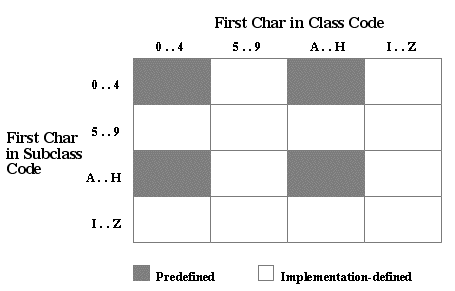

An application program must anticipate runtime errors and attempt to recover from them. This chapter provides an in-depth discussion of error reporting and recovery. You learn how to handle errors and status changes using the SQLSTATE status variable, as well as the SQL Communications Area (SQLCA) and the WHENEVER directive. You also learn how to diagnose problems using the Oracle Communications Area (ORACA). This chapter contains the following topics:

- The Need for Error Handling

- Error Handling Alternatives

- The SQLSTATE Status Variable

- About Declaring SQLCODE

- Key Components of Error Reporting Using the SQLCA

- Using the SQL Communications Area (SQLCA)

- About Getting the Full Text of Error Messages

- About Using the WHENEVER Directive

- About Obtaining the Text of SQL Statements

- About Using the Oracle Communications Area (ORACA)

### 9.1 The Need for Error Handling

A significant part of every application program must be devoted to error handling. The main reason for error handling is that it allows your program to continue operating in the presence of errors. Errors arise from design faults, coding mistakes, hardware failures, invalid user input, and many other sources.

You cannot anticipate all possible errors, but you can plan to handle certain kinds of errors that are meaningful to your program. For the Pro\*C/C++ Precompiler, error handling means detecting and recovering from SQL statement execution errors. You can also prepare to handle warnings such as "value truncated" and status changes such as "end of data." It is especially important to check for error and warning conditions after every SQL data manipulation statement, because an INSERT, UPDATE, or DELETE statement might fail before processing all eligible rows in a table.

### 9.2 Error Handling Alternatives

There are several alternatives that you can use to detect errors and status changes in the application. This chapter describes these alternatives, however, no specific recommendations are made about what method you should use. The method is, after all, dictated by the design of the application program or tool that you are building.

#### 9.2.1 Status Variables

You can declare a separate status variable, SQLSTATE or SQLCODE, examine its value after each executable SQL statement, and take appropriate action. The action might be calling an error-reporting function, then exiting the program if the error is unrecoverable. Or, you might be able to adjust data or control variables and retry the action.

**Related Topics**

- The SQLSTATE Status Variable
- About Declaring SQLCODE

#### 9.2.2  The SQL Communications Area

Another alternative that you can use is to include the SQL Communications Area structure (sqlca) in your program. This structure contains components that are filled in at runtime after the SQL statement is processed by Oracle.

**Note:**

In this guide, the sqlca structure is commonly referred to using the acronym for SQL Communications Area (SQLCA). When this guide refers to a specific component in the C struct, the structure name (sqlca) is used.

The SQLCA is defined in the header file `sqlca.h`, which you include in your program using either of the following statements:

- EXEC SQL INCLUDE SQLCA;

- \#include \<sqlca.h\>

Oracle updates the SQLCA after every executable SQL statement. (SQLCA values are unchanged after a declarative statement.) By checking Oracle return codes stored in the SQLCA, your program can determine the outcome of a SQL statement. This can be done in the following two ways:

- Implicit checking with the WHENEVER directive

- Explicit checking of SQLCA components

You can use WHENEVER directives, code explicit checks on SQLCA components, or do both.

The most frequently-used components in the SQLCA are the status variable (sqlca.sqlcode), and the text associated with the error code (sqlca.sqlerrm.sqlerrmc). Other components contain warning flags and miscellaneous information about the processing of the SQL statement.

**Note:**

SQLCODE (upper case) always refers to a separate status variable, not a component of the SQLCA. SQLCODE is declared as a integer. When referring to the component of the SQLCA named sqlcode, the fully-qualified name sqlca.sqlcode is always used.

When more information is needed about runtime errors than the SQLCA provides, you can use the ORACA. The ORACA is a C struct that handles Oracle communication. It contains cursor statistics, information about the current SQL statement, option settings, and system statistics.

**Related Topics**

- About Using the Oracle Communications Area (ORACA)
- Using the SQL Communications Area (SQLCA)

### 9.3 The SQLSTATE Status Variable

The precompiler command line option MODE governs ANSI/ISO compliance. When MODE=ANSI, declaring the SQLCA data structure is optional. However, you must declare a separate status variable named SQLCODE. The SQL standard specifies a similar status variable named SQLSTATE, which you can use with or without SQLCODE.

After executing a SQL statement, the Oracle Server returns a status code to the SQLSTATE variable currently in scope. The status code indicates whether the SQL statement executed successfully or raised an exception (error or warning condition). To promote interoperability (the ability of systems to exchange information easily), the SQL standard predefines all the common SQL exceptions.

Unlike SQLCODE, which stores only error codes, SQLSTATE stores error and warning codes. Furthermore, the SQLSTATE reporting mechanism uses a standardized coding scheme. Thus, SQLSTATE is the preferred status variable. SQLCODE was a deprecated feature of SQL-92 that was retained only for compatibility with SQL-89. SQLCODE has been removed from all editions of the SQL standard subsequent to SQL-92.

#### 9.3.1  About Declaring SQLSTATE

When MODE=ANSI, you must declare SQLSTATE or SQLCODE. Declaring the SQLCA is optional. When MODE=ORACLE, if you declare SQLSTATE, it is not used.

Unlike SQLCODE, which stores signed integers and can be declared outside the Declare Section, SQLSTATE stores 5-character null-terminated strings and must be declared inside the Declare Section. You declare SQLSTATE as

    char  SQLSTATE[6];  /* Upper case is required. */

**Note:**

SQLSTATE must be declared with a dimension of exactly 6 characters.

#### 9.3.2  SQLSTATE Values

SQLSTATE status codes consist of a 2-character class code immediately followed by a 3-character subclass code. Aside from class code 00 ("successful completion",) the class code denotes a category of exceptions. And, aside from subclass code 000 ("not applicable",) the subclass code denotes a specific exception within that category. For example, the SQLSTATE value '22012' consists of class code 22 ("data exception") and subclass code 012 ("division by zero").

Each of the five characters in a SQLSTATE value is a digit (0..9) or an uppercase Latin letter (A..Z). Class codes that begin with a digit in the range 0..4 or a letter in the range A..H are reserved for predefined conditions (those defined in the SQL standard). All other class codes are reserved for implementation-defined conditions. Within predefined classes, subclass codes that begin with a digit in the range 0..4 or a letter in the range A..H are reserved for predefined subconditions. All other subclass codes are reserved for implementation-defined subconditions. Figure 9-1 shows the coding scheme.

Figure 9-1 SQLSTATE Coding Scheme

[Description of "Figure 9-1 SQLSTATE Coding Scheme"](img_text/sqlstate.md)

Table 9-1 shows the classes predefined by SQL92.

Table 9-1 Predefined Class Codes

| Class | Condition                                                 |
|:------|:----------------------------------------------------------|
| 00    | success completion                                        |
| 01    | warning                                                   |
| 02    | no data                                                   |
| 07    | dynamic SQL error                                         |
| 08    | connection exception                                      |
| 09    | triggered action exception                                |
| 0A    | feature not supported                                     |
| 0D    | invalid target type specification                         |
| 0E    | invalid schema name list specification                    |
| 0F    | locator exception                                         |
| 0L    | invalid grantor                                           |
| 0M    | invalid SQL-invoked procedure reference                   |
| 0P    | invalid role specification                                |
| 0S    | invalid transform group name specification                |
| 0T    | target table disagrees with cursor specification          |
| 0U    | attempt to assign to non-updatable column                 |
| 0V    | attempt to assign to ordering column                      |
| 0W    | prohibited statement encountered during trigger execution |
| 0Z    | diagnostics exception                                     |
| 21    | cardinality violation                                     |
| 22    | data exception                                            |
| 23    | integrity constraint violation                            |
| 24    | invalid cursor state                                      |
| 25    | invalid transaction state                                 |
| 26    | invalid SQL statement name                                |
| 27    | triggered data change violation                           |
| 28    | invalid authorization specification                       |
| 2A    | direct SQL syntax error or access rule violation          |
| 2B    | dependent privilege descriptors still exist               |
| 2C    | invalid character set name                                |
| 2D    | invalid transaction termination                           |
| 2E    | invalid connection name                                   |
| 2F    | SQL routine exception                                     |
| 2H    | invalid collation name                                    |
| 30    | invalid SQL statement identifier                          |
| 33    | invalid SQL descriptor name                               |
| 34    | invalid cursor name                                       |
| 35    | invalid condition number                                  |
| 36    | cursor sensitivity exception                              |
| 37    | dynamic SQL syntax error or access rule violation         |
| 38    | external routine exception                                |
| 39    | external routine invocation exception                     |
| 3B    | savepoint exception                                       |
| 3C    | ambiguous cursor name                                     |
| 3D    | invalid catalog name                                      |
| 3F    | invalid schema name                                       |
| 40    | transaction rollback                                      |
| 42    | syntax error or access rule violation                     |
| 44    | with check option violation                               |
| HZ    | remote database access                                    |

**Note:**

The class code HZ is reserved for conditions defined in International Standard ISO/IEC DIS 9579-2, Remote Database Access.

Table 9-2 shows how SQLSTATE status codes and conditions are mapped to Oracle errors. Status codes in the range 60000 to 99999 are implementation-defined.

Table 9-2 SQLSTATE Status Codes

| Code  | Condition                                                                             | Oracle Error(s)                                                                                                                                                                                                                             |
|:------|:--------------------------------------------------------------------------------------|:--------------------------------------------------------------------------------------------------------------------------------------------------------------------------------------------------------------------------------------------|
| 00000 | successful completion                                                                 | ORA-00000                                                                                                                                                                                                                                   |
| 01000 | warning                                                                               | --                                                                                                                                                                                                                                          |
| 01001 | cursor operation conflict                                                             | --                                                                                                                                                                                                                                          |
| 01002 | disconnect error                                                                      | --                                                                                                                                                                                                                                          |
| 01003 | NULL value eliminated in set function                                                 | --                                                                                                                                                                                                                                          |
| 01004 | string data-right truncation                                                          | --                                                                                                                                                                                                                                          |
| 01005 | insufficient item descriptor areas                                                    | --                                                                                                                                                                                                                                          |
| 01006 | privilege not revoked                                                                 | --                                                                                                                                                                                                                                          |
| 01007 | privilege not granted                                                                 | --                                                                                                                                                                                                                                          |
| 01008 | implicit zero-bit padding                                                             | --                                                                                                                                                                                                                                          |
| 01009 | search condition too long for info schema                                             | --                                                                                                                                                                                                                                          |
| 0100A | query expression too long for info schema                                             | --                                                                                                                                                                                                                                          |
| 02000 | no data                                                                               | ORA-01095 ORA-01403                                                                                                                                                                                                                      |
| 07000 | dynamic SQL error                                                                     | --                                                                                                                                                                                                                                          |
| 07001 | using clause does not match parameter specs                                           | --                                                                                                                                                                                                                                          |
| 07002 | using clause does not match target specs                                              | --                                                                                                                                                                                                                                          |
| 07003 | cursor specification cannot be executed                                               | --                                                                                                                                                                                                                                          |
| 07004 | using clause required for dynamic parameters                                          | --                                                                                                                                                                                                                                          |
| 07005 | prepared statement not a cursor specification                                         | --                                                                                                                                                                                                                                          |
| 07006 | restricted datatype attribute violation                                               | --                                                                                                                                                                                                                                          |
| 07007 | using clause required for result components invalid descriptor count                  | --                                                                                                                                                                                                                                          |
| 07008 | invalid descriptor count                                                              | SQL-02126                                                                                                                                                                                                                                   |
| 07009 | invalid descriptor index                                                              | --                                                                                                                                                                                                                                          |
| 08000 | connection exception                                                                  | --                                                                                                                                                                                                                                          |
| 08001 | SQL-client unable to establish SQL-connection                                         | --                                                                                                                                                                                                                                          |
| 08002 | connection name is use                                                                | --                                                                                                                                                                                                                                          |
| 08003 | connection does not exist                                                             | SQL-02121                                                                                                                                                                                                                                   |
| 08004 | SQL-server rejected SQL-connection                                                    | --                                                                                                                                                                                                                                          |
| 08006 | connection failure                                                                    | --                                                                                                                                                                                                                                          |
| 08007 | transaction resolution unknown                                                        | --                                                                                                                                                                                                                                          |
| 0A000 | feature not supported                                                                 | ORA-03000..03099                                                                                                                                                                                                                            |
| 0A001 | multiple server transactions                                                          | --                                                                                                                                                                                                                                          |
| 21000 | cardinality violation                                                                 | ORA-01427 SQL-02112                                                                                                                                                                                                                      |
| 22000 | data exception                                                                        | --                                                                                                                                                                                                                                          |
| 22001 | string data - right truncation                                                        | ORA-01406                                                                                                                                                                                                                                   |
| 22002 | NULL value-no indicator parameter                                                     | SQL-02124                                                                                                                                                                                                                                   |
| 22003 | numeric value out of range                                                            | ORA-01426                                                                                                                                                                                                                                   |
| 22005 | error in assignment                                                                   | --                                                                                                                                                                                                                                          |
| 22007 | invalid datetime format                                                               | --                                                                                                                                                                                                                                          |
| 22008 | datetime field overflow                                                               | ORA-01800..01899                                                                                                                                                                                                                            |
| 22009 | invalid time zone displacement value                                                  | --                                                                                                                                                                                                                                          |
| 22011 | substring error                                                                       | --                                                                                                                                                                                                                                          |
| 22012 | division by zero                                                                      | ORA-01476                                                                                                                                                                                                                                   |
| 22015 | interval field overflow                                                               | --                                                                                                                                                                                                                                          |
| 22018 | invalid character value for cast                                                      | --                                                                                                                                                                                                                                          |
| 22019 | invalid escape character                                                              | ORA-00911                                                                                                                                                                                                                                   |
| 22021 | character not in repertoire                                                           | --                                                                                                                                                                                                                                          |
| 22022 | indicator overflow                                                                    | ORA-01411                                                                                                                                                                                                                                   |
| 22023 | invalid parameter value                                                               | ORA-01025 ORA-04000..04019                                                                                                                                                                                                               |
| 22024 | unterminated C string                                                                 | ORA-01479 ORA-01480                                                                                                                                                                                                                      |
| 22025 | invalid escape sequence                                                               | ORA-01424 ORA-01425                                                                                                                                                                                                                      |
| 22026 | string data-length mismatch                                                           | ORA-01401                                                                                                                                                                                                                                   |
| 22027 | trim error                                                                            | \-                                                                                                                                                                                                                                          |
| 23000 | integrity constraint violation                                                        | ORA-1400, ORA-02290..02299                                                                                                                                                                                                                  |
| 24000 | invalid cursor state                                                                  | ORA-001002 ORA-001003 SQL-02114 SQL-02117                                                                                                                                                                                          |
| 25000 | invalid transaction state                                                             | SQL-02118                                                                                                                                                                                                                                   |
| 26000 | invalid SQL statement name                                                            | --                                                                                                                                                                                                                                          |
| 27000 | triggered data change violation                                                       | --                                                                                                                                                                                                                                          |
| 28000 | invalid authorization specification                                                   | --                                                                                                                                                                                                                                          |
| 2A000 | direct SQL syntax error or access rule violation                                      | --                                                                                                                                                                                                                                          |
| 2B000 | dependent privilege descriptors still exist                                           | --                                                                                                                                                                                                                                          |
| 2C000 | invalid character set name                                                            | --                                                                                                                                                                                                                                          |
| 2D000 | invalid transaction termination                                                       | --                                                                                                                                                                                                                                          |
| 2E000 | invalid connection name                                                               | --                                                                                                                                                                                                                                          |
| 33000 | invalid SQL descriptor name                                                           | --                                                                                                                                                                                                                                          |
| 34000 | invalid cursor name                                                                   | --                                                                                                                                                                                                                                          |
| 35000 | invalid condition number                                                              | --                                                                                                                                                                                                                                          |
| 37000 | dynamic SQL syntax error or access rule violation                                     | --                                                                                                                                                                                                                                          |
| 3C000 | ambiguous cursor name                                                                 | --                                                                                                                                                                                                                                          |
| 3D000 | invalid catalog name                                                                  | --                                                                                                                                                                                                                                          |
| 3F000 | invalid schema name                                                                   | --                                                                                                                                                                                                                                          |
| 40000 | transaction rollback                                                                  | ORA-02091 ORA-02092                                                                                                                                                                                                                      |
| 40001 | serialization failure                                                                 | --                                                                                                                                                                                                                                          |
| 40002 | integrity constraint violation                                                        | --                                                                                                                                                                                                                                          |
| 40003 | statement completion unknown                                                          | --                                                                                                                                                                                                                                          |
| 42000 | syntax error or access rule violation                                                 | ORA-00022 ORA-00251 ORA-00900..00999 ORA-01031 ORA-01490..01493 ORA-01700..01799 ORA-01900..02099 ORA-02140..02289 ORA-02420..02424 ORA-02450..02499 ORA-03276..03299 ORA-04040..04059 ORA-04070..04099 |
| 44000 | with check option violation                                                           | ORA-01402                                                                                                                                                                                                                                   |
| 60000 | system error                                                                          | ORA-00370..00429 ORA-00600..00899 ORA-06430..06449 ORA-07200..07999 ORA-09700..09999                                                                                                                                            |
| 61000 | shared server and detached process errors                                             | ORA-00018..00035 ORA-00050..00068 ORA-02376..02399 ORA-04020..04039                                                                                                                                                                |
| 62000 | shared server and detached process errors                                             | ORA-00100..00120 ORA-00440..00569                                                                                                                                                                                                        |
| 63000 | Oracle\*XA and two-task interface errors                                              | ORA-00150..00159 ORA-02700..02899 ORA-03100..03199 ORA-06200..06249 SQL-02128                                                                                                                                                   |
| 64000 | control file, database file, and redo file errors; archival and media recovery errors | ORA-00200..00369 ORA-01100..01250                                                                                                                                                                                                        |
| 65000 | PL/SQL errors                                                                         | ORA-06500..06599                                                                                                                                                                                                                            |
| 66000 | Oracle Net driver errors                                                              | ORA-06000..06149 ORA-06250..06429 ORA-06600..06999 ORA-12100..12299 ORA-12500..12599                                                                                                                                            |
| 67000 | licensing errors                                                                      | ORA-00430..00439                                                                                                                                                                                                                            |
| 69000 | SQL\*Connect errors                                                                   | ORA-00570..00599 ORA-07000..07199                                                                                                                                                                                                        |
| 72000 | SQL execute phase errors                                                              | ORA-00001 ORA-01000..01099 ORA-01401..01489 ORA-01495..01499 ORA-01500..01699 ORA-02400..02419 ORA-02425..02449 ORA-04060..04069 ORA-08000..08190 ORA-12000..12019 ORA-12300..12499 ORA-12700..21999       |
| 82100 | out of memory (could not allocate)                                                    | SQL-02100                                                                                                                                                                                                                                   |
| 82101 | inconsistent cursor cache (UCE/CUC mismatch)                                          | SQL-02101                                                                                                                                                                                                                                   |
| 82102 | inconsistent cursor cache (no CUC entry for UCE)                                      | SQL-02102                                                                                                                                                                                                                                   |
| 82103 | inconsistent cursor cache (out-or-range CUC ref)                                      | SQL-02103                                                                                                                                                                                                                                   |
| 82104 | inconsistent cursor cache (no CUC available)                                          | SQL-02104                                                                                                                                                                                                                                   |
| 82105 | inconsistent cursor cache (no CUC entry in cache)                                     | SQL-02105                                                                                                                                                                                                                                   |
| 82106 | inconsistent cursor cache (invalid cursor number)                                     | SQL-02106                                                                                                                                                                                                                                   |
| 82107 | program too old for runtime library; re-precompile                                    | SQL-02107                                                                                                                                                                                                                                   |
| 82108 | invalid descriptor passed to runtime library                                          | SQL-02108                                                                                                                                                                                                                                   |
| 82109 | inconsistent host cache (out-or-range SIT ref)                                        | SQL-02109                                                                                                                                                                                                                                   |
| 82110 | inconsistent host cache (invalid SQL type)                                            | SQL-02110                                                                                                                                                                                                                                   |
| 82111 | heap consistency error                                                                | SQL-02111                                                                                                                                                                                                                                   |
| 82113 | code generation internal consistency failed                                           | SQL-02115                                                                                                                                                                                                                                   |
| 82114 | reentrant code generator gave invalid context                                         | SQL-02116                                                                                                                                                                                                                                   |
| 82117 | invalid OPEN or PREPARE for this connection                                           | SQL-02122                                                                                                                                                                                                                                   |
| 82118 | application context not found                                                         | SQL-02123                                                                                                                                                                                                                                   |
| 82119 | unable to obtain error message text                                                   | SQL-02125                                                                                                                                                                                                                                   |
| 82120 | Precompiler/SQLLIB version mismatch                                                   | SQL-02127                                                                                                                                                                                                                                   |
| 82121 | NCHAR error; fetched number of bytes is odd                                           | SQL-02129                                                                                                                                                                                                                                   |
| 82122 | EXEC TOOLS interface not available                                                    | SQL-02130                                                                                                                                                                                                                                   |
| 82123 | runtime context in use                                                                | SQL-02131                                                                                                                                                                                                                                   |
| 82124 | unable to allocate runtime context                                                    | SQL-02132                                                                                                                                                                                                                                   |
| 82125 | unable to initialize process for use with threads                                     | SQL-02133                                                                                                                                                                                                                                   |
| 82126 | invalid runtime context                                                               | SQL-02134                                                                                                                                                                                                                                   |
| HZ000 | remote database access                                                                | --                                                                                                                                                                                                                                          |

#### 9.3.3 About Using SQLSTATE

The following rules apply to using SQLSTATE with SQLCODE or the SQLCA when you precompile with the option setting MODE=ANSI. SQLSTATE must be declared inside a Declare Section; otherwise, it is ignored.

##### 9.3.3.1 If You Declare SQLSTATE

- Declaring SQLCODE is optional. If you declare SQLCODE inside the Declare Section, the Oracle Server returns status codes to SQLSTATE and SQLCODE after every SQL operation. However, if you declare SQLCODE outside of the Declare Section, Oracle returns a status code only to SQLSTATE.

- Declaring the SQLCA is optional. If you declare the SQLCA, Oracle returns status codes to SQLSTATE and the SQLCA. In this case, to avoid compilation errors, do not declare SQLCODE.

##### 9.3.3.2 If You Do not Declare SQLSTATE

- You must declare SQLCODE inside or outside the Declare Section. The Oracle Server returns a status code to SQLCODE after every SQL operation.

- Declaring the SQLCA is optional. If you declare the SQLCA, Oracle returns status codes to SQLCODE and the SQLCA.

You can learn the outcome of the most recent executable SQL statement by checking SQLSTATE explicitly with your own code or implicitly with the WHENEVER SQLERROR directive. Check SQLSTATE only after executable SQL statements and PL/SQL statements.

### 9.4 About Declaring SQLCODE

When MODE=ANSI, and you have not declared a SQLSTATE status variable, you must declare a long integer variable named SQLCODE inside or outside the Declare Section. An example follows:

    /* declare host variables */
    EXEC SQL BEGIN DECLARE SECTION;
    int  emp_number, dept_number;
    char emp_name[20];
    EXEC SQL END DECLARE SECTION;

    /* declare status variable--must be upper case */
    long SQLCODE;

When MODE=ORACLE, if you declare SQLCODE, it is not used.

You can declare more than one SQLCODE. Access to a local SQLCODE is limited by its scope within your program.

After every SQL operation, Oracle returns a status code to the SQLCODE currently in scope. So, your program can learn the outcome of the most recent SQL operation by checking SQLCODE explicitly, or implicitly with the WHENEVER directive.

When you declare SQLCODE instead of the SQLCA in a particular compilation unit, the precompiler allocates an internal SQLCA for that unit. Your host program cannot access the internal SQLCA. If you declare the SQLCA and SQLCODE, Oracle returns the same status code to both after every SQL operation.

### 9.5 Key Components of Error Reporting Using the SQLCA

Error reporting depends on variables in the SQLCA. This section highlights the key components of error reporting. The next section takes a close look at the SQLCA.

#### 9.5.1 Status Codes

Every executable SQL statement returns a status code to the SQLCA variable sqlcode, which you can check implicitly with the WHENEVER directive or explicitly with your own code.

A zero status code means that Oracle executed the statement without detecting an error or exception. A positive status code means that Oracle executed the statement but detected an exception. A negative status code means that Oracle did not execute the SQL statement because of an error.

#### 9.5.2 Warning Flags

Warning flags are returned in the SQLCA variables `sqlwarn[0]` through `sqlwarn[7]`, which you can check implicitly or explicitly. These warning flags are useful for runtime conditions not considered errors by Oracle. If no indicator variable is available, Oracle issues an error message.

#### 9.5.3 Rows-Processed Count

The number of rows processed by the most recently executed SQL statement is returned in the SQLCA variable `sqlca.sqlerrd[2]`, which you can check explicitly.

Strictly speaking, this variable is not for error reporting, but it can help you avoid mistakes. For example, suppose you expect to delete about ten rows from a table. After the deletion, you check `sqlca.sqlerrd[2]` and find that 75 rows were processed. To be safe, you might want to roll back the deletion and examine your WHERE-clause search condition.

#### 9.5.4 Parse Error Offsets

Before executing a SQL statement, Oracle must parse it to make sure it follows syntax rules and refers to valid database objects. If Oracle finds an error, an offset is stored in the SQLCA variable `sqlca.sqlerrd[4]`, which you can check explicitly. The offset specifies the character position in the SQL statement at which the parse error begins. As in a normal C string, the first character occupies position zero. For example, if the offset is 9, the parse error begins at the 10th character.

The parse error offset is used for situations where a separate prepare/parse is performed. This is typical for dynamic SQL statements.

Parse errors may arise from missing, misplaced, or misspelled keywords, invalid options, and the like. For example, the dynamic SQL statement:

    "UPDATE emp SET jib = :job_title WHERE empno = :emp_number"

causes the parse error

    ORA-00904: invalid column name

because the column name JOB is misspelled. The value of `sqlca.sqlerrd[4]` is 15 because the erroneous column name JIB begins at the 16th character.

If your SQL statement does not cause a parse error, Oracle sets `sqlca.sqlerrd[4]` to zero. Oracle also sets `sqlca.sqlerrd[4]` to zero if a parse error begins at the first character (which occupies position zero). So, check `sqlca.sqlerrd[4] `only if sqlca.sqlcode is negative, which means that an error has occurred.

#### 9.5.5 Error Message Text

The error code and message for Oracle errors are available in the SQLCA variable SQLERRMC. At most, the first 70 characters of text are stored. To get the full text of messages longer than 70 characters, you use the `sqlglm()` function.

**Related Topics**

- About Getting the Full Text of Error Messages

### 9.6 Using the SQL Communications Area (SQLCA)

The SQLCA is a data structure. Its components contain error, warning, and status information updated by Oracle whenever a SQL statement is executed. Thus, the SQLCA always reflects the outcome of the most recent SQL operation. To determine the outcome, you can check variables in the SQLCA.

Your program can have more than one SQLCA. For example, it might have one global SQLCA and several local ones. Access to a local SQLCA is limited by its scope within the program. Oracle returns information only to the SQLCA that is in scope.

**Note:**

When your application uses Oracle Net to access a combination of local and remote databases concurrently, all the databases write to one SQLCA. There is not a different SQLCA for each database.

**Related Topics**

- [Advanced Connection Options](database-concepts.md)

#### 9.6.1 About Declaring the SQLCA

When MODE=ORACLE, declaring the SQLCA is required. To declare the SQLCA, you should copy it into your program with the INCLUDE or \#include statement, as follows:

    EXEC SQL INCLUDE SQLCA;

or

    #include <sqlca.h>

If you use a Declare Section, the SQLCA must be declared outside the Declare Section. Not declaring the SQLCA results in compile-time errors.

When you precompile your program, the INCLUDE SQLCA statement is replaced by several variable declarations that allow Oracle to communicate with the program.

When MODE=ANSI, declaring the SQLCA is optional. But in this case you must declare a SQLCODE or SQLSTATE status variable. The type of SQLCODE (upper case is required) is int. If you declare SQLCODE or SQLSTATE instead of the SQLCA in a particular compilation unit, the precompiler allocates an internal SQLCA for that unit. Your Pro\*C/C++ program cannot access the internal SQLCA. If you declare the SQLCA and SQLCODE, Oracle returns the same status code to both after every SQL operation.

**Note:**

Declaring the SQLCA is optional when MODE=ANSI, but you cannot use the WHENEVER SQLWARNING directive without the SQLCA. So, if you want to use the WHENEVER SQLWARNING directive, you must declare the SQLCA.

This Guide uses SQLCODE when referring to the SQLCODE status variable, and sqlca.sqlcode when explicitly referring to the component of the SQLCA structure.

#### 9.6.2 SQLCA Contents

The SQLCA contains the following runtime information about the outcome of SQL statements:

- Oracle error codes

- Warning flags

- Event information

- Rows-processed count

- Diagnostics

The `sqlca.h` header file is:

    /*
    NAME
      SQLCA : SQL Communications Area.
    FUNCTION
      Contains no code. Oracle fills in the SQLCA with status info
      during the execution of a SQL stmt.
    NOTES
      **************************************************************
      ***                                                        ***
      *** This file is SOSD.  Porters must change the data types ***
      *** appropriately on their platform.  See notes/pcport.doc ***
      *** for more information.                                  ***
      ***                                                        ***
      **************************************************************

      If the symbol SQLCA_STORAGE_CLASS is defined, then the SQLCA
      will be defined to have this storage class. For example:

        #define SQLCA_STORAGE_CLASS extern

      will define the SQLCA as an extern.

      If the symbol SQLCA_INIT is defined, then the SQLCA will be
      statically initialized. Although this is not necessary in order
      to use the SQLCA, it is a good programing practice not to have
      unitialized variables. However, some C compilers/operating systems
      don't allow automatic variables to be initialized in this manner.
      Therefore, if you are INCLUDE'ing the SQLCA in a place where it
      would be an automatic AND your C compiler/operating system doesn't
      allow this style of initialization, then SQLCA_INIT should be left
      undefined -- all others can define SQLCA_INIT if they wish.

      If the symbol SQLCA_NONE is defined, then the SQLCA
      variable will not be defined at all.  The symbol SQLCA_NONE
      should not be defined in source modules that have embedded SQL.
      However, source modules that have no embedded SQL, but need to
      manipulate a sqlca struct passed in as a parameter, can set the
      SQLCA_NONE symbol to avoid creation of an extraneous sqlca
      variable.
    */
    #ifndef SQLCA
    #define SQLCA 1
    struct   sqlca
             {
             /* ub1 */ char    sqlcaid[8];
             /* b4  */ long    sqlabc;
             /* b4  */ long    sqlcode;
             struct
               {
               /* ub2 */ unsigned short sqlerrml;
               /* ub1 */ char           sqlerrmc[70];
               } sqlerrm;
             /* ub1 */ char    sqlerrp[8];
             /* b4  */ long    sqlerrd[6];
             /* ub1 */ char    sqlwarn[8];
             /* ub1 */ char    sqlext[8];
             };
    #ifndef SQLCA_NONE
    #ifdef   SQLCA_STORAGE_CLASS
    SQLCA_STORAGE_CLASS struct sqlca sqlca
    #else
             struct sqlca sqlca
    #endif
    #ifdef  SQLCA_INIT
             = {
             {'S', 'Q', 'L', 'C', 'A', ' ', ' ', ' '},
             sizeof(struct sqlca),
             0,
             { 0, {0}},
             {'N', 'O', 'T', ' ', 'S', 'E', 'T', ' '},
             {0, 0, 0, 0, 0, 0},
             {0, 0, 0, 0, 0, 0, 0, 0},
             {0, 0, 0, 0, 0, 0, 0, 0}
             }
    #endif
             ;
    #endif
    #endif

#### 9.6.3 SQLCA Structure

This section describes the structure of the SQLCA, its components, and the values they can store.

##### 9.6.3.1 sqlcaid

This string component is initialized to "SQLCA" to identify the SQL Communications Area.

##### 9.6.3.2 sqlcabc

This integer component holds the length, in bytes, of the SQLCA structure.

##### 9.6.3.3 sqlcode

This integer component holds the status code of the most recently executed SQL statement. The status code, which indicates the outcome of the SQL operation, can be any of the following numbers:

| Status Codes | Description                                                                                                                                                                                                 |
|:-------------|:------------------------------------------------------------------------------------------------------------------------------------------------------------------------------------------------------------|
| 0            | Means that Oracle executed the statement without detecting an error or exception.                                                                                                                           |
| \>0          | Means that Oracle executed the statement but detected an exception. This occurs when Oracle cannot find a row that meets your WHERE-clause search condition or when a SELECT INTO or FETCH returns no rows. |

When MODE=ANSI, +100 is returned to sqlcode after an INSERT of no rows. This can happen when a subquery returns no rows to process.

- \<0 - Means that Oracle did not execute the statement because of a database, system, network, or application error. Such errors can be fatal. When they occur, the current transaction should, in most cases, be rolled back.

Negative return codes correspond to error codes listed in[ Oracle Database Error Messages](../errmg/index.md)

##### 9.6.3.4 sqlerrm

This embedded struct contains the following two components:

| Components | Description                                                                                                                                                                            |
|:-----------|:---------------------------------------------------------------------------------------------------------------------------------------------------------------------------------------|
| sqlerrml   | This integer component holds the length of the message text stored in sqlerrmc.                                                                                                        |
| sqlerrmc   | This string component holds the message text corresponding to the error code stored in sqlcode. The string is not null terminated. Use the sqlerrml component to determine the length. |

This component can store up to 70 characters. To get the full text of messages longer than 70 characters, you must use the `sqlglm()` function (discussed later).

Make sure sqlcode is negative before you reference sqlerrmc. If you reference sqlerrmc when sqlcode is zero, you get the message text associated with a prior SQL statement.

##### 9.6.3.5 sqlerrp

This string component is reserved for future use.

##### 9.6.3.6 sqlerrd

This array of binary integers has six elements. Descriptions of the components in sqlerrd follow:

| Components   | Description                                                                                                                                                                                                                                                                                                                                                                       |
|:-------------|:----------------------------------------------------------------------------------------------------------------------------------------------------------------------------------------------------------------------------------------------------------------------------------------------------------------------------------------------------------------------------------|
| sqlerrd\[0\] | This component is reserved for future use.                                                                                                                                                                                                                                                                                                                                        |
| sqlerrd\[1\] | This component is reserved for future use.                                                                                                                                                                                                                                                                                                                                        |
| sqlerrd\[2\] | This component holds the number of rows processed by the most recently executed SQL statement. However, if the SQL statement failed, the value of sqlca.sqlerrd\[2\] is undefined, with one exception. If the error occurred during an array operation, processing stops at the row that caused the error, so sqlca.sqlerrd\[2\] gives the number of rows processed successfully. |

The rows-processed count is zeroed after an OPEN statement and incremented after a FETCH statement. For the EXECUTE, INSERT, UPDATE, DELETE, and SELECT INTO statements, the count reflects the number of rows processed successfully. The count does not include rows processed by an UPDATE or DELETE CASCADE. For example, if 20 rows are deleted because they meet WHERE-clause criteria, and 5 more rows are deleted because they now (after the primary delete) violate column constraints, the count is 20 not 25.

| Components   | Description                                                                                                                                                                                 |
|:-------------|:--------------------------------------------------------------------------------------------------------------------------------------------------------------------------------------------|
| sqlerrd\[3\] | This component is reserved for future use.                                                                                                                                                  |
| sqlerrd\[4\] | This component holds an offset that specifies the character position at which a parse error begins in the most recently executed SQL statement. The first character occupies position zero. |
| sqlerrd\[5\] | This component is reserved for future use.                                                                                                                                                  |

##### 9.6.3.7 sqlwarn

This array of single characters has eight elements. They are used as warning flags. Oracle sets a flag by assigning it a "W" (for warning) character value.

The flags warn of exceptional conditions. For example, a warning flag is set when Oracle assigns a truncated column value to an output host variable.

Descriptions of the components in sqlwarn follow:

| Components   | Description                                                                                                                                                                                                                 |
|:-------------|:----------------------------------------------------------------------------------------------------------------------------------------------------------------------------------------------------------------------------|
| sqlwarn\[0\] | This flag is set if another warning flag is set.                                                                                                                                                                            |
| sqlwarn\[1\] | This flag is set if a truncated column value was assigned to an output host variable. This applies only to character data. Oracle truncates certain numeric data without setting a warning or returning a negative sqlcode. |

To find out if a column value was truncated and by how much, check the indicator variable associated with the output host variable. The (positive) integer returned by an indicator variable is the original length of the column value. You can increase the length of the host variable accordingly.

| Components   | Description                                                                                                                                                                                                              |
|:-------------|:-------------------------------------------------------------------------------------------------------------------------------------------------------------------------------------------------------------------------|
| sqlwarn\[2\] | This flag is set if a NULL column is not used in the result of a SQL group function, such as AVG() or SUM().                                                                                                             |
| sqlwarn\[3\] | This flag is set if the number of columns in a query select list does not equal the number of host variables in the INTO clause of the SELECT or FETCH statement. The number of items returned is the lesser of the two. |
| sqlwarn\[4\] | This flag is no longer in use.                                                                                                                                                                                           |
| sqlwarn\[5\] | This flag is set when an EXEC SQL CREATE {PROCEDURE \| FUNCTION \| PACKAGE \| PACKAGE BODY} statement fails because of a PL/SQL compilation error.                                                                       |
| sqlwarn\[6\] | This flag is no longer in use.                                                                                                                                                                                           |
| sqlwarn\[7\] | This flag is no longer in use.                                                                                                                                                                                           |

##### 9.6.3.8 sqlext

This string component is reserved for future use.

#### 9.6.4 PL/SQL Considerations

When the precompiler application executes an embedded PL/SQL block, not all components of the SQLCA are set. For example, if the block fetches several rows, the rows-processed count (`sqlerrd[2]`) is set to only 1. You should depend only on the sqlcode and sqlerrm components of the SQLCA after execution of a PL/SQL block.

### 9.7 About Getting the Full Text of Error Messages

The SQLCA can accommodate error messages up to 70 characters long. To get the full text of longer (or nested) error messages, you need to use the `sqlglm()` function. The syntax is

    void sqlglm(unsigned char   *message_buffer,
                size_t *buffer_size,
                size_t *message_length);

where:

| Syntax         | Description                                                                                                           |
|:---------------|:----------------------------------------------------------------------------------------------------------------------|
| message_buffer | Is the text buffer in which you want Oracle to store the error message (Oracle blank-pads to the end of this buffer). |
| buffer_size    | Is a scalar variable that specifies the maximum size of the buffer in bytes.                                          |
| message_length | Is a scalar variable in which Oracle stores the actual length of the error message, if not truncated.                 |

**Note:**

The types of the last two arguments for the `sqlglm()` function are shown here generically as `size_t` pointers. However on your platform they might have a different type. For example, on many UNIX workstation ports, they are `unsigned int *`.

You should check the file `sqlcpr.h`, which is in the standard include directory on your system, to determine the datatype of these parameters.

The maximum length of an Oracle error message is 512 characters including the error code, nested messages, and message inserts such as table and column names. The maximum length of an error message returned by `sqlglm()` depends on the value you specify for buffer_size.

The following example calls `sqlglm()` to get an error message of up to 200 characters in length:

    EXEC SQL WHENEVER SQLERROR DO sql_error();
    ...
    /* other statements */
    ...
    sql_error()
    {
        char msg[200];
        size_t buf_len, msg_len;

        buf_len = sizeof (msg);
        sqlglm(msg, &buf_len, &msg_len);   /* note use of pointers */
        if (msg_len > buf_len)
        msg_len = buf_len;
        printf("%.*s\n\n", msg_len, msg);
        exit(1);
    }

Notice that `sqlglm()` is called only when a SQL error has occurred. Always make sure SQLCODE (or sqlca.sqlcode) is nonzero before calling sqlglm. If you call `sqlglm()` when SQLCODE is zero, you get the message text associated with a prior SQL statement.

**Note:**

In cases where multiple runtime contexts are used, use the version of sqlglmt() that takes a context to get the correct error message.

**Related Topics**

- [Multithreaded Applications](multithreaded-applications.md)

### 9.8 About Using the WHENEVER Directive

By default, precompiled programs ignore Oracle error and warning conditions and continue processing if possible. To do automatic condition checking and error handling, you need the WHENEVER directive.

With the WHENEVER directive you can specify actions to be taken when Oracle detects an error, warning condition, or "not found" condition. These actions include continuing with the next statement, calling a routine, branching to a labeled statement, or stopping.

You code the WHENEVER directive using the following syntax:

    EXEC SQL WHENEVER <condition> <action>;

#### 9.8.1 WHENEVER Conditions

You can have Oracle automatically check the SQLCA for any of the following conditions.

##### 9.8.1.1 SQLWARNING

`sqlwarn[0]` is set because Oracle returned a warning (one of the warning flags, `sqlwarn[1]` through `sqlwarn[7]`, is also set) or SQLCODE has a positive value other than +1403. For example, `sqlwarn[0]` is set when Oracle assigns a truncated column value to an output host variable.

Declaring the SQLCA is optional when MODE=ANSI. To use WHENEVER SQLWARNING, however, you must declare the SQLCA.

##### 9.8.1.2 SQLERROR

SQLCODE has a negative value because Oracle returned an error.

##### 9.8.1.3 NOT FOUND

SQLCODE has a value of +1403 (+100 when MODE=ANSI) because Oracle could not find a row that meets your WHERE-clause search condition, or a SELECT INTO or FETCH returned no rows.

When MODE=ANSI, +100 is returned to SQLCODE after an INSERT of no rows.

#### 9.8.2 WHENEVER Actions

When Oracle detects one of the preceding conditions, you can have your program take any of the following actions.

##### 9.8.2.1 CONTINUE

Your program continues to run with the next statement if possible. This is the default action, equivalent to not using the WHENEVER directive. You can use it to turn off condition checking.

##### 9.8.2.2 DO

Your program transfers control to an error handling function in the program. When the end of the routine is reached, control transfers to the statement that follows the failed SQL statement.

The usual rules for entering and exiting a function apply. You can pass parameters to the error handler invoked by an EXEC SQL WHENEVER ... DO ... directive, and the function can return a value.

##### 9.8.2.3 DO BREAK

An actual "break" statement is placed in your program. Use this action in loops. When the WHENEVER condition is met, your program exits the loop it is inside.

##### 9.8.2.4 DO CONTINUE

An actual "continue" statement is placed in your program. Use this action in loops. When the WHENEVER condition is met, your program continues with the next iteration of the loop it is inside.

##### 9.8.2.5 GOTO label_name

Your program branches to a labeled statement. Label names can be any length, but only the first 31 characters are significant. Your C compiler might require a different maximum length. Check your C compiler user's guide.

##### 9.8.2.6 STOP

Your program stops running and uncommitted work is rolled back.

STOP in effect just generates an `exit()` call whenever the condition occurs. Be careful. The STOP action displays no messages before disconnecting from Oracle.

#### 9.8.3 WHENEVER Examples

If you want your program to

- Go to close_cursor if a "no data found" condition occurs

- Continue with the next statement if a warning occurs

- Go to error_handler if an error occurs

you must code the following WHENEVER directives before the first executable SQL statement:

    EXEC SQL WHENEVER NOT FOUND GOTO close_cursor;
    EXEC SQL WHENEVER SQLWARNING CONTINUE;
    EXEC SQL WHENEVER SQLERROR GOTO error_handler;

In the following example, you use WHENEVER...DO directives to handle specific errors:

    ...
    EXEC SQL WHENEVER SQLERROR DO handle_insert_error("INSERT error");
    EXEC SQL INSERT INTO emp (empno, ename, deptno)
        VALUES (:emp_number, :emp_name, :dept_number);
    EXEC SQL WHENEVER SQLERROR DO handle_delete_error("DELETE error");
    EXEC SQL DELETE FROM dept WHERE deptno = :dept_number;
    ...
    handle_insert_error(char *stmt)
    {   switch(sqlca.sqlcode)
        {
        case -1:
        /* duplicate key value */
            ...
            break;
        case -1401:
        /* value too large */
            ...
            break;
        default:
        /* do something here too */
            ...
            break;
        }
    }

    handle_delete_error(char *stmt)
    {
        printf("%s\n\n", stmt);
        if (sqlca.sqlerrd[2] == 0)
        {
            /* no rows deleted */
            ...
        }
        else
        {   ...
        }
        ...
    }

Notice how the procedures check variables in the SQLCA to determine a course of action.

#### 9.8.4 Use of DO BREAK and DO CONTINUE

This example illustrates how to display employee name, salary, and commission for only those employees who receive commissions:

    #include <sqlca.h>
    #include <stdio.h>

    main()
    {
        char *uid = "scott/tiger";
        struct { char ename[12]; float sal; float comm; } emp;

        /* Trap any connection error that might occur. */
        EXEC SQL WHENEVER SQLERROR GOTO whoops;
        EXEC SQL CONNECT :uid;

        EXEC SQL DECLARE c CURSOR FOR
            SELECT ename, sal, comm FROM EMP ORDER BY ENAME ASC;

        EXEC SQL OPEN c;

        /* Set up 'BREAK' condition to exit the loop. */
        EXEC SQL WHENEVER NOT FOUND DO BREAK;
       /* The DO CONTINUE makes the loop start at the next iteration when an error occurs.*/
        EXEC SQL WHENEVER SQLERROR DO CONTINUE;

        while (1)
          {
              EXEC SQL FETCH c INTO :emp;
       /* An ORA-1405 would cause the 'continue' to occur. So only employees with */
       /* non-NULL commissions will be displayed. */
              printf("%s  %7.2f  %9.2f\n", emp.ename, emp.sal, emp.comm);
           }

    /* This 'CONTINUE' shuts off the 'DO CONTINUE' allowing the program to
       proceed if any further errors do occur, specifically, with the CLOSE */
        EXEC SQL WHENEVER SQLERROR CONTINUE;

        EXEC SQL CLOSE c;

        exit(EXIT_SUCCESS);

    whoops:
        printf("%.*s\n", sqlca.sqlerrm.sqlerrml, sqlca.sqlerrm.sqlerrmc);
        exit(EXIT_FAILURE);
    }

#### 9.8.5 Scope of WHENEVER

Because WHENEVER is a declarative statement, its scope is positional, not logical. That is, it tests all executable SQL statements that physically follow it in the source file, not in the flow of program logic. So, code the WHENEVER directive before the first executable SQL statement you want to test.

A WHENEVER directive stays in effect until superseded by another WHENEVER directive checking for the same condition.

In the following example, the first WHENEVER SQLERROR directive is superseded by a second, and so applies only to the CONNECT statement. The second WHENEVER SQLERROR directive applies to both the UPDATE and DROP statements, despite the flow of control from step1 to step3.

    step1:
        EXEC SQL WHENEVER SQLERROR STOP;
        EXEC SQL CONNECT :username IDENTIFIED BY :password;
        ...
        goto step3;
    step2:
        EXEC SQL WHENEVER SQLERROR CONTINUE;
        EXEC SQL UPDATE emp SET sal = sal * 1.10;
        ...
    step3:
        EXEC SQL DROP INDEX emp_index;
        ...

#### 9.8.6 Guidelines for WHENEVER

The following guidelines will help you avoid some common pitfalls.

##### 9.8.6.1 Placing the Statements

In general, code a WHENEVER directive before the first executable SQL statement in your program. This ensures that all ensuing errors are trapped because WHENEVER directives stay in effect to the end of a file.

##### 9.8.6.2 Handling End-of-Data Conditions

Your program should be prepared to handle an end-of-data condition when using a cursor to fetch rows. If a FETCH returns no data, the program should exit the fetch loop, as follows:

    EXEC SQL WHENEVER NOT FOUND DO break;
    for (;;)
    {
        EXEC SQL FETCH...
    }
    EXEC SQL CLOSE my_cursor;
    ...

An INSERT can return NOT FOUND if no rows have been inserted. If you do not want to catch that condition, use the EXEC SQL WHENEVER NOT FOUND CONTINUE statement before the INSERT:

    EXEC SQL WHENEVER NOT FOUND DO break;
    for(;;)
    {
       EXEC SQL FETCH ...
       EXEC SQL WHENEVER NOT FOUND CONTINUE;
       EXEC SQL INSERT INTO ...
    }
    EXEC SQL CLOSE my_cursor;
    ...

##### 9.8.6.3 About Avoiding Infinite Loops

If a WHENEVER SQLERROR GOTO directive branches to an error handling routine that includes an executable SQL statement, your program might enter an infinite loop if the SQL statement fails with an error. You can avoid this by coding WHENEVER SQLERROR CONTINUE before the SQL statement, as shown in the following example:

    EXEC SQL WHENEVER SQLERROR GOTO sql_error;
    ...
    sql_error:
        EXEC SQL WHENEVER SQLERROR CONTINUE;
        EXEC SQL ROLLBACK WORK RELEASE;
        ...

Without the WHENEVER SQLERROR CONTINUE statement, a ROLLBACK error would invoke the routine again, starting an infinite loop.

Careless use of WHENEVER can cause problems. For example, the following code enters an infinite loop if the DELETE statement sets NOT FOUND because no rows meet the search condition:

    /* improper use of WHENEVER */
    ...
    EXEC SQL WHENEVER NOT FOUND GOTO no_more;
    for (;;)
    {
        EXEC SQL FETCH emp_cursor INTO :emp_name, :salary;
        ...
    }

    no_more:
        EXEC SQL DELETE FROM emp WHERE empno = :emp_number;
         ...

The next example handles the NOT FOUND condition properly by resetting the GOTO target:

    /* proper use of WHENEVER */
    ...
    EXEC SQL WHENEVER NOT FOUND GOTO no_more;
    for (;;)
    {
        EXEC SQL FETCH emp_cursor INTO :emp_name, :salary;
        ...
    }
    no_more:
        EXEC SQL WHENEVER NOT FOUND GOTO no_match;
        EXEC SQL DELETE FROM emp WHERE empno = :emp_number;
        ...
    no_match:
        ...

##### 9.8.6.4 About Maintaining Addressability

Make sure all SQL statements governed by a WHENEVER GOTO directive can branch to the GOTO label. The following code results in a compile-time error because labelA in func1 is not within the scope of the INSERT statement in func2:

    func1()
    {
     
        EXEC SQL WHENEVER SQLERROR GOTO labelA;
        EXEC SQL DELETE FROM emp WHERE deptno = :dept_number;
        ...
    labelA:
    ...
    }
    func2()
    {
     
        EXEC SQL INSERT INTO emp (job) VALUES (:job_title);
        ...
    }

The label to which a WHENEVER GOTO directive branches must be in the same precompilation file as the statement.

##### 9.8.6.5 About Returning After an Error

If your program must return after handling an error, use the DO routine_call action. Alternatively, you can test the value of sqlcode, as shown in the following example:

    ...
    EXEC SQL UPDATE emp SET sal = sal * 1.10;
    if (sqlca.sqlcode < 0)
    {  /* handle error  */

    EXEC SQL DROP INDEX emp_index;

Just make sure no WHENEVER GOTO or WHENEVER STOP directive is active.

### 9.9 About Obtaining the Text of SQL Statements

In many precompiler applications it is convenient to know the text of the statement being processed, its length, and the SQL command (such as INSERT or SELECT) that it contains. This is especially true for applications that use dynamic SQL.

The `SQLStmtGetText()` function (old name:`sqlgls()` function)—part of the SQLLIB runtime library—returns the following information:

- The text of the most recently parsed SQL statement

- The effective length of the statement

- A function code for the SQL command used in the statement

`SQLStmtGetText()` is thread-safe. You can call `SQLStmtGetText()` after issuing a static SQL statement. For dynamic SQL Method 1, call `SQLStmtGetText()` after the SQL statement is executed. For dynamic SQL Methods 2, 3, and 4, you can call `SQLStmtGetText()` as soon as the statement has been PREPAREd.

For the new names of all the SQLLIB functions, see also "[New Names for SQLLIB Public Functions](advanced-topics.md)".

The prototype for `SQLStmtGetText()` is

    void SQLStmtGetText(dvoid *context, char *sqlstm, size_t *stmlen, size_t *sqlfc);

The context parameter is the runtime context. For definition and use of contexts, see "[CONTEXT Variables](datatypes-and-host-variables.md)".

The sqlstm parameter is a character buffer that holds the returned text of the SQL statement. Your program must statically declare the buffer or dynamically allocate memory for the buffer.

The stmlen parameter is a size_t variable. Before calling `SQLStmtGetText()`, set this parameter to the actual size, in bytes, of the sqlstm buffer. When `SQLStmtGetText()` returns, the sqlstm buffer contains the SQL statement text, blank padded to the length of the buffer. The stmlen parameter returns the actual number of bytes in the returned statement text, not counting blank padding. The maximum value of stmlen is port-specific and generally will be the maximum integer size.

The sqlfc parameter is a size_t variable that returns the SQL function code for the SQL command in the statement. Table 9-3 shows the SQL function codes for the commands.

Table 9-3 SQL Function Codes

| Code | SQL Function     | Code | SQL Function             | Code | SQL Function        |
|:-----|:-----------------|:-----|:-------------------------|:-----|:--------------------|
| 01   | CREATE TABLE     | 26   | ALTER TABLE              | 51   | DROP TABLESPACE     |
| 02   | SET ROLE         | 27   | EXPLAIN                  | 52   | ALTER SESSION       |
| 03   | INSERT           | 28   | GRANT                    | 53   | ALTER USER          |
| 04   | SELECT           | 29   | REVOKE                   | 54   | COMMIT              |
| 05   | UPDATE           | 30   | CREATE SYNONYM           | 55   | ROLLBACK            |
| 06   | DROP ROLE        | 31   | DROP SYNONYM             | 56   | SAVEPOINT           |
| 07   | DROP VIEW        | 32   | ALTER SYSTEM SWITCH LOG  | 57   | CREATE CONTROL FILE |
| 08   | DROP TABLE       | 33   | SET TRANSACTION          | 58   | ALTER TRACING       |
| 09   | DELETE           | 34   | PL/SQL EXECUTE           | 59   | CREATE TRIGGER      |
| 10   | CREATE VIEW      | 35   | LOCK TABLE               | 60   | ALTER TRIGGER       |
| 11   | DROP USER        | 36   | (NOT USED)               | 61   | DROP TRIGGER        |
| 12   | CREATE ROLE      | 37   | RENAME                   | 62   | ANALYZE TABLE       |
| 13   | CREATE SEQUENCE  | 38   | COMMENT                  | 63   | ANALYZE INDEX       |
| 14   | ALTER SEQUENCE   | 39   | AUDIT                    | 64   | ANALYZE CLUSTER     |
| 15   | (NOT USED)       | 40   | NOAUDIT                  | 65   | CREATE PROFILE      |
| 16   | DROP SEQUENCE    | 41   | ALTER INDEX              | 66   | DROP PROFILE        |
| 17   | CREATE SCHEMA    | 42   | CREATE EXTERNAL DATABASE | 67   | ALTER PROFILE       |
| 18   | CREATE CLUSTER   | 43   | DROP EXTERNAL DATABASE   | 68   | DROP PROCEDURE      |
| 19   | CREATE USER      | 44   | CREATE DATABASE          | 69   | (NOT USED)          |
| 20   | CREATE INDEX     | 45   | ALTER DATABASE           | 70   | ALTER RESOURCE COST |
| 21   | DROP INDEX       | 46   | CREATE ROLLBACK SEGMENT  | 71   | CREATE SNAPSHOT LOG |
| 22   | DROP CLUSTER     | 47   | ALTER ROLLBACK SEGMENT   | 72   | ALTER SNAPSHOT LOG  |
| 23   | VALIDATE INDEX   | 48   | DROP ROLLBACK SEGMENT    | 73   | DROP SNAPSHOT LOG   |
| 24   | CREATE PROCEDURE | 49   | CREATE TABLESPACE        | 74   | CREATE SNAPSHOT     |
| 25   | ALTER PROCEDURE  | 50   | ALTER TABLESPACE         | 75   | ALTER SNAPSHOT      |
| --   | --               | --   | --                       | 76   | DROP SNAPSHOT    |

The length parameter (stmlen) returns a zero if an error occurred. Possible error conditions are:

- No SQL statement has been parsed.

- You passed an invalid parameter (for example, a negative length parameter).

- An internal exception occurred in SQLLIB.

#### 9.9.1 Restrictions (using SQLStmtGetText())

`SQLStmtGetText()` does not return the text for statements that contain the following commands:

- CONNECT

- COMMIT

- ROLLBACK

- FETCH

There are no SQL function codes for these commands.

#### 9.9.2 Example Program

The example program `sqlvcp.pc`, is available in the `demo` directory. It demonstrates how you can use the `sqlgls()` function.

**Related Topics**

- [Datatypes and Host Variables](datatypes-and-host-variables.md)

### 9.10 About Using the Oracle Communications Area (ORACA)

The SQLCA handles standard SQL communications The ORACA handles Oracle communications. When you need more information about runtime errors and status changes than the SQLCA provides, use the ORACA. It contains an extended set of diagnostic tools. However, use of the ORACA is optional because it adds to runtime overhead.

Besides helping you to diagnose problems, the ORACA lets you monitor your program's use of Oracle resources such as the SQL Statement Executor and the cursor cache.

Your program can have more than one ORACA. For example, it might have one global ORACA and several local ones. Access to a local ORACA is limited by its scope within the program. Oracle returns information only to the ORACA that is in scope.

#### 9.10.1 About Declaring the ORACA

To declare the ORACA, copy it into your program with the INCLUDE statement or the \#include preprocessor directive, as follows:

    EXEC SQL INCLUDE ORACA;

or

    #include <oraca.h>

If your ORACA must be of the extern storage class, define ORACA_STORAGE_CLASS in your program as follows:

    #define ORACA_STORAGE_CLASS extern

If the program uses a Declare Section, the ORACA must be defined outside it.

#### 9.10.2 About Enabling the ORACA

To enable the ORACA, you must specify the ORACA option, either on the command line with

    ORACA=YES

or inline with

    EXEC ORACLE OPTION (ORACA=YES);

Then, you must choose appropriate runtime options by setting flags in the ORACA.

#### 9.10.3 ORACA Contents

The ORACA contains option settings, system statistics, and extended diagnostics such as

- SQL statement text (you can specify when to save the text)

- The name of the file in which an error occurred (useful when using subroutines)

- Location of the error in a file

- Cursor cache errors and statistics

A partial listing of `oraca.h` is

    /*
    NAME
      ORACA : Oracle Communications Area.

      If the symbol ORACA_NONE is defined, then there will be no ORACA
      *variable*, although there will still be a struct defined.  This
      macro should not normally be defined in application code.

      If the symbol ORACA_INIT is defined, then the ORACA will be
      statically initialized. Although this is not necessary in order
      to use the ORACA, it is a good pgming practice not to have
      unitialized variables. However, some C compilers/operating systems
      don't allow automatic variables to be init'd in this manner. Therefore,
      if you are INCLUDE'ing the ORACA in a place where it would be
      an automatic AND your C compiler/operating system doesn't allow this style
      of initialization, then ORACA_INIT should be left undefined --
      all others can define ORACA_INIT if they wish.
    */

    #ifndef  ORACA
    #define  ORACA      1

    struct    oraca
    {
        char oracaid[8];   /* Reserved               */
        long oracabc;      /* Reserved               */

    /*    Flags which are setable by User. */

       long  oracchf;      /* <> 0 if "check cur cache consistncy"*/
       long  oradbgf;      /* <> 0 if "do DEBUG mode checking"    */
       long  orahchf;      /* <> 0 if "do Heap consistency check" */
       long  orastxtf;     /* SQL stmt text flag            */
    #define  ORASTFNON 0   /* = don't save text of SQL stmt       */
    #define  ORASTFERR 1   /* = only save on SQLERROR         */
    #define  ORASTFWRN 2   /* = only save on SQLWARNING/SQLERROR  */
    #define  ORASTFANY 3      /* = always save             */
        struct
          {
      unsigned short orastxtl;
      char  orastxtc[70];
          } orastxt;         /* text of last SQL stmt          */
        struct
          {
      unsigned short orasfnml;
      char      orasfnmc[70];
          } orasfnm;        /* name of file containing SQL stmt    */
      long   oraslnr;        /* line nr-within-file of SQL stmt     */
      long   orahoc;         /* highest max open OraCurs requested  */
      long   oramoc;         /* max open OraCursors required         */
      long   oracoc;         /* current OraCursors open         */
      long   oranor;         /* nr of OraCursor re-assignments      */
      long   oranpr;         /* nr of parses               */
      long   oranex;         /* nr of executes            */
        };

    #ifndef ORACA_NONE

    #ifdef ORACA_STORAGE_CLASS
    ORACA_STORAGE_CLASS struct oraca oraca
    #else
    struct oraca oraca
    #endif
    #ifdef ORACA_INIT
        =
        {
        {'O','R','A','C','A',' ',' ',' '},
        sizeof(struct oraca),
        0,0,0,0,
        {0,{0}},
        {0,{0}},
        0,
        0,0,0,0,0,0
        }
    #endif
        ;

    #endif

    #endif
    /* end oraca.h */

#### 9.10.4 About Choosing Runtime Options

The ORACA includes several option flags. Setting these flags by assigning them nonzero values provides the ability to

- Save the text of SQL statements

- Enable DEBUG operations

- Check cursor cache consistency (the cursor cache is a continuously updated area of memory used for cursor management)

- Check heap consistency (the heap is an area of memory reserved for dynamic variables)

- Gather cursor statistics

The following descriptions will help you choose the options you need.

#### 9.10.5 Structure of the ORACA

This section describes the structure of the ORACA, its components, and the values they can store.

##### 9.10.5.1 oracaid

This string component is initialized to "ORACA" to identify the Oracle Communications Area.

##### 9.10.5.2 oracabc

This integer component holds the length, in bytes, of the ORACA data structure.

##### 9.10.5.3 oracchf

If the master DEBUG flag (oradbgf) is set, this flag enables the gathering of cursor cache statistics and lets you check the cursor cache for consistency before every cursor operation.

The Oracle runtime library does the consistency checking and might issue error messages, which are listed in the manua[l Oracle Database Error Messages](../errmg/index.md). They are returned to the SQLCA just like Oracle error messages.

This flag has the following settings:

- Disable cache consistency checking (the default).

- Enable cache consistency checking.

##### 9.10.5.4 oradbgf

This master flag lets you choose all the DEBUG options. It has the following settings:

Disable all DEBUG operations (the default).

Enable all DEBUG operations.

##### 9.10.5.5 orahchf

If the master DEBUG flag (oradbgf) is set, this flag tells the Oracle runtime library to check the heap for consistency every time the precompiler dynamically allocates or frees memory. This is useful for detecting program bugs that upset memory.

This flag must be set before the CONNECT command is issued and, once set, cannot be cleared; subsequent change requests are ignored. It has the following settings:

- Disable heap consistency checking (the default).

- Enable heap consistency checking.

##### 9.10.5.6 orastxtf

This flag lets you specify when the text of the current SQL statement is saved. It has the following settings:

- Never save the SQL statement text (the default).

- Save the SQL statement text on SQLERROR only.

- Save the SQL statement text on SQLERROR or SQLWARNING.

- Always save the SQL statement text.

The SQL statement text is saved in the ORACA embedded struct named orastxt.

##### 9.10.5.7 Diagnostics

The ORACA provides an enhanced set of diagnostics; the following variables help you to locate errors quickly:

##### 9.10.5.8 orastxt

This embedded struct helps you find faulty SQL statements. It lets you save the text of the last SQL statement parsed by Oracle. It contains the following two components:

| Components | Description                                                                                                                                                                                                          |
|:-----------|:---------------------------------------------------------------------------------------------------------------------------------------------------------------------------------------------------------------------|
| orastxtl   | This integer component holds the length of the current SQL statement.                                                                                                                                                |
| orastxtc   | This string component holds the text of the current SQL statement. At most, the first 70 characters of text are saved. The string is not null terminated. Use the oratxtl length component when printing the string. |

Statements parsed by the precompiler, such as CONNECT, FETCH, and COMMIT, are not saved in the ORACA.

##### 9.10.5.9 orasfnm

This embedded struct identifies the file containing the current SQL statement and so helps you find errors when multiple files are precompiled for one application. It contains the following two components:

| Components | Description                                                                            |
|:-----------|:---------------------------------------------------------------------------------------|
| orasfnml   | This integer component holds the length of the filename stored in orasfnmc.            |
| orasfnmc   | This string component holds the filename. At most, the first 70 characters are stored. |

##### 9.10.5.10 oraslnr

This integer component identifies the line at (or near) which the current SQL statement can be found.

##### 9.10.5.11 Cursor Cache Statistics

If the master DEBUG flag (oradbgf) and the cursor cache flag (oracchf) are set, the following variables let you gather cursor cache statistics. They are automatically set by every COMMIT or ROLLBACK command your program issues.

Internally, there is a set of these variables for each CONNECTed database. The current values in the ORACA pertain to the database against which the last COMMIT or ROLLBACK was executed:

##### 9.10.5.12 orahoc

This integer component records the highest value to which MAXOPENCURSORS was set during program execution.

##### 9.10.5.13 oramoc

This integer component records the maximum number of open Oracle cursors required by your program. This number can be higher than orahoc if MAXOPENCURSORS was set too low, which forced the precompiler to extend the cursor cache.

##### 9.10.5.14 oracoc

This integer component records the current number of open Oracle cursors required by your program.

##### 9.10.5.15 oranor

This integer component records the number of cursor cache reassignments required by your program. This number shows the degree of "thrashing" in the cursor cache and should be kept as low as possible.

##### 9.10.5.16 oranpr

This integer component records the number of SQL statement parses required by your program.

##### 9.10.5.17 oranex

This integer component records the number of SQL statement executions required by your program. The ratio of this number to the oranpr number should be kept as high as possible. In other words, avoid unnecessary re-parsing.

**Related Topics**

- [Performance Tuning](performance-tuning.md)

#### 9.10.6 ORACA Example

The following program prompts for a department number, inserts the name and salary of each employee in that department into one of two tables, then displays diagnostic information from the ORACA. This program is available online in the `demo` directory, as `oraca.pc`.

    /* oraca.pc
     * This sample program demonstrates how to
     * use the ORACA to determine various performance
     * parameters at runtime.
     */
    #include <stdio.h>
    #include <string.h>
    #include <sqlca.h>
    #include <oraca.h>

    EXEC SQL BEGIN DECLARE SECTION;
    char *userid = "SCOTT/TIGER";
    char  emp_name[21];
    int   dept_number;
    float salary;
    char SQLSTATE[6];
    EXEC SQL END DECLARE SECTION;

    void sql_error();

    main()
    {
        char temp_buf[32];

        EXEC SQL WHENEVER SQLERROR DO sql_error("Oracle error");
        EXEC SQL CONNECT :userid;

        EXEC ORACLE OPTION (ORACA=YES);

        oraca.oradbgf  = 1;             /* enable debug operations */
        oraca.oracchf  = 1;      /* gather cursor cache statistics */
        oraca.orastxtf = 3;       /* always save the SQL statement */

        printf("Enter department number: ");
        gets(temp_buf);
        dept_number = atoi(temp_buf);

        EXEC SQL DECLARE emp_cursor CURSOR FOR
          SELECT ename, sal + NVL(comm,0) AS sal_comm
            FROM emp
            WHERE deptno = :dept_number
            ORDER BY sal_comm DESC;
        EXEC SQL OPEN emp_cursor;
        EXEC SQL WHENEVER NOT FOUND DO sql_error("End of data");

        for (;;)
        {
            EXEC SQL FETCH emp_cursor INTO :emp_name, :salary;
            printf("%.10s\n", emp_name);
            if (salary < 2500)
                EXEC SQL INSERT INTO pay1 VALUES (:emp_name, :salary);
            else
                EXEC SQL INSERT INTO pay2 VALUES (:emp_name, :salary);
        }
    }

    void
    sql_error(errmsg)
    char *errmsg;
    {
        char buf[6];

        strcpy(buf, SQLSTATE);
        EXEC SQL WHENEVER SQLERROR CONTINUE;
        EXEC SQL COMMIT WORK RELEASE;

        if (strncmp(errmsg, "Oracle error", 12) == 0)
            printf("\n%s, sqlstate is %s\n\n", errmsg, buf);
        else
            printf("\n%s\n\n", errmsg);

        printf("Last SQL statement: %.*s\n",
        oraca.orastxt.orastxtl, oraca.orastxt.orastxtc);
        printf("\nAt or near line number %d\n", oraca.oraslnr);
        printf
    ("\nCursor Cache Statistics\n------------------------\n");
        printf
    ("Maximum value of MAXOPENCURSORS:    %d\n", oraca.orahoc);
        printf
    ("Maximum open cursors required:      %d\n", oraca.oramoc);
        printf
    ("Current number of open cursors:     %d\n", oraca.oracoc);
        printf
    ("Number of cache reassignments:      %d\n", oraca.oranor);
        printf
    ("Number of SQL statement parses:     %d\n", oraca.oranpr);
        printf
    ("Number of SQL statement executions: %d\n", oraca.oranex);
        exit(1);
    }
