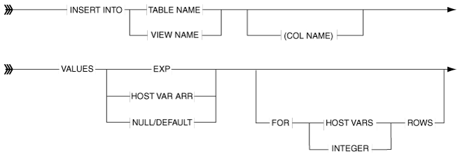
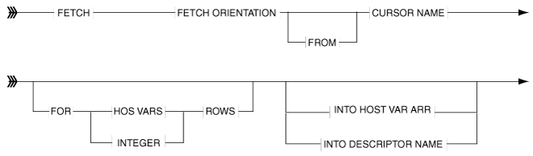

This chapter looks at using arrays to simplify coding and improve program performance. You will learn how to manipulate Oracle data using arrays, how to operate on all the elements of an array with a single SQL statement, and how to limit the number of array elements processed. The chapter contains the following topics:

- Why Use Arrays?

- About Declaring Host Arrays

- About Using Arrays in SQL Statements

- About Selecting into Arrays

- About Inserting with Arrays

- About Updating with Arrays

- About Deleting with Arrays

- About Using the FOR Clause

- About Using the WHERE Clause

- Arrays of Structs

- About Mimicking CURRENT OF

- About Using sqlca.sqlerrd\[2\]

- About Using Additional Array Insert/Select Syntax

- About Using Implicit Buffered Insert

### 8.1 Why Use Arrays?

Arrays reduce programming time and result in improved performance.

With arrays, you manipulate an entire array with a single SQL statement. Thus, Oracle communication overhead is reduced markedly, especially in a networked environment. A major portion of runtime is spent on network round trips between the client program and the server database. Arrays reduce the round trips.

For example, suppose you want to insert information about 300 employees into the EMP table. Without arrays your program must do 300 individual INSERTs—one for each employee. With arrays, only one INSERT needs to be done.

### 8.2 About Declaring Host Arrays

The following example declares three host arrays, each with a maximum of 50 elements:

    char  emp_name[50][10];
    int   emp_number[50];
    float salary[50];

Arrays of VARCHARs are also allowed. The following declaration is a valid host language declaration:

    VARCHAR v_array[10][30];

#### 8.2.1 Restrictions (Declaring Host Arrays)

You cannot declare host arrays of pointers, except for object types.

Except for character arrays (strings), host arrays that might be referenced in a SQL statement are limited to one dimension. So, the two-dimensional array declared in the following example is invalid:

    int hi_lo_scores[25][25];   /* not allowed */

#### 8.2.2 Maximum Size of Arrays

The maximum number of array elements in a SQL statement that is accessible in one fetch is 32K (or possibly greater, depending on the platform and the available memory). If you try to access a number that exceeds the maximum, you get a "parameter out of range" runtime error. If the statement is an anonymous PL/SQL block, the number of array elements accessible is limited to 32512 divided by the size of the datatype.

### 8.3 About Using Arrays in SQL Statements

You can use host arrays as input variables in the INSERT, UPDATE, and DELETE statements and as output variables in the INTO clause of SELECT and FETCH statements.

The embedded SQL syntax used for host arrays and simple host variables is nearly the same. One difference is the optional FOR clause, which lets you control array processing. Also, there are restrictions on mixing host arrays and simple host variables in a SQL statement.

The following sections illustrate the use of host arrays in data manipulation statements.

#### 8.3.1 About Referencing Host Arrays

If you use multiple host arrays in a single SQL statement, their number of elements should be the same. Otherwise, an "array size mismatch" warning message is issued at precompile time. If you ignore this warning, the precompiler uses the smallest number of elements for the SQL operation.

In this example, only 25 rows are Inserted

    int    emp_number[50];
    char   emp_name[50][10];
    int    dept_number[25];
    /* Populate host arrays here. */

    EXEC SQL INSERT INTO emp (empno, ename, deptno)
        VALUES (:emp_number, :emp_name, :dept_number);

It is possible to subscript host arrays in SQL statements, and use them in a loop to INSERT or fetch data. For example, you could INSERT every fifth element in an array using a loop such as:

    for (i = 0; i < 50; i += 5)
        EXEC SQL INSERT INTO emp (empno, deptno)
            VALUES (:emp_number[i], :dept_number[i]);

However, if the array elements that you need to process are contiguous, you should not process host arrays in a loop. Simply use the non-scripted array names in your SQL statement. Oracle treats a SQL statement containing host arrays of element number n like the same statement executed n times with n different scalar variables.

#### 8.3.2 About Using Indicator Arrays

You can use indicator arrays to assign NULLs to input host arrays, and to detect NULL or truncated values (character columns only) in output host arrays. The following example shows how to INSERT with indicator arrays:

    int    emp_number[50];
    int    dept_number[50];
    float  commission[50];
    short  comm_ind[50];       /* indicator array */

    /* Populate the host and indicator arrays.  To insert a null
       into the comm column, assign -1 to the appropriate
       element in the indicator array. */
        EXEC SQL INSERT INTO emp (empno, deptno, comm)
            VALUES (:emp_number, :dept_number,
            :commission INDICATOR :comm_ind);

#### 8.3.3 Oracle Restrictions (for Host Arrays)

Mixing scalar host variables with host arrays in the VALUES, SET, INTO, or WHERE clause is not allowed. If any of the host variables is an array, all must be arrays.

You cannot use host arrays with the CURRENT OF clause in an UPDATE or DELETE statement.

#### 8.3.4 ANSI Restriction and Requirements

The array interface is an Oracle extension to the ANSI/ISO embedded SQL standard. However, when you precompile with MODE=ANSI, array SELECTs and FETCHes are still allowed. The use of arrays can be flagged using the FIPS flagger precompiler option, if desired.

When doing array SELECTs and FETCHes, always use indicator arrays. That way, you can test for NULLs in the associated output host array.

If `DBMS=V7` or `DBMS=v8` and you `SELECT` or `FETCH` a `NULL` column value into a host array that is not associated with an indicator array, then Oracle stops processing, sets `sqlerrd[2]` to the number of rows processed, and returns an error message. When `DBMS=V7` or `DBMS=v8`, Oracle does not consider truncation to be an error.

Also, if your `SELECT` or `FETCH` results in any warning such as `ORA-24347` due to usage of `NULL`, and if any column does not have an indicator array, Oracle stops processing.

**Note:**

Use indicator variables for all the columns in the `SELECT` or `FETCH`. If all columns do not have indicators, then the precompiler option `unsafe_null=yes` can be used as an alternative.

### 8.4 About Selecting into Arrays

You can use host arrays as output variables in the SELECT statement. If you know the maximum number of rows the SELECT will return, simply declare the host arrays with that number of elements. In the following example, you select directly into three host arrays. Knowing the SELECT will return no more than 50 rows, you declare the arrays with 50 elements:

    char   emp_name[50][20];
    int    emp_number[50];
    float  salary[50];

    EXEC SQL SELECT ENAME, EMPNO, SAL
        INTO :emp_name, :emp_number, :salary
        FROM EMP
        WHERE SAL > 1000;

In the preceding example, the SELECT statement returns up to 50 rows. If there are fewer than 50 eligible rows or you want to retrieve only 50 rows, this method will suffice. However, if there are more than 50 eligible rows, you cannot retrieve all of them this way. If you reexecute the SELECT statement, it just returns the first 50 rows again, even if more are eligible. You must either declare a larger array or declare a cursor for use with the FETCH statement.

If a SELECT INTO statement returns more rows than the number of elements you declared, Oracle issues an error message unless you specify SELECT_ERROR=NO.

**See Also:**

"[Precompiler Options](precompiler-options.md) " for more information about the SELECT_ERROR option.

#### 8.4.1 Cursor Fetches

If you do not know the maximum number of rows a SELECT will return, you can declare and open a cursor, then fetch from it in "batches."

Batch fetches within a loop let you retrieve a large number of rows with ease. Each FETCH returns the next batch of rows from the current active set. In the following example, you fetch in 20-row batches:

    int   emp_number[20];
    float salary[20];

    EXEC SQL DECLARE emp_cursor CURSOR FOR
        SELECT empno, sal FROM emp;

    EXEC SQL OPEN emp_cursor;

    EXEC SQL WHENEVER NOT FOUND do break;
    for (;;)
    {
        EXEC SQL FETCH emp_cursor
            INTO :emp_number, :salary;
        /* process batch of rows */
        ...
    }
    ...

Do not forget to check how many rows were actually returned in the last fetch, and process them.

**Related Topics**

- Number of Rows Fetched

#### 8.4.2 About Using sqlca.sqlerrd\[2\]

For INSERT, UPDATE, DELETE, and SELECT INTO statements, `sqlca.sqlerrd[2]` records the number of rows processed. For FETCH statements, it records the cumulative sum of rows processed.

When using host arrays with FETCH, to find the number of rows returned by the most recent iteration, subtract the current value of `sqlca.sqlerrd[2]` from its previous value (stored in another variable). In the following example, you determine the number of rows returned by the most recent fetch:

    int  emp_number[100];
    char emp_name[100][20];

    int rows_to_fetch, rows_before, rows_this_time;
    EXEC SQL DECLARE emp_cursor CURSOR FOR
        SELECT empno, ename
        FROM emp
        WHERE deptno = 30;
    EXEC SQL OPEN emp_cursor;
    EXEC SQL WHENEVER NOT FOUND CONTINUE;
    /* initialize loop variables */
    rows_to_fetch = 20;   /* number of rows in each "batch" */
    rows_before = 0;      /* previous value of sqlerrd[2]  */
    rows_this_time = 20;

    while (rows_this_time == rows_to_fetch)
    {
        EXEC SQL FOR :rows_to_fetch
        FETCH emp_cursor
            INTO :emp_number, :emp_name;
        rows_this_time = sqlca.sqlerrd[2] - rows_before;
        rows_before = sqlca.sqlerrd[2];
    }
    ...

`sqlca.sqlerrd[2]` is also useful when an error occurs during an array operation. Processing stops at the row that caused the error, so `sqlerrd[2]` gives the number of rows processed successfully.

#### 8.4.3 Number of Rows Fetched

Each FETCH returns, at most, the total number of rows in the array. Fewer rows are returned in the following cases:

- The end of the active set is reached. The "no data found" Oracle error code is returned to SQLCODE in the SQLCA. For example, this happens if you fetch into an array of number of elements 100 but only 20 rows are returned.

- Fewer than a full batch of rows remain to be fetched. For example, this happens if you fetch 70 rows into an array of 20 number elements because after the third FETCH, only 10 rows remain to be fetched.

- An error is detected while processing a row. The FETCH fails and the applicable Oracle error code is returned to SQLCODE.

The cumulative number of rows returned can be found in the third element of sqlerrd in the SQLCA, called `sqlerrd[2]` in this guide. This applies to each open cursor. In the following example, notice how the status of each cursor is maintained separately:

    EXEC SQL OPEN cursor1;
    EXEC SQL OPEN cursor2;
    EXEC SQL FETCH cursor1 INTO :array_of_20;
    /* now running total in sqlerrd[2] is 20 */
    EXEC SQL FETCH cursor2 INTO :array_of_30;
    /* now running total in sqlerrd[2] is 30, not 50 */
    EXEC SQL FETCH cursor1 INTO :array_of_20;
    /* now running total in sqlerrd[2] is 40 (20 + 20) */
    EXEC SQL FETCH cursor2 INTO :array_of_30;
    /* now running total in sqlerrd[2] is 60 (30 + 30) */

#### 8.4.4 Scrollable Cursor Fetches

You can also use host arrays with scrollable cursors. With scrollable cursors `sqlca.sqlerrd[2]` represents the maximum (absolute) row number processed. Since an application can arbitrarily position the fetches in scrollable mode, it need not be the total number of rows processed.

While using host arrays with the FETCH statement in scrollable mode, you cannot subtract the current value of `sqlca.sqlerrd[2]` from its previous value to find the number of rows returned by the most recent iteration. The application program determines the total number of rows in the result set by executing a FETCH LAST. The value of `sqlca.sqlerrd[2]` provides the total number of rows in the result set.

**Related Topics**

- Sample Program: Host Arrays Using Scrollable Cursor

#### 8.4.5 Sample Program 3: Host Arrays

The demonstration program in this section shows how you can use host arrays when writing a query in Pro\*C/C++. Pay particular attention to the use of the "rows processed count" in the SQLCA (`sqlca.sqlerrd[2]`). This program is available on-line in the file `sample3.pc` in your `demo` directory.

    /*
     *  sample3.pc
     *  Host Arrays
     *
     *  This program connects to ORACLE, declares and opens a cursor,
     *  fetches in batches using arrays, and prints the results using
     *  the function print_rows().
     */

    #include <stdio.h>
    #include <string.h>

    #include <sqlca.h>

    #define NAME_LENGTH   20
    #define ARRAY_LENGTH   5
    /* Another way to connect. */
    char *username = "SCOTT";
    char *password = "TIGER";

    /* Declare a host structure tag. */
    struct
    {
        int    emp_number[ARRAY_LENGTH];
        char   emp_name[ARRAY_LENGTH][NAME_LENGTH];
        float  salary[ARRAY_LENGTH];
    } emp_rec;

    /* Declare this program's functions. */
    void print_rows();              /* produces program output */
    void sql_error();          /* handles unrecoverable errors */

    main()
    {
        int  num_ret;               /* number of rows returned */

    /* Connect to ORACLE. */
        EXEC SQL WHENEVER SQLERROR DO sql_error("Connect error:");

        EXEC SQL CONNECT :username IDENTIFIED BY :password;
        printf("\nConnected to ORACLE as user: %s\n", username);

        EXEC SQL WHENEVER SQLERROR DO sql_error("Oracle error:");
    /* Declare a cursor for the FETCH. */
        EXEC SQL DECLARE c1 CURSOR FOR
            SELECT empno, ename, sal FROM emp;

        EXEC SQL OPEN c1;

    /* Initialize the number of rows. */
        num_ret = 0;

    /* Array fetch loop - ends when NOT FOUND becomes true. */
        EXEC SQL WHENEVER NOT FOUND DO break;

        for (;;)
        {
            EXEC SQL FETCH c1 INTO :emp_rec;

    /* Print however many rows were returned. */
            print_rows(sqlca.sqlerrd[2] - num_ret);
            num_ret = sqlca.sqlerrd[2];        /* Reset the number. */
        }
    /* Print remaining rows from last fetch, if any. */
        if ((sqlca.sqlerrd[2] - num_ret) > 0)
            print_rows(sqlca.sqlerrd[2] - num_ret);

        EXEC SQL CLOSE c1;
        printf("\nAu revoir.\n\n\n");

    /* Disconnect from the database. */
        EXEC SQL COMMIT WORK RELEASE;
        exit(0);
    }

    void
    print_rows(n)
    int n;
    {
        int i;

        printf("\nNumber   Employee         Salary");
        printf("\n------   --------         ------\n");

        for (i = 0; i < n; i++)
            printf("%-9d%-15.15s%9.2f\n", emp_rec.emp_number[i],
                   emp_rec.emp_name[i], emp_rec.salary[i]);

    }

    void
    sql_error(msg)
    char *msg;
    {
        EXEC SQL WHENEVER SQLERROR CONTINUE;

        printf("\n%s", msg);
        printf("\n% .70s \n", sqlca.sqlerrm.sqlerrmc);

        EXEC SQL ROLLBACK WORK RELEASE;
        exit(1);
    }

**See Also:**

" [Handling Runtime Errors](handling-run-time-errors.md)" for more information about SQLCA

#### 8.4.6 Sample Program: Host Arrays Using Scrollable Cursor

This program describes how to use host arrays with scrollable cursors. This program is available on-line in the file `scdemo2.pc` in your demo directory.

**Note:**

Note that we do a FETCH LAST to determine the number of rows in the result set.

##### 8.4.6.1 scdemo2.pc

    /*
     *  A Sample program to demonstrate the use of scrollable
     *  cursors with host arrays.
     *
     *  This program uses the hr/hr schema.Make sure
     *  that this schema exists before executing this program
     */

    #include <stdio.h>
    #include <string.h>
    #include <stdlib.h>
    #include <sqlca.h>

    #define ARRAY_LENGTH   4

    /* user and passwd */
    char *username = "hr";
    char *password = "hr";

    /* Declare a host structure tag. */
    struct emp_rec_array
    {
        int    emp_number;
        char   emp_name[20];
        float  salary;
    } emp_rec[ARRAY_LENGTH];

    /* Print the result of the query */

    void print_rows()
    {
        int i;

        for (i=0; i<ARRAY_LENGTH; i++)
            printf("%d    %s  %8.2f\n", emp_rec[i].emp_number,
                 emp_rec[i].emp_name, emp_rec[i].salary);

    }

    /*  Oracle error handler */

    void sql_error(char *msg)
    {
        EXEC SQL WHENEVER SQLERROR CONTINUE;

        printf("\n%s", msg);
        printf("\n% .70s \n", sqlca.sqlerrm.sqlerrmc);

        EXEC SQL ROLLBACK WORK RELEASE;
        exit(EXIT_FAILURE);
    }

    void main()
    {
        int noOfRows; /* Number of rows in the result set */

        /* Error handler */
        EXEC SQL WHENEVER SQLERROR DO sql_error("Connect error:");

        /* Connect to the data base */
        EXEC SQL CONNECT :username IDENTIFIED BY :password;

        /* Error handle */
        EXEC SQL WHENEVER SQLERROR DO sql_error("Oracle error:");

        /* declare the cursor in scrollable mode */
        EXEC SQL DECLARE c1 SCROLL CURSOR FOR
            SELECT employee_id, first_name, salary FROM employees;

        EXEC SQL OPEN c1;

        EXEC SQL WHENEVER SQLERROR DO sql_error("Fetch Error:");

        /* This is a dummy fetch to find out the number of rows
           in the result set */
        EXEC SQL FETCH LAST c1 INTO :emp_rec;

        /* The number of rows in the result set is given by
           the value of sqlca.sqlerrd[2] */

        noOfRows = sqlca. sqlerrd[2];
        printf("Total number of rows in the result set %d:\n",
                 noOfRows);

        /* Fetch the first ARRAY_LENGTH number of rows */
        EXEC SQL FETCH FIRST c1 INTO :emp_rec;
        printf("******************** DEFAULT : \n");
        print_rows();

        /* Fetch the next set of ARRAY_LENGTH rows */
        EXEC SQL FETCH NEXT c1 INTO :emp_rec;
        printf("******************** NEXT  : \n");
        print_rows();

        /* Fetch a set of ARRAY_LENGTH rows from the 3rd row onwards */
        EXEC SQL FETCH ABSOLUTE 3 c1 INTO :emp_rec;
        printf("******************** ABSOLUTE 3 : \n");
        print_rows();

        /* Fetch the current ARRAY_LENGTH set of rows */
        EXEC SQL FETCH CURRENT c1 INTO :emp_rec;
        printf("******************** CURRENT : \n");
        print_rows();

        /* Fetch a set of ARRAY_LENGTH rows from the 2nd offset
           from the current cursor position */
        EXEC SQL FETCH RELATIVE 2 c1 INTO :emp_rec;
        printf("******************** RELATIVE 2 : \n");
        print_rows();

        /* Again Fetch the first ARRAY_LENGTH number of rows */
        EXEC SQL FETCH ABSOLUTE 0 c1 INTO :emp_rec;
        printf("******************** ABSOLUTE 0 : \n");
        print_rows();

        /* close the cursor */
        EXEC SQL CLOSE c1;

    /* Disconnect from the database. */
        EXEC SQL COMMIT WORK RELEASE;
        exit(EXIT_SUCCESS);
    }

#### 8.4.7 Host Array Restrictions

Using host arrays in the WHERE clause of a SELECT statement is not allowed except in a subquery. For an example, see "About Using the WHERE Clause ".

Also, you cannot mix simple host variables with host arrays in the INTO clause of a SELECT or FETCH statement. If any of the host variables is an array, all must be arrays.

Table 8-1 shows which uses of host arrays are valid in a SELECT INTO statement:

Table 8-1 Valid Host Arrays for SELECT INTO

| INTO Clause | WHERE Clause | Valid? |
|:------------|:-------------|:-------|
| array       | array        | no     |
| scalar      | scalar       | yes    |
| array       | scalar       | yes    |
| scalar      | array        | no     |

#### 8.4.8 About Fetching NULLs

When doing array SELECTs and FETCHes, always use indicator arrays. That way, you can test for NULLs in the associated output host array.

When DBMS = V7 or DBMS=v8, if you SELECT or FETCH a NULL column value into a host array that is not associated with an indicator array, Oracle stops processing, sets `sqlerrd[2]` to the number of rows processed, and issues an error message.

Also, if your SELECT or FETCH results in any warning such as ORA-24347 due to usage of NULL, and if any column does not have an indicator array, Oracle stops processing. Use indicator variables in all the columns in the SELECT or FETCH.If all columns do not have indicators, the precompiler option `unsafe_null=yes` could be used as an alternative.

#### 8.4.9 About Fetching Truncated Values

When DBMS=V7, truncation results in a warning message, but Oracle continues processing.

Again, when doing array SELECTs and FETCHes, always use indicator arrays. That way, if Oracle assigns one or more truncated column values to an output host array, you can find the original lengths of the column values in the associated indicator array.

### 8.5 About Inserting with Arrays

You can use host arrays as input variables in an INSERT statement. Just make sure your program populates the arrays with data before executing the INSERT statement.

If some elements in the arrays are irrelevant, you can use the FOR clause to control the number of rows inserted.

An example of inserting with host arrays follows:

    char   emp_name[50][20];
    int    emp_number[50];
    float  salary[50];
    /* populate the host arrays */
    ...
    EXEC SQL INSERT INTO EMP (ENAME, EMPNO, SAL)
        VALUES (:emp_name, :emp_number, :salary);

The cumulative number of rows inserted can be found in the rows-processed count, `sqlca.sqlerrd[2]`.

In the following example, the INSERT is done one row at a time. This is much less efficient than the previous example, since a call to the server must be made for each row inserted.

    for (i = 0; i < array_size; i++)
        EXEC SQL INSERT INTO emp (ename, empno, sal)
            VALUES (:emp_name[i], :emp_number[i], :salary[i]);

**Related Topics**

- About Using the FOR Clause

#### 8.5.1 About Inserting with Arrays Restrictions

You cannot use an array of pointers in the VALUES clause of an INSERT statement; all array elements must be data items.

Mixing scalar host variables with host arrays in the VALUES clause of an INSERT statement is not allowed. If any of the host variables is an array, all must be arrays.

### 8.6 About Updating with Arrays

You can also use host arrays as input variables in an UPDATE statement, as the following example shows:

    int   emp_number[50];
    float salary[50];
    /* populate the host arrays */
    EXEC SQL UPDATE emp SET sal = :salary
        WHERE EMPNO = :emp_number;

The cumulative number of rows updated can be found in `sqlerrd[2]`. This number does not include rows processed by an update cascade.

If some elements in the arrays are irrelevant, you can use the embedded SQL FOR clause to limit the number of rows updated.

The last example showed a typical update using a unique key (EMP_NUMBER). Each array element qualified just one row for updating. In the following example, each array element qualifies multiple rows:

    char  job_title [10][20];
    float commission[10];

    ...

    EXEC SQL UPDATE emp SET comm = :commission
        WHERE job = :job_title;

#### 8.6.1 About Updating with Arrays Restrictions

Mixing simple host variables with host arrays in the SET or WHERE clause of an UPDATE statement is not recommended. If any of the host variables is an array, all should be arrays. Furthermore, if you use a host array in the SET clause, use one of equal number of elements in the WHERE clause.

You cannot use host arrays with the CURRENT OF clause in an UPDATE statement.

Table 8-2 shows which uses of host arrays are valid in an UPDATE statement:

Table 8-2 Host Arrays Valid in an UPDATE

| SET Clause | WHERE Clause | Valid? |
|:-----------|:-------------|:-------|
| array      | array        | yes    |
| scalar     | scalar       | yes    |
| array      | scalar       | no     |
| scalar     | array        | no     |

**Related Topics**

- About Mimicking CURRENT OF

### 8.7 About Deleting with Arrays

You can also use host arrays as input variables in a DELETE statement. It is like executing the DELETE statement repeatedly using successive elements of the host array in the WHERE clause. Thus, each execution might delete zero, one, or more rows from the table.

An example of deleting with host arrays follows:

    ...
    int emp_number[50];

    /* populate the host array */
    ...
    EXEC SQL DELETE FROM emp
        WHERE empno = :emp_number;

The cumulative number of rows deleted can be found in `sqlerrd[2]`. The number does not include rows processed by a delete cascade.

The last example showed a typical delete using a unique key (EMP_NUMBER). Each array element qualified just one row for deletion. In the following example, each array element qualifies multiple rows:

    ...
    char job_title[10][20];

    /* populate the host array  */
    ...
    EXEC SQL DELETE FROM emp
        WHERE job = :job_title;
    ...

#### 8.7.1 About Deleting with Arrays Restrictions

Mixing simple host variables with host arrays in the WHERE clause of a DELETE statement is not allowed. If any of the host variables is an array, all must be arrays.

You cannot use host arrays with the CURRENT OF clause in a DELETE statement.

**See Also:**

"About Mimicking CURRENT OF " for an alternative.

### 8.8 About Using the FOR Clause

You can use the optional embedded SQL FOR clause to set the number of array elements processed by any of the following SQL statements:

- DELETE

- EXECUTE

- FETCH

- INSERT

- OPEN

- UPDATE

The FOR clause is especially useful in UPDATE, INSERT, and DELETE statements. With these statements you might not want to use the entire array. The FOR clause lets you limit the elements used to just the number you need, as the following example shows:

    char  emp_name[100][20];
    float salary[100];
    int   rows_to_insert;

    /* populate the host arrays */
    rows_to_insert = 25;             /* set FOR-clause variable */
    EXEC SQL FOR :rows_to_insert   /* will process only 25 rows */
        INSERT INTO emp (ename, sal)
        VALUES (:emp_name, :salary);

The FOR clause can use an integer host variable to count array elements, or an integer literal. A complex C expression that resolves to an integer cannot be used. For example, the following statement that uses an integer expression is illegal:

    EXEC SQL FOR :rows_to_insert + 5                 /* illegal */
        INSERT INTO emp (ename, empno, sal)
            VALUES (:emp_name, :emp_number, :salary);

The FOR clause variable specifies the number of array elements to be processed. Make sure the number does not exceed the smallest array dimension. Internally, the value is treated as an unsigned quantity. An attempt to pass a negative value through the use of a signed host variable will result in unpredictable behavior.

#### 8.8.1 FOR Clause Restrictions

Two restrictions keep FOR clause semantics clear: you cannot use the FOR clause in a SELECT statement or with the CURRENT OF clause.

##### 8.8.1.1 In a SELECT Statement

If you use the FOR clause in a SELECT statement, you get an error message.

The FOR clause is not allowed in SELECT statements because its meaning is unclear. Does it mean "execute this SELECT statement n times"? Or, does it mean "execute this SELECT statement once, but return n rows"? The problem in the former case is that each execution might return multiple rows. In the latter case, it is better to declare a cursor and use the FOR clause in a FETCH statement, as follows:

    EXEC SQL FOR :limit FETCH emp_cursor INTO ...

##### 8.8.1.2 With the CURRENT OF Clause

You can use the CURRENT OF clause in an UPDATE or DELETE statement to refer to the latest row returned by a FETCH statement, as the following example shows:

    EXEC SQL DECLARE emp_cursor CURSOR FOR
        SELECT ename, sal FROM emp WHERE empno = :emp_number;
    ...
    EXEC SQL OPEN emp_cursor;
    ...
    EXEC SQL FETCH emp_cursor INTO :emp_name, :salary;
    ...
    EXEC SQL UPDATE emp SET sal = :new_salary
    WHERE CURRENT OF emp_cursor;

However, you cannot use the FOR clause with the CURRENT OF clause. The following statements are invalid because the only logical value of limit is 1 (you can only update or delete the current row once):

    EXEC SQL FOR :limit UPDATE emp SET sal = :new_salary
    WHERE CURRENT OF emp_cursor;
    ...
    EXEC SQL FOR :limit DELETE FROM emp
    WHERE CURRENT OF emp_cursor;

### 8.9 About Using the WHERE Clause

Oracle treats a SQL statement containing host arrays of number of elements n like the same SQL statement executed n times with n different scalar variables (the individual array elements). The precompiler issues an error message only when such treatment would be ambiguous.

For example, assuming the declarations

    int  mgr_number[50];
    char job_title[50][20];

it would be ambiguous if the statement

    EXEC SQL SELECT mgr INTO :mgr_number FROM emp
    WHERE job = :job_title;

were treated like the imaginary statement

    for (i = 0; i < 50; i++)
        SELECT mgr INTO :mgr_number[i] FROM emp
            WHERE job = :job_title[i];

because multiple rows might meet the WHERE-clause search condition, but only one output variable is available to receive data. Therefore, an error message is issued.

On the other hand, it would not be ambiguous if the statement

    EXEC SQL UPDATE emp SET mgr = :mgr_number
        WHERE empno IN (SELECT empno FROM emp
            WHERE job = :job_title);

were treated like the imaginary statement

    for (i = 0; i < 50; i++)
        UPDATE emp SET mgr = :mgr_number[i]
            WHERE empno IN (SELECT empno FROM emp
                WHERE job = :job_title[i]);

because there is a mgr_number in the SET clause for each row matching job_title in the WHERE clause, even if each job_title matches multiple rows. All rows matching each job_title can be SET to the same mgr_number. Therefore, no error message is issued.

### 8.10 Arrays of Structs

Using arrays of scalars, you can perform multirow operations involving a single column only. Using structs of scalars allows users to perform single row operations involving multiple columns.

In order to perform multirow operations involving multiple columns, however, you previously needed to allocate several parallel arrays of scalars either separately or encapsulated within a single struct. In many cases, it is easier to reorganize this data structure more conveniently as a single array of structs instead.

Pro\*C/C++ supports the use of arrays of structs which enable an application programmer to perform multirow, multicolumn operations using an array of C structs. With this enhancement, Pro\*C/C++ can handle simple arrays of structs of scalars as bind variables in embedded SQL statements for easier processing of user data. This makes programming more intuitive, and allows users greater flexibility in organizing their data.

In addition to supporting arrays of structs as bind variables, Pro\*C/C++ also supports arrays of indicator structs when used in conjunction with an array of structs declaration.

**Note:**

Binding structs to PL/SQL records and binding arrays of structs to PL/SQL tables of records are not part of this new functionality. Arrays of structs may also not be used within an embedded PL/SQL block.

Since arrays of structs are intended to be used when performing multirow operations involving multiple columns, it is generally anticipated that they will be used in the following ways.

- As output bind variables in SELECT statements or FETCH statements.

- As input bind variables in the VALUES clause of an INSERT statement.

**Related Topics**

- Restrictions on Arrays of Structs

#### 8.10.1 Arrays of Structs Usage

The notion of an array of structs is not new to C programmers. It does, however, present a conceptual difference for data storage when it is compared to a struct of parallel arrays.

In a struct of parallel arrays, the data for the individual columns is stored contiguously. In an array of structs, on the other hand, the column data is interleaved, whereby each occurrence of a column in the array is separated by the space required by the other columns in the struct. This space is known as a stride.

#### 8.10.2 Restrictions on Arrays of Structs

The following restrictions apply to the use of arrays of structs in Pro\*C/C++:

- Arrays of structs (just as with ordinary structs) are not permitted inside an embedded PL/SQL block.

- Use of arrays of structs in WHERE or FROM clauses is prohibited.

- Arrays of structs are not permitted with Oracle Dynamic SQL Method 4. They are permitted with ANSI Dynamic SQL.

- Arrays of structs are not permitted in the SET clause of an UPDATE statement.

The syntax for declaring an array of structs does not change. There are, however, a few things to keep in mind when using an array of structs.

**Related Topics**

- [ANSI Dynamic SQL](ANSI-dynamic-SQL.md)

#### 8.10.3 About Declaring an Array of Structs

When declaring an array of structs which will be used in a Pro\*C/C++ application, the programmer must keep in mind the following important points:

- The struct must have a structure tag. For example, in the following code segment

<!-- -->

        struct person {
           char name[15];
           int  age;
        } people[10];

the `person` variable is the structure tag. This is so the precompiler can use the name of the struct to compute the size of the stride.

- The members of the struct must not be arrays. The only exception to this rule is for character types such as char or VARCHAR since array syntax is used when declaring variables of these types.

- char and VARCHAR members may not be two-dimensional.

- Nested structs are not permitted as members of an array of structs. This is not a new restriction, since nested structs have not been supported by previous releases of Pro\*C/C++.

- The size of just the struct may not exceed the maximum value that a signed 4-byte quantity may represent. This is typically two gigabytes.

Given these restrictions regarding the use of arrays of structs, the following declaration is legal in Pro\*C/C++

    struct department {
       int deptno;
       char dname[15];
       char loc[14];
    } dept[4];

while the following declaration is illegal.

    struct {              /* the struct is missing a structure tag */
      int empno[15];      /* struct members may not be arrays */
      char ename[15][10]; /* character types may not be 2-dimensional */
      struct nested {
        int salary;   /* nested struct not permitted in array of structs */
      } sal_struct;
    } bad[15];

It is also important to note that you cannot apply datatype equivalencing to either the array of structs itself or to any of the individual fields within the struct. For example, assuming `empno` is not declared as an array in the earlier illegal struct, the following is illegal:

    exec sql var bad[3].empno is integer(4);

The precompiler has no way to keep track of individual structure elements within the array of structs. One could do the following, on the other hand, to achieve the desired effect.

    typedef int myint;
    exec sql type myint is integer(4);

    struct equiv {
      myint empno; /* now legally considered an integer(4) datatype */
       ...
    } ok[15];

This should come as no surprise since equivalencing individual array items has not been supported by previous releases of Pro\*C/C++. For example, the following scalar array declarations illustrate what is legal and what is not.

    int empno[15];
    exec sql var empno[3] is integer(4); /* illegal */

    myint empno[15]; /* legal */

In summary, you may not equivalence any individual array item.

#### 8.10.4 Variables Guidelines

Indicator variables for an array of structs declaration work in much the same way as a normal struct declaration. An indicator array of structs declaration must abide by the rules for an array of structs as follows:

- The number of fields in the indicator struct must be less than or equal to the number of fields in the corresponding array of structs.

- The order of the fields must match the order of the corresponding members of the array of structs.

- The datatype for all elements in the indicator struct must be short.

- The size of the indicator array must be at least the same size as the host variable declaration. It may be larger, but it may not be smaller.

These rules generally reflect the rules for using structs as implemented in prior releases of Pro\*C/C++. The array restriction is also the same as that previously used for arrays of scalars.

Given these rules, assume the following struct declaration:

    struct department {
       int deptno;
       char dname[15];
       char loc[14];
    } dept[4];

The following is a legal indicator variable struct declaration:

    struct department_ind {
       short deptno_ind;
       short dname_ind;
       short loc_ind;
    } dept_ind[4];

while the following is illegal as an indicator variable

    struct{               /* missing indicator structure tag */
      int deptno_ind;     /* indicator variable not of type short */
      short dname_ind[15];/* array element forbidden in indicator struct */
      short loc_ind[14];  /* array element forbidden in indicator struct */
    } bad_ind[2];     /* indicator array size is smaller than host array */

**Related Topics**

- [ANSI Dynamic SQL](ANSI-dynamic-SQL.md)

#### 8.10.5 About Declaring a Pointer to an Array of Structs

In some cases, it may be desirable to declare a pointer to an array of structs. This allows pointers to arrays of structs to be passed to other functions or used directly in an embedded SQL statement.

**Note:**

The length of the array referenced by a pointer to an array of structs cannot be known during precompilation. For this reason, an explicit FOR clause must be used when a bind variable whose type is a pointer to an array of structs is used in any embedded SQL statement.

Remember that FOR clauses may not be used in an embedded SQL SELECT statement. Therefore, to retrieve data into a pointer to an array of structs, an explicit cursor and FETCH statement must be used with the FOR clause.

#### 8.10.6 Examples

The following examples demonstrate different uses of the array of structs functionality in Pro\*C/C++.

##### 8.10.6.1 Example 1: A Simple Array of Structs of Scalars

Given the following structure declaration,

    struct department {
       int deptno;
       char dname[15];
       char loc[14];
    } my_dept[4];

a user could then select the `dept` data into `my_dept` as follows:

    exec sql select * into :my_dept from dept;

or the user could populate `my_dept` first and then bulk insert it into the `dept` table:

    exec sql insert into dept values (:my_dept);

To use an indicator variable, a parallel indicator array of structs could be declared.

    struct deptartment_ind {
       short deptno_ind;
       short dname_ind;
       short loc_ind;
    } my_dept_ind[4];

Data is then be selected using the same query except for the addition of the indicator variable:

    exec sql select * into :my_dept indicator :my_dept_ind from dept;

Similarly, the indicator could be used when inserting the data as well:

    exec sql insert into dept values (:my_dept indicator :my_dept_ind);

##### 8.10.6.2 Example 2: Using Mixed Scalar Arrays with An Array of Structs

As in prior releases of Pro\*C/C++, when using multiple arrays for bulk handling of user data, the size of the arrays must be the same. If they are not, the smallest array size is chosen leaving the remaining portions of the arrays unaffected.

Given the following declarations,

    struct employee {
       int empno;
       char ename[11];
    } emp[14];

    float sal[14];
    float comm[14];

it is possible to select multiple rows for all columns in one simple query:

    exec sql select empno, ename, sal, comm into :emp, :sal, :comm from emp;

We also want to know whether the column values for the commissions are NULL or not. A single indicator array could be used given the following declaration:

    short comm_ind[14];
    ...
    exec sql select empno, ename, sal, comm
       into :emp, :sal, :comm indicator :comm_ind from emp;

You cannot declare a single indicator array of structs that encapsulate all indicator information from the query. Therefore:

    struct employee_ind {   /* example of illegal usage */
       short empno_ind;
       short ename_ind;
       short sal_ind;
       short comm_ind;
    } illegal_ind[15];

    exec sql select empno, ename, sal, comm
       into :emp, :sal, :comm indicator :illegal_ind from emp;

is illegal (as well as undesirable). The earlier statement associates the indicator array with the `comm` column only, not the entire SELECT...INTO list.

Assuming the array of structs and the `sal`, `comm` and `comm_ind` arrays were populated with the desired data, insertion is straightforward:

    exec sql insert into emp (empno, ename, sal, comm)
       values (:emp, :sal, :comm indicator :comm_ind);

##### 8.10.6.3 Example 3: Using Multiple Arrays of Structs with a Cursor

For this example, we make the following declarations:

    struct employee {
       int empno;
       char ename[11];
       char job[10];
    } emp[14];

    struct compensation {
       int sal;
       int comm;
    } wage[14];

    struct compensation_ind {
       short sal_ind;
       short comm_ind;
    } wage_ind[14];

Our program could then make use of these arrays of structs as follows:

    exec sql declare c cursor for
       select empno, ename, job, sal, comm from emp;

    exec sql open c;

    exec sql whenever not found do break;
    while(1)
    {
      exec sql fetch c into :emp, :wage indicator :wage_ind;
      ... process batch rows returned by the fetch ...
    }

    printf("%d rows selected.\n", sqlca.sqlerrd[2]);

    exec sql close c;

###### 8.10.6.3.1 About Using the FOR clause

Alternatively, we could have used the FOR clause to instruct the fetch on how many rows to retrieve. Recall that the FOR clause is prohibited when using the SELECT statement, but not the INSERT or FETCH statements.

We add the following to our original declarations

    int limit = 10;

and code our example accordingly.

       exec sql for :limit
          fetch c into :emp, :wage indicator :wage_ind;

##### 8.10.6.4 Example 4: Individual Array and Struct Member Referencing

Prior releases of Pro\*C/C++ allowed array references to single structures in an array of structs. The following is therefore legal since the bind expression resolves to a simple struct of scalars.

    exec sql select * into :dept[3] from emp;

Users can reference an individual scalar member of a specific struct in an array of structs as the following example shows.

    exec sql select dname into :dept[3].dname from dept where ...;

Naturally, this requires that the query be a single row query so only one row is selected into the variable represented by this bind expression.

##### 8.10.6.5 Example 5: Using Indicator Variables, a Special Case

Prior releases of Pro\*C/C++ required that an indicator struct have the same number of fields as its associated bind struct. This restriction has been relaxed when using structs in general. By following the previously mentioned guidelines for indicator arrays of structs it is possible to construct the following example.

    struct employee {
        float comm;
        float sal;
        int empno;
        char ename[10];
    } emp[14];

    struct employee_ind {
        short comm;
    } emp_ind[14];

    exec sql select comm, sal, empno, ename
       into :emp indicator :emp_ind from emp;

The mapping of indicator variables to bind values is one-to-one. They map in associative sequential order starting with the first field.

Be aware, however, that if any of the other fields has a fetched value of NULL and no indicator is provided, the following error is raised:

    ORA-1405: fetched column value is NULL

As an example, such is the case if `sal` was nullable because there is no indicator for `sal`.

Suppose we change the array of structs as follows,

    struct employee {
       int empno;
       char ename[10];
       float sal;
       float comm;
    } emp[15];

but still used the same indicator array of structs.

Because the indicators map in associative sequential order, the `comm` indicator maps to the `empno` field leaving the `comm` bind variable without an indicator once again leading to the ORA-1405 error.

To avoid the ORA-1405 when using indicator structs that have fewer fields than their associative bind variable structs, the nullable attributes should appear first and in sequential order.

We could easily change this into a single-row fetch involving multiple columns by using non-array structs and expect it to work as though the indicator struct was declared as follows.

    struct employee_ind {
       short comm;
       short sal;
       short empno;
       short ename;
    } emp_ind;

Because Pro\*C/C++ no longer requires that the indicator struct have the same number of fields as its associated value struct, the earlier example is now legal in Pro\*C/C++ whereas previously it was not.

Our indicator struct could now look like the following simple struct.

    struct employee_ind {
       short comm;
    } emp_ind;

Using the non-array `emp` and `emp_ind` structs we are able to perform a single row fetch as follows.

    exec sql fetch comm, sal, empno, ename
       into :emp indicator :emp_ind from emp;

Note once again how the `comm` indicator maps to the `comm` bind variable in this case as well.

##### 8.10.6.6 Example 6: Using a Pointer to an Array of Structs

This example demonstrates how to use a pointer to an array of structs.

Given the following type declaration:

    typedef struct dept {
       int deptno;
       char dname[15];
       char loc[14];
    } dept;

we can perform a variety of things, manipulating a pointer to an array of structs of that type. For example, we can pass pointers to arrays of structs to other functions.

    void insert_data(d, n)
       dept *d;
       int n;
    {
        exec sql for :n insert into dept values (:d);
    }

    void fetch_data(d, n)
       dept *d;
       int n;
    {
       exec sql declare c cursor for select deptno, dname, loc from dept;
       exec sql open c;
       exec sql for :n fetch c into :d;
       exec sql close c;
    }

Such functions are invoked by passing the address of the array of structs as these examples indicate.

    dept d[4];
    dept *dptr = &d[0];
    const int n = 4;

    fetch_data(dptr, n);
    insert_data(d, n); /* We are treating '&d[0]' as being equal to 'd' */

Or we can simply use such pointers to arrays of structs directly in some embedded SQL statement.

    exec sql for :n insert into dept values (:dptr);

The most important thing to remember is the use of the FOR clause.

### 8.11 About Mimicking CURRENT OF

You use the CURRENT OF cursor clause in a DELETE or UPDATE statement to refer to the latest row FETCHed from the cursor. However, you cannot use CURRENT OF with host arrays. Instead, select the ROWID of each row, then use that value to identify the current row during the update or delete.

For example:

    char  emp_name[20][10];
    char  job_title[20][10];
    char  old_title[20][10];
    char  row_id[20][19];
    ...
    EXEC SQL DECLARE emp_cursor CURSOR FOR
    SELECT ename, job, rowid FROM emp FOR UPDATE;
    ...
    EXEC SQL OPEN emp_cursor;
    EXEC SQL WHENEVER NOT FOUND do break;
    for (;;)
    {
        EXEC SQL FETCH emp_cursor
            INTO :emp_name, :job_title, :row_id;
        ...
        EXEC SQL DELETE FROM emp
            WHERE job = :old_title AND rowid = :row_id;
        EXEC SQL COMMIT WORK;
    }

**Related Topics**

- [The CURRENT OF Clause](embedded-SQL.md)

### 8.12 About Using Additional Array Insert/Select Syntax

The Oracle precompiler also supports the DB2 insert and fetch syntax for the host tables. The supported additional array insert and fetch syntax are shown in the following figures, respectively.

Figure 8-1 Additional Insert Syntax

[Description of "Figure 8-1 Additional Insert Syntax"](img_text/insert2.md)

Figure 8-2 Additional Fetch Syntax

[Description of "Figure 8-2 Additional Fetch Syntax"](img_text/fetch2.md)

The optional ROWSET and ROWSET STARTING AT clauses are used in the fetch-orientation (FIRST, PRIOR, NEXT, LAST, CURRENT, RELATIVE and ABSOLUTE). Consider the following examples:

- FIRST ROWSET

- PRIOR ROWSET

- NEXT ROWSET

- LAST ROWSET

- CURRENT ROWSET

- ROWSET STARTING AT RELATIVEn

- ROWSET STARTING AT ABSOLUTEn

Examples of the DB2 array insert/fetch syntax and their comparison with the corresponding Oracle precompiler syntax are shown in Table 8-3:

Table 8-3 DB2 Array Syntax vs. Oracle Precompiler Syntax

| DB2 Array Syntax                                                                                                                           | Oracle Precompiler Syntax                                                                                                    |
|:-------------------------------------------------------------------------------------------------------------------------------------------|:-----------------------------------------------------------------------------------------------------------------------------|
| `EXEC SQL` `  INSERT INTO dsn8810.act ` `  (actno, actkwd, actdesc) ` `  VALUES (:hva1, :hva2, :hva3)` `  FOR :NUM_ROWS ROWS;` | `EXEC SQL FOR :num_rows` `  INSERT INTO dsn8810.act` `  (actno, actkwd, actdesc)` `  VALUES (:hva1, :hva2, :hva3);` |
| `EXEC SQL` `  FETCH NEXT ROWSET FROM c1 ` `  FOR 20 ROWS ` `  INTO :hva_empno, :hva_lastname,` `       :hva_salary;`           | `EXEC SQL` `   FOR :twenty` `   FETCH c1 ` `   INTO :hva_empno, :hva_lastname,` `        :hva_salary;`           |

In DB2 syntax, a row-set positioned cursor should be first declared before retrieving row sets of data. To enable a cursor to fetch row sets, the 'WITH ROWSET POSITIONING' clause has to be used in the DECLARE CURSOR statement, which is not required and relevant in the Oracle precompiler syntax, as shown in the following table.

| DB2 Array Syntax                                                                                                                         | Oracle Precompiler Syntax                                                                                      |
|:-----------------------------------------------------------------------------------------------------------------------------------------|:---------------------------------------------------------------------------------------------------------------|
| `EXEC SQL` ` DECLARE c1 CURSOR` `  WITH ROWSET POSITIONING FOR` `  SELECT empno, lastname, salary` `      FROM dsn8810.emp;` | `EXEC SQL` `   DECLARE c1 CURSOR FOR` `   SELECT empno, lastname, salary` `        FROM dsn8810.emp;` |

This DB2 array syntax support can be enabled with the precompiler option `db2_array`, whose default option is `no`. The DB2 array syntax support cannot be used together with the Oracle precompiler syntax; only one of the syntax, only on of the syntax, either Oracle precompiler or DB2 syntax, is supported at a time.

Example 8-1 Inserting and Fetching Rows by Using the DB2 Array Syntax

This program inserts INSCNT rows into the EMP table by using the DB2 array insert syntax, and then fetches the inserted rows by using the DB2 array fetch syntax.

    /*
     * db2arrdemo.pc
     */

    #include <stdio.h>
    #include <string.h>
    #include <stdlib.h>
    #include <sqlda.h>
    #include <sqlcpr.h>
    #include <sqlca.h>

    /* Number of rows to be inserted in one shot */
    #define INSCNT 100
    /* Number of rows to be fetched in one shot */
    #define FETCHCNT 20

    /* Define a host structure
       for inserting data into the table
       and for fetching data from the table */
    struct emprec
    {
      int     empno;
      varchar ename[10];
      varchar job[9];
      int mgr;
      char hiredate[10];
      float sal;
      float comm;
      int deptno;
    };
    typedef struct emprec empdata;

    /* Function prototypes */
    void sql_error(char *);
    void insertdata();
    void fetchdata();
    void printempdata(empdata *);

    void main()
    {

      exec sql begin declare section;
        char *uid = "scott/tiger";
      exec sql end declare section;

      exec sql whenever sqlerror do sql_error("ORACLE error--\n");
      exec sql connect :uid;

      printf("Inserting %d rows into EMP table using DB2 array insert syntax.\n",
             INSCNT);
      insertdata();
      printf("\nFetching data using DB2 array fetch syntax.\n");
      fetchdata();

      exec sql rollback work release;
      exit(EXIT_SUCCESS);
    }

    /* Inserting data into the table using DB2 array insert syntax*/
    void insertdata()
    {
      int i, cnt;
      char *str;
      empdata emp_in[INSCNT];

      /* To store temporary strings */
      str = (char *)malloc (25 * sizeof(char));

      /* Fill the array elements to insert */
      for (i = 0; i < INSCNT; i++)
      {
        emp_in[i].empno = i+1;
        sprintf(str, "EMP_%03d", i+1);
        strcpy (emp_in[i].ename.arr, str);
        emp_in[i].ename.len = strlen (emp_in[i].ename.arr);
        sprintf(str, "JOB_%03d", i+1);
        strcpy (emp_in[i].job.arr, str);
        emp_in[i].job.len = strlen (emp_in[i].job.arr);
        emp_in[i].mgr = i+1001;
        sprintf(str, "%02d-MAY-06", (i%30)+1);
        strcpy (emp_in[i].hiredate, str);
        emp_in[i].sal = (i+1) * 10;
        emp_in[i].comm = (i+1) * 0.1;
        emp_in[i].deptno = 10;
      }

      free (str);

      /* Inserting data using DB2 array insert syntax */
      exec sql insert into emp values (:emp_in) FOR :INSCNT rows;

      exec sql select count(*) into :cnt from emp where ename like 'EMP_%';
      printf ("Number of rows successfully inserted into emp table: %d\n", cnt);
    }

    /* Fetches data from the table using DB2 array fetch syntax*/
    void fetchdata()
    {
      empdata emp_out[FETCHCNT];

      /* Declares scrollable cursor to fetch data */
      exec sql declare c1 scroll cursor with rowset positioning for
             select empno, ename, job, mgr, hiredate, sal, comm, deptno
             from emp where ename like 'EMP_%' order by empno;

      exec sql open c1;

      exec sql whenever not found do break;
      while(1)
      {
        /* Fetches data using DB2 array fetch syntax */
        exec sql fetch next rowset from c1 for :FETCHCNT rows into :emp_out;
        printempdata(emp_out);
      }
      exec sql whenever not found do sql_error("ORACLE ERROR");

      exec sql close c1;
    }

    /* Prints the fetched employee data */
    void printempdata(empdata *emp_out)
    {
      int i;
      for (i=0; i<FETCHCNT; i++)
      {
        emp_out[i].ename.arr[emp_out[i].ename.len] = '\0';
        emp_out[i].job.arr[emp_out[i].job.len] = '\0';
        printf("Empno=%d, Ename=%s, Job=%s, Mgr=%d, Hiredate=%s, Sal=%6.2f,\n"
               "Comm=%5.2f, Deptno=%d\n", emp_out[i].empno, emp_out[i].ename.arr,
     emp_out[i].job.arr, emp_out[i].mgr, emp_out[i].hiredate,
     emp_out[i].sal, emp_out[i].comm, emp_out[i].deptno);
      }
    }

    /* Error handling function. */
    void sql_error(char *msg)
    {
      exec sql whenever sqlerror continue;

      printf("\n%s\n", msg);
      printf("%.70s\n", sqlca.sqlerrm.sqlerrmc);
      exec sql rollback release;

      exit(EXIT_FAILURE);
    }

### 8.13 About Using Implicit Buffered Insert

For improved performance, Pro\*C/C++ application developers can reference host arrays in their embedded SQL statements. This provides a means to execute an array of SQL statements with a single round-trip to the database. Despite the significant performance improvements afforded by array execution, some developers choose not to use this capability because it is not ANSI standard. For example, an application written to exploit array execution in Oracle cannot be precompiled using IBM's precompiler.

One workaround is to use buffered INSERT statements, which enable you to gain performance benefits while retaining ANSI standard embedded SQL syntax.

The command line option "max_row_insert" controls the number of rows to be buffered before executing the INSERT statement. By default it is zero and the feature is disabled. To enable this feature, specify any number greater than zero.

If insert bufering is enabled, precompiler runtime will flag the corresponding cursor and:

- Allocate or re-allocate extra memory to hold bind values (first execute only).

- Copy bind values from program host variables to internal runtime bind structures.

- Increment the rows buffered count.

- Flush the buffered INSERT statements if MAX_INSERT_ROWS have been buffered.

- If MAX_INSERT_ROWS has not been hit, then return after copying the values to the internal bind buffers without flushing.

If a new embedded SQL statement is executed and results in a flush of the buffered insert statements:

- Flush the buffers.

- Continue with the call that prompted the flush.

The application is informed of the error through the standard precompiler error mechanisms such as the sqlca in Pro\*C.

The "implicit_svpt" option controls whether an implicit savepoint is taken prior to the start of a new batched insert.

- If yes, a savepoint is taken prior to the start of a new batch of rows. If an error occurs on the insert, an implicit "rollback to savepoint" is executed.

- If no, there is no implicit savepoint taken. If an error occurs on the buffered insert, then it is reported back to the application, but no rollback is executed. Errors are reported asynchronously for buffer inserts. Errors for inserted rows are not reported when the INSERT statement is executed in the application.

  - Some errors for inserted rows are reported later, when the first statement other than the INSERT is executed. This may include DELETE, UPDATE, INSERT (into different tables), COMMIT, and ROLLBACK. Any statement that closes the buffered insert statement can report an error. In such cases, the statement that reports the error is not executed. You need to first handle the error and also reexecute the statement on which the buffered insert error is reported. Otherwise, you may rollback the transaction and reexecute it.

    For example, consider using a COMMIT statement to close a buffered insert loop. COMMIT can report an error because of a duplicate key from an earlier insert. In this scenario, the commit is not executed. You should first handle the error and then reexecute COMMIT. Otherwise, you can rollback the transaction and reexecute it.

  - Some errors are reported on the insert itself, and may reflect an error of a previously inserted row. In such cases, no further inserts are executed. You need to handle the errors of the previously inserted row and continue inserting the current insert, which is a long process. Instead, you may rollback and reexecute the transaction.

    For example, consider that the limit of internal buffer is 10 rows and the application is inserting 15 rows in a loop. Suppose there is an error on the 8th row. The error is reported when the 11th row insert happens and the insert is no more executed further.

The following are some of the possible errors that you might face during buffered insert:

- ORA-00001: duplicate key in index

- ORA-01400: mandatory (not null) column is missing or Null during insert

- ORA-01401: inserted value too large for column

- ORA-01438: value larger than specified precision allows for this column

Example 8-2 Inserting Buffered Rows into a Table

This program inserts LOOPCNT number of rows into the EMP table. At loop counter=5, this program attempts to insert an invalid empno. Without the max_row_insert option, the program inserts all rows except the invalid row. When the max_row_insert option is set to LOOPCNT, only the first four rows are inserted.

Using the max_row_insert option, when the erroneous statement is removed, the program performs the same way an array insert program would.

    /*
     * bufinsdemo.pc
     */
    #include <stdio.h>
    #include <string.h>
    #include <stdlib.h>
    #include <sqlda.h>
    #include <sqlcpr.h>
    #include <sqlca.h>

    /* Number of rows to be inserted into the table */
    #define LOOPCNT 100

    /* Define a host structure
       for inserting data into the table
       and for fetching data from the table */
    struct emprec
    {
      int empno;
      varchar ename[10];
      varchar job[9];
      int mgr;
      char hiredate[10];
      float sal;
      float comm;
      int deptno;
    };
    typedef struct emprec buffinstyp;

    /* Function prototypes */
    void sql_error();
    void insertdata();
    void fetchdata();
    void printempdata(buffinstyp);

    void main()
    {

      exec sql begin declare section;
        char *uid = "scott/tiger";
      exec sql end declare section;

      exec sql whenever sqlerror do sql_error();
      exec sql connect :uid;

      printf("\nInserting %d rows into EMP table.\n", LOOPCNT);
      insertdata();
      printf("\nFetching inserted data from EMP table.\n");
      fetchdata();

      exec sql delete from emp where empno < 1000;

      exec sql commit work release;
      exit(EXIT_SUCCESS);
    }

    /* Inserting data into the table */
    void insertdata()
    {
      int i, cnt;
      char *str;
      buffinstyp emp_in;

      /* To store temporary strings */
      str = (char *)malloc (25 * sizeof(char));

      /*
       * When max_row_insert option is set to LOOPCNT and when the errorneous
       * statement is removed, all the rows will be inserted into the database in
       * one stretch and hence maximum performance gain will be achieved.
     */
      for (i = 1; i <= LOOPCNT; i++)
      {
        if (i != 5)
          emp_in.empno = i;
        else
        /* Errorneous statement. In emp table, empno is defined as number(4). */
          emp_in.empno = 10000;

        sprintf(str, "EMP_%03d", i);
        strcpy (emp_in.ename.arr, str);
        emp_in.ename.len = strlen (emp_in.ename.arr);
        sprintf(str, "JOB_%03d", i);
        strcpy (emp_in.job.arr, str);
        emp_in.job.len = strlen (emp_in.job.arr);
        emp_in.mgr = i+1001;
        sprintf(str, "%02d-MAY-06", (i%30));
        strcpy (emp_in.hiredate, str);
        emp_in.sal = (i) * 10;
        emp_in.comm = (i) * 0.1;
        emp_in.deptno = 10;

        exec sql insert into emp values (:emp_in);
      }

      free (str);

      exec sql commit;

      exec sql select count(*) into :cnt from emp where ename like 'EMP_%';
      printf ("Number of rows successfully inserted into emp table: %d\n", cnt);
    }

    /* Fetches data from the table*/
    void fetchdata()
    {
      buffinstyp emp_out;

      /* Declares cursor to fetch only the rows that are inserted */
      exec sql declare c1 cursor for
             select empno, ename, job, mgr, hiredate, sal, comm, deptno
             from emp where ename like 'EMP_%' order by empno;

      exec sql open c1;

      exec sql whenever not found do break;
      while(1)
      {
        /* Fetches single row at each call */
        exec sql fetch c1 into :emp_out;
        printempdata(emp_out);
      }
      exec sql whenever not found do sql_error();

      exec sql close c1;
    }

    /* Prints the fetched employee data */
    void printempdata(buffinstyp emp_out)
    {
      emp_out.ename.arr[emp_out.ename.len] = '\0';
      emp_out.job.arr[emp_out.job.len] = '\0';
      printf("Empno=%d, Ename=%s, Job=%s, Mgr=%d, Hiredate=%s, Sal=%6.2f,\n"
             "Comm=%5.2f, Deptno=%d\n", emp_out.empno, emp_out.ename.arr,
     emp_out.job.arr, emp_out.mgr, emp_out.hiredate, emp_out.sal,
     emp_out.comm, emp_out.deptno);
    }

    /* Error handling function. */
    void sql_error()
    {
       printf("Error %s\n", sqlca.sqlerrm.sqlerrmc);
       printf(" Rows Processed: %d\n", sqlca.sqlerrd[2]);
       printf(" Rows Rolled Back: %d\n", sqlca.sqlerrd[0]);
    }

### 8.14 Scrollable Cursors

A scrollable cursor is a work area where Oracle executes SQL statements and stores information that is processed during execution.When a cursor is executed, the results of the query are placed into a a set of rows called the result set. The result set can be fetched either sequentially or non-sequentially. Non-sequential result sets are called scrollable cursors. A scrollable cursor enables users to access the rows of a database result set in a forward, backward, and random manner. This enables the program to fetch any row in the result set.
