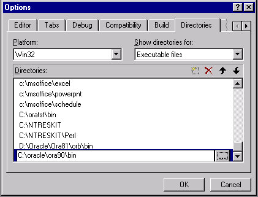
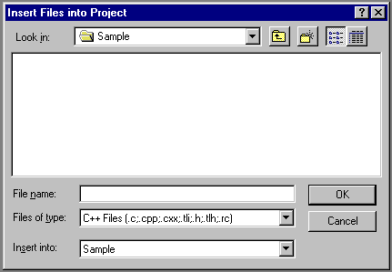
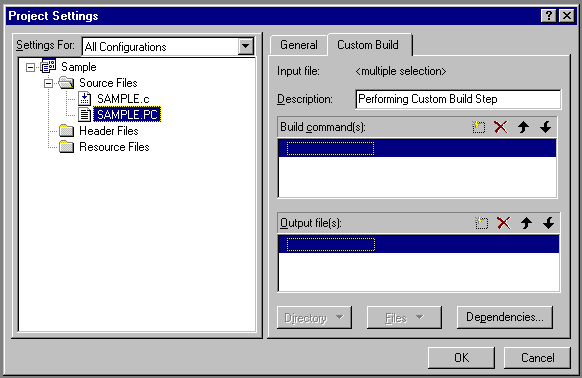
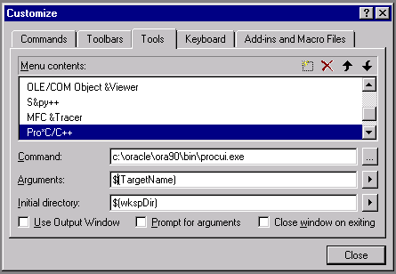

This appendix describes how to integrate Pro\*C/C++ into the Microsoft Visual Studio .NET 2002/2003 (or later) integrated development environment.

This appendix contains the following topics:

- Integrating Pro\*C/C++ within Microsoft Visual Studio .NET Projects

- Adding Pro\*C/C++ to the Tools Menu

### G.1 Integrating Pro\*C/C++ within Microsoft Visual Studio .NET Projects

This section describes how to fully integrate Pro\*C/C++ within Microsoft Visual Studio .NET projects.

All the precompiler errors and warnings are displayed in the output box where Microsoft Visual Studio .NET 2002/2003 displays compiler and linker messages. You do not have to precompile a file separately from the Microsoft Visual Studio .NET 2002/2003 build environment. More importantly, Microsoft Visual Studio .NET 2002/2003 maintains the dependencies between `.c` and `.pc` files. Microsoft Visual Studio .NET 2002/2003 maintains the dependency and precompile files, if needed.

All of the procedures in this section are performed within Microsoft Visual Studio .NET.

#### G.1.1 Specifying the Location of the Pro\*C/C++ Executable

For Microsoft Visual Studio .NET to run Pro\*C/C++, it must know the location of the Pro\*C/C++ executable. If Microsoft Visual Studio .NET was installed before any Oracle release products were installed, then you must add the directory path.

To specify the location of the Pro\*C/C++ executable:

1.  Select Options from the Tools menu.
    The Options dialog appears.
2.  Click the Directories tab.
3.  Select Executable files from Show directories For.
4.  Scroll to the bottom of the Directories box and click the dotted rectangle.
5.  Enter the `ORACLE_BASE\ORACLE_HOME``\bin` directory. For example:
    `C:\oracle\ora121\bin`
6.  Click OK.

[Description of the illustration ms5.gif](img_text/ms5.md)

#### G.1.2 Specifying the Location of the Pro\*C/C++ Header Files

To specify the location of the Pro\*C/C++ header files:

1.  Select Options from the Tools menu. The Options dialog appears.
2.  Click the Directories tab.
3.  Select Include Files from the Show Directories For list.
4.  Scroll to the bottom of the Directories box and click the dotted rectangle.
5.  Enter the `ORACLE_BASE\ORACLE_HOME``\precomp\public` directory. For example:
    ` C:\oracle\ora121\precomp\public`
6.  Click OK.

### G.2 Adding .pc Files to a Project

After you create a project, you need to add the `.pc` files.

To add a `.pc` file to a project:

1.  Select Add To Project from the Project menu and then select Files. The Insert Files into Project dialog appears.
    
    [Description of the illustration ms2.gif](img_text/ms2.md)
2.  Select All Files from the Files list.
3.  Select the `.pc` file.
4.  Click OK.

#### G.2.1 Adding References to .c Files to a Project

For each `.pc` file, you need to add a reference to the `.c` file that will result from precompiling.

To add a reference to a `.c` file to a project:

1.  Select Add To Project from the Project menu, and then select Files. The Insert Files into Project dialog appears.
2.  Type the name of the `.c` file in the File Name box.
3.  Click OK. Because the `.c` file has not been created yet, Microsoft Visual Studio .NET displays the following message: "The specified file does not exist. Do you want to add a reference to the project anyway?"
4.  Click Yes.

#### G.2.2 Adding the Pro\*C/C++ Library to a Project

Pro\*C/C++ applications must link with the library file `orasql12.lib`.

To add the Pro\*C/C++ library to a project:

1.  Select Add To Project from the Project menu, and then select Files. The Insert Files into Project dialog appears.
2.  Select All Files from the Files list.
3.  Select orasql12.lib from the `ORACLE_BASE\ORACLE_HOME``\precomp\lib\msvc` directory.
4.  Click OK.

#### G.2.3 Specifying Custom Build Options

[Description of the illustration ms3.gif](img_text/ms3.md)

To specify Custom Build options:

1.  In FileView, right-click a `.pc` file and select Settings. The Project Settings dialog appears with the Custom Build tab displayed.
2.  In the Build commands box, on one line, set the build to use the same hardcoded path as that of the `$ORACLE_HOME` setting.
3.  In the Output files box, enter one of the following:
    - If you are generating `.c` files, then enter `$(ProjDir)\$(InputName).c`.

    - If you are generating `.cpp` files, then enter `$(ProjDir)\$(InputName).cpp`.

    `$(ProjDir)` and `$MSDEVDIR` are macros for custom build commands in Microsoft Visual Studio .NET. When the project is built, Microsoft Visual Studio .NET checks the date of the output files to determine whether they need to be rebuilt for any new modifications made to the source code.
4.  Click OK.
    **See Also:**

    Microsoft Visual Studio .NET documentation

### G.3 Adding Pro\*C/C++ to the Tools Menu

[Description of the illustration ms1.gif](img_text/ms1.md)

You can include Pro\*C/C++ as a choice in the Tools menu of Microsoft Visual Studio .NET.

To add Pro\*C/C++ to the Tools menu:

1.  From within Microsoft Visual Studio .NET, select Customize from the Tools menu. The Customize dialog appears.
2.  Click the Tools tab.
3.  Scroll to the bottom of the Menu contents box and click the dotted rectangle.
4.  Enter the following text:
    `Pro*C/C++`
5.  In the Command box, type the path and filename of the graphical Pro\*C/C++ executable, or use the Browse button to the right of the box to select the file name. For example:
    `C:\oracle\ora121\bin\procui.exe`
6.  In the Arguments box, enter the following text:
    `$(TargetName)`

    When you select Pro\*C/C++ from the Tools menu, Microsoft Visual Studio .NET uses the `$(TargetName)` argument to pass the name of the current development project to Pro\*C/C++. Pro\*C/C++ then opens a precompile project with the same name as the opened project, but with a `.pre` extension in the project directory.
7.  In the Initial directory box, enter the following text:
    `$(WkspDir)`

    The Customize dialog should now look like the following graphic (although the Oracle home directory may be different on your computer).
8.  Click Close. Microsoft Visual Studio .NET adds Pro\*C/C++ to the Tools menu.
