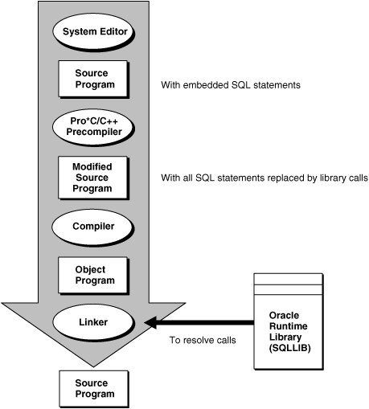
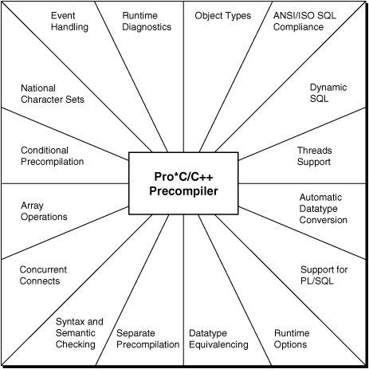

This chapter introduces you to the Oracle Pro\*C/C++ Precompiler. You look at its role in developing application programs that manipulate Oracle data and find out what it enables your applications to do. This chapter contains the following topics:

- What is an Oracle Precompiler?

- Why Use the Oracle Pro\*C/C++ Precompiler

- Why Use SQL

- Why Use PL/SQL

- Pro\*C/C++ Precompiler Benefits

- Frequently Asked Questions

### 1.1 What is an Oracle Precompiler?

An Oracle Precompiler is a programming tool that enables the user to embed SQL statements in a high-level source program. As Figure 1-1 shows, the precompiler accepts the source program as input, translates the embedded SQL statements into standard Oracle runtime library calls, and generates a modified source program that you can compile, link, and execute in the usual way.

Figure 1-1 Embedded SQL Program Development

[Description of "Figure 1-1 Embedded SQL Program Development"](img_text/lnpcc001.md)

### 1.2 Why Use the Oracle Pro\*C/C++ Precompiler

The Oracle Pro\*C/C++ Precompiler lets you use the power and flexibility of SQL in your application programs. A convenient, easy to use interface lets your application access Oracle directly.

Unlike many application development tools, Pro\*C/C++ lets you create highly customized applications. For example, you can create user interfaces that incorporate the latest windowing and mouse technology. You can also create applications that run in the background without the need for user interaction.

Furthermore, Pro\*C/C++ helps you fine-tune your applications. It allows close monitoring of resource use, SQL statement execution, and various runtime indicators. With this information, you can change program parameters for maximum performance.

Although precompiling adds a step to the application development process, it saves time. The precompiler, not you, translates each embedded SQL statement into calls to the Oracle runtime library (SQLLIB). The Pro\*C/C++ precompiler also analyzes host variables, defines mappings of structures into columns, and, with SQLCHECK=FULL, performs semantic analysis of the embedded SQL statements.

### 1.3 Why Use SQL

If you want to access and manipulate Oracle data, you need SQL. Whether you use SQL interactively through SQL\*Plus or embedded in an application program depends on the job at hand. If the job requires the procedural processing power of C or C++, or must be done on a regular basis, use embedded SQL.

SQL has become the database language of choice because it is flexible, powerful, and easy to learn. Being non-procedural, it lets you specify what you want done without specifying how to do it. A few English-like statements make it easy to manipulate Oracle data one row or many rows at a time.

You can execute any SQL (not SQL\*Plus) statement from an application program. For example, you can

- CREATE, ALTER, and DROP database tables dynamically

- SELECT, INSERT, UPDATE, and DELETE rows of data

- COMMIT or ROLLBACK transactions

Before embedding SQL statements in an application program, you can test them interactively using SQL\*Plus. Usually, only minor changes are required to switch from interactive to embedded SQL.

### 1.4 Why Use PL/SQL

An extension to SQL, PL/SQL is a transaction processing language that supports procedural constructs, variable declarations, and robust error handling. Within the same PL/SQL block, you can use SQL and all the PL/SQL extensions.

The main advantage of embedded PL/SQL is better performance. Unlike SQL, PL/SQL provides the ability to group SQL statements logically and send them to Oracle in a block rather than one by one. This reduces network traffic and processing overhead.

**Related Topics**

- [Embedded PL/SQL](embedded-PL-SQL.md)

### 1.5 Pro\*C/C++ Precompiler Benefits

As Figure 1-2 shows, Pro\*C/C++ offers many features and benefits, which help you to develop effective, reliable applications.

Figure 1-2 Features and Benefits

[Description of "Figure 1-2 Features and Benefits"](img_text/lnpcc002.md)

Pro\*C/C++ enables:

- Writing applications in C or C++.

- Following the ANSI/ISO standards for embedding SQL statements in a high-level language.

- Taking advantage of dynamic SQL, an advanced programming technique that lets your Program accept or build any valid SQL statement at runtime.

- Designing and developing highly customized applications.

- Writing shared server process applications.

- Automatically converting between Oracle internal datatypes and high-level language datatypes.

- Improved performance by embedding PL/SQL transaction processing blocks in your application program.

- Specifying useful precompiler options inline and on the command line and change their values during precompilation.

- The use of datatype equivalencing to control the way Oracle interprets input data and formats output data.

- Separately precompiling several program modules, then link them into one executable Program.

- Complete checking of the syntax and semantics of embedded SQL data manipulation statements and PL/SQL blocks.

- Concurrent access to Oracle databases on multiple nodes using Oracle Net.

- The use of arrays as input and output program variables.

- Conditionally precompiling sections of code in your host program so that it can run in different environments.

- Direct interface with SQL\*Forms through the use of user exits written in a high-level language.

- Handling errors and warnings with the SQL Communications Area (SQLCA) and the WHENEVER or DO statement.

- The use of an enhanced set of diagnostics provided by the Oracle Communications Area (ORACA).

- Working with user-defined object types in the database.

- The use of collections (varrays and nested tables) in the database.

- The use of LOBs (Large Objects) in the database.

- The use of National Character Set data stored in the database.

- The use of OCI (Oracle Call Interface) functions in your program.

- The use of multi-threaded applications.

- Microsoft Visual Studio .NET 2002/2003 support.

Pro\*C/C++ is a full-featured tool that supports a professional approach to embedded SQL programming.

**Note:**

Pro\*C/C++ does not support 16-bit code generation.

### 1.6 Directory Structure

When you install Oracle software, a directory structure is created on your hard drive for the Oracle products. A main Oracle directory contains the Oracle subdirectories and files that are necessary to run Pro\*C/C++.

When you install Pro\*C/C++, Oracle Universal Installer creates a directory called `\precomp` in the `ORACLE_BASE``\``ORACLE_HOME` directory. This subdirectory contains the Pro\*C/C++ executable files, library files, and sample programs listed in Table 1-1.

Table 1-1 precomp Directory Structure

| Directory Name | Contents                        |
|:---------------|:--------------------------------|
| `\admin`       | Configuration files             |
| `\demo\proc`   | Sample programs for Pro\*C/C++  |
| `\demo\sql`    | SQL scripts for sample programs |
| `\doc\proc`    | Readme files for Pro\*C/C++     |
| `\lib\msvc`    | Library files for Pro\*C/C++    |
| `\mesg`        | Message files                   |
| `\public`      | Header files                    |

**Note:**

The `\precomp` directory can contain files for other products, such as Pro\*COBOL.

#### 1.6.1 Known Problems, Restrictions, and Workarounds

Although all Windows operating systems allow spaces in file names and directory names, the Oracle Pro\*C/C++ and Oracle Pro\*COBOL precompilers will not precompile files that include spaces in the filename or directory name. For example, do not use the following formats:

- `proc iname=test one.pc `

- `proc iname=d:\dir1\second dir\sample1.pc `

### 1.7 Library Files

When linking Pro\*C/C++ applications, you use library files. The Pro\*C/C++ library files are installed as follows:

    ORACLE_HOME\precomp\LIB\orasql12.lib

    ORACLE_HOME\precomp\LIB\ottclasses.zip

    ORACLE_HOME\precomp\LIB\msvc\orasqx12.lib

Pro\*C/C++ application program interface (API) calls are implemented in DLL files provided with your Pro\*C/C++ software. To use the DLLs, you must link your application with the import libraries (.lib files) that correspond to the Pro\*C/C++ DLLs. Also, you must ensure that the DLL files are installed on the computer that is running your Pro\*C/C++ application.

Microsoft provides you with three libraries: `libc.lib`, `libcmt.lib`, and `msvcrt.lib`. The Oracle DLLs use the `msvcrt.lib` runtime library. You must link the applications with `msvcrt.lib` instead of the other two Microsoft libraries.

### 1.8 Frequently Asked Questions

This section presents some questions that are frequently asked about Pro\*C/C++, and about Oracle in relation to Pro\*C/C++. The answers are more informal than the documentation in the rest of this Guide, but do provide references to places where you can find the reference material.

#### 1.8.1 What is a VARCHAR?

Here is a short description of VARCHARs:

| VARCHAR                      | Description                                                                                                                                                                                                               |
|:-----------------------------|:--------------------------------------------------------------------------------------------------------------------------------------------------------------------------------------------------------------------------|
| VARCHAR2                     | A kind of column in the database that contains variable-length character data. This is what Oracle calls an "internal datatype", because it is a possible column type.                                                    |
| VARCHAR                      | An Oracle "external datatype" (datatype code 9). You use this only if you are doing dynamic SQL Method 4, or datatype equivalencing.                                                                                      |
| VARCHAR\[n\] varchar\[n\] | This is a Pro\*C/C++ "pseudotype" that you can declare as a host variable in your Pro\*C/C++ program. It is actually generated by Pro\*C/C++ as a struct, with a 2-byte length element, and a \[n\]-byte character array. |

**Related Topics**

- [Datatypes and Host Variables](datatypes-and-host-variables.md)
- [ANSI Dynamic SQL](ANSI-dynamic-SQL.md)
- [Oracle Dynamic SQL: Method 4](Oracle-dynamic-SQL-method-4.md)

#### 1.8.2 Does Pro\*C/C++ Generate Calls to the Oracle Call Interface?

No. Pro\*C/C++ generates data structures and calls to its runtime library: SQLLIB.

#### 1.8.3 Why Not Code Using SQLLIB Calls and Not Use Pro\*C/C++?

SQLLIB is not externally documented, is unsupported, and might change from release to release. Also, Pro\*C/C++ is an ANSI/ISO compliant product, that follows the standard requirements for embedded SQL.

SQLLIB is not an API. While it has user-callable functions, it is primarily a runtime library for the precompiler suite of languages.

If you need to do API coding for the database, either use the Oracle Call Interface, the client side API for the Oracle RDBMS, or mix OCI and Pro\*C/C++.

**Related Topics**

- [SQLLIB Extensions for OCI Release 8 Interoperability](advanced-topics.md)

#### 1.8.4 Can I Call A PL/SQL Stored Procedure From a Pro\*C/C++ Program?

Certainly. See [Embedded PL/SQL](embedded-PL-SQL.md). There is a demo program, "[About Calling a Stored PL/SQL or Java Subprogram](embedded-PL-SQL.md)".

#### 1.8.5 Can I Write C++ Code, and Precompile It Using Pro\*C/C++?

Yes. See [C++ Applications](C-Plus-Plus-Applications.md).

#### 1.8.6 Can I Use Bind Variables Anywhere in a SQL Statement?

For example, I would d like to be able to input the name of a table in my SQL statements at runtime. But when I use host variables, I get precompiler errors.

In general, you can use host variables at anywhere in a SQL or PL/SQL, statement where expressions are allowed.

However, the following SQL statement, where table_name is a host variable, is illegal:

    EXEC SQL SELECT ename,sal INTO :name, :salary FROM :table_name;

To solve your problem, you need to use dynamic SQL. There is a demo program that you can adapt to do this, "[Example Program: Dynamic SQL Method 1](Oracle-dynamic-SQL.md)".

**Related Topics**

- [Host Variable Referencing](datatypes-and-host-variables.md)
- [Oracle Dynamic SQL](Oracle-dynamic-SQL.md)

#### 1.8.7 I Am Confused By Character Handling in Pro\*C/C++.

There are many options, but we can simplify. First of all, if you need compatibility with previous precompiler releases, and Oracle7, the safest thing to do is use VARCHAR\[n\] host variables.

The default datatype for all other character variables in Pro\*C/C++ is CHARZ. Briefly, this means that you must null-terminate the string on input, and it is both blank-padded and null-terminated on output.

In release 8.0, the CHAR_MAP precompiler option was introduced to specify the default mapping of char variables.

If neither VARCHAR nor CHARZ works for your application, and you need total C-like behavior (null termination, absolutely no blank-padding), use the TYPE command and the C `typedef` statement, and use datatype equivalencing to convert your character host variables to STRING. There is an example program that shows how to use the TYPE command starting on "[Example Program: Using sqlvcp()](datatypes-and-host-variables.md)".

**Related Topics**

- [VARCHAR Variable Declaration](datatypes-and-host-variables.md)
- [CHARZ](datatypes-and-host-variables.md)
- [Precompiler Option CHAR_MAP](advanced-topics.md)
- [User-Defined Type Equivalencing](advanced-topics.md)

#### 1.8.8 Is There Anything Special About Character Pointers?

Yes. When Pro\*C/C++ binds an input or output host variable, it must know the length. When you use VARCHAR\[n\], or declare a host variable of type char\[n\], Pro\*C/C++ knows the length from your declaration. But when you use a character pointer as a host variable, and use `malloc()` to define the buffer in your program, Pro\*C/C++ has no way of knowing the length.

On output you must not only allocate the buffer, but pad it out with some non-null characters, then null-terminate it. On input or output, Pro\*C/C++ calls `strlen()` for the buffer to get the length.

**Related Topics**

- [Pointer Variables](datatypes-and-host-variables.md)

#### 1.8.9 Why Does SPOOL Not Work in Pro\*C/C++?

SPOOL is a special command used in SQL\*Plus. It is not an embedded SQL command.

**Related Topics**

- [Key Concepts of Embedded SQL Programming](precompiler-concepts.md)

#### 1.8.10 Where Can I Find The On-line Versions of the Example Programs?

Each Oracle installation should have a `demo` directory. If the directory is not there, or it does not contain the example programs, see your system or database administrator.

#### 1.8.11 How Can I Compile and Link My Application?

Compiling and linking are very platform specific. Your system-specific Oracle documentation has instructions on how to link a Pro\*C/C++ application. On UNIX systems, there is a makefile called `demo_proc.mk` in the `demo` directory. To link, say, the demo program sample1.pc, you would enter the command line

    make -f demo_proc.mk sample1

If you need to use special precompiler options, you can run Pro\*C/C++ separately, then do the make. Or, you can create your own custom makefile. For example, if your program contains embedded PL/SQL code, you can enter

    proc cv_demo userid=username/password sqlcheck=semantics
    make -f demo_proc.mk build OBJS=sample1.o EXE=sample1

On VMS systems, there is a script called LNPROC that you use to link your Pro\*C/C++ applications.

#### 1.8.12 Does Pro\*C/C++ Now Support Using Structures As Host Variables?

How does this work with the array interface?

You can use arrays inside a single structure, or an array of structures with the array interface.

**Related Topics**

- [Host Structures](datatypes-and-host-variables.md)
- [Pointer Variables](datatypes-and-host-variables.md)

#### 1.8.13 Is It Possible to Have Recursive Functions In Pro\*C/C++ If I Use Embedded SQL In the Function?

Yes. However, for embedded SQL, you must use cursor variables.

#### 1.8.14 Can I Use Any Release of Pro\*C/C++ with Any Version of the Oracle Server?

When you run a precompiler or OCI application against a database server, Oracle recommends that the release of the database server software be equal to or higher than the client software release, but this configuration is not strictly required. For example, if your Oracle Database client software is release 8.1.7, then it is recommended that your Oracle Database server software be release 8.1.7 or higher to run a precompiler application on the client against the server.

More information about upgrading your applications can be found in the [Oracle Database Upgrade Guide](../upgrd/index.md).

#### 1.8.15 When My Application Runs, I Keep Getting an Ora-1405 Error (Fetched Column Value Is NULL).

You are selecting a NULL into a host variable that does not have an associated indicator variable. This is not in compliance with the ANSI/ISO standards, and was changed beginning with Oracle7.

If possible, rewrite your program using indicator variables, and use indicators in future development.

Alternatively, if precompiling with MODE=ORACLE and DBMS=V7 or V8, specify UNSAFE_NULL=YES on the command line to disable the ORA-01405 message.

**Related Topics**

- [Indicator Variables](embedded-SQL.md)
- [UNSAFE_NULL](precompiler-options.md)

#### 1.8.16 Are All SQLLIB Functions Private?

No. There are some SQLLIB functions that you can call to get information about your program, or its data. The SQLLIB public functions are shown here:

| SQLLIB Public Functions     | Description                                                                                                                                                                                |
|:----------------------------|:-------------------------------------------------------------------------------------------------------------------------------------------------------------------------------------------|
| SQLSQLDAAlloc()             | Used to allocate a SQL descriptor array (SQLDA) for dynamic SQL Method 4. See "[How is the SQLDA Referenced?](Oracle-dynamic-SQL-method-4.md) ".                                           |
| SQLCDAFromResultSetCursor() | Used to convert a Pro\*C/C++ cursor variable to an OCI cursor data area. See "[New Names for SQLLIB Public Functions](advanced-topics.md)".                                                |
| SQLSQLDAFree()              | Used to free a SQLDA allocated using SQLSQLDAAlloc(). See "[New Names for SQLLIB Public Functions](advanced-topics.md)".                                                                   |
| SQLCDAToResultSetCursor()   | Used to convert an OCI cursor data area to a Pro\*C/C++ cursor variable. See "[New Names for SQLLIB Public Functions](advanced-topics.md)".                                                |
| SQLErrorGetText()           | Returns a long error message. See "[sqlerrm](handling-run-time-errors.md) ".                                                                                                               |
| SQLStmtGetText()            | Used to return the text of the most recently executed SQL statement. See "[About Obtaining the Text of SQL Statements](handling-run-time-errors.md) ".                                     |
| SQLLDAGetNamed()            | Used to obtain a valid Logon Data Area for a named connection, when OCI calls are used in a Pro\*C/C++ program. See "[New Names for SQLLIB Public Functions](advanced-topics.md)".         |
| SQLLDAGetCurrent()          | Used to obtain a valid Logon Data Area for the most recent connection, when OCI calls are used in a Pro\*C/C++ program. See "[New Names for SQLLIB Public Functions](advanced-topics.md)". |
| SQLColumnNullCheck()        | Returns an indication of NULL status for dynamic SQL Method 4. See "[Handling NULL/Not NULL Datatypes](Oracle-dynamic-SQL-method-4.md) ".                                                  |
| SQLNumberPrecV6()           | Returns precision and scale of numbers. See "[Extracting Precision and Scale](Oracle-dynamic-SQL-method-4.md) ".                                                                           |
| SQLNumberPrecV7()           | A variant of SQLNumberPrecV6(). See "[Extracting Precision and Scale](Oracle-dynamic-SQL-method-4.md) ".                                                                                   |
| SQLVarcharGetLength()       | Used for obtaining the padded size of a VARCHAR\[n\]. See "[Find the Length of the VARCHAR Array Component](datatypes-and-host-variables.md) ".                                            |
| SQLEnvGet()                 | Returns the OCI environment handle for a given SQLLIB runtime context. See "[SQLEnvGet()](advanced-topics.md)".                                                                            |
| SQLSvcCtxGet()              | Returns the OCI service context for the database connection. See [SQLSvcCtxGet()](advanced-topics.md).                                                                                     |
| SQLRowidGet()               | Returns the universal ROWID of the last row inserted. See "[SQLRowidGet()](datatypes-and-host-variables.md)".                                                                              |
| SQLExtProcError()           | Returns control to PL/SQL when an error occurs in an external C procedure. See "[SQLExtProcError()](embedded-PL-SQL.md)".                                                                  |

In the preceding list, the functions are thread-safe SQLLIB public functions. Use these functions in all new applications. For more information about these thread-safe public functions (including their old names), see the table "[New Names for SQLLIB Public Functions](advanced-topics.md)".

#### 1.8.17 How Does Oracle Support The New Object Types?

See the chapters [Objects](about-Objects.md) and [The Object Type Translator](the-Object-type.md) for how to use Object types in Pro\*C/C++ applications.

#### 1.8.18 Compatibility, Upgrading, and Migration

Pro\*C/C++ adopts a similar compatibility rule to OCI-based applications. This compatibility is subject to the same limitations that OCI imposes on backward compatibility.

The additional "array insert" and "array select" syntax will help migrating DB2 precompiler applications to the Pro\*C/C++ application. This is because you will not need to change DB2 array INSERT and SELECT syntax to that of Oracle Pro\*C/C++.

The "Implicit Buffered Insert" feature supported by Pro\*C/C++ helps you to migrate DB2 precompiler applications to Pro\*C/C++ applications without using the array syntax of Pro\*C/C++ for better performance.
