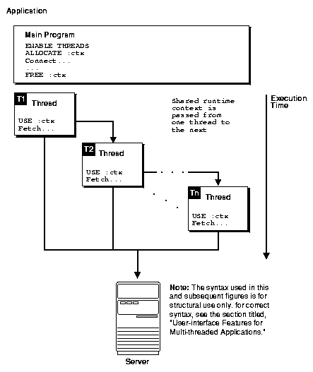
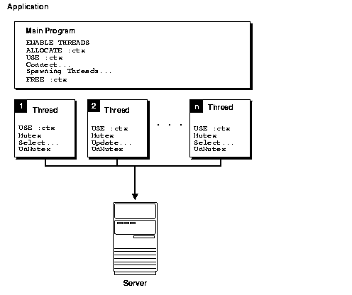
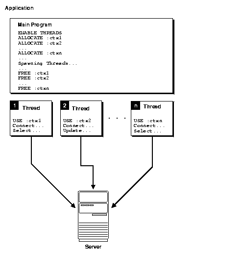
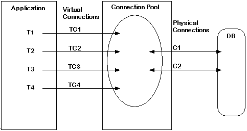
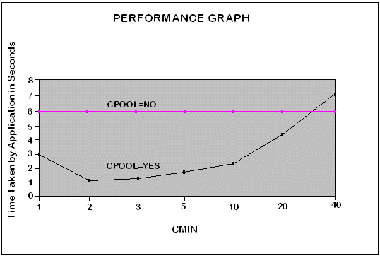
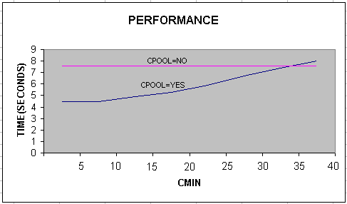
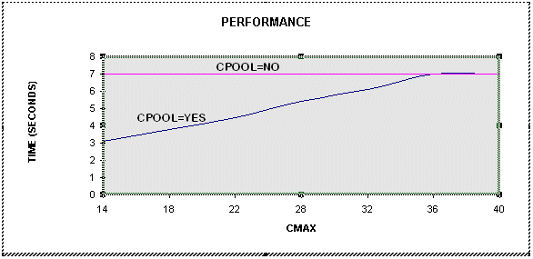

If your development platform does not support threads, ignore this chapter. This chapter contains the following topics:

- What are Threads?

- Runtime Contexts in Pro\*C/C++

- Runtime Context Usage Models

- User Interface Features for Multithreaded Applications

- Multithreaded Example

- Connection Pooling

  **Note:**

  When using XA with the Pro\*C/C++ Precompiler, you must use multithreading provided by XA. Use of multithreading provided by Pro\*C/C++ using the statement EXEC SQL ENABLE THREADS will result in an error.

### 11.1 What are Threads?

Multithreaded applications have multiple threads executing in a shared address space. Threads are "lightweight" subprocesses that execute within a process. They share code and data segments, but have their own program counters, machine registers and stack. Global and static variables are common to all threads, and a mutual exclusivity mechanism is often required to manage access to these variables from multiple threads within an application.Mutexes are the synchronization mechanism to insure that data integrity is preserved.

For further discussion of mutexes, see texts on multithreading. For more detailed information about multithreaded applications, see the documentation of your threads functions.

Pro\*C/C++ supports development of multithreaded Oracle Server applications (on platforms that support multithreaded applications) using the following:

- A command-line option to generate thread-safe code

- Embedded SQL statements and directives to support multithreading

- Thread-safe SQLLIB and other client-side Oracle libraries

  **Note:**

  While your platform may support a particular thread package, see your platform-specific Oracle documentation to determine whether Oracle supports it.

The chapter's topics discuss how to use the preceding features to develop multithreaded Pro\*C/C++ applications:

- Runtime contexts for multithreaded applications

- Two models for using runtime contexts

- User-interface features for multithreaded applications

- Programming considerations for writing multithreaded applications with Pro\*C/C++

- An example multithreaded Pro\*C/C++ application

### 11.2 Runtime Contexts in Pro\*C/C++

To loosely couple a thread and a connection, Pro\*C/C++ introduces the notion of a runtime context. The runtime context includes the following resources and their current states:

- Zero or more connections to one or more Oracle Servers

- Zero or more cursors used for the server connections

- Inline options, such as MODE, HOLD_CURSOR, RELEASE_CURSOR, and SELECT_ERROR

Rather than simply supporting a loose coupling between threads and connections, Pro\*C/C++ provides the ability to loosely couple threads with runtime contexts. Pro\*C/C++ allows your application to define a handle to a runtime context, and pass that handle from one thread to another.

For example, an interactive application spawns a thread, T1, to execute a query and return the first 10 rows to the application. T1 then terminates. After obtaining the necessary user input, another thread, T2, is spawned (or an existing thread is used) and the runtime context for T1 is passed to T2 so it can fetch the next 10 rows by processing the same cursor. See Figure 11-1.

Figure 11-1 Loosely Coupling Connections and Threads

[Description of "Figure 11-1 Loosely Coupling Connections and Threads"](img_text/pc_81021.md)

### 11.3 Runtime Context Usage Models

Two possible models for using runtime contexts in multithreaded Pro\*C/C++ applications are shown here:

- Multiple threads sharing a single runtime context

- Multiple threads using separate runtime contexts

Regardless of the model you use for runtime contexts, you cannot share a runtime context between multiple threads at the same time. If two or more threads attempt to use the same runtime context simultaneously, a runtime error occurs.

#### 11.3.1 Multiple Threads Sharing a Single Runtime Context

Figure 11-2 shows an application running in a multithreaded environment. The various threads share a single runtime context to process one or more SQL statements. Again, runtime contexts cannot be shared by multiple threads at the same time. The mutexes in Figure 11-2 show how to prevent concurrent usage.

Figure 11-2 Context Sharing Among Threads

[Description of "Figure 11-2 Context Sharing Among Threads "](img_text/pc_81023.md)

#### 11.3.2 Multiple Threads Sharing Multiple Runtime Contexts

Figure 11-3 shows an application that executes multiple threads using multiple runtime contexts. In this situation, the application does not require mutexes, because each thread has a dedicated runtime context.

Figure 11-3 No Context Sharing Among Threads

[Description of "Figure 11-3 No Context Sharing Among Threads"](img_text/pc_81022.md)

### 11.4 User Interface Features for Multithreaded Applications

The Pro\*C/C++ Precompiler provides the following user-interface features to support multithreaded applications:

- Command-line option, THREADS=YES\|NO

- Embedded SQL statements and directives

- Thread-safe SQLLIB public functions

#### 11.4.1 THREADS Option

With THREADS=YES specified on the command line, the Pro\*C/C++ Precompiler ensures that the generated code is thread-safe, given that you follow the guidelines. With THREADS=YES specified, Pro\*C/C++ verifies that all SQL statements execute within the scope of a user-defined runtime context. If your program does not meet this requirement, a precompiler error is returned.

**Related Topics**

- Programming Considerations

#### 11.4.2 Embedded SQL Statements and Directives

The following embedded SQL statements and directives support the definition and usage of runtime contexts and threads:

- EXEC SQL ENABLE THREADS;

- EXEC SQL CONTEXT ALLOCATE :context_var;

- EXEC SQL CONTEXT USE { :context_var \| DEFAULT};

- EXEC SQL CONTEXT FREE :context_var;

For these EXEC SQL statements, context_var is the handle to the runtime context and must be declared of type sql_context as follows:

    sql_context <context_variable>;

Using DEFAULT means that the default (global) runtime context will be used in all embedded SQL statements that lexically follow until another CONTEXT USE statement overrides it.

##### 11.4.2.1 EXEC SQL ENABLE THREADS

This executable SQL statement initializes a process that supports multiple threads. This must be the first executable SQL statement in your multithreaded application.

**Note:**

When using XA with the Pro\*C/C++ Precompiler, you must use multithreading provided by XA. Use of multithreading provided by Pro\*C using the statement EXEC SQL ENABLE THREADS will result in an error.

**Related Topics**

- [ENABLE THREADS (Executable Embedded SQL Extension)](embedded-SQL-statements-and-directives.md)

##### 11.4.2.2 EXEC SQL CONTEXT ALLOCATE

This executable SQL statement allocates and initializes memory for the specified runtime context; the runtime-context variable must be declared of type sql_context.

**Related Topics**

- [CONTEXT ALLOCATE (Executable Embedded SQL Extension)](embedded-SQL-statements-and-directives.md)

##### 11.4.2.3 EXEC SQL CONTEXT USE

This directive instructs the precompiler to use the specified runtime context for subsequent executable SQL statements. The runtime context specified must be previously allocated using an EXEC SQL CONTEXT ALLOCATE statement.

The EXEC SQL CONTEXT USE directive works similarly to the EXEC SQL WHENEVER directive in that it affects all executable SQL statements which positionally follow it in a given source file without regard to standard C scope rules. In the following example, the UPDATE statement in `function2()` uses the global runtime context, ctx1:

    sql_context ctx1;            /* declare global context ctx1     */

    function1()
    {
       sql_context :ctx1;         /* declare local context ctx1      */
       EXEC SQL CONTEXT ALLOCATE :ctx1;
       EXEC SQL CONTEXT USE :ctx1;
       EXEC SQL INSERT INTO ...  /* local ctx1 used for this stmt   */
       ...
    }

    function2()
    {
       EXEC SQL UPDATE ...       /* global ctx1 used for this stmt */
    }

To use the global context after using a local context, add this code to function1():

    function1()
    {
       sql_context :ctx1;         /* declare local context ctx1      */
       EXEC SQL CONTEXT ALLOCATE :ctx1;
       EXEC SQL CONTEXT USE :ctx1;
       EXEC SQL INSERT INTO ...  /* local ctx1 used for this stmt   */
       EXEC SQL CONTEXT USE DEFAULT;
       EXEC SQL INSERT INTO ... /* global ctx1 used for this stmt   */
       ...
    }

In the next example, there is no global runtime context. The precompiler refers to the ctx1 runtime context in the generated code for the UPDATE statement. However, there is no context variable in scope for `function2()`, so errors are generated at compile time.

    function1()
    {
       sql_context ctx1;         /* local context variable declared */
       EXEC SQL CONTEXT ALLOCATE :ctx1;
       EXEC SQL CONTEXT USE :ctx1;
       EXEC SQL INSERT INTO ...     /* ctx1 used for this statement */
       ...
    }
    function2()
    {
       EXEC SQL UPDATE ...   /* Error! No context variable in scope */
    }

**Related Topics**

- [CONTEXT OBJECT OPTION GET (Executable Embedded SQL Extension)](embedded-SQL-statements-and-directives.md)
- [CONTEXT ALLOCATE (Executable Embedded SQL Extension)](embedded-SQL-statements-and-directives.md)

##### 11.4.2.4 EXEC SQL CONTEXT FREE

This executable SQL statement frees the memory associated with the specified runtime context and places a null pointer in the host program variable.

**Related Topics**

- [CONTEXT FREE (Executable Embedded SQL Extension)](embedded-SQL-statements-and-directives.md)

#### 11.4.3 CONTEXT USE Examples

The following code fragments show how to use embedded SQL statements and precompiler directives for two typical programming models; they use thread_create() to create threads.

The first example showing multiple threads using multiple runtime contexts:

    main()
    {
       sql_context ctx1,ctx2;           /* declare runtime contexts */
       EXEC SQL ENABLE THREADS;
       EXEC SQL CONTEXT ALLOCATE :ctx1;
       EXEC SQL CONTEXT ALLOCATE :ctx2;
       ...
    /* spawn thread, execute function1 (in the thread) passing ctx1 */
       thread_create(..., function1, ctx1);
    /* spawn thread, execute function2 (in the thread) passing ctx2 */
       thread_create(..., function2, ctx2);
       ...
       EXEC SQL CONTEXT FREE :ctx1;
       EXEC SQL CONTEXT FREE :ctx2;
       ...
    }

    void function1(sql_context ctx)
    {
       EXEC SQL CONTEXT USE :ctx;
    /* execute executable SQL statements on runtime context ctx1!!! */
       ...
    }

    void function2(sql_context ctx)
    {
       EXEC SQL CONTEXT USE :ctx;
    /* execute executable SQL statements on runtime context ctx2!!! */
       ...
    }

The next example shows how to use multiple threads that share a common runtime context. Because the SQL statements executed in `function1()` and `function2()` potentially execute at the same time, you must place mutexes around every executable EXEC SQL statement to ensure serial, therefore safe, manipulation of the data.

    main()
    {
       sql_context ctx;                  /* declare runtime context */
       EXEC SQL CONTEXT ALLOCATE :ctx;
       ...
    /* spawn thread, execute function1 (in the thread) passing ctx  */
       thread_create(..., function1, ctx);
    /* spawn thread, execute function2 (in the thread) passing ctx  */
       thread_create(..., function2, ctx);
       ...
    }

    void function1(sql_context ctx)
    {
       EXEC SQL CONTEXT USE :ctx;
    /* Execute SQL statements on runtime context ctx.               */
       ...
    }

    void function2(sql_context ctx)
    {
       EXEC SQL CONTEXT USE :ctx;
    /* Execute SQL statements on runtime context ctx.               */
       ...
    }

#### 11.4.4 Programming Considerations

While Oracle ensures that the SQLLIB code is thread-safe, you are responsible for ensuring that your Pro\*C/C++ source code is designed to work properly with threads; for example, carefully consider your use of static and global variables.

In addition, multithreaded applications require design decisions regarding the following:

- Declaring the SQLCA as a thread-safe struct, typically an auto variable and one for each runtime context

- Declaring the SQLDA as a thread-safe struct, like the SQLCA, typically an auto variable and one for each runtime context

- Declaring host variables in a thread-safe fashion, in other words, carefully consider your use of static and global host variables.

- Avoiding simultaneous use of a runtime context in multiple threads

- Whether or not to use default database connections or to explicitly define them using the AT clause

Also, no more than one executable embedded SQL statement, for example, EXEC SQL UPDATE, may be outstanding on a runtime context at a given time.

Existing requirements for precompiled applications also apply. For example, all references to a given cursor must appear in the same source file.

### 11.5 Multithreaded Example

The following program is one approach to writing a multithreaded embedded SQL application. The program creates as many sessions as there are threads. Each thread executes zero or more transactions, that are specified in a transient structure called "records."

**Note:**

This program was developed specifically for a Sun workstation running Solaris.Either the DCE or Solaris threads package is usable with this program. See your platform-specific documentation for the availability of threads packages.

    /*
     * Name:        Thread_example1.pc
     *
     * Description: This program illustrates how to use threading in
     *      conjunction with precompilers. The program creates as many
     *      sessions as there are threads. Each thread executes zero or
     *      more transactions, that are specified in a transient
     *      structure called 'records'.
     * Requirements:
     *      The program requires a table 'ACCOUNTS' to be in the schema
     *      scott/tiger. The description of ACCOUNTS is:
     *  SQL> desc accounts
     *   Name                            Null?    Type
     *  ------------------------------- -------  ------
     *  ACCOUNT                                  NUMBER(36)
     *  BALANCE                                  NUMBER(36,2)
     *
     *  For proper execution, the table should be filled with the accounts
     *      10001 to 10008.
     *
     *
     */

    #include <stdio.h>
    #include <stdlib.h>
    #include <string.h>
    #include <sqlca.h>

    #define      _EXC_OS_        _EXC__UNIX
    #define      _CMA_OS_        _CMA__UNIX

    #ifdef DCE_THREADS
      #include <pthread.h>
    #else
      #include <thread.h>
    #endif

    /* Function prototypes */
    void   err_report();
    #ifdef DCE_THREADS
    void   do_transaction();
    #else
    void   *do_transaction();
    #endif
    void   get_transaction();
    void   logon();
    void   logoff();

    #define CONNINFO "scott/tiger"
    #define THREADS  3

    struct parameters
    { sql_context * ctx;
      int thread_id;
    };
    typedef struct parameters parameters;

    struct record_log
    {  char action;
       unsigned int from_account;
       unsigned int to_account;
       float  amount;
    };
    typedef struct record_log record_log;

    record_log records[]= { { 'M', 10001, 10002, 12.50 },
                            { 'M', 10001, 10003, 25.00 },
                            { 'M', 10001, 10003, 123.00 },
                            { 'M', 10001, 10003, 125.00 },
                            { 'M', 10002, 10006, 12.23 },
                            { 'M', 10007, 10008, 225.23 },
                            { 'M', 10002, 10008, 0.70 },
                            { 'M', 10001, 10003, 11.30 },
                            { 'M', 10003, 10002, 47.50 },
                            { 'M', 10002, 10006, 125.00 },
                            { 'M', 10007, 10008, 225.00 },
                            { 'M', 10002, 10008, 0.70 },
                            { 'M', 10001, 10003, 11.00 },
                            { 'M', 10003, 10002, 47.50 },
                            { 'M', 10002, 10006, 125.00 },
                            { 'M', 10007, 10008, 225.00 },
                            { 'M', 10002, 10008, 0.70 },
                            { 'M', 10001, 10003, 11.00 },
                            { 'M', 10003, 10002, 47.50 },
                            { 'M', 10008, 10001, 1034.54}};

    static unsigned int trx_nr=0;
    #ifdef DCE_THREADS
    pthread_mutex_t mutex;
    #else
    mutex_t mutex;
    #endif

    /*********************************************************************
     *  Main
     ********************************************************************/
    main()
    {
      sql_context ctx[THREADS];
    #ifdef DCE_THREADS
      pthread_t thread_id[THREADS];
      pthread_addr_t status;
    #else
      thread_t thread_id[THREADS];
      int status;
    #endif
      parameters params[THREADS];
      int i;

      EXEC SQL ENABLE THREADS;

      EXEC SQL WHENEVER SQLERROR DO err_report(sqlca);

      /* Create THREADS sessions by connecting THREADS times */
      for(i=0;i<THREADS;i++)
      {
        printf("Start Session %d....",i);
        EXEC SQL CONTEXT ALLOCATE :ctx[i];
        logon(ctx[i],CONNINFO);
      }

      /*Create mutex for transaction retrieval */
    #ifdef DCE_THREADS
      if (pthread_mutex_init(&mutex,pthread_mutexattr_default))
    #else
      if (mutex_init(&mutex, USYNC_THREAD, NULL))
    #endif
      {
         printf("Can't initialize mutex\n");
         exit(1);
      }

      /*Spawn threads*/
      for(i=0;i<THREADS;i++)
      {
        params[i].ctx=ctx[i];
        params[i].thread_id=i;

        printf("Thread %d... ",i);
    #ifdef DCE_THREADS
        if (pthread_create(&thread_id[i],pthread_attr_default,
            (pthread_startroutine_t)do_transaction,
            (pthread_addr_t) &params[i]))
    #else
        if (status = thr_create
        (NULL, 0, do_transaction, &params[i], 0, &thread_id[i]))
    #endif
          printf("Cant create thread %d\n",i);
        else
          printf("Created\n");
      }

      /* Logoff sessions....*/
      for(i=0;i<THREADS;i++)
      {
         /*wait for thread to end */
         printf("Thread %d ....",i);
    #ifdef DCE_THREADS
         if (pthread_join(thread_id[i],&status))
           printf("Error when waiting for thread % to terminate\n", i);
         else
          printf("stopped\n");

         printf("Detach thread...");
         if (pthread_detach(&thread_id[i]))
           printf("Error detaching thread! \n");
         else
           printf("Detached!\n");
    #else
         if (thr_join(thread_id[i], NULL, NULL))
           printf("Error waiting for thread to terminate\n");
    #endif
         printf("Stop Session %d....",i);
         logoff(ctx[i]);
         EXEC SQL CONTEXT FREE :ctx[i];
      }

      /*Destroys mutex*/
    #ifdef DCE_THREADS
      if (pthread_mutex_destroy(&mutex))
    #else
      if (mutex_destroy(&mutex))
    #endif
      {
        printf("Can't destroy mutex\n");
        exit(1);
      }
    }

    /*********************************************************************
     * Function: do_transaction
     *
     * Description:  This functions executes one transaction out of the
     *               records array. The records array is 'managed' by
     *               the get_transaction function.
     *
     *
     ********************************************************************/
    #ifdef DCE_THREADS
    void do_transaction(params)
    #else
    void *do_transaction(params)
    #endif
    parameters *params;
    {
      struct sqlca sqlca;
      record_log *trx;
      sql_context ctx=params->ctx;

      /* Done all transactions ? */
      while (trx_nr < (sizeof(records)/sizeof(record_log)))
      {
        get_transaction(&trx);

        EXEC SQL WHENEVER SQLERROR DO err_report(sqlca);
        EXEC SQL CONTEXT USE :ctx;

        printf("Thread %d executing transaction\n",params->thread_id);
        switch(trx->action)
        {
          case 'M':  EXEC SQL UPDATE ACCOUNTS
                              SET    BALANCE=BALANCE+:trx->amount
                              WHERE  ACCOUNT=:trx->to_account;
                     EXEC SQL UPDATE ACCOUNTS
                              SET    BALANCE=BALANCE-:trx->amount
                              WHERE  ACCOUNT=:trx->from_account;
                     break;
           default:  break;
        }
        EXEC SQL COMMIT;
      }
    }

    /*****************************************************************
     * Function: err_report
     *
     * Description: This routine prints out the most recent error
     *
     ****************************************************************/
    void      err_report(sqlca)
    struct sqlca sqlca;
    {
      if (sqlca.sqlcode < 0)
       printf("\n%.*s\n\n",sqlca.sqlerrm.sqlerrml,sqlca.sqlerrm.sqlerrmc);
      exit(1);
    }

    /*****************************************************************
     * Function: logon
     *
     * Description: Logs on to the database as USERNAME/PASSWORD
     *
     *****************************************************************/
    void      logon(ctx,connect_info)
    sql_context ctx;
    char * connect_info;
    {
        EXEC SQL WHENEVER SQLERROR DO err_report(sqlca);
        EXEC SQL CONTEXT USE :ctx;
        EXEC SQL CONNECT :connect_info;
        printf("Connected!\n");

    }

    /******************************************************************
     * Function: logoff
     *
     * Description: This routine logs off the database
     *
     ******************************************************************/
    void      logoff(ctx)
    sql_context ctx;
    {
        EXEC SQL WHENEVER SQLERROR DO err_report(sqlca);
        EXEC SQL CONTEXT USE :ctx;
        EXEC SQL COMMIT WORK RELEASE;
        printf("Logged off!\n");
    }

    /******************************************************************
     * Function: get_transaction
     *
     * Description: This routine returns the next transaction to process
     *
     ******************************************************************/
    void get_transaction(trx)
    record_log ** trx;
    {
    #ifdef DCE_THREADS
      if (pthread_mutex_lock(&mutex))
    #else
      if (mutex_lock(&mutex))
    #endif
        printf("Can't lock mutex\n");

      *trx=&records[trx_nr];

      trx_nr++;

    #ifdef DCE_THREADS
      if (pthread_mutex_unlock(&mutex))
    #else
      if (mutex_unlock(&mutex))
    #endif
        printf("Can't unlock mutex\n");
    }

### 11.6 Connection Pooling

A connection pool is a group of physical connections to a database that can be re-used by several connections. The objective of the connection pooling feature is to improve performance, and reduce resource use by avoiding usage of dedicated connections by each connection.

Figure 11-4 illustrates functionality of the connection pooling feature. In this example, four threads of the application are interacting with the database using the connection pool. The connection pool has two physical connections. The connection pool handle is used by four threads using different runtime contexts.

Figure 11-4 Connection Pooling

    thread1()
    {
    EXEC SQL CONTEXT ALLOCATE :ctx1;
    EXEC SQL CONTEXT USE:ctxl;
    EXEC SQL CONNECT :uid  AT :TC1 USING :db_string;
    ...

    }

    thread2()
    {
    EXEC SQL CONTEXT ALLOCATE :ctx2;
    EXEC SQL CONNECT :uid  AT :TC2 USING :db_string;
    ...

    }

    thread3()
    {
    EXEC SQL CONTEXT ALLOCATE :ctx3;
    EXEC SQL CONNECT :uid  AT :TC3 USING :db_string;
    EXEC SQL AT :TC3 SELECT count(*) into :count FROM emp;
    ...

    }

    thread4()
    {
    EXEC SQL CONTEXT ALLOCATE :ctx4;
    EXEC SQL CONNECT :uid  AT :TC4 USING :db_string;
    ...

    }

In this example, four named connections TC1, TC2, TC3, and TC4 are virtual connections created by threads T1, T2, T3, and T4 respectively. Named connections TC1, TC2, TC3, and TC4 from different runtime contexts share the same connection pool, and share physical database connections available in the connection pool. Two physical connections, C1 and C2, serve four named connections and connect to the same database.

When the first connect request TC1 from thread T1 is received, SQLLIB creates a connection pool with one physical connection C1 to the database. When another connect request TC2 from thread T2 is sent to the same database, C1 serves the TC2 request to the database, if it is free. Otherwise, a new physical connection C2 is created to serve the request. If another connect request from thread T3 named TC3 comes in, TC3 either waits for a specified time or returns an error message, if both physical connections C1 and C2 are busy.

When thread T2 needs to select data using the TC2 named connection, it acquires any free physical connection, C1 or C2. After the request is served, the chosen connection will again be available in the connection pool, so that another named or virtual connection can utilize the same physical connection.

#### 11.6.1 About Using the Connection Pooling Feature

This section comprises the following topics:

- How to Enable Connection Pooling

- Command Line Options for Connection Pooling

- Example

- Performance Tuning

##### 11.6.1.1 How to Enable Connection Pooling

To enable connection pooling while precompiling an application, the user must set the command line option `CPOOL=YES`. Based on `CPOOL=YES/NO`, the connection pool feature is enabled or disabled.

**Note:**

- By default, `CPOOL` is set to `NO` and hence the connection pool feature is disabled. This feature cannot be enabled or disabled inline.

- Connection pool will not be created with external operating system authentication, even if `CPOOL` is set to `YES`.

##### 11.6.1.2 Command Line Options for Connection Pooling

Table 11-1 lists the command line options for connection pooling:

Table 11-1 Command Line Options for Connection Pooling

| Option   | Valid Values                        | Default                                                   | Remarks                                                                                                                                                                                                                                                                                                                                                                                                                                                                                                                                                                       |
|:---------|:------------------------------------|:----------------------------------------------------------|:------------------------------------------------------------------------------------------------------------------------------------------------------------------------------------------------------------------------------------------------------------------------------------------------------------------------------------------------------------------------------------------------------------------------------------------------------------------------------------------------------------------------------------------------------------------------------|
| CPOOL    | YES/NO                              | NO                                                        | Based on this option, the precompiler generates the appropriate code that directs SQLLIB to enable or disable the connection pool feature. Note: If this option is set to NO, other connection pooling options will be ignored by the precompiler.                                                                                                                                                                                                                                                                                                                         |
| CMAX     | Valid values are 1 to 65535.        | 100                                                       | Specifies the maximum number of physical connections that can be opened for the database. CMAX value must be at least CMIN+CINCR. Note: Once this value is reached, more physical connections cannot be opened. In a typical application, running 100 concurrent database operations is more than sufficient. The user can set an appropriate value.                                                                                                                                                                                                                    |
| CMIN     | Valid values are 1 to (CMAX-CINCR). | 2                                                         | Specifies the minimum number of physical connections in the connection pool. Initially, all physical connections as specified through CMIN are opened to the server. Subsequently, physical connections are opened only when necessary. Users should set CMIN to the total number of planned or expected concurrent statements to be run by the application to get optimum performance. The default value is set to 2.                                                                                                                                                        |
| CINCR    | Valid values are 1 to (CMAX-CMIN).  | 1                                                         | Allows the application to set the next increment for physical connections to be opened to the database, if the current number of physical connections is less than CMAX. To avoid creating unnecessary extra connections, the default value is set to 1.                                                                                                                                                                                                                                                                                                                      |
| CTIMEOUT | Valid values are 1 to 65535.        | 0 which means not set; hence will not time out.           | Physical connections that are idle for more than the specified time (in seconds) are terminated to maintain an optimum number of open physical connections. If this attribute is not set, the physical connections are never timed out. Hence, physical connections will not be closed until the connection pool is terminated. Note: Creating a new physical connection will cost a round trip to the server.                                                                                                                                                             |
| CNOWAIT  | Valid values are 1 to 65535.        | 0 which means not set; hence waits for a free connection. | This attribute determines if the application must repeatedly try for a physical connection when all other physical connections in the pool are busy, and the total number of physical connections has already reached its maximum. If physical connections are not available and no more physical connections can be opened, an error is thrown when this attribute is set. Otherwise, the call waits until it acquires another connection. By default, CNOWAIT is not to be set so a thread will wait until it can acquire a free connection, instead of returning an error. |

A typical multithreaded application creates a pool of 'n' physical connections. The 'n' value needs to be specified by providing the CMIN value during precompilation. A minimum number of physical connections (CMIN) to the database are created on the first connect call. For new incoming requests, the mapping from a virtual connection (named connection) to a physical connection is carried out as described in the following section:

Case 1: If a physical connection is available (among the already opened connections), a new request will be served by this connection.

Case 2: If all physical connections are in use then,

Case 2a: If the number of opened connections has not reached the maximum limit (CMAX), new CINCR connections are created, and one of these connections is used to serve the request.

Case 2b: If the number of opened connections has reached the maximum limit (CMAX) without the CNOWAIT being set, the request waits until it acquires a connection. Otherwise, the application displays an error message ORA 24401: cannot open further connections.

##### 11.6.1.3 Example

Refer to Figure 11-4 for an illustration of the following example.

    Let
    CMIN be 1,
    CMAX be 2, and
    CINCR be 1.

Consider the following scenario. When the first request TC1 comes in, SQLLIB creates the connection pool with one physical connection C1. When another request TC2 comes in, the application checks if C1 is free. As C1 is used to serve the first request (Case 1), a new physical connection C2 is created to serve the request (Case 2a). If another request TC3 comes in, and if both C1 and C2 are busy, then TC3 either waits for a specified time or returns with an error message (Case 2b).

##### 11.6.1.4 Performance Tuning

Users can set the connection pooling parameters to get better performance, based on the application. The Performance Graph in Figure 11-5 illustrates performance gain by changing the CMIN value for the Pro\*C/C++ Demo Program:1. Demo Program:2 illustrates performance gain by changing the CMAX parameter.

#### 11.6.2 Demo Program:1

The following connection pool parameters are used while precompiling the Demo Program:1.

    CMAX = 40
    CINCR = 3
    CMIN = varying values between 1 to 40
    CPOOL = YES
    CTIMEOUT - Do not set

(indicates that physical connections never time out)

    CNOWAIT - Do not set

(indicates that a thread waits until it gets a free connection; see Table 11-1, for more details)

Other command line options required for this example are provided in the following section:

    threads = yes

**Note:**

In this example, there are 40 threads and database operations are performed against the local database.

It was observed that with CPOOL=NO (without connection pooling), the time taken by the application was 6.1 seconds, whereas, with CPOOL=YES (with connection pooling), the minimum time taken by the application was 1.3 seconds (when CMIN was 2).

In both cases, the time taken for database query operations should remain the same since the connection pool only reduces the time taken for CONNECT statements. When CPOOL=NO the application will create 40 dedicated connections. When CPOOL=YES and CMIN=2 it will create 2 connections initially and, only if 2 threads access the connections concurrently, will it create more connections. Otherwise all threads will share those 2 connections. So the application potentially avoids 38 connections which in turn avoids 38 round trips to the server to establish those connections. This is where the three fold performance gain is seen.

**Note:**

These results were observed on a Sparc Ultra60 single CPU, 256 MB RAM machine, running one Oracle server on a Solaris 2.6 operating system; the server and client were running on the same machine.

Figure 11-5 Performance Graph

The CPOOL=YES curve represents the time taken by the application when connection pooling is enabled. The CPOOL=NO curve represents the time taken by the application when connection pooling is disabled.

##### 11.6.2.1 Example

    /*
    *  cpdemo1.pc
    *
    * Description:
    *      The program creates as many sessions as there are threads.
    *      Each thread connects to the default database and executes the
    *      SELECT statement 5 times. Each thread has its own runtime context.
    *
    */

    #include <stdio.h>
    #include <stdlib.h>
    #include <string.h>
    #include <sqlca.h>

    #define      _EXC_OS_        _EXC__UNIX
    #define      _CMA_OS_        _CMA__UNIX

    #ifdef DCE_THREADS
    #include <pthread.h>
    #else
    #include <pthread.h>
    typedef void*       pthread_addr_t;
    typedef void*      (*pthread_startroutine_t) (void*);
    #define pthread_attr_default  (const pthread_attr_t *)NULL
    #endif

    /* Function prototypes */
    void   err_report();
    void   do_transaction();
    void   get_transaction();
    void   logon();
    void   logoff();

    #define CONNINFO "hr/hr"
    #define THREADS  40

    struct parameters
      {
       sql_context * ctx;
       int thread_id;
      };
    typedef struct parameters parameters;

    struct timeval tp1;
    struct timeval tp2;

    /***************************************
    *  Main
    ***************************************/

    main()
    {
      sql_context ctx[THREADS];
      pthread_t thread_id[THREADS];
      pthread_addr_t status;
      parameters params[THREADS];
      int i;

      EXEC SQL ENABLE THREADS;
      EXEC SQL WHENEVER SQLERROR DO err_report(sqlca);

      if(gettimeofday(&tp1, (void*)NULL) == -1)
      {
        perror("First: ");
        exit(0);
      }

      /* Create THREADS sessions by connecting THREADS times */
      for(i=0;i<THREADS;i++)
      {
        printf("Start Session %d....",i);
        EXEC SQL CONTEXT ALLOCATE :ctx[i];
        logon(ctx[i],CONNINFO);
      }

      /*Spawn threads*/
      for(i=0;i<THREADS;i++)
      {
        params[i].ctx=ctx[i];
        params[i].thread_id=i;

        if (pthread_create(&thread_id[i],pthread_attr_default,
          (pthread_startroutine_t)do_transaction,
          (pthread_addr_t) &params[i]))
          printf("Cant create thread %d\n",i);
        else
          printf("Created Thread %d\n", i);
      }

      /* Logoff sessions....*/
      for(i=0;i<THREADS;i++)
      {
        /*wait for thread to end */
        if (pthread_join(thread_id[i],&status))
          printf("Error when waiting for thread % to terminate\n", i);
        else
          printf("stopped\n");

        if(i==THREADS-1)
        {
          logoff(ctx[i]);
          EXEC SQL CONTEXT FREE :ctx[i];
        }
      }

      if(gettimeofday(&tp2, (void*)NULL) == -1)
      {
        perror("Second: ");
        exit(0);
      }

        printf(" \n\nTHE TOTAL TIME TAKEN FOR THE PROGRAM EXECUTION = %f \n\n",
        (float)(tp2.tv_sec - tp1.tv_sec) + ((float)(tp2.tv_usec -
        tp1.tv_usec)/1000000.0));

    }

    /***********************************************************************
    * Function: do_transaction
    * Description:  This functions executes SELECT 5 times and calls COMMIT.
    ***********************************************************************/
    void do_transaction(params)
    parameters *params;
    {
      struct sqlca sqlca;
      int src_count;
      sql_context ctx=params->ctx;

      EXEC SQL WHENEVER SQLERROR DO err_report(sqlca);
      EXEC SQL CONTEXT USE :ctx;
      printf("Thread %d executing transaction\n",params->thread_id);
      EXEC SQL COMMIT;
      EXEC SQL SELECT count(*) into :src_count from EMPLOYEES;
      EXEC SQL SELECT count(*) into :src_count from EMPLOYEES;
      EXEC SQL SELECT count(*) into :src_count from EMPLOYEES;
      EXEC SQL SELECT count(*) into :src_count from EMPLOYEES;
      EXEC SQL SELECT count(*) into :src_count from EMPLOYEES;
    }

    /**************************************************************
    * Function: err_report
    * Description: This routine prints out the most recent error
    **************************************************************/
    void      err_report(sqlca)
    struct sqlca sqlca;
    {
      if (sqlca.sqlcode < 0)
        printf("\n%.*s\n\n",sqlca.sqlerrm.sqlerrml,sqlca.sqlerrm.sqlerrmc);
      exit(1);
    }

    /************************************************************
    * Function: logon
    * Description: Logs on to the database as USERNAME/PASSWORD
    ************************************************************/
    void      logon(ctx,connect_info)
    sql_context ctx;
    char * connect_info;
    {
      EXEC SQL WHENEVER SQLERROR DO err_report(sqlca);
      EXEC SQL CONTEXT USE :ctx;
      EXEC SQL CONNECT :connect_info;
      printf("Connected!\n");
    }

    /***************************************************
    * Function: logoff
    * Description: This routine logs off the database
    ***************************************************/
    void      logoff(ctx)
    sql_context ctx;
    {
      EXEC SQL WHENEVER SQLERROR DO err_report(sqlca);
      EXEC SQL CONTEXT USE :ctx;
      EXEC SQL COMMIT WORK RELEASE;
      printf("Logged off!\n");
    }

#### 11.6.3 Demo Program:2

The following connection pool parameters are used while precompiling the Demo Program:2.

CMAX = varying values between 5 to 40

CINCR = 3

CMIN = varying values between 1 to 40

CPOOL = YES

CTIMEOUT - Do not set

(indicates that physical connections never time out)

CNOWAIT - Do not set

(indicates that a thread waits until it gets a free connection; see Table 11-1, for more details)

Other command line options required for this example are provided in the following section:

`threads = yes`

The following figure illustrates the performance graph for cpdemo2.

**Note:**

In this example there are 40 threads and database operations are performed against the local database.

In this example the best performance is observed with CMIN=5 and CMAX=14 when the program runs approximately 2.3 times faster compared to using CPOOL=NO.This is less of an improvement than "cpdemo1" though which ran faster with connection pooling enabled.The reason for this is because "cpdemo1" performs only simple SELECT statements whereas "cpdemo2" performs both UPDATE AND SELECT statements.Therefore "cpdemo1" spends more time creating connections than performing database operations.When connection pooling is enabled, time is saved as fewer connections are created. Hence overall performance improves. Since "cpdemo2" spends less time creating connections compared to performing database operations, the overall performance gain is less.

In the following graphs, the CPOOL=YES curve represents the time taken by the application when connection pooling is enabled. The CPOOL=NO curve represents the time taken by the application when connection pooling is disabled. The demo program "cpdemo2" creates 40 threads. With CPOOL=NO option, each thread establishes its own dedicated connection to the server. Hence 40 connections are created. The same demo program, when built with CPOOL=YES and CMAX=14, creates a maximum of 14 connections. These connections are shared across the 40 threads thus saving at least 26 connections and so avoiding 26 round-trips to the server.

The following two graphs show performance against varying CMIN and CMAX values respectively.

##### 11.6.3.1 Case 1: By varying CMIN

Figure 11-6 Performance Graph Case 1

The application takes around 7.5 seconds for execution with CPOOL=NO. With CPOOL=YES, and CMIN=8 and CMAX=14, the execution time reduces to 4.5 seconds. So, the performance improvement is about 1.7 times. The difference in performance is because of different database operations (SELECT vs UPDATE) which is purely a server side activity and beyond the scope of connection pool feature which is a client side feature.

##### 11.6.3.2 Case 2: By varying CMAX

Figure 11-7 Performance Graph Case 2

For the preceding graph the demo program was run with CMIN=5 and CINCR=3. The best performance was observed with CMAX=14. Execution takes around 7.4 seconds with CPOOL=NO. With CPOOL=YES, when CMAX=14 the execution time reduces to around 3.1 seconds, resulting in a 2.3 fold performance gain.

The performance improvement varies with CMAX.Therefore to obtain the best performance for a given application, the user should vary CMIN and CMAX until the optimal performance is achieved.

##### 11.6.3.3 Example

    /*
    *  cpdemo2.pc
      * Program to show the performance imcrement when the cpool option is used
      * Run this program with cpool=no. Record the time taken for the program to
      * execute
      *
      * Compare the execution time
      *
      * This program also demonstrates the impact of a properly tuned CMAX
      * parameter on the performance
      *
      * Run the program with the following parameter values
      *
      * CMIN=5
      * CINCR=2
      * CMAX=20
      *
      */

    #include <stdio.h>
    #include <sqlca.h>

    #ifdef DCE_THREADS
    #include <pthread.h>
    #else
    #include <sys/time.h>
    #include <pthread.h>
    typedef void*       pthread_addr_t;
    typedef void*      (*pthread_startroutine_t) (void*);
    #define pthread_attr_default  (const pthread_attr_t *)NULL
    #endif

    #define CONNINFO "hr/hr"
    #define THREADS 40

    /***** prototypes ************** */
    void selectFunction();
    void updateFunction();

    void err_report(struct sqlca sqlca);
    /* ************************* */

    /***** parameter to the function selectFunction, updateFunction */
    struct parameters
    {
      sql_context ctx;
      char connName[20];
      char dbName[20];
      int thread_id;
    };
    typedef struct parameters parameters;
    /*******************************************/

    parameters params[THREADS];

    struct timeval tp1;
    struct timeval tp2;

    int main()
    {
      int i;
      pthread_t thread_id[THREADS];
      pthread_addr_t status;

      int thrNos[THREADS];

      for(i=0; i<THREADS; i++)
        thrNos[i] = i;

      EXEC SQL ENABLE THREADS;

      /* Time before executing the program */
      if(gettimeofday(&tp1, (void*)NULL) == -1){
        perror("First: ");
        exit(0);
      }

      EXEC SQL WHENEVER SQLERROR DO err_report(sqlca);
      /* connect THREADS times to the data base */
      for(i=0; i<THREADS; i++)
      {
        strcpy(params[i].dbName, "");
        sprintf(params[i].connName,"conn%d", i);
        params[i].thread_id = i;

        /* logon to the data base */
        EXEC SQL CONTEXT ALLOCATE :params[i].ctx;
        EXEC SQL CONTEXT USE :params[i].ctx;
        EXEC SQL CONNECT :CONNINFO
          AT :params[i].connName USING :params[i].dbName;
      }

      /* create THREADS number of threads */
      for(i=0;i<THREADS;i++)
      {
          printf("Creating thread %d \n", i);
          if(i%2)
          {
            /* do a select operation if the thread id is odd */
            if(pthread_create(&thread_id[i],pthread_attr_default,
                (pthread_startroutine_t)selectFunction,
                (pthread_addr_t) &params[i]))
            printf("Cant create thread %d \n", i);
          }
          else
          {
            /* otherwise do an update operation */
            if(pthread_create(&thread_id[i],pthread_attr_default,
                (pthread_startroutine_t)updateFunction,
                (pthread_addr_t) &params[i]))
            printf("Cant create thread %d \n", i);
          }
      }

      for(i=0; i<THREADS; i++)
      {
        if(pthread_join(thread_id[i],&status))
          printf("Error when waiting for thread % to terminate\n", i);

      }

      if(gettimeofday(&tp2, (void*)NULL) == -1){
      perror("Second: ");
            exit(0);
      }

      printf(" \n\nTHE TOTAL TIME TAKEN FOR THE PROGRAM EXECUTION = %f \n\n",
          (float)(tp2.tv_sec - tp1.tv_sec) + ((float)(tp2.tv_usec -
          tp1.tv_usec)/1000000.0));

      /* free the context */
      for(i=0; i<THREADS; i++)
      {
        EXEC SQL CONTEXT USE :params[i].ctx;
        EXEC SQL AT :params[i].connName COMMIT WORK RELEASE;

        EXEC SQL CONTEXT FREE :params[i].ctx;
      }

      return 0;
    }

    void selectFunction(parameters *params)
    {
      struct sqlca sqlca;
      char empName[110][21];
      printf("Thread %d selecting .... \n", params->thread_id);

      EXEC SQL CONTEXT USE :params->ctx;
      EXEC SQL AT : params->connName
        SELECT FIRST_NAME into empName from EMPLOYEES;
      printf("Thread %d selected ....\n", params->thread_id);
      return 0;
    }

    void updateFunction(parameters *params)
    {
      struct sqlca sqlca;
      printf(" Thread %d Updating ... \n", params->thread_id);

      EXEC SQL CONTEXT USE :params->ctx;
      EXEC SQL AT :params->connName update EMPLOYEES
        set SALARY = 4000 where DEPARTMENT_ID = 10;

      /* commit the changes */
      EXEC SQL AT :params->connName COMMIT;

      printf(" Thread %d Updated ... \n", params->thread_id);
      return 0;
    }

    /*********** Oracle error ***********/
    void err_report(struct sqlca sqlca)
    {
      if (sqlca.sqlcode < 0)
       printf("\n%.*s\n\n",sqlca.sqlerrm.sqlerrml,sqlca.sqlerrm.sqlerrmc);

      exit(0);
    }
