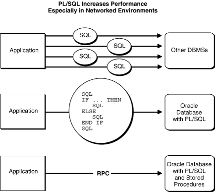
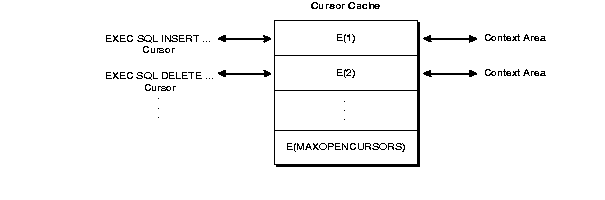

This appendix shows you some simple, easy-to-apply methods for improving the performance of your applications. Using these methods, you can often reduce processing time by 25% or more. This appendix contains the following topics:

- What Causes Poor Performance?

- How Can Performance Be Improved?

- About Using Host Arrays

- About Using Embedded PL/SQL

- About Optimizing SQL Statements

- About Statement Caching

- About Using Indexes

- About Taking Advantage of Row-Level Locking

- About Eliminating Unnecessary Parsing

- About Using Connection Pooling

- About Using Oracle Connection Manager in Traffic Director Mode

### B.1 What Causes Poor Performance?

One cause of poor performance is high communications overhead. The server must process SQL statements one at a time. Thus, each statement results in another call to single and higher overhead. In a networked environment, SQL statements must be sent over the network, adding to network traffic. Heavy network traffic can slow down your application significantly.

Another cause of poor performance is inefficient SQL statements. Because SQL is so flexible, you can get the same result with two different statements, but one statement might be less efficient. For example, the following two SELECT statements return the same rows (the name and number of every department having at least one employee):

    EXEC SQL SELECT dname, deptno
        FROM dept
        WHERE deptno IN (SELECT deptno FROM emp);

    EXEC SQL SELECT dname, deptno
        FROM dept
        WHERE EXISTS
        (SELECT deptno FROM emp WHERE dept.deptno = emp.deptno);

However, the first statement is slower because it does a time-consuming full scan of the EMP table for every department number in the DEPT table. Even if the DEPTNO column in EMP is indexed, the index is not used because the subquery lacks a WHERE clause naming DEPTNO.

A third cause of poor performance is unnecessary parsing and binding. Recall that before executing a SQL statement, the server must parse and bind it. Parsing means examining the SQL statement to make sure it follows syntax rules and refers to valid database objects. Binding means associating host variables in the SQL statement with their addresses so that the server can read or write their values.

Many applications manage cursors poorly. This results in unnecessary parsing and binding, which adds noticeably to processing overhead.

### B.2 How Can Performance Be Improved?

If you are unhappy with the performance of your precompiled programs, there are several ways you can reduce overhead.

You can greatly reduce communications overhead, especially in networked environments, by

- Using host arrays

- Using embedded PL/SQL

You can reduce processing overhead—sometimes dramatically—by

- Optimizing SQL statements

- Using indexes

- Taking advantage of row-level locking

- Eliminating unnecessary parsing

- Avoiding unnecessary reparsing

The following sections look at each of these ways to cut overhead.

### B.3 About Using Host Arrays

Host arrays can increase performance because they let you manipulate an entire collection of data with a single SQL statement. For example, suppose you want to INSERT salaries for 300 employees into the EMP table. Without arrays your program must do 300 individual INSERTs—one for each employee. With arrays, only one INSERT is necessary. Consider the following statement:

    EXEC SQL INSERT INTO emp (sal) VALUES (:salary);

If salary is a simple host variable, the server executes the INSERT statement once, inserting a single row into the EMP table. In that row, the SAL column has the value of salary. To insert 300 rows this way, you must execute the INSERT statement 300 times.

However, if salary is a host array of size 300, all 300 rows are inserted into the EMP table at once. In each row, the SAL column has the value of an element in the salary array.

**Related Topics**

- [Host Arrays](host-arrays.md)

### B.4 About Using Embedded PL/SQL

As Figure B-1 shows, if your application is database-intensive, you can use control structures to group SQL statements in a PL/SQL block, then send the entire block to the database server. This can drastically reduce communication between your application and the database server.

Also, you can use PL/SQL subprograms to reduce calls from your application to the server. For example, to execute ten individual SQL statements, ten calls are required, but to execute a subprogram containing ten SQL statements, only one call is required.

Figure B-1 PL/SQL Boosts Performance

[Description of "Figure B-1 PL/SQL Boosts Performance"](img_text/lnpcc019.md)

PL/SQL can also cooperate with Oracle application development tools such as Oracle Forms. By adding procedural processing power to these tools, PL/SQL boosts performance. Using PL/SQL, a tool can do any computation quickly and efficiently without calling on the database server. This saves time and reduces network traffic.

**Related Topics**

- [Embedded PL/SQL](embedded-PL-SQL.md)
- [Oracle Database PL/SQL Language Reference](../lnpls/index.md)

### B.5 About Optimizing SQL Statements

For every SQL statement, the Oracle optimizer generates an execution plan, which is a series of steps that the server takes to execute the statement. These steps are determined by rules given in Oracle Application Developer's Guide - Fundamentals. Following these rules will help you write optimal SQL statements.

#### B.5.1 Optimizer Hints

In some cases, you can suggest to the server the way to optimize a SQL statement. These suggestions, called hints, let you influence decisions made by the optimizer.

Hints are not directives; they merely help the optimizer do its job. Some hints limit the scope of information used to optimize a SQL statement, while others suggest overall strategies.

You can use hints to specify the

- Optimization approach for a SQL statement

- Access path for each referenced table

- Join order for a join

- Method used to join tables

Hence, hints fall into the following four categories:

- Optimization Approach

- Access Path

- Join Order

- Join Operation

For example, the two optimization approach hints, COST and NOCOST, invoke the cost-based optimizer and the rule-based optimizer, respectively.

You give hints to the optimizer by placing them in a C-style comment immediately after the verb in a SELECT, UPDATE, INSERT, or DELETE statement. For instance, the optimizer uses the cost-based approach for the following statement:

    SELECT /*+ COST */ ename, sal INTO ...

For C++ code, optimizer hints in the form //+ are also recognized.

**Related Topics**

- [Using Edition-Based Redefinition](../adfns/editions.md)

#### B.5.2 Trace Facility

You can use the SQL trace facility and the EXPLAIN PLAN statement to identify SQL statements that might be slowing down your application.

The SQL trace facility generates statistics for every SQL statement executed. From these statistics, you can determine which statements take the most time to process. Then, you can concentrate your tuning efforts on those statements.

The EXPLAIN PLAN statement shows the execution plan for each SQL statement in your application. An execution plan describes the database operations that must be carried out to execute a SQL statement. You can use the execution plan to identify inefficient SQL statements.

**Related Topics**

- [Tools for Performance](../adfns/performance-and-scalability.md)

### B.6 About Statement Caching

This is a feature that will help in the performance improvement of all the precompiler applications that rely on dynamic SQL statements. The new implementation will remove the overhead of parsing the dynamic statements on reuse. The precompiler application user can obtain this performance improvement using a new command line option (for the statement cache size), which will enable the statement caching of the dynamic statements. By enabling the new option, the statement cache will be created at session creation time. The caching is only applicable for the dynamic statements and the cursor cache for the static statements co-exists with this feature.

### B.7 About Using Indexes

Using ROWIDs, an index associates each distinct value in a table column with the rows containing that value. An index is created with the CREATE INDEX statement. For details, see [CREATE INDEX](../sqlrf/CREATE-INDEX.md).

You can use indexes to boost the performance of queries that return less than 15% of the rows in a table. A query that returns 15% or more of the rows in a table is executed faster by a full scan, that is, by reading all rows sequentially.

Any query that names an indexed column in its WHERE clause can use the index. For guidelines that help you choose which columns to index, see[ Oracle Database Advanced Application Developer's Guide](../adfns/index.md).

### B.8 About Taking Advantage of Row-Level Locking

By default, data is locked at the row level rather than at the table level. Row-level locking allows multiple users to access different rows in the same table concurrently. The resulting performance gain is significant.

You can specify table-level locking, but it lessens the effectiveness of the transaction processing option.

Applications that do online transaction processing benefit most from row-level locking. If your application relies on table-level locking, modify it to take advantage of row-level locking. In general, avoid explicit table-level locking.

**Related Topics**

- [Using LOCK TABLE](database-concepts.md)

### B.9 About Eliminating Unnecessary Parsing

Eliminating unnecessary parsing requires correct handling of cursors and selective use of the following cursor management options:

- MAXOPENCURSORS

- HOLD_CURSOR

- RELEASE_CURSOR

These options affect implicit and explicit cursors, the cursor cache, and private SQL areas.

#### B.9.1 About Handling Explicit Cursors

Recall that there are two types of cursors: implicit and explicit. A cursor is implicitly declared for all data definition and data manipulation statements. However, for queries that return more than one row, you must explicitly declare a cursor (or use host arrays). You use the DECLARE CURSOR statement to declare an explicit cursor. The way you handle the opening and closing of explicit cursors affects performance.

If you need to reevaluate the active set, simply reOPEN the cursor. OPEN will use any new host-variable values. You can save processing time if you do not CLOSE the cursor first.

**Note:**

To make performance tuning easier, you can reOPEN an already open cursor. However, this is an ANSI extension. So, when MODE=ANSI, you must CLOSE a cursor before reOPENing it.

Only CLOSE a cursor when you want to free the resources (memory and locks) acquired by OPENing the cursor. For example, your program should CLOSE all cursors before exiting.

##### B.9.1.1 Cursor Control

In general, there are three ways to control an explicitly declared cursor:

- Use DECLARE, OPEN, and CLOSE.

- Use PREPARE, DECLARE, OPEN, and CLOSE.

- COMMIT closes the cursor when MODE=ANSI.

With the first way, beware of unnecessary parsing. OPEN does the parsing, but only if the parsed statement is unavailable because the cursor was CLOSEd or never OPENed. Your program should DECLARE the cursor, reOPEN it every time the value of a host variable changes, and CLOSE it only when the SQL statement is no longer needed.

With the second way (for dynamic SQL Methods 3 and 4), PREPARE does the parsing, and the parsed statement is available until a CLOSE is executed. Your program should do the following:

- PREPARE the SQL statement

- DECLARE the cursor

- Again OPEN the cursor every time the value of a host variable changes

- Again PREPARE the SQL statement

- Again OPEN the cursor if the SQL statement changes

- CLOSE the cursor only when the SQL statement is no longer needed.

When possible, avoid placing OPEN and CLOSE statements in a loop; this is a potential cause of unnecessary reparsing of the SQL statement. In the next example, both the OPEN and CLOSE statements are inside the outer while loop. When MODE=ANSI, the CLOSE statement must be positioned as shown, because ANSI requires a cursor to be CLOSEd before being reOPENed.

    EXEC SQL DECLARE emp_cursor CURSOR FOR
         SELECT ename, sal from emp where sal >  :salary and
                                          sal <= :salary + 1000;
    salary = 0;
    while (salary < 5000)
    {
         EXEC SQL OPEN emp_cursor;
         while (SQLCODE==0)
         {
             EXEC SQL FETCH emp_cursor INTO ....
             ...
         }
         salary += 1000;
         EXEC SQL CLOSE emp_cursor;
    }

With MODE=ORACLE, however, a CLOSE statement can execute without the cursor being OPENed. By placing the CLOSE statement outside the outer while loop, you can avoid possible reparsing at each iteration of the OPEN statement.

    ...
    while (salary < 5000)
    {
         EXEC SQL OPEN emp_cursor;
         while (sqlca.sqlcode==0)
         {
             EXEC SQL FETCH emp_cursor INTO ....
             ...
         }
         salary += 1000;
    }
    EXEC SQL CLOSE emp_cursor;

#### B.9.2 About Using the Cursor Management Options

A SQL statement need be parsed only once unless you change its makeup. For example, you change the makeup of a query by adding a column to its select list or WHERE clause. The HOLD_CURSOR, RELEASE_CURSOR, and MAXOPENCURSORS options give you some control over how the server manages the parsing and reparsing of SQL statements. Declaring an explicit cursor gives you maximum control over parsing.

##### B.9.2.1 SQL Areas and Cursor Cache

When a data manipulation statement is executed, its associated cursor is linked to an entry in the Pro\*C/C++ cursor cache. The cursor cache is a continuously updated area of memory used for cursor management. The cursor cache entry is in turn linked to a private SQL area.

The private SQL area, a work area created dynamically at run time, contains the addresses of host variables, and other information needed to process the statement. An explicit cursor lets you name a SQL statement, access the information in its private SQL area, and, to some extent, control its processing.

Figure B-2 represents the cursor cache after your program has done an INSERT and a DELETE.

Figure B-2 Cursors Linked using the Cursor Cache

[Description of "Figure B-2 Cursors Linked using the Cursor Cache"](img_text/pco81062.md)

##### B.9.2.2 Resource Use

The maximum number of open cursors for each user session is set by the initialization parameter OPEN_CURSORS.

MAXOPENCURSORS specifies the initial size of the cursor cache. If a new cursor is needed and there are no free cache entries, the server tries to reuse an entry. Its success depends on the values of HOLD_CURSOR and RELEASE_CURSOR and, for explicit cursors, on the status of the cursor itself.

If the value of MAXOPENCURSORS is less than the number of cache entries actually needed, the server uses the first cache entry marked as reusable. For example, suppose an INSERT statement's cache entry E(1) is marked as reusable, and the number of cache entries already equals MAXOPENCURSORS. If the program executes a new statement, cache entry E(1) and its private SQL area might be reassigned to the new statement. To reexecute the INSERT statement, the server would have to reparse it and reassign another cache entry.

The server allocates an additional cache entry if it cannot find one to reuse. For example, if MAXOPENCURSORS=8 and all eight entries are active, a ninth is created. If necessary, the server keeps allocating additional cache entries until it runs out of memory or reaches the limit set by OPEN_CURSORS. This dynamic allocation adds to processing overhead.

Thus, specifying a low value for MAXOPENCURSORS saves memory but causes potentially expensive dynamic allocations and deallocations of new cache entries. Specifying a high value for MAXOPENCURSORS assures speedy execution but uses more memory.

##### B.9.2.3 Infrequent Execution

Sometimes, the link between an infrequently executed SQL statement and its private SQL area should be temporary.

When HOLD_CURSOR=NO (the default), after the server executes the SQL statement and the cursor is closed, the precompiler marks the link between the cursor and cursor cache as reusable. The link is reused as soon as the cursor cache entry to which it points is needed for another SQL statement. This frees memory allocated to the private SQL area and releases parse locks. However, because a PREPAREd cursor must remain active, its link is maintained even when HOLD_CURSOR=NO.

When RELEASE_CURSOR=YES, after the server executes the SQL statement and the cursor is closed, the private SQL area is automatically freed and the parsed statement lost. This might be necessary if, for example, MAXOPENCURSORS is set low at your site to conserve memory.

If a data manipulation statement precedes a data definition statement and they reference the same tables, specify RELEASE_CURSOR=YES for the data manipulation statement. This avoids a conflict between the parse lock obtained by the data manipulation statement and the exclusive lock required by the data definition statement.

When RELEASE_CURSOR=YES, the link between the private SQL area and the cache entry is immediately removed and the private SQL area freed. Even if you specify HOLD_CURSOR=YES, the server must still reallocate memory for a private SQL area and reparse the SQL statement before executing it because RELEASE_CURSOR=YES overrides HOLD_CURSOR=YES.

However, when RELEASE_CURSOR=YES, the reparse might still require no extra processing because the server caches the parsed representations of SQL statements and PL/SQL blocks in its Shared SQL Cache. Even if its cursor is closed, the parsed representation remains available until it is aged out of the cache.

##### B.9.2.4 Frequent Execution

The links between a frequently executed SQL statement and its private SQL area should be maintained because the private SQL area contains all the information needed to execute the statement. Maintaining access to this information makes subsequent execution of the statement much faster.

When HOLD_CURSOR=YES, the link between the cursor and cursor cache is maintained after the server executes the SQL statement. Thus, the parsed statement and allocated memory remain available. This is useful for SQL statements that you want to keep active because it avoids unnecessary reparsing.

When RELEASE_CURSOR=NO (the default), the link between the cache entry and the private SQL area is maintained after the server executes the SQL statement and is not reused unless the number of open cursors exceeds the value of MAXOPENCURSORS. This is useful for SQL statements that are executed often because the parsed statement and allocated memory remain available.

**Note:**

With versions of Oracle prior to Oracle8i, when RELEASE_CURSOR=NO and HOLD_CURSOR=YES, after the server executes a SQL statement, its parsed representation remains available. But with later versions of Oracle, when RELEASE_CURSOR=NO and HOLD_CURSOR=YES, the parsed representation remains available only until it is aged out of the Shared SQL Cache. Normally, this is not a problem, but you might get unexpected results if the definition of a referenced object changes before the SQL statement is reparsed.

##### B.9.2.5 Embedded PL/SQL Considerations

For the purposes of cursor management, an embedded PL/SQL block is treated just like a SQL statement. When an embedded PL/SQL block is executed, a parent cursor is associated with the entire block and a link is created between the cache entry and the private SQL area in the PGA for the embedded PL/SQL block. Be aware that each SQL statement inside the embedded block also requires a private SQL area in the PGA. These SQL statements use child cursors that PL/SQL manages itself. The disposition of the child cursors is determined through its associated parent cursor. That is, the private SQL areas used by the child cursors are freed after the private SQL area for its parent cursor is freed.

##### B.9.2.6 Parameter Interactions

Figure B-1 shows how HOLD_CURSOR and RELEASE_CURSOR interact. Notice that HOLD_CURSOR=NO overrides RELEASE_CURSOR=NO and that RELEASE_CURSOR=YES overrides HOLD_CURSOR=YES.

Table B-1 HOLD_CURSOR and RELEASE \_CURSOR Interactions

| HOLD_CURSOR | RELEASE_CURSOR | Links are ...       |
|:------------|:---------------|:--------------------|
| NO          | NO             | marked as reusable  |
| YES         | NO             | maintained          |
| NO          | YES            | removed immediately |
| YES         | YES            | removed immediately |

### B.10 About Avoiding Unnecessary Reparsing

Avoiding unnecessary reparsing involves eliminating errors encountered during the execute phase of an SQL statement in a loop. When an embedded SQL statement is executed in a loop, the SQL statement is parsed only once. However, if the execution of the SQL statement results in an error, the SQL statement is usually reparsed. In this case, reparsing will occur for all errors encountered, except the following:

- ORA-1403 (not found)

- ORA-1405 (truncation)

- ORA-1406 (null value)

By eliminating all other errors, you can avoid unnecessary reparsing.

### B.11 About Using Connection Pooling

This section describes performance tuning using connection pooling. If an application is multithreaded and is performing concurrent operations on the same database, users can use the connection pooling feature to achieve better performance. Users can tune an application's performance by choosing the appropriate values for parameters used with connection pooling, and can achieve up to three times performance increase, when compared to existing application performance.

**Related Topics**

- [Multithreaded Applications](multithreaded-applications.md)
- [Connection Pooling](multithreaded-applications.md)
- [Oracle Call Interface Programmer's Guide](../lnoci/index.md)

### B.12 About Using Oracle Connection Manager in Traffic Director Mode

Oracle Connection Manager in Traffic Director Mode is a proxy that is placed between supported database clients and database instances.

Supported clients from Oracle Database 11g Release 2 (11.2) and later can connect to Oracle Connection Manager in Traffic Director Mode. Oracle Connection Manager in Traffic Director Mode provides improved high availability (HA) for planned and unplanned database server outages, connection multiplexing support, and load balancing. Support for Oracle Connection Manager in Traffic Director Mode is described in more detail in the following sections

- Modes of Operation

- Key Features

#### Modes of Operation

Oracle Connection Manager in Traffic Director Mode supports the following modes of operation:

- In pooled connection mode, Oracle Connection Manager in Traffic Director Mode supports any application using the following database client releases:
  - OCI, OCCI, and Open Source Drivers (Oracle Database 11g release 2 (11.2.0.4) and later))

  - JDBC (Oracle Database 12c release 1 (12.1) and later)

  - ODP.NET (Oracle Database 12c release 2 (12.2) and later)

  In addition, applications must use DRCP. That is, the application must enable DRCP in the connect string (or in the `tnsnames.ora` alias).

- In non-pooled connection (or dedicated) mode, Oracle Connection Manager in Traffic Director Mode supports any application using database client releases Oracle Database 11g release 2 (11.2.0.4) and later. In this mode, some capabilities, such as connection multiplexing are not available.

#### Key Features

Oracle Connection Manager in Traffic Director Mode furnishes support for the following:

- Transparent performance enhancements and connection multiplexing, which includes:
  - Statement caching, rows prefetching, and result set caching are auto-enabled for all modes of operation.

  - Database session multiplexing (pooled mode only) using the proxy resident connection pool (PRCP), where PRCP is a proxy mode of Database Resident Connection Pooling (DRCP). Applications get transparent connect-time load balancing and run-time load balancing between Oracle Connection Manager in Traffic Director Mode and the database.

  - For multiple Oracle Connection Manager in Traffic Director Mode instances, applications get increased scalability through client-side connect time load balancing or with a load balancer (BIG-IP, NGINX, and others)
- Zero application downtime
  - Planned database maintenance or pluggable database (PDB) relocation
    - Pooled mode

      Oracle Connection Manager in Traffic Director Mode responds to Oracle Notification Service (ONS) events for planned outages and redirects work. Connections are drained from the pool on Oracle Connection Manager in Traffic Director Mode when the request completes. Service relocation is supported for Oracle Database 11g release 2 (11.2.0.4) and later.

      For PDB relocation, Oracle Connection Manager in Traffic Director Mode responds to in-band notifications when a PDB is relocated, that is even when ONS is not configured (for Oracle Database release 18c, version 18.1 and later server only) 

    - Non-pooled or dedicated mode

      When there is no request boundary information from the client, Oracle Connection Manager in Traffic Director Mode supports planned outage for many applications (as long as only simple session state and cursor state need to be preserved across the request/transaction boundaries). This support includes:
      - Stop service/PDB at the transaction boundary or it leverages Oracle Database release 18c continuous application availability to stop the service at the request boundary

      - Oracle Connection Manager in Traffic Director Mode leverages Transparent Application Failover (TAF) failover restore to reconnect and restore simple states.

  - Unplanned database outages for read-mostly workloads
- High Availability of Oracle Connection Manager in Traffic Director Mode to avoid a single point of failure. This is supported by:
  - Multiple instances of Oracle Connection Manager in Traffic Director Mode using a load balancer or client side load balancing/failover in the connect string

  - Rolling upgrade of Oracle Connection Manager in Traffic Director Mode instances

  - Graceful close of existing connections from client to Oracle Connection Manager in Traffic Director Mode for planned outages

  - In-band notifications to Oracle Database release 18c and later clients

  - For older clients, notifications are sent with the response of the current request
- For security and isolation, Oracle Connection Manager in Traffic Director Mode furnishes:
  - Database Proxy supporting transmission control protocol/transmission control protocol secure (TCP/TCPS) and protocol conversion

  - Firewall based on the IP address, service name, and secure socket layer/transport layer security (SSL/TLS) wallets

  - Tenant isolation in a multi-tenant environment

  - Protection against denial-of-service and fuzzing attacks

  - Secure tunneling of database traffic across Oracle Database on-premises and Oracle Cloud

**See Also:**

- [Oracle Database Net Services Administrator's Guide](../netag/configuring-oracle-connection-manager.md) for information about configuring `cman.ora` configuration file to set up Oracle Connection Manager in Traffic Director Mode

- [Oracle Database Net Services Administrator's Guide](../netag/configuring-oracle-connection-manager.md) for information about configuring databases for Oracle Connection Manager in Traffic Director Mode proxy authentication

- [Oracle Database Net Services Administrator's Guide](../netag/configuring-oracle-connection-manager.md) for information about configuring Oracle Connection Manager in Traffic Director Mode for unplanned down events

- [Oracle Database Net Services Administrator's Guide](../netag/configuring-oracle-connection-manager.md) for information about configuring Oracle Connection Manager in Traffic Director Mode for planned down events

- [Oracle Database Net Services Administrator's Guide](../netag/configuring-oracle-connection-manager.md) for information about configuring proxy resident connection pools for use by Oracle Connection Manager in Traffic Director Mode

- [Oracle Database Net Services Administrator's Guide](../netag/configuring-oracle-connection-manager.md) for information about functionality not supported for all drivers with Oracle Connection Manager in Traffic Director Mode

- [Oracle Database Net Services Reference](../netrf/index.md) for an overview of Oracle CMAN configuration file
