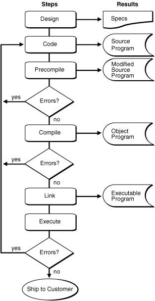

This chapter explains how embedded SQL programs do their work. You examine the special environment in which they operate and the impact of this environment on the design of your applications. After covering the key concepts of embedded SQL programming and the steps you take in developing an application, this chapter uses a simple program to illustrate the main points.

This chapter contains the following topics:

- Key Concepts of Embedded SQL Programming

- Steps in Developing an Embedded SQL Application

- Guidelines for Programming

- Example Tables

- Example Program: A Simple Query

- Example Program: A Simple Query using SQL99 Syntax

### 2.1 Key Concepts of Embedded SQL Programming

This section lays the conceptual foundation on which later chapters build. This section contains these topics:

- Embedded SQL Statements

- Embedded SQL Syntax

- Static Versus Dynamic SQL Statements

- Embedded PL/SQL Blocks

- Host and Indicator Variables

- Oracle Datatypes

- Arrays

- Datatype Equivalencing

- Private SQL Areas\_ Cursors\_ and Active Sets

- Transactions

- Errors and Warnings

- SQL99 Syntax Support

#### 2.1.1 Embedded SQL Statements

The term embedded SQL refers to SQL statements placed within an application program. Because it houses the SQL statements, the application program is called a host program, and the language in which it is written is called the host language. For example, Pro\*C/C++ provides the ability to embed certain SQL statements in a C or C++ host program.

To manipulate and query Oracle data, you use the INSERT, UPDATE, DELETE, and SELECT statements. INSERT adds rows of data to database tables, UPDATE modifies rows, DELETE removes unwanted rows, and SELECT retrieves rows that meet your search condition.

The powerful SET ROLE statement lets you dynamically manage database privileges. A role is a named group of related system and object privileges, or a named group of related system or object privileges granted to users or other roles. Role definitions are stored in the Oracle data dictionary. Your applications can use the SET ROLE statement to enable and disable roles as needed.

Only SQL statements—not SQL\*Plus statements—are valid in an application program. (SQL\*Plus has additional statements for setting environment parameters, editing, and report formatting.)

##### 2.1.1.1 Executable Statements and Directives

Embedded SQL includes all the interactive SQL statements plus others that allow you to transfer data between Oracle and a host program. There are two types of embedded SQL statements: executable statements and directives. Executable statements result in calls to the runtime library SQLLIB. You use them to connect to Oracle, to define, query, and manipulate Oracle data, to control access to Oracle data, and to process transactions. They can be placed wherever C or C++ language executable statements can be placed.

Directives, on the other hand, do not result in calls to SQLLIB and do not operate on Oracle data. You use them to declare Oracle objects, communications areas, and SQL variables. They can be placed wherever C or C++ variable declarations can be placed.

Table 2-1 groups the various embedded SQL statements (not a complete list):

Table 2-1 Embedded SQL Statements

| DIRECTIVE                                        | PURPOSE                              |
|:-------------------------------------------------|:-------------------------------------|
| ARRAYLEN\*                                       | To use host arrays with PL/SQL       |
| BEGIN DECLARE SECTION\* END DECLARE SECTION\* | To declare host variables (optional) |
| DECLARE\*                                        | To name Oracle schema objects        |
| INCLUDE\*                                        | To copy in files                     |
| TYPE\*                                           | To equivalence datatypes             |
| VAR\*                                            | To equivalence variables             |
| WHENEVER\*                                       | To handle runtime errors             |

Table 2-2 Embedded SQL Statements

| EXECUTABLE STATEMENT             | PURPOSE                           |
|:---------------------------------|:----------------------------------|
| ALLOCATE\*                       | To define and control Oracle data |
| ALTER                            | \-                                |
| ANALYZE                          | \-                                |
| DELETE                           | DML                               |
| INSERT                           | \-                                |
| SELECT                           | \-                                |
| UPDATE                           | \-                                |
| COMMIT                           | To process transactions           |
| ROLLBACK                         | \-                                |
| SAVEPOINT                        | \-                                |
| SET TRANSACTION                  | \-                                |
| DESCRIBE\*                       | To use dynamic SQL                |
| EXECUTE\*                        | \-                                |
| PREPARE\*                        | \-                                |
| ALTER SESSION                    | To control sessions               |
| SET ROLE                         | \-                                |
| \*Has no interactive counterpart |                                   |

#### 2.1.2 Embedded SQL Syntax

In your application program, you can freely mix complete SQL statements with complete C statements and use C variables or structures in SQL statements. The only special requirement for building SQL statements into your host program is that you begin them with the keywords EXEC SQL and end them with a semicolon. Pro\*C/C++ translates all EXEC SQL statements into calls to the runtime library SQLLIB.

Many embedded SQL statements differ from their interactive counterparts only through the addition of a new clause or the use of program variables. The following example compares interactive and embedded ROLLBACK statements:

    ROLLBACK WORK:           -- interactive
    EXEC SQL ROLLBACK WORK;  -- embedded

These statements have the same effect, but you would use the first in an interactive SQL environment (such as when running SQL\*Plus), and the second in a Pro\*C/C++ program.

#### 2.1.3 Static Versus Dynamic SQL Statements

Most application programs are designed to process static SQL statements and fixed transactions. In this case, you know the makeup of each SQL statement and transaction before runtime; that is, you know which SQL commands will be issued, which database tables might be changed, which columns will be updated, and so on.

However, some applications might be required to accept and process any valid SQL statement at runtime. So, you might not know until runtime all the SQL commands, database tables, and columns involved.

Dynamic SQL is an advanced programming technique that lets your program accept or build SQL statements at run time and take explicit control over datatype conversion.

#### 2.1.4 Embedded PL/SQL Blocks

Pro\*C/C++ treats a PL/SQL block like a single embedded SQL statement. You can place a PL/SQL block anywhere in an application program that you can place a SQL statement. To embed PL/SQL in your host program, you simply declare the variables to be shared with PL/SQL and bracket the PL/SQL block with the keywords EXEC SQL EXECUTE and END-EXEC.

From embedded PL/SQL blocks, you can manipulate Oracle data flexibly and safely because PL/SQL supports all SQL data manipulation and transaction processing commands.

#### 2.1.5 Host and Indicator Variables

Host variables are the key to communication between Oracle and your program. A host variable is a scalar or aggregate variable declared in C and shared with Oracle, meaning that both your program and Oracle can reference its value.

Your program uses input host variables to pass data to Oracle. Oracle uses output host variables to pass data and status information to your program. The program assigns values to input host variables; Oracle assigns values to output host variables.

Host variables can be used anywhere a SQL expression can be used. In SQL statements, host variables must be prefixed with a colon (:) to set them apart from the SQL keywords.

You can also use a C struct to contain a number of host variables. When you name the structure in an embedded SQL statement, prefixed with a colon, Oracle uses each of the components of the struct as a host variable.

You can associate any host variable with an optional indicator variable. An indicator variable is a short integer variable that "indicates" the value or condition of its host variable. You use indicator variables to assign NULLs to input host variables and to detect NULLs or truncated values in output host variables. A NULL is a missing, unknown, or inapplicable value.

In SQL statements, an indicator variable must be prefixed with a colon and immediately follow its associated host variable. The keyword INDICATOR can be placed between the host variable and its indicator for additional clarity.

If the host variables are packaged in a struct, and you want to use indicator variables, you simply create a struct that has an indicator variable for each host variable in the host structure, and name the indicator struct in the SQL statement, immediately following the host variable struct, and prefixed with a colon. You can also use the INDICATOR keyword to separate a host structure and its associated indicator structure.

#### 2.1.6 Oracle Datatypes

Typically, a host program inputs data to Oracle, and Oracle outputs data to the program. Oracle stores input data in database tables and stores output data in program host variables. To store a data item, Oracle must know its datatype, which specifies a storage format and valid range of values.

Oracle recognizes two kinds of datatypes: internal and external. Internal datatypes specify how Oracle stores data in database columns. Oracle also uses internal datatypes to represent database pseudocolumns, which return specific data items but are not actual columns in a table.

External datatypes specify how data is stored in host variables. When your host program inputs data to Oracle, if necessary, Oracle converts between the external datatype of the input host variable and the internal datatype of the target database column. When Oracle outputs data to your host program, if necessary, Oracle converts between the internal datatype of the source database column and the external datatype of the output host variable.

#### 2.1.7 Arrays

Pro\*C/C++ lets you define array host variables (called host arrays) and arrays of structures and operate on them with a single SQL statement. Using the array SELECT, FETCH, DELETE, INSERT, and UPDATE statements, you can query and manipulate large volumes of data with ease. You can also use host arrays inside a host variable struct.

#### 2.1.8 Datatype Equivalencing

Pro\*C/C++ adds flexibility to your applications by letting you equivalence datatypes. That means you can customize the way Oracle interprets input data and formats output data.

On a variable-by-variable basis, you can equivalence supported C datatypes to the Oracle external datatypes. You can also equivalence user-defined datatypes to Oracle external datatypes.

#### 2.1.9 Private SQL Areas, Cursors, and Active Sets

To process a SQL statement, Oracle opens a work area called a private SQL area. The private SQL area stores information needed to execute the SQL statement. An identifier called a cursor lets you name a SQL statement, access the information in its private SQL area, and, to some extent, control its processing.

For static SQL statements, there are two types of cursors: implicit and explicit. Oracle implicitly declares a cursor for all data definition and data manipulation statements, including SELECT statements (queries) that return only one row. However, for queries that return more than one row, to process beyond the first row, you must explicitly declare a cursor (or use host arrays).

The set of rows returned is called the active set; its size depends on how many rows meet the query search condition. You use an explicit cursor to identify the row currently being processed, called the current row.

Imagine the set of rows being returned to a terminal screen. A screen cursor can point to the first row to be processed, then the next row, and so on. In the same way, an explicit cursor "points" to the current row in the active set. This allows your program to process the rows one at a time.

#### 2.1.10 Transactions

A transaction is a series of logically related SQL statements (two UPDATEs that credit one bank account and debit another, for example) that Oracle treats as a unit, so that all changes brought about by the statements are made permanent or undone at the same time.

All the data manipulation statements executed since the last data definition, COMMIT, or ROLLBACK statement was executed make up the current transaction.

To help ensure the consistency of your database, Pro\*C/C++ lets you define transactions using the COMMIT, ROLLBACK, and SAVEPOINT statements.

COMMIT makes permanent any changes made during the current transaction. ROLLBACK ends the current transaction and undoes any changes made since the transaction began. SAVEPOINT marks the current point in the processing of a transaction; used with ROLLBACK, it undoes part of a transaction.

#### 2.1.11 Errors and Warnings

When you execute an embedded SQL statement, it either succeeds or fails, and might result in an error or warning. You need a way to handle these results. Pro\*C/C++ provides two error handling mechanisms: the SQL Communications Area (SQLCA) and the WHENEVER statement.

The SQLCA is a data structure that you include (or hard-code) in your host program. It defines program variables used by Oracle to pass runtime status information to the program. With the SQLCA, you can take different actions based on feedback from Oracle about work just attempted. For example, you can check to see if a DELETE statement succeeded and, if so, how many rows were deleted.

With the WHENEVER statement, you can specify actions to be taken automatically when Oracle detects an error or warning condition. These actions are: continuing with the next statement, calling a function, branching to a labeled statement, or stopping.

#### 2.1.12 SQL99 Syntax Support

The SQL standard enables the portability of SQL applications across all conforming software products. Oracle features are compliant with the ANSI/ISO SQL99 standard, including ANSI compliant joins. Pro\*C/C++ supports all SQL99 features that are supported by Oracle database, which means that the SQL99 syntax for the SELECT, INSERT, DELETE, and UPDATE statements and the body of the cursor in a DECLARE CURSOR statement are supported.

### 2.2 Steps in Developing an Embedded SQL Application

Figure 2-1 shows the embedded SQL application development process.

Figure 2-1 Embedded SQL Application Development Process

[Description of "Figure 2-1 Embedded SQL Application Development Process"](img_text/lnpcc003.md)

As you can see, precompiling results in a modified source file that can be compiled normally. Though precompiling adds a step to the traditional development process, that step lets you write very flexible applications.

### 2.3 Guidelines for Programming

This section deals with embedded SQL syntax, coding conventions, and C-specific features and restrictions. Topics are arranged alphabetically for quick reference.

#### 2.3.1 Comments

You can place C-style Comments (/\* ... \*/) in a SQL statement wherever blanks can be placed (except between the keywords EXEC SQL). Also, you can place ANSI-style Comments (-- ...) within SQL statements at the end of a line, as the following example shows:

    EXEC SQL SELECT ENAME, SAL
        INTO :emp_name, :salary  -- output host variables
        FROM EMP
        WHERE DEPTNO = :dept_number;

You can use C++ style Comments (//) in your Pro\*C/C++ source if you precompile using the CODE=CPP precompiler option.

#### 2.3.2 Constants

An L or l suffix specifies a long integer constant, a U or u suffix specifies an unsigned integer constant, a 0X or 0x prefix specifies a hexadecimal integer constant, and an F or f suffix specifies a float floating-point constant. These forms are not allowed in SQL statements.

#### 2.3.3 Declare Section

A Declare Section contains the host variable declarations and is of the form:

    EXEC SQL BEGIN DECLARE SECTION;
    /* Declare all host variables inside this section:  */
        char *uid = "username/password";
        ...
    EXEC SQL END DECLARE SECTION;

A Declare Section begins with the statement:

    EXEC SQL BEGIN DECLARE SECTION;

and ends with the statement:

    EXEC SQL END DECLARE SECTION;

Between these two statements only the following are allowed:

- Host-variable and indicator-variable declarations

- Non-host C/C++ variables

- EXEC SQL DECLARE statements

- EXEC SQL INCLUDE statements

- EXEC SQL VAR statements

- EXEC SQL TYPE statements

- EXEC ORACLE statements

- C/C++ comments

A Declare Section is required when MODE=ANSI or CODE=CPP (in a C++ application) or PARSE=NONE or PARTIAL.

More than one Declare Section is allowed. They can be in different code modules.

**Related Topics**

- [About Parsing Code](C-Plus-Plus-Applications.md)

#### 2.3.4 Delimiters

While C uses single quotes to delimit single characters, as in

    ch = getchar();
    switch (ch)
    {
    case 'U': update();  break;
    case 'I': insert();  break;
    ...

SQL uses single quotes to delimit character strings, as in

    EXEC SQL SELECT ENAME, SAL FROM EMP WHERE JOB = 'MANAGER';

While C uses double quotes to delimit character strings, as in

    printf("\nG'Day, mate!");

SQL uses double quotes to delimit identifiers containing special or lowercase characters, as in

    EXEC SQL CREATE TABLE "Emp2" (empno  number(4), ...);

#### 2.3.5 File Length

Pro\*C/C++ cannot process arbitrarily long source files. There is a limit to the number of lines allowed. The following aspects of the source file are contributing factors to the file-size constraint:

- Complexity of the embedded SQL statements (for example, the number of bind and define variables).

- Whether a database name is used (for example, connecting to a database with an AT clause).

- Number of embedded SQL statements.

To prevent problems related to this limitation, use multiple program units to sufficiently reduce the size of the source files.

#### 2.3.6 Function Prototyping

The ANSI C standard (X3.159-1989) provides for function prototyping. A function prototype declares a function and the data types of its arguments, so that the C compiler can detect missing or mismatched arguments.

The CODE option, which you can enter on the command line or in a configuration file, determines the way that the precompiler generates C or C++ code.

##### 2.3.6.1 ANSI_C

When you precompile your program with CODE=ANSI_C, the precompiler generates fully prototyped function declarations. For example:

    extern void sqlora(long *, void *);

##### 2.3.6.2 KR_C

When you precompile with the option CODE=KR_C (KR for "Kernighan and Ritchie"), the precompiler generates function prototypes in the same way that it does for ANSI_C, except that function parameter lists are commented out. For example:

    extern void sqlora(/*_ long *, void *  _*/);

So, make sure to set the precompiler option CODE to KR_C if you use a C compiler that does not support ANSI C. When the CODE option is set to ANSI_C, the precompiler can also generate other ANSI-specific constructs; for example, the const type qualifier.

##### 2.3.6.3 CPP

When you compile with CODE=CPP you will generate C++ compatible function prototypes. Use this option setting with C++ compilers.

**Related Topics**

- [C++ Applications](C-Plus-Plus-Applications.md)

#### 2.3.7 Hint Length

Maximum length of a sql hint in an embedded sql statement is limited to 256 characters. Any hint exceeding this limit will be truncated.

#### 2.3.8 Host Variable Names

Host variable names can consist of upper or lowercase letters, digits, and underscores, but must begin with a letter. They can be any length, but only the first 31 characters are significant to Pro\*C/C++. Your C compiler or linker might require a shorter maximum length, so check your C compiler user's guide.

For portability, you may wish to restrict the length of host variable names to 18 or fewer characters (the length mandated by the SQL standard).

**Related Topics**

- [Reserved Words, Keywords, and Namespaces](reserved-words-keywords-namespaces.md)

#### 2.3.9 Line Continuation

You can continue SQL statements from one line to the next. You must use a backslash (\\ to continue a string literal from one line to the next, as the following example shows:

    EXEC SQL INSERT INTO dept (deptno, dname) VALUES (50, 'PURCHAS\
    ING');

In this context, the precompiler treats the backslash as a continuation character.

#### 2.3.10 Line Length

The maximum line length is 1299 for lines consisting of only ASCII characters, or 324 for multibyte characters.

#### 2.3.11 MAXLITERAL Default Value

The precompiler option MAXLITERAL lets you specify the maximum length of string literals generated by the precompiler. The MAXLITERAL default value is 1024. Specify a smaller value if required. For example, if your C compiler cannot handle string literals longer than 512 characters, you then specify MAXLITERAL=512. Check your C compiler user's guide.

#### 2.3.12 Operators

The logical operators and the "equal to" relational operator are different in C and SQL, as the following list shows. These C operators are not allowed in SQL statements:

| SQL Operator | C Operator |
|:-------------|:-----------|
| NOT          | !          |
| AND          | &&         |
| OR           | \|\|       |
| =            | ==         |

The following C operators also not allowed in SQL statements:

| Type                | C Operator              |
|:--------------------|:------------------------|
| address             | &                       |
| bitwise             | &, \|, ^, ~             |
| compound assignment | +=, -=, \*=, and so on. |
| conditional         | ?:                      |
| decrement           | --                      |
| increment           | ++                      |
| indirection         | \*                      |
| modulus             | %                       |
| shift               | \>\>,\<\<               |

#### 2.3.13 Statement Terminator

Embedded SQL statements are always terminated by a semicolon, as the following example shows:

    EXEC SQL DELETE FROM emp WHERE deptno = :dept_number;

### 2.4 Conditional Precompilation

Conditional precompilation includes (or excludes) sections of code in your host program based on certain conditions. For example, you might want to include one section of code when precompiling under UNIX and another section when precompiling under VMS. Conditional precompilation lets you write programs that can run in different environments.

Conditional sections of code are marked by statements that define the environment and actions to take. You can code C or C++ statements as well as EXEC SQL statements in these sections. The following statements let you exercise conditional control over precompilation:

    EXEC ORACLE DEFINE symbol;        -- define a symbol
    EXEC ORACLE IFDEF symbol;         -- if symbol is defined
    EXEC ORACLE IFNDEF symbol;        -- if symbol is not defined
    EXEC ORACLE ELSE;                 -- otherwise
    EXEC ORACLE ENDIF;                -- end this control block

All EXEC ORACLE statements must be terminated with a semi-colon.

#### 2.4.1 Symbol Definition

You can define a symbol in two ways. Either include the statement:

    EXEC ORACLE DEFINE symbol;

in your host program or define the symbol on the command line using the syntax:

    ... DEFINE=symbol ...

where` symbol` is not case-sensitive.

**Note:**

The \#define preprocessor directive is not the same as the EXEC ORACLE DEFINE statement.

Some port-specific symbols are predefined for you when Pro\*C/C++ is installed on your system. For example, predefined operating symbols include CMS, MVS, MS-DOS, UNIX, and VMS.

#### 2.4.2 Example SELECT Statement

In the following example, the SELECT statement is precompiled only when the symbol `site2` is defined:

    EXEC ORACLE IFDEF site2;
       EXEC SQL SELECT DNAME
           INTO :dept_name
           FROM DEPT
           WHERE DEPTNO= :dept_number;
    EXEC ORACLE ENDIF;

You can "comment out" C, C++, or embedded SQL code by placing it between IFDEF and ENDIF and not defining the symbol.

### 2.5 Precompile Separately

You can precompile several C or C++ program modules separately, then link them into one executable program. This supports modular programming, which is required when the functional components of a program are written and debugged by different programmers. The individual program modules need not be written in the same language.

#### 2.5.1 Guidelines

The following guidelines will help you avoid some common problems.

##### 2.5.1.1 Referencing Cursors

Cursor names are SQL identifiers, whose scope is the precompilation unit. Hence, cursor operations cannot span precompilation units (files). That is, you cannot DECLARE a cursor in one file, and OPEN or FETCH from it in another file. So, when doing a separate precompilation, make sure all definitions and references to a given cursor are in one file.

##### 2.5.1.2 Specifying MAXOPENCURSORS

When you precompile the program module that CONNECTs to Oracle, specify a value for MAXOPENCURSORS that is high enough for any of the program modules. If you use MAXOPENCURSORS for another program module, one that does not do a CONNECT, then that value for MAXOPENCURSORS is ignored. Only the value in effect for the CONNECT is used at runtime.

##### 2.5.1.3 Use a Single SQLCA

If you want to use just one SQLCA, you must declare it as global in one of the program modules and as external in the other modules. Use the externstorage class, and the following define in your code:

    #define SQLCA_STORAGE_CLASS extern

which tells the precompiler to look for the SQLCA in another program module. Unless you declare the SQLCA as external, each program module uses its own local SQLCA.

**Note:**

All source files in an application must be uniquely named, or else an error will be generated.

### 2.6 Compile and Link

To get an executable program, you must compile the output `.c` source files produced by the precompiler, then link the resulting object modules with modules needed from SQLLIB and system-specific Oracle libraries. If you are mixing precompiler code and OCI calls, be sure to also link in the OCI runtime library (`liboci.a` on UNIX systems).

The linker resolves symbolic references in the object modules. If these references conflict, the link fails. This can happen when you try to link third-party software into a precompiled program. Not all third-party software is compatible with Oracle. So, linking your program shared might cause an obscure problem. In some cases, linking standalone or two-task might solve the problem.

Compiling and linking are system dependent. On most platforms, example makefiles or batch files are supplied that you can use to precompile, compile, and link a Pro\*C/C++ application. See your system-specific documentation.

### 2.7 Example Tables

Most programming examples in this guide use two example database tables: DEPT and EMP. Their definitions follow:

    CREATE TABLE DEPT
        (DEPTNO    NUMBER(2) NOT NULL,
         DNAME     VARCHAR2(14),
         LOC       VARCHAR2(13))

    CREATE TABLE EMP
        (EMPNO     NUMBER(4) NOT NULL,
         ENAME     VARCHAR2(10),
         JOB       VARCHAR2(9),
         MGR       NUMBER(4),
         HIREDATE  DATE,
         SAL       NUMBER(7,2),
         COMM      NUMBER(7,2),
         DEPTNO    NUMBER(2))

#### 2.7.1 Example Data

Respectively, the DEPT and EMP tables contain the following rows

of data:

    DEPTNO  DNAME      LOC
    ------- ---------- ---------
    10      ACCOUNTING NEW YORK
    20      RESEARCH   DALLAS
    30      SALES      CHICAGO
    40      OPERATIONS BOSTON

    EMPNO ENAME   JOB          MGR  HIREDATE    SAL   COMM  DEPTNO
    ----- ------- --------- ------ --------- ------ ------ -------
     7369 SMITH   CLERK       7902 17-DEC-80    800             20
     7499 ALLEN   SALESMAN    7698 20-FEB-81   1600    300      30
     7521 WARD    SALESMAN    7698 22-FEB-81   1250    500      30
     7566 JONES   MANAGER     7839 02-APR-81   2975             20
     7654 MARTIN  SALESMAN    7698 28-SEP-81   1250   1400      30
     7698 BLAKE   MANAGER     7839 01-MAY-81   2850             30
     7782 CLARK   MANAGER     7839 09-JUN-81   2450             10
     7788 SCOTT   ANALYST     7566 19-APR-87   3000             20
     7839 KING    PRESIDENT        17-NOV-81   5000             10
     7844 TURNER  SALESMAN    7698 08-SEP-81   1500             30
     7876 ADAMS   CLERK       7788 23-MAY-87   1100             20
     7900 JAMES   CLERK       7698 03-DEC-81    950             30
     7902 FORD    ANALYST     7566 03-DEC-81   3000             20
     7934 MILLER  CLERK       7782 23-JAN-82   1300             10

### 2.8 Example Program: A Simple Query

One way to get acquainted with Pro\*C/C++ and embedded SQL is to study a program example. The following program is also available on-line in the file `sample1.pc` in your Pro\*C/C++ `demo` directory.

The program connects to Oracle, then loops, prompting the user for an employee number. It queries the database for the employee's name, salary, and commission, displays the information, and then continues the loop. The information is returned to a host structure. There is also a parallel indicator structure to signal whether any of the output values SELECTed might be NULL.

Precompile example programs using the precompiler option MODE=ORACLE.

**Note:**

For simplicity in demonstrating this feature, this example does not perform the password management techniques that a deployed system normally uses. In a production environment, follow the Oracle Database password management guidelines, and disable any sample accounts. See [Oracle Database Security Guide](../dbseg/managing-security-for-application-developers.md) for password management guidelines and other security recommendations.

    /*
     *  sample1.pc
     *
     *  Prompts the user for an employee number,
     *  then queries the emp table for the employee's
     *  name, salary and commission.  Uses indicator
     *  variables (in an indicator struct) to determine
     *  if the commission is NULL.
     *
     */

    #include <stdio.h>
    #include <string.h>

    /* Define constants for VARCHAR lengths. */
    #define     UNAME_LEN      20
    #define     PWD_LEN        40

    /* Declare variables. No declare section is needed if MODE=ORACLE.*/
    VARCHAR     username[UNAME_LEN];
    /* VARCHAR is an Oracle-supplied struct */
    varchar     password[PWD_LEN];
    /* varchar can be in lower case also. */
    /*
    Define a host structure for the output values of a SELECT statement.
    */
    struct {
        VARCHAR   emp_name[UNAME_LEN];
        float     salary;
        float     commission;
    } emprec;
    /*
    Define an indicator struct to correspond to the host output struct. */
    struct
    {
        short     emp_name_ind;
        short     sal_ind;
        short     comm_ind;
    } emprec_ind;

    /*  Input host variable. */
    int         emp_number;
    int         total_queried;
    /* Include the SQL Communications Area.
       You can use #include or EXEC SQL INCLUDE. */
    #include <sqlca.h>

    /* Declare error handling function. */
    void sql_error();

    main()
    {
        char temp_char[32];

    /* Connect to ORACLE--
     * Copy the username into the VARCHAR.
     */
        strncpy((char *) username.arr, "SCOTT", UNAME_LEN);
    /* Set the length component of the VARCHAR. */
        username.len = strlen((char *) username.arr);
    /* Copy the password. */
        strncpy((char *) password.arr, "TIGER", PWD_LEN);
        password.len = strlen((char *) password.arr);
    /* Register sql_error() as the error handler. */
        EXEC SQL WHENEVER SQLERROR DO sql_error("ORACLE error--\n");

    /* Connect to ORACLE.  Program will call sql_error()
     * if an error occurs when connecting to the default database.
     */
        EXEC SQL CONNECT :username IDENTIFIED BY :password;
        printf("\nConnected to ORACLE as user: %s\n", username.arr);
    /* Loop, selecting individual employee's results */
        total_queried = 0;
        for (;;)
        {
    /* Break out of the inner loop when a
     * 1403 ("No data found") condition occurs.
     */
            EXEC SQL WHENEVER NOT FOUND DO break;
            for (;;)
            {
                emp_number = 0;
                printf("\nEnter employee number (0 to quit): ");
                gets(temp_char);
                emp_number = atoi(temp_char);
                if (emp_number == 0)
                    break;
                EXEC SQL SELECT ename, sal, NVL(comm, 0)
                    INTO :emprec INDICATOR :emprec_ind
                    FROM EMP
                    WHERE EMPNO = :emp_number;
    /* Print data. */
                printf("\n\nEmployee\tSalary\t\tCommission\n");
                printf("--------\t------\t\t----------\n");
    /* Null-terminate the output string data. */
                emprec.emp_name.arr[emprec.emp_name.len] = '\0';
                printf("%-8s\t%6.2f\t\t",
                    emprec.emp_name.arr, emprec.salary);
                if (emprec_ind.comm_ind == -1)
                    printf("NULL\n");
                else
                    printf("%6.2f\n", emprec.commission);

                total_queried++;
            }  /* end inner for (;;) */
            if (emp_number == 0) break;
            printf("\nNot a valid employee number - try again.\n");
        } /* end outer for(;;) */

        printf("\n\nTotal rows returned was %d.\n", total_queried);
        printf("\nG'day.\n\n\n");

    /* Disconnect from ORACLE. */
        EXEC SQL COMMIT WORK RELEASE;
        exit(0);
    }
    void sql_error(msg)
    char *msg;
    {
        char err_msg[128];
        int buf_len, msg_len;

        EXEC SQL WHENEVER SQLERROR CONTINUE;
        printf("\n%s\n", msg);
        buf_len = sizeof (err_msg);
        sqlglm(err_msg, &buf_len, &msg_len);
        if (msg_len > buf_len)
        msg_len = buf_len;
        printf("%.*s\n", msg_len, err_msg);
        EXEC SQL ROLLBACK RELEASE;
        exit(1);
    }

### 2.9 Example Program: A Simple Query using SQL99 Syntax

This program is similar to the previous example, but uses SQL99 syntax for SELECT, INSERT, DELETE and UPDATE statements and the body of the cursor in a DECLARE CURSOR statement is supported.

Precompile example programs using the precompiler option MODE=ORACLE.

    /*
     *  sql99.pc
     *
     *  Prompts the user for an employee number,
     *  then queries the emp table for the employee's
     *  name, salary and department.
     *
     */
    #include <stdio.h>
    #include <string.h>
    #include <stdlib.h>
    #include <sqlda.h>
    #include <sqlcpr.h>
    .
    /* Define constants for VARCHAR lengths. */
    #define     UNAME_LEN     30
    #define     PWD_LEN        40
    /* Declare variables.  No declare section is needed if MODE=ORACLE. */

    VARCHAR     username[UNAME_LEN];
     /* VARCHAR is an Oracle-supplied struct */
     varchar     password[PWD_LEN];
     /* varchar can be in lower case also. */
    /* Define a host structure for the output values of a SELECT statement.  */

    struct{
       VARCHAR   emp_name[UNAME_LEN];
       float     salary;
       VARCHAR  dept_name[UNAME_LEN] ;
      } emprec;
    /* Define an indicator struct to correspond to the host output struct. */
    struct{
       short     emp_name_ind;
       short     sal_ind;
       short     dept_name;
      } emprec_ind;

    /*  Input host variable. */
    int         emp_number;
    int         total_queried;
    /* Include the SQL Communications Area. You can use #include or EXEC SQL
    INCLUDE. */

    #include <sqlca.h>
    /* Declare error handling function. */
    void sql_error(msg)
       char *msg;
       {
        char err_msg[128];
        size_t buf_len, msg_len;
        EXEC SQL WHENEVER SQLERROR CONTINUE;
        printf("\n%s\n", msg);
        buf_len = sizeof (err_msg);
        sqlglm(err_msg, &buf_len, &msg_len);
        printf("%.*s\n", msg_len, err_msg);
        EXEC SQL ROLLBACK RELEASE;
      exit(EXIT_FAILURE);
      }

    void main(){
       char temp_char[32];
      /* Connect to ORACLE-- * Copy the username into the VARCHAR. */
        strncpy((char *) username.arr, "scott", UNAME_LEN);
      /* Set the length component of the VARCHAR. */
        username.len = (unsigned short) strlen((char *) username.arr);
       /* Copy the password. */
         strncpy((char *) password.arr, "tiger", PWD_LEN);
         password.len = (unsigned short) strlen((char *) password.arr);
      /* Register sql_error() as the error handler. */
        EXEC SQL WHENEVER SQLERROR DO sql_error("ORACLE error--\n");
      /* Connect to ORACLE.  Program will call sql_error() * if an error occurs
    when connecting to the default database. */
         EXEC SQL CONNECT :username IDENTIFIED BY :password;
        printf("\nConnected to ORACLE as user: %s\n", username.arr);
      /* Loop, selecting individual employee's results */
         total_queried = 0;
         for (;;)    {
                      emp_number = 0;
                      printf("\nEnter employee number (0 to quit): ");
                      gets(temp_char);
                      emp_number = atoi(temp_char);
                      if (emp_number == 0)
                            break;
      /* Branch to the notfound label when the * 1403 ("No data found") condition
    occurs. */
       EXEC SQL WHENEVER NOT FOUND GOTO notfound;

      /* The following query uses SQL99 syntax - RIGHT OUTER JOIN */
        EXEC SQL SELECT e.ename, e.sal, d.dname
        INTO :emprec INDICATOR :emprec_ind
        FROM EMP e RIGHT OUTER JOIN dept d
        ON e.deptno = d.deptno
        WHERE e.EMPNO = :emp_number;
      /* Print data. */
      printf("\n\nEmployee   Salary    Department Name\n");
      printf("--------   -------   ------------------\n");
      /* Null-terminate the output string data. */
        emprec.emp_name.arr[emprec.emp_name.len] = '\0';
        emprec.dept_name.arr[emprec.dept_name.len]='\0';
        printf("%s      %7.2f          %s ",            emprec.emp_name.arr,
      emprec.salary, emprec.dept_name.arr);
        total_queried++;
         continue;

      notfound:
         printf("\nNot a valid employee number - try again.\n");
      }

     printf("\n\nTotal rows returned was %d.\n", total_queried);
     printf("\nG'day.\n\n\n");
    /* Disconnect from ORACLE. */
       EXEC SQL ROLLBACK WORK RELEASE;
     exit(EXIT_SUCCESS);
    }
