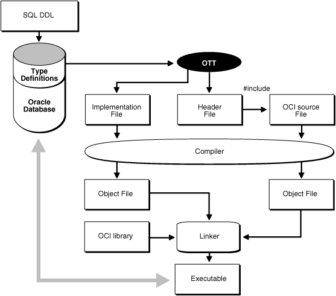
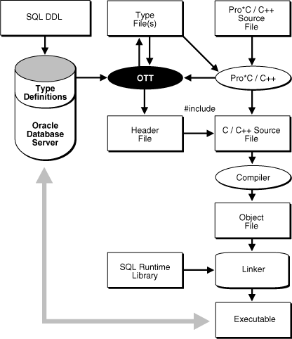

This chapter discusses the OTT (Object Type Translator), which maps database object types, LOB types, and collection types to C structs for use in Pro\*C/C++ applications.

The chapter includes the following sections:

- OTT Overview

- What is the Object Type Translator

- AUsing OTT with OCI Applications

- About Using OTT with Pro\*C/C++ Applications

- OTT Reference

### 19.1 OTT Overview

OTT (The Object Type Translator) assists in the development of applications that make use of user-defined types in an Oracle server.

Through the use of SQL CREATE TYPE statements, you can create object types. The definitions of these types are stored in the database, and can be used in the creation of database tables. Once these tables are populated, an OCI, Pro\*C/C++, or Java programmer can access objects stored in the tables.

An application that accesses object data must be able to represent the data in a host language format. This is accomplished by representing object types as C structs. It would be possible for a programmer to code struct declarations by hand to represent database object types, but this can be very time-consuming and error-prone if many types are involved. OTT simplifies this step by automatically generating appropriate struct declarations. For Pro\*C/C++, the application only needs to include the header file generated by OTT. In OCI, the application also needs to call an initialization function generated by OTT.

In addition to creating structs that represent stored datatypes, OTT also generates parallel indicator structs which indicate whether an object type or its fields are NULL.

**Related Topics**

- [LOBs](about-LOBs.md)
- [Objects](about-Objects.md)
- [Collections](about-Collections.md)

### 19.2 What is the Object Type Translator

The Object Type Translator (OTT) converts database definitions of object types and named collection types into C struct declarations which can be included in an OCI or Pro\*C/C++ application.

Both OCI programmers and Pro\*C/C++ programmers must explicitly invoke OTT to translate database types to C representations. OCI programmers must also initialize a data structure called the Type Version Table with information about the user-defined types required by the program. Code to perform this initialization is generated by OTT. In Pro\*C/C++, the type version information is recorded in the `OUTTYPE` file which is passed as a parameter to Pro\*C/C++.

On most operating systems, OTT is invoked on the command line. It takes as input an `INTYPE` file, and it generates an `OUTTYPE` file and one or more C header files and an optional implementation file (for OCI programmers). The following is an example of a command that invokes OTT:

    ott userid=scott/tiger intype=demoin.typ outtype=demoout.typ code=c hfile=demo.h

This command causes OTT to connect to the database with username scott and password tiger, and translate database types to C structs, based on instructions in the `INTYPE` file, `demoin.typ`. The resulting structs are output to the header file, demo.h, for the host language (C) specified by the `CODE` parameter. The `OUTTYPE` file, `demoout.typ`, receives information about the translation.

Each of these parameters is described in more detail in later sections of this chapter.

Sample `demoin.typ` file:

    CASE=LOWER
    TYPE employee

Sample `demoout.typ` file:

    CASE = LOWER
    TYPE SCOTT.EMPLOYEE AS employee
      VERSION = "$8.0"
      HFILE = demo.h

In this example, the `demoin.typ` file contains the type to be translated, preceded by TYPE (for example, TYPE employee). The structure of the `OUTTYPE` file is similar to the `INTYPE` file, with the addition of information obtained by OTT.

Once OTT has completed the translation, the header file contains a C struct representation of each type specified in the `INTYPE` file, and a NULL indicator struct corresponding to each type. For example, if the employee type listed in the `INTYPE` file was defined as

    CREATE TYPE employee AS OBJECT
    (
        name       VARCHAR2(30),
        empno      NUMBER,
        deptno     NUMBER,
        hiredate   DATE,
        salary     NUMBER
    );

the header file generated by OTT (`demo.h`) includes, among other items, the following declarations:

    struct employee
    {
        OCIString * name;
        OCINumber empno;
        OCINumber deptno;
        OCIDate   hiredate;
        OCINumber salary;
    };
    typedef struct emp_type emp_type;

    struct employee_ind
    {
        OCIInd _atomic;
        OCIInd name;
        OCIInd empno;
        OCIInd deptno;
        OCIInd hiredate;
        OCIInd salary;
    };
    typedef struct employee_ind employee_ind;

The datatypes that appear in the struct declarations (for example, OCIString and OCIInd) are special datatypes which were new in Oracle 8.

The following sections describe these aspects of using OTT:

- About Creating Types in the Database

- About Invoking OTT

- The OTT Command Line

- The INTYPE File

- OTT Datatype Mappings

- NULL Indicator Structs

- OTT Support for Type Inheritance

The remaining sections of the chapter discuss the use of OTT with OCI and Pro\*C/C++, followed by a reference section that describes command line syntax, parameters, `INTYPE` file structure, nested `#include` file generation, schema names usage, default name mapping, and restrictions.

**Related Topics**

- OTT Datatype Mappings

#### 19.2.1 About Creating Types in the Database

The first step in using OTT is to create object types or named collection types and store them in the database. This is accomplished through the use of the SQL CREATE TYPE statement.

**Related Topics**

- [Objects](about-Objects.md)

#### 19.2.2 About Invoking OTT

The next step is to invoke OTT.

You can specify OTT parameters on the command line, or in a file called a configuration file. Certain parameters can also be specified in the `INTYPE` file.

If you specify a parameter in more than one place, its value on the command line will take precedence over its value in the `INTYPE` file, which takes precedence over its value in a user-defined configuration file, which takes precedence over its value in the default configuration file.

For global options -- that is, options on the command line or options at the beginning of the `INTYPE` file before any TYPE statements -- the value on the command line overrides the value in the `INTYPE` file. (The options that can be specified globally in the `INTYPE` file are `CASE`, `CODE`, `INITFILE`, `OUTDIR`, and `INITFUNC`, but not `HFILE`.) Anything in the `INTYPE` file in a TYPE specification applies to a particular type only, and overrides anything on the command line that would otherwise apply to the type. So if you enter `TYPE person HFILE=p.h`, it applies to `person` only and overrides the `HFILE` on the command line. The statement is not considered a command-line parameter.

##### 19.2.2.1 Command Line

Parameters (also called options) set on the command line override any set elsewhere.

**Related Topics**

- [Objects](about-Objects.md)

##### 19.2.2.2 Configuration File

A configuration file is a text file that contains OTT parameters. Each non-blank line in the file contains one parameter, with its associated value or values. If more than one parameter is put on a line, only the first one will be used. No whitespace may occur on any non-blank line of a configuration file.

A configuration file can be named on the command line. In addition, a default configuration file is always read. This default configuration file must always exist, but can be empty. The name of the default configuration file is `ottcfg.cfg`, and the location of the file is system-specific. See your platform-specific documentation for further information.

##### 19.2.2.3 INTYPE File

The `INTYPE` file gives a list of types for OTT to translate.

The parameters `CASE`, `HFILE`, `INITFUNC`, and `INITFILE` can appear in the `INTYPE` file.

**Related Topics**

- The INTYPE File

#### 19.2.3 The OTT Command Line

On most platforms, OTT is invoked on the command line. You can specify the input and output files and the database connection information, among other things. Consult your platform-specific documentation to see how to invoke OTT on your platform.

The following is an example (example 1) of an OTT invocation from the command line:

    ott userid=scott/tiger intype=demoin.typ outtype=demoout.typ code=c hfile=demo.h

**Note:**

No spaces are permitted around the equals sign (=).

The following sections describe the elements of the command line used in this example.

**Related Topics**

- OTT Reference

##### 19.2.3.1 OTT

Causes OTT to be invoked. It must be the first item on the command line.

##### 19.2.3.2 Userid

Specifies the database connection information which OTT will use. In example one, OTT will attempt to connect with username scott and password tiger.

##### 19.2.3.3 INTYPE

Specifies the name of the `INTYPE` file which will be used. In example 1, the name of the `INTYPE` file is specified as `demoin.typ`.

##### 19.2.3.4 OUTTYPE

Specifies the name of the `OUTTYPE` file. When OTT generates the C header file, it also writes information about the translated types into the `OUTTYPE` file. This file contains an entry for each of the types that is translated, including its version string, and the header file to which its C representation was written.

In example one, the name of the OUTTYPE file is specified as `demoout.typ`.

**Note:**

If the file specified by `OUTTYPE` already exists, it will be overwritten when OTT runs, with one exception: if the contents of the file as generated by OTT are identical to the previous contents of the file, OTT will not actually write to the file. This preserves the modification time of the file so that UNIX make and similar facilities on other platforms do not perform unnecessary recompilations.

##### 19.2.3.5 CODE

Specifies the target language for the translation. The following options are available:

- C (equivalent to ANSI_C)

- ANSI_C (for ANSI C)

- KR_C (for Kernighan & Ritchie C)

There is currently no default value, so this parameter is required.

Struct declarations are identical in both C dialects. The style in which the initialization function defined in the `INITFILE` file is defined depends on whether KR_C is used. If the `INITFILE` option is not used, all three options are equivalent.

##### 19.2.3.6 HFILE

Specifies the name of the C header file to which the generated structs should be written. In example 1, the generated structs will be stored in a file called `demo.h`.

**Note:**

If the file specified by `HFILE` already exists, it will be overwritten when OTT runs, with one exception: if the contents of the file as generated by OTT are identical to the previous contents of the file, OTT will not actually write to the file. This preserves the modification time of the file so that UNIX make and similar facilities on other platforms do not perform unnecessary recompilations.

##### 19.2.3.7 INITFILE

Specifies the use of the C source file into which the type initialization function is to be written.

The initialization function is only needed in OCI programs. In Pro\*C/C++ programs, the Pro\*C/C++ runtime library initializes types for the user.

**Note:**

If the file specified by `INITFILE` already exists, it will be overwritten when OTT runs, with one exception: if the contents of the file as generated by OTT are identical to the previous contents of the file, OTT will not actually write to the file. This preserves the modification time of the file so that UNIX make and similar facilities on other platforms do not perform unnecessary recompilations.

##### 19.2.3.8 INITFUNC

Specifies the name of the initialization function to be defined in the `INITFILE`.

If this parameter is not used and an initialization function is generated, the name of the initialization function will be the same as the base name of the `INITFILE`.

This function is only needed in OCI programs.

#### 19.2.4 The INTYPE File

When you run OTT, the `INTYPE` file tells OTT which database types should be translated. It can also control the naming of the generated structs. You can create the `INTYPE` file, or use the `OUTTYPE` file of a previous invocation of OTT. If the `INTYPE` parameter is not used, all types in the schema to which OTT connects are translated.

The following is a simple example of a user-created `INTYPE` file:

    CASE=LOWER
    TYPE employee
      TRANSLATE SALARY$ AS salary
                DEPTNO AS department
    TYPE ADDRESS
    TYPE item
    TYPE "Person"
    TYPE PURCHASE_ORDER AS p_o

The first line, with the `CASE` keyword, indicates that generated C identifiers should be in lower case. However, this `CASE` option is only applied to those identifiers that are not explicitly mentioned in the `INTYPE` file. Thus, employee` `and ADDRESS would always result in C structures `employee` and `ADDRESS`, respectively. The members of these structures would be named in lower case.

The lines that begin with the TYPE keyword specify which types in the database should be translated. In this case, the EMPLOYEE, ADDRESS, ITEM, PERSON, and PURCHASE_ORDER types.

The TRANSLATE...AS keywords specify that the name of an object attribute should be changed when the type is translated into a C struct. In this case, the SALARY\$ attribute of the `employee` type is translated to `salary`.

The AS keyword in the final line specifies that the name of an object type should be changed when it is translated into a struct. In this case, the purchase_order database type is translated into a struct called p_o.

If you do not use AS to translate a type or attribute name, the database name of the type or attribute will be used as the C identifier name, except that the `CASE` option will be observed, and any characters that cannot be mapped to a legal C identifier character will be replaced by an underscore. Reasons for translating a type or attribute name include:

- the name contains characters other than letters, digits, and underscores

- the name conflicts with a C keyword

- the type name conflicts with another identifier in the same scope. This can happen, for example, if the program uses two types with the same name from different schemas.

- the programmer prefers a different name

OTT may need to translate additional types that are not listed in the `INTYPE` file. This is because OTT analyzes the types in the `INTYPE` file for type dependencies before performing the translation, and translates other types as necessary. For example, if the ADDRESS` `type were not listed in the `INTYPE` file, but the Person type had an attribute of type ADDRESS, OTT would still translate ADDRESS because it is required to define the Person type.

**Note:**

As of Release 1 (9.0.1), users may specify TRANSITIVE = FALSE to not generate types that are not specified in the `INTYPE` file. TRANSITIVE is set to TRUE by default.

A normal case-insensitive SQL identifier can be spelled in any combination of upper and lower case in the `INTYPE` file, and is not quoted.

Use quotation marks, such as TYPE "Person" to reference SQL identifiers that have been created in a case-sensitive manner, for example, CREATE TYPE "Person". A SQL identifier is case-sensitive if it was quoted when it was declared.

Quotation marks can also be used to refer to a SQL identifier that is also an OTT-reserved word, for example, TYPE "CASE". In this case, the quoted name must be in upper case if the SQL identifier was created in a case-insensitive manner, for example, CREATE TYPE Case. If an OTT-reserved word is used to refer to the name of a SQL identifier but is not quoted, OTT will report a syntax error in the `INTYPE` file.

**Related Topics**

- CASE
- Structure of the INTYPE File

#### 19.2.5 OTT Datatype Mappings

When OTT generates a C struct from a database type, the struct contains one element corresponding to each attribute of the object type. The datatypes of the attributes are mapped to types that are used in Oracle object data types. The datatypes found in Oracle include a set of predefined, primitive types, and provide for the creation of user-defined types, like object types and collections.

The set of predefined types includes standard types that are familiar to most programmers, including number and character types. It also includes datatypes that were introduced with Oracle8 (for example, BLOB or CLOB).

Oracle also includes a set of predefined types that are used to represent object type attributes in C structs. As an example, consider the following object type definition, and its corresponding OTT-generated struct declarations:

    CREATE TYPE employee AS OBJECT
    (   name       VARCHAR2(30),
        empno      NUMBER,
        deptno     NUMBER,
        hiredate   DATE,
        salary$    NUMBER);

The OTT output, assuming `CASE=LOWER` and no explicit mappings of type or attribute names, is:

    struct employee
    {   OCIString * name;
        OCINumber empno;
        OCINumber department;
        OCIDate   hiredate;
        OCINumber salary_;
    };
    typedef struct emp_type emp_type;
    struct employee_ind
    {
        OCIInd _atomic;
        OCIInd name;
        OCIInd empno;
        OCIInd department;
        OCIInd hiredate;
        OCIInd salary_;
    }
    typedef struct employee_ind employee_ind;

The indicator struct `(struct employee_ind)` is explained in "NULL Indicator Structs".

The datatypes in the struct declarations—`OCIString`, `OCINumber`, `OCIDate`, `OCIInd`—are C mappings of object types introduced in Oracle8. They are used here to map the datatypes of the object type attributes. The `NUMBER` datatype of the `empno` attribute, maps to the new `OCINumber` datatype, for example. These new datatypes can also be used as the types of bind and define variables.

**Related Topics**

- [OCI Data Structures](../lnoci/oci-programming-basics.md)

##### 19.2.5.1 Mapping Object Datatypes to C

This section describes the mappings of object attribute types to C types generated by OTT. Table 19-1 lists the mappings from types that can be used as attributes of object datatypes that are generated by OTT.

Table 19-1 Object Datatype Mappings for Object Type Attributes

| Object Attribute Types            | C Mapping                                        |
|:----------------------------------|:-------------------------------------------------|
| VARCHAR2(N)                       | OCIString \*                                     |
| VARCHAR(N)                        | OCIString \*                                     |
| CHAR(N), CHARACTER(N)             | OCIString \*                                     |
| NUMBER, NUMBER(N), NUMBER(N,N)    | OCINumber                                        |
| NUMERIC, NUMERIC(N), NUMERIC(N,N) | OCINumber                                        |
| REAL                              | OCINumber                                        |
| INT, INTEGER, SMALLINT            | OCINumber                                        |
| FLOAT, FLOAT(N), DOUBLE PRECISION | OCINumber                                        |
| DEC, DEC(N), DEC(N,N)             | OCINumber                                        |
| DECIMAL, DECIMAL(N), DECIMAL(N,N) | OCINumber                                        |
| DATE                              | OCIDate \*                                       |
| BLOB                              | OCIBlobLocator \*                                |
| CLOB                              | OCIClobLocator \*                                |
| BFILE                             | OCIBFileLocator \*                               |
| Nested Object Type                | C name of the nested object type.                |
| REF                               | Declared using typedef; equivalent to OCIRef \*. |
| RAW(N)                            | OCIRaw \*                                        |

Table 19-2 shows the mappings of named collection types to object datatypes generated by OTT:

Table 19-2 Object Datatype Mappings for Collection Types

| Named Collection Type | C Mapping                                          |
|:----------------------|:---------------------------------------------------|
| VARRAY                | Declared using typedef; equivalent to OCIArray \*. |
| NESTED TABLE          | Declared using typedef; equivalent to OCITable \*. |

**Note:**

For REF, VARRAY, and NESTED TABLE types, OTT generates a typedef. The type declared in the typedef is then used as the type of the data member in the struct declaration.

If an object type includes an attribute of a REF or collection type, a typedef for the REF or collection type is first generated. Then the struct declaration corresponding to the object type is generated. The struct includes an element whose type is a pointer to the REF or collection type.

If an object type includes an attribute whose type is another object type, OTT first generates the nested type (if TRANSITIVE = TRUE.) It then maps the object type attribute to a nested struct of the type of the nested object type.

The C datatypes to which OTT maps non-object database attribute types are structures, which, except for OCIDate, are opaque.

**Related Topics**

- OTT Type Mapping Example

##### 19.2.5.2 OTT Type Mapping Example

The following example demonstrates the various type mappings created by OTT.

Given the following database types:

    CREATE TYPE my_varray AS VARRAY(5) of integer;

    CREATE TYPE object_type AS OBJECT
    (object_name    VARCHAR2(20));

    CREATE TYPE my_table AS TABLE OF object_type;

    CREATE TYPE many_types AS OBJECT
    ( the_varchar    VARCHAR2(30),
      the_char       CHAR(3),
      the_blob       BLOB,
      the_clob       CLOB,
      the_object     object_type,
      another_ref    REF other_type,
      the_ref        REF many_types,
      the_varray     my_varray,
      the_table      my_table,
      the_date       DATE,
      the_num        NUMBER,
      the_raw        RAW(255));

and an `INTYPE` file that includes:

    CASE = LOWER
    TYPE many_types

OTT would generate the following C structs:

**Note:**

Comments are provided here to help explain the structs. These comments are not part of actual OTT output.

    #ifndef MYFILENAME_ORACLE
    #define MYFILENAME_ORACLE

    #ifndef OCI_ORACLE
    #include <oci.h>
    #endif

    typedef OCIRef many_types_ref;
    typedef OCIRef object_type_ref;
    typedef OCIArray my_varray;             /* part of many_types */
    typedef OCITable my_table;              /* part of many_types*/
    typedef OCIRef other_type_ref;
    struct object_type                      /* part of many_types */
    {
       OCIString * object_name;
    };
    typedef struct object_type object_type;

    struct object_type_ind                  /*indicator struct for*/
    {                                       /*object_types*/
       OCIInd _atomic;
       OCIInd object_name;
    };
    typedef struct object_type_ind object_type_ind;

    struct many_types
    {
       OCIString *        the_varchar;
       OCIString *        the_char;
       OCIBlobLocator *   the_blob;
       OCIClobLocator *   the_clob;
       struct object_type the_object;
       other_type_ref *   another_ref;
       many_types_ref *   the_ref;
       my_varray *        the_varray;
       my_table *         the_table;
       OCIDate            the_date;
       OCINumber          the_num;
       OCIRaw *           the_raw;
    };
    typedef struct many_types many_types;

    struct many_types_ind                   /*indicator struct for*/
    {                                       /*many_types*/
       OCIInd _atomic;
       OCIInd the_varchar;
       OCIInd the_char;
       OCIInd the_blob;
       OCIInd the_clob;
       struct object_type_ind the_object;   /*nested*/
       OCIInd another_ref;
       OCIInd the_ref;
       OCIInd the_varray;
       OCIInd the_table;
       OCIInd the_date;
       OCIInd the_num;
       OCIInd the_raw;
    };
    typedef struct many_types_ind many_types_ind;

    #endif

Notice that even though only one item was listed for translation in the `INTYPE` file, two object types and two named collection types were translated. This is because the OTT parameter "TRANSITIVE", has the default value of TRUE. As described in that section, when TRANSITIVE=TRUE, OTT automatically translates any types which are used as attributes of a type being translated, in order to complete the translation of the listed type.

This is not the case for types that are only accessed by a pointer or REF in an object type attribute. For example, although the many_types` type contains the attribute `another_ref` `REF other_type`, a declaration of struct other_type` was not generated.

This example also illustrates how typedefs are used to declare VARRAY, NESTED TABLE, and REF types.

The typedefs occur near the beginning:

    typedef OCIRef many_types_ref;
    typedef OCIRef object_type_ref;
    typedef OCIArray my_varray;
    typedef OCITable my_table;
    typedef OCIRef other_type_ref;

In the struct `many_types`, the VARRAY, NESTED TABLE, and REF attributes are declared:

    struct many_types
    {
       ...
       other_type_ref *   another_ref;
       many_types_ref *   the_ref;
       my_varray *        the_varray;
       my_table *         the_table;
       ...
    }

#### 19.2.6 NULL Indicator Structs

Each time OTT generates a C struct to represent a database object type, it also generates a corresponding NULL indicator struct. When an object type is selected into a C struct, NULL indicator information can be selected into a parallel struct.

For example, the following NULL indicator struct was generated in the example in the previous section:

    struct many_types_ind
    {
    OCIInd _atomic;
    OCIInd the_varchar;
    OCIInd the_char;
    OCIInd the_blob;
    OCIInd the_clob;
    struct object_type_ind the_object;
    OCIInd another_ref;
    OCIInd the_ref;
    OCIInd the_varray;
    OCIInd the_table;
    OCIInd the_date;
    OCIInd the_num;
    OCIInd the_raw;
    };
    typedef struct many_types_ind many_types_ind;

The layout of the NULL struct is important. The first element in the struct (`_atomic`) is the atomic NULL indicator. This value indicates the NULL status for the object type as a whole. The atomic NULL indicator is followed by an indicator element corresponding to each element in the OTT-generated struct representing the object type.

Notice that when an object type contains another object type as part of its definition (in the earlier example, it is the object_type` `attribute), the indicator entry for that attribute is the NULL indicator struct (`object_type_ind`) corresponding to the nested object type.

VARRAYs and NESTED TABLEs contain the NULL information for their elements. The datatype for all other elements of a NULL indicator struct is `OCIInd`.

For more information about atomic NULLness, refer to the discussion of object types in [Data Types](../lnoci/data-types.md).

#### 19.2.7 OTT Support for Type Inheritance

To support type inheritance of objects, OTT generates a C struct to represent an object subtype by declaring the inherited attributes in an encapsulated struct with the special name '\_super', before declaring the new attributes. Thus, for an object subtype that inherits from a supertype, the first element in the struct is named '\_super', followed by elements corresponding to each attribute of the subtype.The type of the element named '\_super' is the name of the supertype.

For example, given the type `Person_t`, with subtype `Student_t` and subtype `Employee_t, `which are created as follows:

    CREATE TYPE Person_t AS OBJECT
    ( ssn     NUMBER,
      name    VARCHAR2(30),
      address VARCHAR2(100)) NOT FINAL;

    CREATE TYPE Student_t UNDER Person_t
    ( deptid NUMBER,
      major  VARCHAR2(30)) NOT FINAL;

    CREATE TYPE Employee_t UNDER Person_t
    ( empid NUMBER,
      mgr   VARCHAR2(30));

and, given an `INTYPE` file which includes:

    CASE=SAME
    TYPE EMPLOYEE_T
    TYPE STUDENT_T
    TYPE PERSON_T

OTT generates the following C structs for `Person_t`, `Student_t`, and `Employee_t `and their null indicator structs:

    #ifndef MYFILENAME_ORACLE
    #define MYFILENAME_ORACLE

    #ifndef OCI_ORACLE
    #include <oci.h>
    #endif

    typedef OCIRef EMPLOYEE_T_ref;
    typedef OCIRef STUDENT_T_ref;
    typedef OCIRef PERSON_T_ref;

    struct PERSON_T
    {
       OCINumber SSN;
       OCIString * NAME;
       OCIString * ADDRESS;
    };
    typedef struct PERSON_T PERSON_T;

    struct PERSON_T_ind
    {
       OCIInd _atomic;
       OCIInd SSN;
       OCIInd NAME;
       OCIInd ADDRESS;
    };
    typedef struct PERSON_T_ind PERSON_T_ind;

    struct EMPLOYEE_T
    {
       PERSON_T _super;
       OCINumber EMPID;
       OCIString * MGR;
    };
    typedef struct EMPLOYEE_T EMPLOYEE_T;

    struct EMPLOYEE_T_ind
    {
       PERSON_T _super;
       OCIInd EMPID;
       OCIInd MGR;
    };
    typedef struct EMPLOYEE_T_ind EMPLOYEE_T_ind;

    struct STUDENT_T
    {
       PERSON_T _super;
       OCINumber DEPTID;
       OCIString * MAJOR;
    };
    typedef struct STUDENT_T STUDENT_T;

    struct STUDENT_T_ind
    {
       PERSON_T _super;
       OCIInd DEPTID;
       OCIInd MAJOR;
    };
    typedef struct STUDENT_T_ind STUDENT_T_ind;

    #endif

The earlier C mapping convention allows simple up-casting from an instance of a subtype to an instance of a supertype in C to work properly. For example:

    STUDENT_T *stu_ptr = some_ptr;               /* some STUDENT_T instance  */
    PERSON_T  *pers_ptr = (PERSON_T *)stu_ptr;   /* up-casting */

The null indicator structs are generated similarly. Note that for the supertype `Person_t` null indicator struct, the first element is '\_atomic', and that for the subtypes `Employee_t` and `Student_t` null indicator structs, the first element is '\_super' (no atomic element is generated for subtypes).

##### 19.2.7.1 Substitutable Object Attributes

For attributes of NOT FINAL types (and therefore potentially substitutable), the embedded attribute is represented as a pointer.

Consider a type `Book_t` created as:

    CREATE TYPE Book_t AS OBJECT
    ( title   VARCHAR2(30),
      author  Person_t     /* substitutable */);

The corresponding C struct generated by OTT contains a pointer to `Person_t`:

    struct Book_t
    {
      OCIString  *title;
      Person_t   *author;    /* pointer to Person_t struct */
    }

The null indicator struct corresponding to the earlier type is:

    struct Book_t_ind
    {
      OCIInd  _atomic;
      OCIInd  title;
      OCIInd  author;
    }

Note that the null indicator struct corresponding to the `author` attribute can be obtained from the `author` object itself.

If a type is defined to be FINAL, it cannot have any subtypes. An attribute of a FINAL type is therefore not substitutable. In such cases, the mapping is as before: the attribute struct is inline. Now, if the type is altered and defined to be NOT FINAL, the mapping will have to change. The new mapping is generated by running OTT again.

**Related Topics**

- [OBJECT GET](about-Objects.md)

#### 19.2.8 The OUTTYPE File

The `OUTTYPE` file is named on the OTT command line. When OTT generates the C header file, it also writes the results of the translation into the `OUTTYPE` file. This file contains an entry for each of the types that is translated, including its version string, and the header file to which its C representation was written.

The `OUTTYPE` file from one OTT run can be used as the `INTYPE` file for a subsequent OTT invocation.

For example, given the simple `INTYPE` file used earlier in this chapter

    CASE=LOWER
    TYPE employee
      TRANSLATE SALARY$ AS salary
                DEPTNO AS department
    TYPE ADDRESS
    TYPE item
    TYPE person
    TYPE PURCHASE_ORDER AS p_o

the user has chosen to specify the case for OTT-generated C identifiers, and has provided a list of types that should be translated. In two of these types, naming conventions are specified.

The following example shows what the `OUTTYPE` file looks like after running OTT:

    CASE = LOWER
    TYPE EMPLOYEE AS employee
      VERSION = "$8.0"
      HFILE = demo.h
      TRANSLATE SALARY$ AS salary
                 DEPTNO AS department
    TYPE ADDRESS AS ADDRESS
      VERSION = "$8.0"
      HFILE = demo.h
    TYPE ITEM AS item
      VERSION = "$8.0"
      HFILE = demo.h
    TYPE "Person" AS Person
      VERSION = "$8.0"
      HFILE = demo.h
    TYPE PURCHASE_ORDER AS p_o
      VERSION = "$8.0"
      HFILE = demo.h

When examining the contents of the `OUTTYPE` file, you might discover types listed that were not included in the `INTYPE` specification. For example, if the `INTYPE` file only specified that the person type was to be translated:

    CASE = LOWER
    TYPE PERSON

and the definition of the person type includes an attribute of type address, then the `OUTTYPE` file will include entries for both `PERSON `and `ADDRESS`. The `person` type cannot be translated completely without first translating address.

When the parameter TRANSITIVE has been set to TRUE (it is the default), OTT analyzes the types in the `INTYPE` file for type dependencies before performing the translation, and translates other types as necessary.

### 19.3 AUsing OTT with OCI Applications

C header and implementation files that have been generated by OTT can be used by an OCI application that accesses objects in a database server. Incorporate the header file into the OCI code with an `#include` statement.

Once the header file has been included, the OCI application can access and manipulate object data in the host language format.

Figure 19-1 shows the steps involved in using OTT with OCI.

1.  SQL is used to create type definitions in the database.
2.  OTT generates a header file containing C representations of object types and named collection types. It also generates an implementation file, as named with the `INITFILE` option.
3.  The application is written. User-written code in the OCI application declares and calls the `INITFUNC` function.
4.  The header file is included in an OCI source code file.
5.  The OCI application, including the implementation file generated by OTT, is compiled and linked with the OCI libraries.
6.  The OCI executable is run against the Oracle Server.

Figure 19-1 Using OTT with OCI

[Description of "Figure 19-1 Using OTT with OCI"](img_text/lnpcc072.md)

#### 19.3.1 About Accessing and Manipulating Objects with OCI

Within the application, the OCI program can perform bind and define operations using program variables declared to be of types that appear in the OTT-generated header file.

For example, an application might fetch a REF to an object using a SQL SELECT statement and then pin that object using the appropriate OCI function. Once the object has been pinned, its attribute data can be accessed and manipulated with other OCI functions.

OCI includes a set of datatype mapping and manipulation functions specifically designed to work on attributes of object types and named collection types.

Some of the available functions follow:

- `OCIStringSize()` gets the size of an `OCIString` string.

- `OCINumberAdd()` adds two `OCINumber` numbers together.

- `OCILobIsEqual()` compares two LOB locators for equality.

- `OCIRawPtr()` gets a pointer to an `OCIRaw` raw datatype.

- `OCICollAppend()` appends an element to a collection type (`OCIArray `or `OCITable`).

- `OCITableFirst()` returns the index for the first existing element of a nested table (`OCITable`).

- `OCIRefIsNull()` tests if a REF (`OCIRef)` is NULL

These functions are described in detail in the following chapters of the [Oracle Call Interface Programmer's Guide](../lnoci/index.md):

- Chapter 2, which covers OCI concepts, including binding and defining

- Chapter 6, which covers object access and navigation

- Chapter 7, which covers datatype mapping and manipulation

- Chapter 12, which lists datatype mapping and manipulation functions

#### 19.3.2 About Calling the Initialization Function

OTT generates a C initialization function if requested. The initialization function tells the environment, for each object type used in the program, which version of the type is used. You can specify a name for the initialization function when invoking OTT with the `INITFUNC` option, or may allow OTT to select a default name based on the name of the implementation file (`INITFILE`) containing the function.

The initialization function takes two arguments, an environment handle pointer and an error handle pointer. There is typically a single initialization function, but this is not required. If a program has several separately compiled pieces requiring different types, you may want to execute OTT separately for each piece requiring, for each piece, one initialization file, containing an initialization function.

After you create an environment handle by an explicit OCI object call, for example, by calling`OCIEnvInit()`, you must also call the initialization functions explicitly for each environment handle. This gives each handle access to all the datatypes used in the entire program.

If an environment handle is implicitly created using embedded SQL statements, such as EXEC SQL CONTEXT USE and EXEC SQL CONNECT, the handle is initialized implicitly, and the initialization functions need not be called. This is relevant for Pro\*C/C++ applications, or when Pro\*C/C++ is being combined with OCI applications.

The following example shows an initialization function.

Given an `INTYPE` file, ex2c.typ, containing

    TYPE SCOTT.PERSON
    TYPE SCOTT.ADDRESS

and the command line

    ott userid=scott/tiger intype=ex2c outtype=ex2co hfile=ex2ch.h initfile=ex2cv.c

OTT generates the following to the file ex2cv.c:

    #ifndef OCI_ORACLE
    #include <oci.h>
    #endif

    sword ex2cv(OCIEnv *env, OCIError *err)
    {
       sword status = OCITypeVTInit(env, err);
       if (status == OCI_SUCCESS)
          status = OCITypeVTInsert(env, err,
              "SCOTT", 5,
              "PERSON", 6,
              "$8.0", 4);
        if (status == OCI_SUCCESS)
            status = OCITypeVTInsert(env, err,
               "SCOTT", 5,
               "ADDRESS", 7,
               "$8.0", 4);
        return status;
    }

The function ex2cv creates the type version table and inserts the types SCOTT.PERSON and SCOTT.ADDRESS.

If a program explicitly creates an environment handle, all the initialization functions must be generated, compiled, and linked, because they must be called for each explicitly created handle. If a program does not explicitly create any environment handles, initialization functions are not required.

A program that uses an OTT-generated header file must also use the initialization function generated at the same time. More precisely, if a header file generated by OTT is included in a compilation that generates code that is linked into program P, and an environment handle is explicitly created somewhere in program P, the implementation file generated by the same invocation of OTT must also be compiled and linked into program P. Doing this correctly is your responsibility.

#### 19.3.3 Tasks of the Initialization Function

The C initialization function supplies version information about the types processed by OTT. It adds to the type-version table the name and version identifier of every OTT-processed object datatype.

The type-version table is used by the Open Type Manager (OTM) to determine which version of a type a particular program uses. Different initialization functions generated by OTT at different times may add some of the same types to the type version table. When a type is added more than once, OTM ensures that the same version of the type is registered each time.

It is the OCI programmer's responsibility to declare a function prototype for the initialization function, and to call the function.

**Note:**

In the current release of Oracle, each type has only one version. Initialization of the type version table is required only for compatibility with future releases of Oracle.

### 19.4 About Using OTT with Pro\*C/C++ Applications

When building Pro\*C/C++ applications, the type-translation process can be simpler than when building OCI-based applications. This is because precompiler-generated code will automatically initialize the type version table.

A C header file generated by OTT can be used by a Pro\*C/C++ application to access objects in a database server. The header file is incorporated into the code with an `#include` statement. Once the header file has been included, the Pro\*C/C++ application can access and manipulate object data in the host language format.

Figure 19-2 shows the steps involved in using OTT with Pro\*C/C++.

1.  SQL is used to create type definitions in the database.

2.  OTT generates a header file containing C representations of object types, REF types, and named collection types. It also generates an `OUTTYPE` file that is passed as the `INTYPE` parameter to Pro\*C/C++.

3.  The header file is included in a Pro\*C/C++ source code file.

4.  The Pro\*C/C++ application is compiled and linked with the Pro\*C/C++ run-time library SQLLIB.

5.  The Pro\*C/C++ executable is run against the Oracle Server.

Figure 19-2 Building an Object-oriented Pro\*C/C++ Application

[Description of "Figure 19-2 Building an Object-oriented Pro\*C/C++ Application"](img_text/lnpcc068.md)

As noted in step 2, earlier, the `OUTTYPE` file generated by OTT serves a special purpose for Pro\*C/C++ programmers. Pass the `OUTTYPE` file to the new `INTYPE` command line parameter when invoking Pro\*C/C++. The contents of this file are used by the precompiler to determine which database types correspond to which OTT-generated structs. OCI programmers must make this association explicitly through the use of special bind, define, and type information access functions.

Also, the precompiler generates code to initialize the type version table with the types named in the OTT `OUTTYPE` (Pro\*C/C++ `INTYPE`) file.

**Note:**

Oracle recommends that the `OUTTYPE` file from OTT always serve as the `INTYPE` file to Pro\*C/C++. It would be possible for you to write an `INTYPE` file for Pro\*C/C++, but this is not recommended, due to the possibility of errors being introduced.

One way to manipulate the attributes of objects retrieved from the server is to call the OCI datatype mapping and manipulation functions. Before doing this, the application must first call `SQLEnvGet()` to obtain an OCI environment handle to pass to the OCI functions, and `SQLSvcCtxGet()` to obtain an OCI service context to pass to the OCI functions. There are also Pro\*C facilities that can be used to manipulate object attributes.

**Related Topics**

- [Objects](about-Objects.md)
- About Accessing and Manipulating Objects with OCI
- [https://www.oracle.com/pls/topic/lookup?ctx=en/database/oracle/oracle-database/19/lnpcc&id=LNOCI030](../lnoci/data-types.md)

### 19.5 OTT Reference

Behavior of OTT is controlled by parameters which can appear on the OTT command line or in a CONFIG file. Certain parameters may also appear in the `INTYPE` file. This section provides detailed information about the following topics:

- OTT Command Line Syntax

- OTT Parameters

- Where OTT Parameters Can Appear

- Structure of the INTYPE File

- Nested \#include File Generation

- SCHEMA_NAMES Usage

- Default Name Mapping

- Restriction

The following conventions are used in this chapter to describe OTT syntax:

- Italic strings are to be supplied by the user.

- Strings in UPPERCASE are entered as shown, except that case is not significant.

- Square brackets \[...\] enclose optional items.

- An ellipsis (...) immediately following an item (or items enclosed in brackets) means that the item can be repeated any number of times.

- Punctuation symbols other than those described earlier are entered as shown. These include '.', '@', and so on.

#### 19.5.1 OTT Command Line Syntax

The OTT command-line interface is used when explicitly invoking OTT to translate database types into C structs. This is always required when developing OCI applications or Pro\*C/C++ applications that use objects.

An OTT command-line statement consists of the keyword `OTT`, followed by a list of OTT parameters.

The parameters that can appear on an OTT command-line statement are as follows:

       [USERID=username/password[@db_name]]
       [INTYPE=in_filename]
       OUTTYPE=out_filename
       CODE={C|ANSI_C|KR_C}
       [HFILE=filename]
       [ERRTYPE=filename]
       [CONFIG=filename]
       [INITFILE=filename]
       [INITFUNC=filename]
       [CASE={SAME|LOWER|UPPER|OPPOSITE}]
       [SCHEMA_NAMES={ALWAYS|IF_NEEDED|FROM_INTYPE}]
       [TRANSITIVE=TRUE|FALSE]

**Note:**

Generally, the order of the parameters following the OTT command does not matter, and only the `OUTTYPE` and `CODE` parameters are always required.

The `HFILE` parameter is almost always used. If omitted, `HFILE` must be specified individually for each type in the `INTYPE` file. If OTT determines that a type not listed in the `INTYPE` file must be translated, an error will be reported. Therefore, it is safe to omit the `HFILE` parameter only if the `INTYPE` file was previously generated as an OTT `OUTTYPE` file.

If the `INTYPE` file is omitted, the entire schema will be translated. See the parameter descriptions in the following section for more information.

The following is an example of an OTT command line statement (enter it as one line):

    OTT userid=scott/tiger intype=in.typ outtype=out.typ code=c hfile=demo.h errtype=demo.tls case=lower

Each of the OTT command line parameters is described in the following sections.

#### 19.5.2 OTT Parameters

Enter parameters on the OTT command line using the following format:

parameter=value

where parameter is the literal parameter string and value is a valid parameter setting. The literal parameter string is not case sensitive.

Separate command-line parameters using either spaces or tabs.

Parameters can also appear within a configuration file, but, in that case, no whitespace is permitted within a line, and each parameter must appear on a separate line. Additionally, the parameters `CASE`, `HFILE`, `INITFUNC`, and `INITFILE` can appear in the `INTYPE` file.

##### 19.5.2.1 USERID

The USERID parameter specifies the Oracle username, password, and optional database name (Oracle Net database specification string). If the database name is omitted, the default database is assumed. The syntax of this parameter is:

    USERID=username/password[@db_name]

If this is the first parameter, "USERID=" may be omitted as shown here:

    OTT username/password...

The USERID parameter is optional. If you omit it, OTT automatically attempts to connect to the default database as user CLUSTER\$username, where username is the user's operating system user name.

##### 19.5.2.2 INTYPE

The `INTYPE` parameter specifies the name of the file from which to read the list of object type specifications. OTT translates each type in the list. The syntax for this parameter is

    INTYPE=filename

"`INTYPE=`" may be omitted if USERID and `INTYPE` are the first two parameters, in that order, and "USERID=" is omitted. If `INTYPE` is not specified, all types in the user's schema will be translated.

    OTT username/password filename...

The `INTYPE` file can be thought of as a makefile for type declarations. It lists the types for which C struct declarations are needed.

If the file name on the command line or in the `INTYPE` file does not include an extension, a platform-specific extension such as "TYP" or "typ" will be added.

**Related Topics**

- Structure of the INTYPE File

##### 19.5.2.3 OUTTYPE

The name of a file into which OTT will write type information for all the object datatypes it processes. This includes all types explicitly named in the `INTYPE` file, and may include additional types that are translated (if TRANSITIVE=TRUE) because they are used in the declarations of other types that need to be translated. This file may be used as an `INTYPE` file in a future invocation of OTT.

    OUTTYPE=filename

If the `INTYPE` and `OUTTYPE` parameters refer to the same file, the new `INTYPE` information replaces the old information in the `INTYPE` file. This provides a convenient way for the same `INTYPE` file to be used repeatedly in the cycle of altering types, generating type declarations, editing source code, precompiling, compiling, and debugging.

`OUTTYPE` must be specified.

If the file name on the command line or in the `INTYPE` file does not include an extension, a platform-specific extension such as "TYP" or "typ" will be added.

##### 19.5.2.4 CODE

    CODE= C|KR_C|ANSI_C

This is the desired host language for OTT output, that may be specified as `CODE=C`,` CODE=KR_C`, or `CODE=ANSI_C`. "`CODE=C`" is equivalent to "`CODE=ANSI_C`".

There is no default value for this parameter; it must be supplied.

##### 19.5.2.5 INITFILE

The `INITFILE` parameter specifies the name of the file where the OTT-generated initialization file is to be written. OTT does not generate the initialization function if you omit this parameter.

For Pro\*C/C++ programs, the `INITFILE` is not necessary, because the SQLLIB run-time library performs the necessary initializations. An OCI program user must compile and link the `INITFILE` file(s), and must call the initialization function(s) when an environment handle is created.

If the file name of an `INITFILE` on the command line or in the `INTYPE` file does not include an extension, a platform-specific extension such as "C" or ".c" will be added.

    INITFILE=filename

##### 19.5.2.6 INITFUNC

The `INITFUNC` parameter is used only in OCI programs. It specifies the name of the initialization function generated by OTT. If this parameter is omitted, the name of the initialization function is derived from the name of the `INITFILE`.

    INITFUNC=filename

##### 19.5.2.7 HFILE

The name of the include (.h) file to be generated by OTT for the declarations of types that are mentioned in the `INTYPE` file but whose include files are not specified there. This parameter is required unless the include file for each type is specified individually in the `INTYPE` file. This parameter is also required if a type not mentioned in the `INTYPE` file must be generated because other types require it (if TRANSITIVE=TRUE), and these other types are declared in two or more different files.

If the file name of an `HFILE` on the command line or in the `INTYPE` file does not include an extension, a platform-specific extension such as "H" or ".h" will be added.

    HFILE=filename

##### 19.5.2.8 CONFIG

The CONFIG parameter specifies the name of the OTT configuration file, that lists commonly used parameter specifications. Parameter specifications are also read from a system configuration file in a platform-dependent location. All remaining parameter specifications must appear on the command line, or in the `INTYPE` file.

    CONFIG=filename

Note: A CONFIG parameter is not allowed in the CONFIG file.

##### 19.5.2.9 ERRTYPE

If you supply this parameter, a listing of the `INTYPE` file is written to the ERRTYPE file, along with all informational and error messages. Informational and error messages are sent to the standard output whether or not ERRTYPE is specified.

Essentially, the ERRTYPE file is a copy of the `INTYPE` file with error messages added. In most cases, an error message will include a pointer to the text that caused the error.

If the file name of an ERRTYPE on the command line or in the `INTYPE` file does not include an extension, a platform-specific extension such as "TLS" or "tls" will be added.

    ERRTYPE=filename

##### 19.5.2.10 CASE

This parameter affects the case of certain C identifiers generated by OTT. The possible values of `CASE` are `SAME`, `LOWER`, `UPPER`, and `OPPOSITE`. If `CASE = SAME`, the case of letters is not changed when converting database type and attribute names to C identifiers. If `CASE=LOWER`, all uppercase letters are converted to lowercase. If `CASE=UPPER`, all lowercase letters are converted to uppercase. If `CASE=OPPOSITE`, all uppercase letters are converted to lower-case, and vice-versa.

    CASE=[SAME|LOWER|UPPER|OPPOSITE]

This parameter affects only those identifiers (attributes or types not explicitly listed) not mentioned in the `INTYPE` file. Case conversion takes place after a legal identifier has been generated.

**Note:**

The case of the C struct identifier for a type specifically mentioned in the `INTYPE` is the same as its case in the `INTYPE` file. For example, if the `INTYPE` file includes the following line

    TYPE Worker

then OTT will generate

    struct Worker {...};

On the other hand, if the `INTYPE` file were written as

    TYPE wOrKeR

OTT would generate

    struct wOrKeR {...};

following the case of the `INTYPE` file.

Case-insensitive SQL identifiers not mentioned in the `INTYPE` file will appear in upper case if `CASE=SAME`, and in lower case if `CASE=OPPOSITE`. A SQL identifier is case-insensitive if it was not quoted when it was declared.

##### 19.5.2.11 SCHEMA_NAMES

This parameter offers control in qualifying the database name of a type from the default schema with a schema name in the `OUTTYPE` file. The `OUTTYPE` file generated by OTT contains information about the types processed by OTT, including the type names.

**Related Topics**

- SCHEMA_NAMES Usage

##### 19.5.2.12 TRANSITIVE

Takes the values TRUE (the default) or FALSE. Indicates whether type dependencies not explicitly listed in the `INTYPE` file are to be translated, or not. If TRANSITIVE=FALSE is specified, then types not mentioned in the `INTYPE` file are not generated. This is the case even if they were used as attribute types of other generated types.

#### 19.5.3 Where OTT Parameters Can Appear

Supply OTT parameters on the command line, in a CONFIG file named on the command line, or both. Some parameters are also allowed in the `INTYPE` file.

OTT is invoked as follows:

OTT username/password parameters

If one of the parameters on the command line is

CONFIG=filename

additional parameters are read from the configuration file named filename.

In addition, parameters are also read from a default configuration file in a platform-dependent location. This file must exist, but can be empty. Each line in the configuration may contain one parameter, with no whitespace on the line.

If OTT is executed without any arguments, an on-line parameter reference is displayed.

The types for OTT to translate are named in the file specified by the `INTYPE` parameter. The parameters `CASE`, `INITFILE`, `INITFUNC`, and `HFILE` may also appear in the `INTYPE` file. `OUTTYPE` files generated by OTT include the `CASE` parameter, and include the `INITFILE`, and `INITFUNC` parameters if an initialization file was generated. The `OUTTYPE` file specifies the `HFILE` individually for each type.

The case of the OTT command is platform-dependent.

#### 19.5.4 Structure of the INTYPE File

The `INTYPE` and `OUTTYPE` files list the types translated by OTT and provide all the information needed to determine how a type or attribute name is translated to a legal C identifier. These files contain one or more type specifications. These files also may contain specifications of the following options:

- `CASE`

- `HFILE`

- `INITFILE`

- `INITFUNC`

If the `CASE`, `INITFILE`, or `INITFUNC` options are present, they must precede any type specifications. If these options appear both on the command line and in the `INTYPE` file, the value on the command line is used.

For an example of a simple user-defined `INTYPE` file, and of the full `OUTTYPE` file that OTT generates from it, see "OTT Support for Type Inheritance".

##### 19.5.4.1 INTYPE File Type Specifications

A type specification in the `INTYPE` names an object datatype that is to be translated. The following is an example of a user-created `INTYPE` file:

    TYPE employee
      TRANSLATE SALARY$ AS salary
                DEPTNO AS department
    TYPE ADDRESS
    TYPE PURCHASE_ORDER AS p_o

The structure of a type specification is as follows:

    TYPE type_name [AS type_identifier]
    [VERSION [=] version_string]
    [HFILE [=] hfile_name]
    [TRANSLATE{member_name [AS identifier]}...]

The syntax of type_name is:

    [schema_name.]type_name

where schema_name is the name of the schema that owns the given object datatype, and type_name is the name of the type. The default schema is that of the user running OTT. The default database is the local database.

The components of a type specification are:

- type name is the name of an object datatype.

- type identifier is the C identifier used to represent the type. If omitted, the default name mapping algorithm will be used.

- version string is the version string of the type that was used when the code was generated by a previous invocation of OTT. The version string is generated by OTT and written to the `OUTTYPE` file, that may later be used as the `INTYPE` file when OTT is later executed. The version string does not affect the OTT's operation, but will eventually be used to select which version of the object datatype should be used in the running program.

- hfile name is the name of the header file in which the declarations of the corresponding struct or class appears or will appear. If hfile name is omitted, the file named by the command-line `HFILE` parameter will be used if a declaration is generated.

- member name is the name of an attribute (data member) which is to be translated to the following identifier.

- identifier is the C identifier used to represent the attribute in the user program. You can specify identifiers in this way for any number of attributes. The default name mapping algorithm will be used for the attributes that are not mentioned.

An object datatype may need to be translated for one of two reasons:

- It appears in the `INTYPE` file.

- It is required to declare another type that must be translated, and TRANSITIVE = TRUE.

If a type that is not mentioned explicitly is required by types declared in exactly one file, the translation of the required type is written to the same file(s) as the explicitly declared types that require it.

If a type that is not mentioned explicitly is required by types declared in two or more different files, the translation of the required type is written to the global `HFILE` file.

**Related Topics**

- Default Name Mapping

#### 19.5.5 Nested \#include File Generation

Every `HFILE` generated by OTT `#includes` other necessary files, and `#defines`` `a symbol constructed from the name of the file, that may be used to determine if the `HFILE` has already been included. Consider, for example, a database with the following types:

    create type px1 AS OBJECT (col1 number, col2 integer);
    create type px2 AS OBJECT (col1 px1);
    create type px3 AS OBJECT (col1 px1);

where the `INTYPE` file contains:

    CASE=lower
    type pxl
      hfile tott95a.h
    type px3
      hfile tott95b.h

If we invoke OTT with

    ott scott/tiger tott95i.typ outtype=tott95o.typ code=c

then it will generate the two following header files.

File tott95b.h is:

    #ifndef TOTT95B_ORACLE
    #define TOTT95B_ORACLE
    #ifndef OCI_ORACLE
    #include <oci.h>
    #endif
    #ifndef TOTT95A_ORACLE
    #include "tott95a.h"
    #endif
    typedef OCIRef px3_ref;
    struct px3
    {
       struct px1 col1;
    };
    typedef struct px3 px3;
    struct px3_ind
    {
       OCIInd _atomic;
       struct px1_ind col1
    };
    typedef struct px3_ind px3_ind;
    #endif

File tott95a.h is:

    #ifndef TOTT95A_ORACLE
    #define TOTT95A_ORACLE
    #ifndef OCI_ORACLE
    #include <oci.h>
    #endif
    typedef OCIRef px1_ref;
    struct px1
    {
       OCINumber col1;
       OCINumber col2;
    }
    typedef struct px1 px1;
    struct px1_ind
    {
       OCIInd _atomic;
       OCIInd col1;
       OCIInd col2;
    }
    typedef struct px1_ind px1_ind;
    #endif

In this file, the symbol TOTT95B_ORACLE is defined first so that the programmer may conditionally include `tott95b.h` without having to worry whether`tott95b.h` depends on the include file using the following construct:

    #ifndef TOTT95B_ORACLE
    #include "tott95b.h"
    #endif

Using this technique, you can include "tott95b.h" from some file, say "foo.h", without having to know whether some other file included by "foo.h" also includes "tott95b.h".

After the definition of the symbol TOTT95B_ORACLE, the file `oci.h` is `#includ`ed. Every `HFILE` generated by OTT includes `oci.h`, that contains type and function declarations that the Pro\*C/C++ or OCI programmer will find useful. This is the only case in which OTT uses angle brackets in an `#include`.

Next, the file `tott95a.h` is included because it contains the declaration of "struct px1", that `tott95b.h` requires. When the `INTYPE` file requests that type declarations be written to more than one file, OTT will determine which other files each `HFILE` must include, and will generate the necessary `#includes`.

Note that OTT uses quotes in this `#include`. When a program including `tott95b.h` is compiled, the search for `tott95a.h` begins where the source program was found, and will thereafter follow an implementation-defined search rule. If `tott95a.h` cannot be found in this way, a complete file name (for example, a UNIX absolute path name beginning with /) should be used in the `INTYPE` file to specify the location of `tott95a.h`.

#### 19.5.6 SCHEMA_NAMES Usage

This parameter affects whether the name of a type from the default schema to which OTT is connected is qualified with a schema name in the `OUTTYPE` file.

The name of a type from a schema other that the default schema is always qualified with a schema name in the `OUTTYPE` file.

The schema name, or its absence, determines in which schema the type is found during program execution.

There are three settings:

- SCHEMA_NAMES=ALWAYS(default)

  All type names in the `OUTTYPE` file are qualified with a schema name.

- SCHEMA_NAMES=IF_NEEDED

  The type names in the `OUTTYPE` file that belong to the default schema are not qualified with a schema name. As always, type names belonging to other schemas are qualified with the schema name.

- SCHEMA_NAMES=FROM_INTYPE

  A type mentioned in the `INTYPE` file is qualified with a schema name in the `OUTTYPE` file if, and only if, it was qualified with a schema name in the `INTYPE` file. A type in the default schema that is not mentioned in the `INTYPE` file but that has to be generated because of type dependencies is written with a schema name only if the first type encountered by OTT that depends on it was written with a schema name. However, a type that is not in the default schema to which OTT is connected is always written with an explicit schema name.

The `OUTTYPE` file generated by OTT is the Pro\*C/C++ `INTYPE` file. This file matches database type names to C struct names. This information is used at run-time to make sure that the correct database type is selected into the struct. If a type appears with a schema name in the `OUTTYPE` file (Pro\*C/C++ `INTYPE` file), the type will be found in the named schema during program execution. If the type appears without a schema name, the type will be found in the default schema to which the program connects, which may be different from the default schema OTT used.

##### An Example

If `SCHEMA_NAMES` is set to `FROM_INTYPE`, and the `INTYPE` file reads:

    TYPE Person
    TYPE joe.Dept
    TYPE sam.Company

then the Pro\*C/C++ application that uses the OTT-generated structs will use the types sam.Company, joe.Dept, and Person. Person without a schema name refers to the Person type in the schema to which the application is connected.

If OTT and the application both connect to schema joe, the application will use the same type (joe.Person) that OTT used. If OTT connected to schema joe but the application connects to schema mary, the application will use the type mary.Person. This behavior is appropriate only if the same "CREATE TYPE Person" statement has been executed in schema joe and schema mary.

On the other hand, the application will use type joe.Dept regardless of to which schema the application is connected. If this is the behavior you want, be sure to include schema names with your type names in the `INTYPE` file.

In some cases, OTT translates a type that the user did not explicitly name. For example, consider the following SQL declarations:

    CREATE TYPE Address AS OBJECT
    (
    street    VARCHAR2(40),
    city      VARCHAR(30),
    state     CHAR(2),
    zip_code  CHAR(10)
    );

    CREATE TYPE Person AS OBJECT
    (
    name      CHAR(20),
    age       NUMBER,
    addr      ADDRESS
    );

Now suppose that OTT connects to schema joe, `SCHEMA_NAMES=FROM_INTYPE` is specified, and the user's `INTYPE` files include either

    TYPE Person or TYPE joe.Person

but do not mention the type joe.Address, which is used as a nested object type in type joe.Person. If "TYPE joe.Person" appeared in the `INTYPE` file, "TYPE joe.Person" and "TYPE joe.Address" will appear in the `OUTTYPE` file. If "Type Person" appeared in the `INTYPE` file, "TYPE Person" and "TYPE Address" will appear in the `OUTTYPE` file.

If the joe.Address type is embedded in several types translated by OTT, but is not explicitly mentioned in the `INTYPE` file, the decision of whether to use a schema name is made the first time OTT encounters the embedded joe.Address type. If, for some reason, the user wants type joe.Address to have a schema name but does not want type Person to have one, you must explicitly request

    TYPE      joe.Address

in the `INTYPE` FILE.

In the usual case in which each type is declared in a single schema, it is safest for you to qualify all type names with schema names in the `INTYPE` file.

#### 19.5.7 Default Name Mapping

When OTT creates a C identifier name for an object type or attribute, it translates the name from the database character set to a legal C identifier. First, the name is translated from the database character set to the character set used by OTT. Next, if a translation of the resulting name is supplied in the `INTYPE` file, that translation is used. Otherwise, OTT translates the name character-by-character to the compiler character set, applying the `CASE` option. The following describes this in more detail.

When OTT reads the name of a database entity, the name is automatically translated from the database character set to the character set used by OTT. In order for OTT to read the name of the database entity successfully, all the characters of the name must be found in the OTT character set, although a character may have different encodings in the two character sets.

The easiest way to guarantee that the character set used by OTT contains all the necessary characters is to make it the same as the database character set. Note, however, that the OTT character set must be a superset of the compiler character set. That is, if the compiler character set is 7-bit ASCII, the OTT character set must include 7-bit ASCII as a subset, and if the compiler character set is 7-bit EBCDIC, the OTT character set must include 7-bit EBCDIC as a subset. The user specifies the character set that OTT uses by setting the NLS_LANG environment variable, or by some other platform-specific mechanism.

Once OTT has read the name of a database entity, it translates the name from the character set used by OTT to the compiler's character set. If a translation of the name appears in the `INTYPE` file, OTT uses that translation.

Otherwise, OTT attempts to translate the name as follows:

1.  First, if the OTT character set is a multibyte character set, all multibyte characters in the name that have singlebyte equivalents are converted to those singlebyte equivalents.

2.  Next, the name is converted from the OTT character set to the compiler character set. The compiler character set is a singlebyte character set such as US7ASCII.

3.  Finally, the case of letters is set according to the `CASE` option in effect, and any character that is not legal in a C identifier, or that has no translation in the compiler character set, is replaced by an underscore. If at least one character is replaced by an underscore, OTT gives a warning message. If all the characters in a name are replaced by underscores, OTT gives an error message.

Character-by-character name translation does not alter underscores, digits, or singlebyte letters that appear in the compiler character set, so legal C identifiers are not altered.

Name translation may, for example, translate accented singlebyte characters such as "o" with an umlaut or "a" with an accent grave to "o" or "a", and may translate a multibyte letter to its singlebyte equivalent. Name translation will typically fail if the name contains multibyte characters that lack singlebyte equivalents. In this case, the user must specify name translations in the `INTYPE` file.

OTT will not detect a naming clash caused by two or more database identifiers being mapped to the same C name, nor will it detect a naming problem where a database identifier is mapped to a C keyword.

#### 19.5.8 Restriction

The following restriction affects the use of OTT.

##### 19.5.8.1 File Name Comparison

Currently, OTT determines if two files are the same by comparing the file names provided by the user on the command line or in the `INTYPE` file. But one potential problem can occur when OTT needs to know if two file names refer to the same file. For example, if the OTT-generated file foo.h requires a type declaration written to foo1.h, and another type declaration written to /private/smith/foo1.h, OTT should generate one `#include` if the two files are the same, and two `#includes` if the files are different. In practice, though, it concludes that the two files are different, and generates two `#includes`, as follows:

    #ifndef FOO1_ORACLE
    #include "foo1.h"
    #endif
    #ifndef FOO1_ORACLE
    #include "/private/smith/foo1.h"
    #endif

If foo1.h and /private/smith/foo1.h are different files, only the first one will be included. If foo1.h and /private/smith/foo1.h are the same file, a redundant `#include` will be written.

Therefore, if a file is mentioned several times on the command line or in the `INTYPE` file, each mention of the file should use exactly the same file name.
