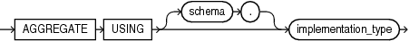

## 13.2 AGGREGATE Clause

Identifies the function as an aggregate function, or one that evaluates a group of rows and returns a single row.

You can specify aggregate functions in the select list, `HAVING` clause, and `ORDER` `BY` clause.

When you specify a user-defined aggregate function in a query, you can treat it as an analytic function (one that operates on a query result set). To do so, use the `OVER` `analytic_clause` syntax available for SQL analytic functions.

The `AGGREGATE` clause can appear in the [CREATE FUNCTION Statement](CREATE-FUNCTION-statement.md).

### Topics

- Syntax

- Semantics

- Examples

- Related Topics

### Syntax

### aggregate_clause ::=

[Description of the illustration aggregate_clause.eps](img_text/aggregate_clause.md)

### Semantics

### aggregate_clause

AGGREGATE USING

Specify the name of the implementation type of the function.

\[schema.\] implementation_type

The implementation type must be an ADT containing the implementation of the `ODCIAggregate` subprograms. If you do not specify `schema`, then the database assumes that the implementation type is in your schema.

Restriction on AGGREGATE USING

You cannot specify the aggregate_clause for a nested function.

If you specify this clause, then you can specify only one input argument for the function.

### Examples

- [Example 12-33](chaining-pipelined-table-functions-multiple-transformations.md), "Pipelined Table Function as Aggregate Function"

### Related Topics

In this chapter:

- [Function Declaration and Definition](function-declaration-and-definition.md)

In other books:

- [Oracle Database SQL Language Reference](../sqlrf/Analytic-Functions.md) for syntax and semantics of analytic functions

- [Oracle Database Data Cartridge Developer's Guide](../addci/using-user-defined-aggregate-functions.md) for more information about user-defined aggregate functions

- [Oracle Database Data Cartridge Developer's Guide](../addci/using-user-defined-aggregate-functions.md) for information about ODCI subprograms
