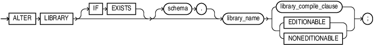
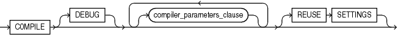

## 14.2 ALTER LIBRARY Statement

The `ALTER` `LIBRARY` statement explicitly recompiles a library.

Explicit recompilation eliminates the need for implicit runtime recompilation and prevents associated runtime compilation errors and performance overhead.

**Note:**

This statement does not change the declaration or definition of an existing library. To redeclare or redefine a library, use the "[CREATE LIBRARY Statement](CREATE-LIBRARY-statement.md)" with the `OR` `REPLACE` clause.

### Topics

- Prerequisites

- Syntax

- Semantics

- Example

- Related Topics

### Prerequisites

If the library is in the `SYS` schema, you must be connected as `SYSDBA`. Otherwise, the library must be in your schema or you must have the `ALTER` `ANY` `LIBRARY` system privilege.

### Syntax

### alter_library ::=

[Description of the illustration alter_library.eps](img_text/alter_library.md)

### library_compile_clause ::=

[Description of the illustration library_compile_clause.eps](img_text/library_compile_clause.md)

([compiler_parameters_clause ::=](COMPILE-clause.md))

### Semantics

### alter_library

IF EXISTS

Alters the library if it exists. If no such library exists, the statement is ignored without error.

library_name

Name of the library to be altered.

{ EDITIONABLE \| NONEDITIONABLE }

Specifies whether the library becomes an editioned or noneditioned object if editioning is later enabled for the schema object type `LIBRARY` in `schema`. Default: `EDITIONABLE`. For information about altering editioned and noneditioned objects, see [Oracle Database Development Guide](../adfns/editions.md).

### library_compile_clause

Recompiles the library.

See [compile_clause](COMPILE-clause.md) and [compiler_parameters_clause](COMPILE-clause.md) semantics.

### Example

Example 14-2 Recompiling a Library

To explicitly recompile the library `my_ext_lib` owned by the sample user `hr`, issue this statement:

    ALTER LIBRARY IF EXISTS hr.my_ext_lib COMPILE;

If the database encounters no compilation errors while recompiling `my_ext_lib`, then `my_ext_lib` becomes valid. The database can subsequently run it without recompiling it at run time. If recompiling `my_ext_lib` results in compilation errors, then the database returns an error, and `my_ext_lib` remains invalid.

The database also invalidates all objects that depend upon `my_ext_lib`. If you subsequently reference one of these objects without explicitly recompiling it first, then the database recompiles it implicitly at run time.

If `my_ext_lib` does not already exist in the schema, this statement is ignored without error due to the `IF EXISTS` clause. Note that the output message is the same whether or not the library exists (in this case, `Library altered`).

### Related Topics

- "[CREATE LIBRARY Statement](CREATE-LIBRARY-statement.md)"

- "[DROP LIBRARY Statement](DROP-LIBRARY-statement.md)"
