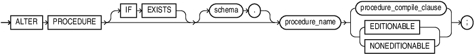
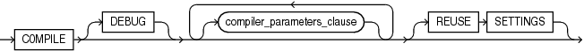

## 14.4 ALTER PROCEDURE Statement

The `ALTER` `PROCEDURE` statement explicitly recompiles a standalone procedure.

Explicit recompilation eliminates the need for implicit runtime recompilation and prevents associated runtime compilation errors and performance overhead.

To recompile a procedure that is part of a package, recompile the entire package using the "[ALTER PACKAGE Statement](ALTER-PACKAGE-statement.md)").

**Note:**

This statement does not change the declaration or definition of an existing procedure. To redeclare or redefine a standalone procedure, use the "[CREATE PROCEDURE Statement](CREATE-PROCEDURE-statement.md)" with the `OR` `REPLACE` clause.

The `ALTER` `PROCEDURE` statement is very similar to the `ALTER` `FUNCTION` statement. See "[ALTER FUNCTION Statement](ALTER-FUNCTION-statement.md)" for more information.

### Topics

- Prerequisites

- Syntax

- Semantics

- Example

- Related Topics

### Prerequisites

If the procedure is in the `SYS` schema, you must be connected as `SYSDBA`. Otherwise, the procedure must be in your schema or you must have `ALTER` `ANY` `PROCEDURE` system privilege.

### Syntax

### alter_procedure ::=

[Description of the illustration alter_procedure.eps](img_text/alter_procedure.md)

### procedure_compile_clause ::=

[Description of the illustration procedure_compile_clause.eps](img_text/procedure_compile_clause.md)

([compiler_parameters_clause ::=](COMPILE-clause.md))

### Semantics

### alter_procedure

IF EXISTS

Alters the procedure if it exists. If no such procedure exists, the statement is ignored without error.

schema

Name of the schema containing the procedure. Default: your schema.

procedure_name

Name of the procedure to be altered.

{ EDITIONABLE \| NONEDITIONABLE }

Specifies whether the procedure becomes an editioned or noneditioned object if editioning is later enabled for the schema object type `PROCEDURE` in `schema`. Default: `EDITIONABLE`. For information about altering editioned and noneditioned objects, see [Oracle Database Development Guide](../adfns/editions.md).

### procedure_compile_clause

See [compile_clause](COMPILE-clause.md) and [compiler_parameters_clause](COMPILE-clause.md) semantics.

### Example

Example 14-4 Recompiling a Procedure

To explicitly recompile the procedure `remove_emp` owned by the user `hr`, issue this statement:

    ALTER PROCEDURE IF EXISTS hr.remove_emp COMPILE;

If the database encounters no compilation errors while recompiling `remove_emp`, then `remove_emp` becomes valid. The database can subsequently run it without recompiling it at run time. If recompiling `remove_emp` results in compilation errors, then the database returns an error and `remove_emp` remains invalid.

The database also invalidates all dependent objects. These objects include any procedures, functions, and package bodies that invoke `remove_emp`. If you subsequently reference one of these objects without first explicitly recompiling it, then the database recompiles it implicitly at run time.

If `remove_emp` does not already exist in the schema, this statement is ignored without error due to the `IF EXISTS` clause. Note that the output message is the same whether or not the procedure exists (in this case, `Procedure altered`).

### Related Topics

- "[CREATE PROCEDURE Statement](CREATE-PROCEDURE-statement.md)"

- "[DROP PROCEDURE Statement](DROP-PROCEDURE-statement.md)"
