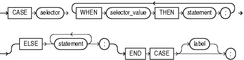
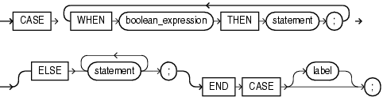

## 13.8 CASE Statement

The `CASE` statement chooses from a sequence of conditions and runs a corresponding statement.

The simple `CASE` statement evaluates a single expression and compares it to several potential values.

The searched `CASE` statement evaluates multiple Boolean expressions and chooses the first one whose value is `TRUE`.

### Topics

- Syntax

- Semantics

- Examples

- Related Topics

### Syntax

### simple_case_statement ::=

[Description of the illustration simple_case_statement.eps](img_text/simple_case_statement.md)

### searched_case_statement ::=

[Description of the illustration searched_case_statement.eps](img_text/searched_case_statement.md)

([boolean_expression ::=](expression.md), [statement ::=](block.md))

### Semantics

### simple_case_statement

selector

Expression whose value is evaluated once and used to select one of several alternatives. `selector` can have any PL/SQL data type except `BLOB`, `BFILE`, or a user-defined type.

WHEN selector_value THEN statement

`selector_value` can be an expression of any PL/SQL type except `BLOB`, `BFILE`, or a user-defined type.

The `selector_value`s are evaluated sequentially. If the value of a `selector_value` equals the value of `selector`, then the `statement` associated with that `selector_value` runs, and the `CASE` statement ends. Subsequent `selector_value`s are not evaluated.

**Caution:**

A `statement` can modify the database and invoke nondeterministic functions. There is no fall-through mechanism, as there is in the C `switch` statement.

ELSE statement \[statement \]...

The `statement`s run if and only if no `selector_value` has the same value as `selector`.

Without the `ELSE` clause, if no `selector_value` has the same value as `selector`, the system raises the predefined exception `CASE_NOT_FOUND`.

label

A label that identifies the statement (see "[statement ::=](block.md)" and "[label](block.md)").

### searched_case_statement

WHEN boolean_expression THEN statement

The `boolean_expression`s are evaluated sequentially. If the value of a `boolean_expression` is `TRUE`, the `statement` associated with that `boolean_expression` runs, and the `CASE` statement ends. Subsequent `boolean_expression`s are not evaluated.

**Caution:**

A `statement` can modify the database and invoke nondeterministic functions. There is no fall-through mechanism, as there is in the C `switch` statement.

ELSE statement \[statement \]...

The `statement`s run if and only if no `boolean_expression` has the value `TRUE`.

Without the `ELSE` clause, if no `boolean_expression` has the value `TRUE`, the system raises the predefined exception `CASE_NOT_FOUND`.

label

A label that identifies the statement (see "[statement ::=](block.md)" and "[label](block.md)").

### Examples

- [Example 3-2](boolean-data-type.md), "Printing BOOLEAN Values"

- [Example 4-6](conditional-selection-statements.md), "Simple CASE Statement"

- [Example 4-7](conditional-selection-statements.md), "Searched CASE Statement"

### Related Topics

In this chapter:

- "[IF Statement](IF-statement.md)"

In other chapters:

- "[CASE Expressions](expressions.md)"

- "[Conditional Selection Statements](conditional-selection-statements.md)"

- "[Simple CASE Statement](conditional-selection-statements.md)"

- "[Searched CASE Statement](conditional-selection-statements.md)"

**See Also:**

- [Oracle Database SQL Language Reference](../sqlrf/NULLIF.md) for information about the `NULLIF` function

- [Oracle Database SQL Language Reference](../sqlrf/COALESCE.md) for information about the `COALESCE` function
