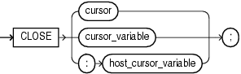

## 13.9 CLOSE Statement

The `CLOSE` statement closes a named cursor, freeing its resources for reuse.

After closing an explicit cursor, you can reopen it with the `OPEN` statement. You must close an explicit cursor before reopening it.

After closing a cursor variable, you can reopen it with the `OPEN` `FOR` statement. You need not close a cursor variable before reopening it.

### Topics

- Syntax

- Semantics

- Examples

- Related Topics

### Syntax

### close_statement ::=

[Description of the illustration close_statement.eps](img_text/close_statement.md)

### Semantics

### close_statement

cursor

Name of an open explicit cursor.

cursor_variable

Name of an open cursor variable.

:host_cursor_variable

Name of a cursor variable declared in a PL/SQL host environment and passed to PL/SQL as a bind variable. Do not put space between the colon (:) and `host_cursor_variable`.

### Examples

- [Example 6-6](cursors-overview.md), "FETCH Statements Inside LOOP Statements"

### Related Topics

In this chapter:

- "[FETCH Statement](FETCH-statement.md)"

- "[OPEN Statement](OPEN-statement.md)"

- "[OPEN FOR Statement](OPEN-FOR-statement.md)"

In other chapters:

- "[Opening and Closing Explicit Cursors](cursors-overview.md)"

- "[Opening and Closing Cursor Variables](cursor-variables.md)"
