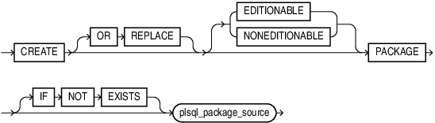
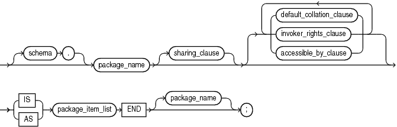
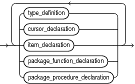
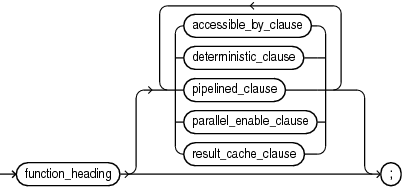
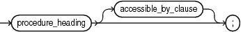

## 14.9 CREATE PACKAGE Statement

The `CREATE` `PACKAGE` statement creates or replaces the specification for a stored package, which is an encapsulated collection of related procedures, functions, and other program objects stored as a unit in the database.

The package specification declares these objects. The package body, specified subsequently, defines these objects.

### Topics

- Prerequisites

- Syntax

- Semantics

- Example

- Related Topics

### Prerequisites

To create or replace a package in your schema, you must have the `CREATE` `PROCEDURE` system privilege. To create or replace a package in another user's schema, you must have the `CREATE` `ANY` `PROCEDURE` system privilege.

To embed a `CREATE` `PACKAGE` statement inside an Oracle database precompiler program, you must terminate the statement with the keyword `END-EXEC` followed by the embedded SQL statement terminator for the specific language.

### Syntax

### create_package ::=

[Description of the illustration create_package.eps](img_text/create_package.md)

### plsql_package_source ::=

[Description of the illustration plsql_package_source.eps](img_text/plsql_package_source.md)

( [sharing_clause ::=](SHARING-clause.md) , [default_collation_clause ::=](DEFAULT-COLLATION-clause.md) , [invoker_rights_clause ::=](invokers_rights_clause.md) , [accessible_by_clause ::=](ACCESSIBLE-BY-clause.md) , )

### package_item_list ::=

[Description of the illustration package_item_list.eps](img_text/package_item_list.md)

( [cursor_declaration ::=](explicit-cursor-declaration-and-definition.md) , [item_declaration ::=](block.md) , [type_definition ::=](block.md) )

### package_function_declaration ::=

[Description of the illustration package_function_declaration.eps](img_text/package_function_declaration.md)

( [function_heading ::=](function-declaration-and-definition.md) , [accessible_by_clause ::=](ACCESSIBLE-BY-clause.md) , [deterministic_clause ::=](DETERMINISTIC-clause.md) , [pipelined_clause ::=](PIPELINED-clause.md),[parallel_enable_clause ::=](PARALLEL_ENABLE-clause.md) ,[result_cache_clause ::=](RESULT_CACHE-clause.md))

### package_procedure_declaration ::=

[Description of the illustration package_procedure_declaration.eps](img_text/package_procedure_declaration.md)

( [procedure_heading ::=](procedure-declaration-and-definition.md), [accessible_by_clause ::=](ACCESSIBLE-BY-clause.md))

### Semantics

### create_package

OR REPLACE

Re-creates the package if it exists, and recompiles it.

Users who were granted privileges on the package before it was redefined can still access the package without being regranted the privileges.

If any function-based indexes depend on the package, then the database marks the indexes `DISABLED`.

\[ EDITIONABLE \| NONEDITIONABLE \]

Specifies whether the package is an editioned or noneditioned object if editioning is enabled for the schema object type `PACKAGE` in `schema`. Default: `EDITIONABLE`. For information about editioned and noneditioned objects, see [Oracle Database Development Guide](../adfns/editions.md).

IF NOT EXISTS

Creates the package if it does not already exist. If a package by the same name does exist, the statement is ignored without error and the original package remains unchanged.

`IF NOT EXISTS` cannot be used in combination with `OR REPLACE`.

### plsql_package_source

schema

Name of the schema containing the package. Default: your schema.

package_name

A package stored in the database. For naming conventions, see "[Identifiers](lexical-units.md)".

package_item_list

Defines every type in the package and declares every cursor and subprogram in the package. Except for polymorphic table functions, every declaration must have a corresponding definition in the package body. The headings of corresponding declarations and definitions must match word for word, except for white space. Package polymorphic table function must be declared in the same package as their implementation package.

Restriction on package_item_list

`PRAGMA` `AUTONOMOUS_TRANSACTION` cannot appear here.

### Example

Example 14-19 Creating the Specification for the emp_mgmt Package

This statement creates the specification of the `emp_mgmt` package.

    CREATE PACKAGE IF NOT EXISTS emp_mgmt AS
       FUNCTION hire (last_name VARCHAR2, job_id VARCHAR2,
          manager_id NUMBER, salary NUMBER,
          commission_pct NUMBER, department_id NUMBER)
          RETURN NUMBER;
       FUNCTION create_dept(department_id NUMBER, location_id NUMBER)
          RETURN NUMBER;
       PROCEDURE remove_emp(employee_id NUMBER);
       PROCEDURE remove_dept(department_id NUMBER);
       PROCEDURE increase_sal(employee_id NUMBER, salary_incr NUMBER);
       PROCEDURE increase_comm(employee_id NUMBER, comm_incr NUMBER);
       no_comm EXCEPTION;
       no_sal EXCEPTION;
    END emp_mgmt;

The specification for the `emp_mgmt` package declares these public program objects:

- The functions `hire` and `create_dept`

- The procedures `remove_emp`, `remove_dept`, `increase_sal`, and `increase_comm`

- The exceptions `no_comm` and `no_sal`

All of these objects are available to users who have access to the package. After creating the package, you can develop applications that invoke any of these public procedures or functions or raise any of the public exceptions of the package.

The optional `IF NOT EXISTS` clause is used to ensure that the statement is idempotent. The resulting output message (in this case `Package created`) is the same whether the package is created or the statement is ignored.

Before you can invoke this package's procedures and functions, you must define these procedures and functions in the package body. For an example of a `CREATE` `PACKAGE` `BODY` statement that creates the body of the `emp_mgmt` package, see "[CREATE PACKAGE BODY Statement](CREATE-PACKAGE-BODY-statement.md)".

### Related Topics

In this chapter:

- "[ALTER PACKAGE Statement](ALTER-PACKAGE-statement.md)"

- "CREATE PACKAGE Statement"

- "[CREATE PACKAGE BODY Statement](CREATE-PACKAGE-BODY-statement.md)"

- "[DROP PACKAGE Statement](DROP-PACKAGE-statement.md)"

In other chapters:

- "[PL/SQL Packages](plsql-packages.md)"

- "[Package Specification](package-specification.md)"

- "[Function Declaration and Definition](function-declaration-and-definition.md)"

- "[Procedure Declaration and Definition](procedure-declaration-and-definition.md)"
