## 14.12 CREATE TRIGGER Statement

The `CREATE` `TRIGGER` statement creates or replaces a database trigger, which is either of these:

- A stored PL/SQL block associated with a table, a view, a schema, or the database

- An anonymous PL/SQL block or an invocation of a procedure implemented in PL/SQL or Java

The database automatically runs a trigger when specified conditions occur.

### Topics

- Prerequisites

- Syntax

- Semantics

- Examples

- Related Topics

### Prerequisites

- To create a trigger in your schema on a table in your schema or on your schema (`SCHEMA`), you must have the `CREATE` `TRIGGER` system privilege.

- To create a trigger in any schema on a table in any schema, or on another user's schema (`schema`.`SCHEMA`), you must have the `CREATE` `ANY` `TRIGGER` system privilege.

- In addition to the preceding privileges, to create a trigger on `DATABASE`, you must have the `ADMINISTER` `DATABASE` `TRIGGER` system privilege.

- To create a trigger on a pluggable database (PDB), you must be connected to that PDB and have the `ADMINISTER` `DATABASE` `TRIGGER` system privilege. For information about PDBs, see [Oracle Database Administrator's Guide](../multi/overview-of-managing-a-multitenant-environment.md).

- In addition to the preceding privileges, to create a crossedition trigger, you must be enabled for editions. For information about enabling editions for a user, see [Oracle Database Development Guide](../adfns/editions.md).

If the trigger issues SQL statements or invokes procedures or functions, then the owner of the trigger must have the privileges necessary to perform these operations. These privileges must be granted directly to the owner rather than acquired through roles.

### Syntax

### create_trigger ::=

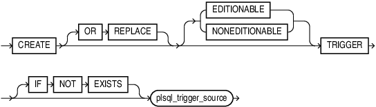
[Description of the illustration create_trigger.eps](img_text/create_trigger.md)

### plsql_trigger_source ::=

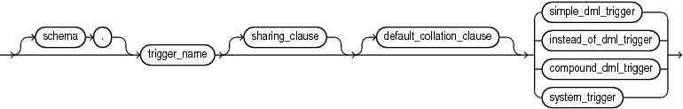
[Description of the illustration plsql_trigger_source.eps](img_text/plsql_trigger_source.md)

( [sharing_clause ::=](SHARING-clause.md) , [default_collation_clause ::=](DEFAULT-COLLATION-clause.md) , compound_dml_trigger ::= , instead_of_dml_trigger ::= , system_trigger ::= )

### simple_dml_trigger ::=

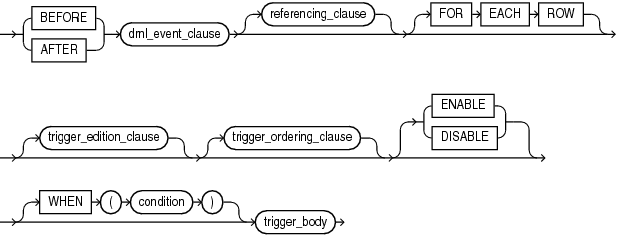
[Description of the illustration simple_dml_trigger.eps](img_text/simple_dml_trigger.md)

( dml_event_clause ::= , referencing_clause ::= , trigger_body ::= , trigger_edition_clause ::= , trigger_ordering_clause ::= )

### instead_of_dml_trigger ::=

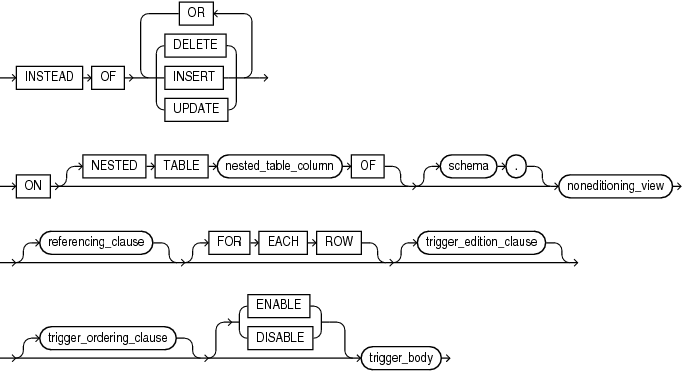
[Description of the illustration instead_of_trigger.eps](img_text/instead_of_trigger.md)

( referencing_clause ::= , trigger_body ::= , trigger_edition_clause ::= , trigger_ordering_clause ::= )

### compound_dml_trigger ::=

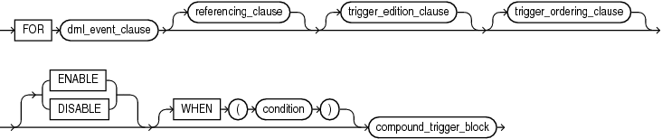
[Description of the illustration compound_dml_trigger.eps](img_text/compound_dml_trigger.md)

( compound_trigger_block ::= , dml_event_clause ::= , referencing_clause ::= , trigger_edition_clause ::= , trigger_ordering_clause ::= )

### system_trigger ::=

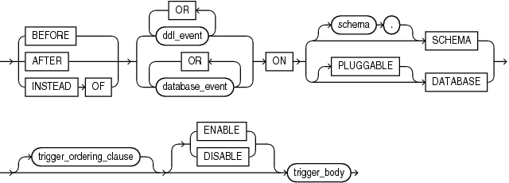
[Description of the illustration system_trigger.eps](img_text/system_trigger.md)

( trigger_body ::= , trigger_ordering_clause ::= )

### dml_event_clause ::=

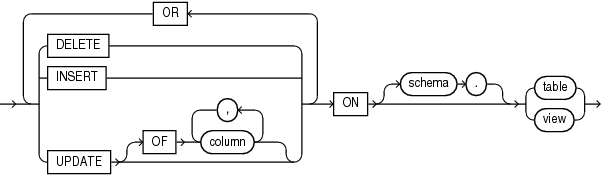
[Description of the illustration dml_event_clause.eps](img_text/dml_event_clause.md)

### referencing_clause ::=

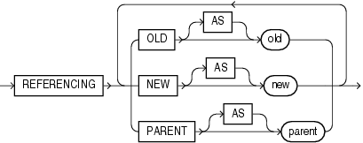
[Description of the illustration referencing_clause.eps](img_text/referencing_clause.md)

### trigger_edition_clause ::=

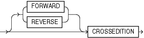
[Description of the illustration trigger_edition_clause.eps](img_text/trigger_edition_clause.md)

### trigger_ordering_clause ::=

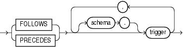
[Description of the illustration trigger_ordering_clause.eps](img_text/trigger_ordering_clause.md)

### trigger_body ::=

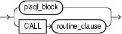
[Description of the illustration trigger_body.eps](img_text/trigger_body.md)

( [plsql_block ::=](block.md) ,

`routine_clause` in [Oracle Database SQL Language Reference](../sqlrf/CALL.md) )

### compound_trigger_block ::=

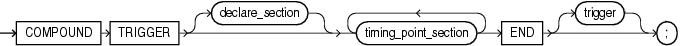
[Description of the illustration compound_trigger_block.eps](img_text/compound_trigger_block.md)

( [declare_section ::=](block.md) )

### timing_point_section ::=

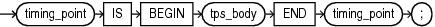
[Description of the illustration timing_point_section.eps](img_text/timing_point_section.md)

### timing_point ::=

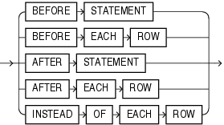
[Description of the illustration timing_point.eps](img_text/timing_point.md)

### tps_body ::=

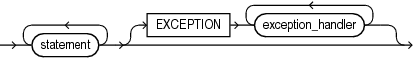
[Description of the illustration tps_body.eps](img_text/tps_body.md)

( [exception_handler ::=](exception-handler.md) , [statement ::=](block.md) )

### Semantics

### create_trigger

OR REPLACE

Re-creates the trigger if it exists, and recompiles it.

Users who were granted privileges on the trigger before it was redefined can still access the procedure without being regranted the privileges.

\[ EDITIONABLE \| NONEDITIONABLE \]

Specifies whether the trigger is an editioned or noneditioned object if editioning is enabled for the schema object type `TRIGGER` in `schema`. Default: `EDITIONABLE`. For information about editioned and noneditioned objects, see [Oracle Database Development Guide](../adfns/editions.md).

Restriction on NONEDITIONABLE

You cannot specify `NONEDITIONABLE` for a crossedition trigger.

IF NOT EXISTS

Creates the trigger if it does not already exist. If a trigger by the same name does exist, the statement is ignored without error and the original trigger remains unchanged.

`IF NOT EXISTS` cannot be used in combination with `OR REPLACE`.

Restrictions on create_trigger

See "[Trigger Restrictions](trigger-restrictions.md)".

### plsql_trigger_source

schema

Name of the schema for the trigger to be created. Default: your schema.

trigger

Name of the trigger to be created.

Triggers in the same schema cannot have the same names. Triggers can have the same names as other schema objects—for example, a table and a trigger can have the same name—however, to avoid confusion, this is not recommended.

If a trigger produces compilation errors, then it is still created, but it fails on execution. A trigger that fails on execution effectively blocks all triggering DML statements until it is disabled, replaced by a version without compilation errors, or dropped. You can see the associated compiler error messages with the SQL\*Plus command `SHOW` `ERRORS`.

**Note:**

If you create a trigger on a base table of a materialized view, then you must ensure that the trigger does not fire during a refresh of the materialized view. During refresh, the `DBMS_MVIEW` procedure `I_AM_A_REFRESH` returns `TRUE`.

### simple_dml_trigger

Creates a simple DML trigger (described in "[DML Triggers](dml-triggers.md)").

BEFORE

Causes the database to fire the trigger before running the triggering event. For row triggers, the trigger fires before each affected row is changed.

Restrictions on BEFORE

- You cannot specify a `BEFORE` trigger on a view unless it is an editioning view.

- In a `BEFORE` statement trigger, the trigger body cannot read `:NEW` or `:OLD`. (In a `BEFORE` row trigger, the trigger body can read and write the `:OLD` and `:NEW` fields.)

AFTER

Causes the database to fire the trigger after running the triggering event. For row triggers, the trigger fires after each affected row is changed.

Restrictions on AFTER

- You cannot specify an `AFTER` trigger on a view unless it is an editioning view.

- In an `AFTER` statement trigger, the trigger body cannot read `:NEW` or `:OLD`. (In an `AFTER` row trigger, the trigger body can read but not write the `:OLD` and `:NEW` fields.)

**Note:**

When you create a materialized view log for a table, the database implicitly creates an `AFTER` row trigger on the table. This trigger inserts a row into the materialized view log whenever an `INSERT`, `UPDATE`, or `DELETE` statement modifies data in the associated table. You cannot control the order in which multiple row triggers fire. Therefore, do not write triggers intended to affect the content of the materialized view.

**See Also:**

- [Oracle Database SQL Language Reference](../sqlrf/CREATE-MATERIALIZED-VIEW-LOG.md) for more information about materialized view logs

- [Oracle Database Development Guide](../adfns/editions.md) for information about editioning views

FOR EACH ROW

Creates the trigger as a row trigger. The database fires a row trigger for each row that is affected by the triggering statement and meets the optional trigger constraint defined in the `WHEN` condition.

If you omit this clause, then the trigger is a statement trigger. The database fires a statement trigger only when the triggering statement is issued if the optional trigger constraint is met.

\[ ENABLE \| DISABLE \]

Creates the trigger in an enabled (default) or disabled state. Creating a trigger in a disabled state lets you ensure that the trigger compiles without errors before you enable it.

**Note:**

`DISABLE` is especially useful if you are creating a crossedition trigger, which affects the online application being redefined if compilation errors occur.

WHEN (condition)

Specifies a SQL condition that the database evaluates for each row that the triggering statement affects. If the value of condition is `TRUE` for an affected row, then trigger_body runs for that row; otherwise, trigger_body does not run for that row. The triggering statement runs regardless of the value of condition.

The condition can contain correlation names (see "referencing_clause ::=").

In `condition`, do not put a colon (:) before the correlation name `NEW`, `OLD`, or `PARENT` (in this context, it is not a placeholder for a bind variable).

**See Also:**

[Oracle Database SQL Language Reference](../sqlrf/Conditions.md) for information about SQL conditions

Restrictions on WHEN (condition)

- If you specify this clause, then you must also specify `FOR` `EACH` `ROW`.

- The `condition` cannot include a subquery or a PL/SQL expression (for example, an invocation of a user-defined function).

trigger_body

The PL/SQL block or `CALL` subprogram that the database runs to fire the trigger. A `CALL` subprogram is either a PL/SQL subprogram or a Java subprogram in a PL/SQL wrapper.

If trigger_body is a PL/SQL block and it contains errors, then the `CREATE` \[`OR` `REPLACE`\] statement fails.

Restriction on trigger_body

The declare_section cannot declare variables of the data type `LONG` or `LONG` `RAW`.

### instead_of_dml_trigger

Creates an `INSTEAD` `OF` DML trigger (described in "[INSTEAD OF DML Triggers](dml-triggers.md)").

Restriction on INSTEAD OF

An `INSTEAD` `OF` trigger can read the `:OLD` and `:NEW` values, but cannot change them.

**Note:**

- If the view is inherently updatable and has `INSTEAD` `OF` triggers, the triggers take precedence: The database fires the triggers instead of performing DML on the view.

- If the view belongs to a hierarchy, then the subviews do not inherit the trigger.

- The `WITH` `CHECK` `OPTION` for views is not enforced when inserts or updates to the view are done using `INSTEAD` `OF` triggers. The `INSTEAD` `OF` trigger body must enforce the check. For information about `WITH` `CHECK` `OPTION`, see [Oracle Database SQL Language Reference](../sqlrf/CREATE-VIEW.md).

- The database fine-grained access control lets you define row-level security policies on views. These policies enforce specified rules in response to DML operations. If an `INSTEAD` `OF` trigger is also defined on the view, then the database does not enforce the row-level security policies, because the database fires the `INSTEAD` `OF` trigger instead of running the DML on the view.

DELETE

If the trigger is created on a noneditioning view, then `DELETE` causes the database to fire the trigger whenever a `DELETE` statement removes a row from the table on which the noneditioning view is defined.

If the trigger is created on a nested table column of a noneditioning view, then `DELETE` causes the database to fire the trigger whenever a `DELETE` statement removes an element from the nested table.

INSERT

If the trigger is created on a noneditioning view, then `INSERT` causes the database to fire the trigger whenever an `INSERT` statement adds a row to the table on which the noneditioning view is defined.

If the trigger is created on a nested table column of a noneditioning view, then `INSERT` causes the database to fire the trigger whenever an `INSERT` statement adds an element to the nested table.

UPDATE

If the trigger is created on a noneditioning view, then `UPDATE` causes the database to fire the trigger whenever an `UPDATE` statement changes a value in a column of the table on which the noneditioning view is defined.

If the trigger is created on a nested table column of a noneditioning view, then `UPDATE` causes the database to fire the trigger whenever an `UPDATE` statement changes a value in a column of the nested table.

nested_table_column

Name of the `nested_table_column` on which the trigger is to be created. The trigger fires only if the DML operates on the elements of the nested table. Performing DML operations directly on nested table columns does not cause the database to fire triggers defined on the table containing the nested table column. For more information, see "[INSTEAD OF DML Triggers](dml-triggers.md)".

**See Also:**

`AS` `subquery` clause of [`CREATE` `VIEW`](../sqlrf/CREATE-VIEW.md) in Oracle Database SQL Language Reference for a list of constructs that prevent inserts, updates, or deletes on a view

schema

Name of the schema containing the noneditioning view. Default: your schema.

noneditioning_view

If you specify `nested_table_column`, then `noneditioning_view` is the name of the noneditioning view that includes `nested_table_column`. Otherwise, `noneditioning_view` is the name of the noneditioning view on which the trigger is to be created.

FOR EACH ROW

For documentation only, because an `INSTEAD OF` trigger is always a row trigger.

`ENABLE`

(Default) Creates the trigger in an enabled state.

`DISABLE`

Creates the trigger in a disabled state, which lets you ensure that the trigger compiles without errors before you enable it.

**Note:**

`DISABLE` is especially useful if you are creating a crossedition trigger, which affects the online application being redefined if compilation errors occur.

trigger_body

The PL/SQL block or `CALL` subprogram that the database runs to fire the trigger. A `CALL` subprogram is either a PL/SQL subprogram or a Java subprogram in a PL/SQL wrapper.

If trigger_body is a PL/SQL block and it contains errors, then the `CREATE` \[`OR` `REPLACE`\] statement fails.

Restriction on trigger_body

The `declare_section` cannot declare variables of the data type `LONG` or `LONG` `RAW`.

### compound_dml_trigger

Creates a compound DML trigger (described in "[Compound DML Triggers](dml-triggers.md)").

ENABLE

(Default) Creates the trigger in an enabled state.

DISABLE

Creates the trigger in a disabled state, which lets you ensure that the trigger compiles without errors before you enable it.

**Note:**

`DISABLE` is especially useful if you are creating a crossedition trigger, which affects the online application being redefined if compilation errors occur.

WHEN (condition)

Specifies a SQL condition that the database evaluates for each row that the triggering statement affects. If the value of condition is `TRUE` for an affected row, then tps_body runs for that row; otherwise, tps_body does not run for that row. The triggering statement runs regardless of the value of condition.

The condition can contain correlation names (see "referencing_clause ::="). In condition, do not put a colon (:) before the correlation name `NEW`, `OLD`, or `PARENT` (in this context, it is not a placeholder for a bind variable).

**See Also:**

[Oracle Database SQL Language Reference](../sqlrf/Conditions.md) for information about SQL conditions

Restrictions on WHEN (condition)

- If you specify this clause, then you must also specify at least one of these timing points:

  - `BEFORE` `EACH` `ROW`

  - `AFTER` `EACH` `ROW`

  - `INSTEAD` `OF` `EACH` `ROW`

- The `condition` cannot include a subquery or a PL/SQL expression (for example, an invocation of a user-defined function).

### system_trigger

Defines a system trigger (described in "[System Triggers](system-triggers.md)").

BEFORE

Causes the database to fire the trigger before running the triggering event.

AFTER

Causes the database to fire the trigger after running the triggering event.

INSTEAD OF

Creates an `INSTEAD` `OF` trigger.

Restrictions on INSTEAD OF

- The triggering event must be a `CREATE` statement.

- You can create at most one `INSTEAD` `OF` DDL trigger (non_dml_trigger).

  For example, you can create an `INSTEAD` `OF` trigger on either the database or schema, but not on both the database and schema.

### ddl_event

One or more types of DDL SQL statements that can cause the trigger to fire.

You can create triggers for these events on `DATABASE` or `SCHEMA` unless otherwise noted. You can create `BEFORE` and `AFTER` triggers for any of these events, but you can create `INSTEAD` `OF` triggers only for `CREATE` events. The database fires the trigger in the existing user transaction.

**Note:**

Some objects are created, altered, and dropped using PL/SQL APIs (for example, scheduler jobs are maintained by subprograms in the `DBMS_SCHEDULER` package). Such PL/SQL subprograms do not fire DDL triggers.

The following ddl_event values are valid:

- `ALTER`

  Causes the database to fire the trigger whenever an `ALTER` statement modifies a database object in the data dictionary. An `ALTER` `DATABASE` statement does not fire the trigger.

- `ANALYZE`

  Causes the database to fire the trigger whenever the database collects or deletes statistics or validates the structure of a database object.

  **See Also:**

  [Oracle Database SQL Language Reference](../sqlrf/ANALYZE.md) for information about using the SQL statement `ANALYZE` to collect statistics

- `ASSOCIATE` `STATISTICS`

  Causes the database to fire the trigger whenever the database associates a statistics type with a database object.

- `AUDIT`

  Causes the database to fire the trigger whenever an `AUDIT` statement is issued.

- `COMMENT`

  Causes the database to fire the trigger whenever a comment on a database object is added to the data dictionary.

- `CREATE`

  Causes the database to fire the trigger whenever a `CREATE` statement adds a database object to the data dictionary. The `CREATE` `DATABASE` or `CREATE` `CONTROLFILE` statement does not fire the trigger.

- `DISASSOCIATE` `STATISTICS`

  Causes the database to fire the trigger whenever the database disassociates a statistics type from a database object.

- `DROP`

  Causes the database to fire the trigger whenever a `DROP` statement removes a database object from the data dictionary.

- `GRANT`

  Causes the database to fire the trigger whenever a user grants system privileges or roles or object privileges to another user or to a role.

- `NOAUDIT`

  Causes the database to fire the trigger whenever a `NOAUDIT` statement is issued.

- `RENAME`

  Causes the database to fire the trigger whenever a `RENAME` statement changes the name of a database object.

- `REVOKE`

  Causes the database to fire the trigger whenever a `REVOKE` statement removes system privileges or roles or object privileges from a user or role.

- `TRUNCATE`

  Causes the database to fire the trigger whenever a `TRUNCATE` statement removes the rows from a table or cluster and resets its storage characteristics.

- `DDL`

  Causes the database to fire the trigger whenever any of the preceding DDL statements is issued.

### database_event

One of the following database events. You can create triggers for these events on either `DATABASE` or `SCHEMA` unless otherwise noted. For each of these triggering events, the database opens an autonomous transaction scope, fires the trigger, and commits any separate transaction (regardless of any existing user transaction).

- `AFTER` `STARTUP`

  Causes the database to fire the trigger whenever the database is opened. This event is valid only with `DATABASE`, not with `SCHEMA`.

- `BEFORE` `SHUTDOWN`

  Causes the database to fire the trigger whenever an instance of the database is shut down. This event is valid only with `DATABASE`, not with `SCHEMA`.

- `AFTER` `DB_ROLE_CHANGE`

  In an Oracle Data Guard configuration, causes the database to fire the trigger whenever a role change occurs from standby to primary or from primary to standby. This event is valid only with `DATABASE`, not with `SCHEMA`.

  **Note:**

  You cannot create an `AFTER` `DB_ROLE_CHANGE` trigger on a PDB.

- `AFTER` `SERVERERROR`

  Causes the database to fire the trigger whenever both of these conditions are true:

  - A server error message is logged.

  - Oracle relational database management system (RDBMS) determines that it is safe to fire error triggers.

    Examples of when it is unsafe to fire error triggers include:

    - RDBMS is starting up.

    - A critical error has occurred.

- `AFTER` `LOGON`

  Causes the database to fire the trigger whenever a client application logs onto the database.

- `BEFORE` `LOGOFF`

  Causes the database to fire the trigger whenever a client application logs off the database.

- `AFTER` `SUSPEND`

  Causes the database to fire the trigger whenever a server error causes a transaction to be suspended.

- `AFTER` `CLONE`

  Can be specified only if `PLUGGABLE` `DATABASE` is specified. After the PDB is copied (cloned), the database fires the trigger in the new PDB and then deletes the trigger. If the trigger fails, then the copy operation fails.

- `BEFORE` `UNPLUG`

  Can be specified only if `PLUGGABLE` `DATABASE` is specified. Before the PDB is unplugged, the database fires the trigger and then deletes it. If the trigger fails, then the unplug operation fails.

- \[` BEFORE` \| `AFTER `\] `SET` `CONTAINER`

  Causes the database to fire the trigger either before or after an `ALTER` `SESSION` `SET` `CONTAINER` statement runs.

**See Also:**

"[Triggers for Publishing Events](triggers-publishing-events.md)" for more information about responding to database events through triggers

\[schema.\]SCHEMA

Defines the trigger on the specified schema. Default: current schema. The trigger fires whenever any user connected as the specified schema initiates the triggering event.

\[ PLUGGABLE \] DATABASE

`DATABASE` defines the trigger on the root. In a multitenant container database (CDB), only a common user who is connected to the root can create a trigger on the entire database.

`PLUGGABLE` `DATABASE` defines the trigger on the PDB to which you are connected.

The trigger fires whenever any user of the specified database or PDB initiates the triggering event.

**Note:**

If you are connected to a PDB, then specifying `DATABASE` is equivalent to specifying `PLUGGABLE` `DATABASE` unless you want to specify an option that applies only to a PDB (such as `CLONE` or `UNPLUG`).

ENABLE

(Default) Creates the trigger in an enabled state.

DISABLE

Creates the trigger in a disabled state, which lets you ensure that the trigger compiles without errors before you enable it.

WHEN (condition)

Specifies a SQL condition that the database evaluates. If the value of `condition` is `TRUE`, then `trigger_body` runs for that row; otherwise, `trigger_body` does not run for that row. The triggering statement runs regardless of the value of `condition`.

**See Also:**

[Oracle Database SQL Language Reference](../sqlrf/Conditions.md) for information about SQL conditions

Restrictions on WHEN (condition)

- You cannot specify this clause for a `STARTUP`, `SHUTDOWN`, or `DB_ROLE_CHANGE` trigger.

- If you specify this clause for a `SERVERERROR` trigger, then `condition` must be `ERRNO` `=` `error_code`.

- The `condition` cannot include a subquery, a PL/SQL expression (for example, an invocation of a user-defined function), or a correlation name.

trigger_body

The PL/SQL block or `CALL` subprogram that the database runs to fire the trigger. A `CALL` subprogram is either a PL/SQL subprogram or a Java subprogram in a PL/SQL wrapper.

If `trigger_body` is a PL/SQL block and it contains errors, then the `CREATE` \[`OR` `REPLACE`\] statement fails.

Restrictions on trigger_body

- The `declare_section` cannot declare variables of the data type `LONG` or `LONG` `RAW`.

- The trigger body cannot specify either `:NEW` or `:OLD`.

### dml_event_clause

Specifies the triggering statements for simple_dml_trigger or compound_dml_trigger. The database fires the trigger in the existing user transaction.

DELETE

Causes the database to fire the trigger whenever a `DELETE` statement removes a row from `table` or the table on which `view` is defined.

INSERT

Causes the database to fire the trigger whenever an `INSERT` statement adds a row to `table` or the table on which `view` is defined.

UPDATE \[ OF column \[, column \] \]

Causes the database to fire the trigger whenever an `UPDATE` statement changes a value in a specified column. Default: The database fires the trigger whenever an `UPDATE` statement changes a value in any column of `table` or the table on which `view` is defined.

If you specify a `column`, then you cannot change its value in the body of the trigger.

schema

Name of the schema that contains the database object on which the trigger is to be created. Default: your schema.

table

Name of the database table or object table on which the trigger is to be created.

Restriction on schema.table

You cannot create a trigger on a table in the schema `SYS`.

view

Name of the database view or object view on which the trigger is to be created.

**Note:**

A compound DML trigger created on a noneditioning view is not really compound, because it has only one timing point section.

### referencing_clause

Specifies correlation names, which refer to old, new, and parent values of the current row. Defaults: `OLD`, `NEW`, and `PARENT`.

If your trigger is associated with a table named `OLD`, `NEW`, or `PARENT`, then use this clause to specify different correlation names to avoid confusion between the table names and the correlation names.

If the trigger is defined on a nested table, then `OLD` and `NEW` refer to the current row of the nested table, and `PARENT` refers to the current row of the parent table. If the trigger is defined on a database table or view, then `OLD` and `NEW` refer to the current row of the database table or view, and `PARENT` is undefined.

Restriction on referencing_clause

The referencing_clause is not valid if trigger_body is `CALL` routine.

DML row-level triggers cannot reference fields of OLD/NEW/PARENT pseudorecords (correlation names) that correspond to columns with declared collation other than `USING_NLS_COMP`.

### trigger_edition_clause

Creates the trigger as a crossedition trigger.

The handling of DML changes during edition-based redefinition (EBR) of an online application can entail multiple steps. Therefore, it is likely, though not required, that a crossedition trigger is also a compound trigger.

Restrictions on trigger_edition_clause

- You cannot define a crossedition trigger on a view.

- You cannot specify `NONEDITIONABLE` for a crossedition trigger.

FORWARD

(Default) Creates the trigger as a forward crossedition trigger. A forward crossedition trigger is intended to fire when DML changes are made in a database while an online application that uses the database is being patched or upgraded with EBR. The body of a crossedition trigger is designed to handle these DML changes so that they can be appropriately applied after the changes to the application code are completed.

REVERSE

Creates the trigger as a reverse crossedition trigger, which is intended to fire when the application, after being patched or upgraded with EBR, makes DML changes. This trigger propagates data to columns or tables used by the application before it was patched or upgraded.

**See Also:**

[Oracle Database Development Guide](../adfns/editions.md) for more information crossedition triggers

### trigger_ordering_clause

FOLLOWS \| PRECEDES

Specifies the relative firing of triggers that have the same timing point. It is especially useful when creating crossedition triggers, which must fire in a specific order to achieve their purpose.

Use `FOLLOWS` to indicate that the trigger being created must fire after the specified triggers. You can specify `FOLLOWS` for a conventional trigger or for a forward crossedition trigger.

Use `PRECEDES` to indicate that the trigger being created must fire before the specified triggers. You can specify `PRECEDES` only for a reverse crossedition trigger.

The specified triggers must exist, and they must have been successfully compiled. They need not be enabled.

If you are creating a noncrossedition trigger, then the specified triggers must be all of the following:

- Noncrossedition triggers

- Defined on the same table as the trigger being created

- Visible in the same edition as the trigger being created

If you are creating a crossedition trigger, then the specified triggers must be all of the following:

- Crossedition triggers

- Defined on the same table or editioning view as the trigger being created, unless you specify `FOLLOWS` or `PRECEDES`.

  If you specify `FOLLOWS`, then the specified triggers must be forward crossedition triggers, and if you specify `PRECEDES`, then the specified triggers must be reverse crossedition triggers. However, the specified triggers need not be on the same table or editioning view as the trigger being created.

- Visible in the same edition as the trigger being created

In the following definitions, A, B, C, and D are either noncrossedition triggers or forward crossedition triggers:

- If B specifies A in its `FOLLOWS` clause, then B directly follows A.

- If C directly follows B, and B directly follows A, then C indirectly follows A.

- If D directly follows C, and C indirectly follows A, then D indirectly follows A.

- If B directly or indirectly follows A, then B explicitly follows A (that is, the firing order of B and A is explicitly specified by one or more `FOLLOWS` clauses).

In the following definitions, A, B, C, and D are reverse crossedition triggers:

- If A specifies B in its `PRECEDES` clause, then A directly precedes B.

- If A directly precedes B, and B directly precedes C, then A indirectly precedes C.

- If A directly precedes B, and B indirectly precedes D, then A indirectly precedes D.

- If A directly or indirectly precedes B, then A explicitly precedes B (that is, the firing order of A and B is explicitly specified by one or more `PRECEDES` clauses).

Belongs to compound_dml_trigger.

### compound_trigger_block

If the trigger is created on a noneditioning view, then compound_trigger_block must have only the `INSTEAD` `OF` `EACH` `ROW` section.

If the trigger is created on a table or editioning view, then timing point sections can be in any order, but no section can be repeated. The compound_trigger_block cannot have an `INSTEAD` `OF` `EACH` `ROW` section.

**See Also:**

"[Compound DML Trigger Structure](dml-triggers.md)"

Restriction on compound_trigger_block

The declare_section of compound_trigger_block cannot include `PRAGMA` `AUTONOMOUS_TRANSACTION`.

**See Also:**

"[Compound DML Trigger Restrictions](dml-triggers.md)"

### timing_point

BEFORE STATEMENT

Specifies the `BEFORE` `STATEMENT` section of a compound_dml_trigger on a table or editioning view. This section causes the database to fire the trigger before running the triggering event.

Restriction on BEFORE STATEMENT

This section cannot specify `:NEW` or `:OLD`.

BEFORE EACH ROW

Specifies the `BEFORE` `EACH` `ROW` section of a compound_dml_trigger on a table or editioning view. This section causes the database to fire the trigger before running the triggering event. The trigger fires before each affected row is changed.

This section can read and write the `:OLD` and `:NEW` fields.

AFTER STATEMENT

Specifies the `AFTER` `STATEMENT` section of compound_dml_trigger on a table or editioning view. This section causes the database to fire the trigger after running the triggering event.

Restriction on AFTER STATEMENT

This section cannot specify `:NEW` or `:OLD`.

AFTER EACH ROW

Specifies the `AFTER` `EACH` `ROW` section of a compound_dml_trigger on a table or editioning view. This section causes the database to fire the trigger after running the triggering event. The trigger fires after each affected row is changed.

This section can read but not write the `:OLD` and `:NEW` fields.

INSTEAD OF EACH ROW

Specifies the `INSTEAD` `OF` `EACH` `ROW` section (the only timing point section) of a compound_dml_trigger on a noneditioning view. The database runs tps_body instead of running the triggering DML statement. For more information, see "[INSTEAD OF DML Triggers](dml-triggers.md)".

Restriction on INSTEAD OF EACH ROW

- This section can appear only in a `compound_dml_trigger` on a noneditioning view.

- This section can read but not write the `:OLD` and `:NEW` values.

### tps_body

The PL/SQL block or `CALL` subprogram that the database runs to fire the trigger. A `CALL` subprogram is either a PL/SQL subprogram or a Java subprogram in a PL/SQL wrapper.

If `tps_body` is a PL/SQL block and it contains errors, then the `CREATE` \[`OR` `REPLACE`\] statement fails.

Restriction on tps_body

The `declare_section` cannot declare variables of the data type `LONG` or `LONG` `RAW`.

### Examples

DML Triggers

- [Example 9-1](dml-triggers.md), "Trigger Uses Conditional Predicates to Detect Triggering Statement"

- [Example 9-2](dml-triggers.md), "INSTEAD OF Trigger"

- [Example 9-3](dml-triggers.md), "INSTEAD OF Trigger on Nested Table Column of View"

- [Example 9-4](dml-triggers.md), "Compound Trigger Logs Changes to One Table in Another Table"

- [Example 9-5](dml-triggers.md), "Compound Trigger Avoids Mutating-Table Error"

Triggers for Ensuring Referencial Integrity

- [Example 9-6](dml-triggers.md), "Foreign Key Trigger for Child Table"

- [Example 9-7](dml-triggers.md), "UPDATE and DELETE RESTRICT Trigger for Parent Table"

- [Example 9-8](dml-triggers.md), "UPDATE and DELETE SET NULL Trigger for Parent Table"

- [Example 9-9](dml-triggers.md), "DELETE CASCADE Trigger for Parent Table"

- [Example 9-10](dml-triggers.md), "UPDATE CASCADE Trigger for Parent Table"

- [Example 9-11](dml-triggers.md), "Trigger Checks Complex Constraints"

- [Example 9-12](dml-triggers.md), "Trigger Enforces Security Authorizations"

- [Example 9-13](dml-triggers.md), "Trigger Derives New Column Values"

Triggers That Use Correlation Names and Pseudorecords

- [Example 9-14](correlation-names-and-pseudorecords.md), "Trigger Logs Changes to EMPLOYEES.SALARY"

- [Example 9-15](correlation-names-and-pseudorecords.md), "Conditional Trigger Prints Salary Change Information"

- [Example 9-16](correlation-names-and-pseudorecords.md), "Trigger Modifies CLOB Columns"

- [Example 9-17](correlation-names-and-pseudorecords.md), "Trigger with REFERENCING Clause"

- [Example 9-18](correlation-names-and-pseudorecords.md), "Trigger References OBJECT_VALUE Pseudocolumn"

System Triggers

- [Example 9-19](system-triggers.md), "BEFORE Statement Trigger on Sample Schema HR"

- [Example 9-20](system-triggers.md), "AFTER Statement Trigger on Database"

- [Example 9-21](system-triggers.md), "Trigger Monitors Logons"

- [Example 9-22](system-triggers.md), "INSTEAD OF CREATE Trigger on Schema"

Miscellaneous Trigger Examples

- [Example 9-23](subprograms-invoked-triggers.md), "Trigger Invokes Java Subprogram"

- [Example 9-24](exception-handling-triggers.md), "Trigger Cannot Handle Exception if Remote Database is Unavailable"

- [Example 9-25](exception-handling-triggers.md), "Workaround for Trigger Cannot Handle Exception if Remote Database is Unavailable"

- [Example 9-26](trigger-restrictions.md), "Trigger Causes Mutating-Table Error"

- [Example 9-27](trigger-restrictions.md), "Update Cascade"

- [Example 9-28](views-information-triggers.md), "Viewing Information About Triggers"

### Related Topics

In this chapter:

- "[ALTER TRIGGER Statement](ALTER-TRIGGER-statement.md)"

- "[DROP TRIGGER Statement](DROP-TRIGGER-statement.md)"

In other chapters:

- [PL/SQL Triggers](plsql-triggers.md)

**See Also:**

[Oracle Database Development Guide](../adfns/editions.md) for more information about crossedition triggers
