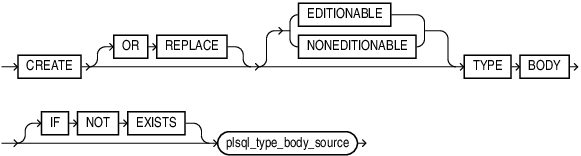
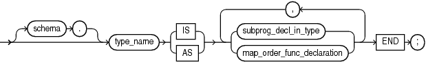
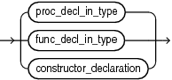
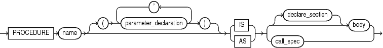
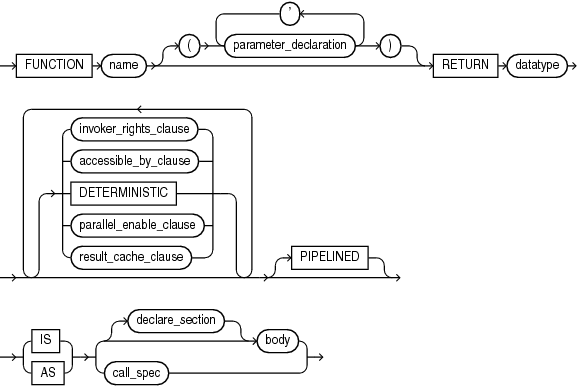
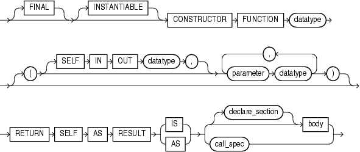
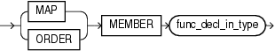

## 14.14 CREATE TYPE BODY Statement

The `CREATE` `TYPE` `BODY` defines or implements the member methods defined in the type specification that was created with the` CREATE` `TYPE` statement.

For each method specified in a type specification for which you did not specify the `call_spec`, you must specify a corresponding method body in the type body.

### Topics

- Prerequisites

- Syntax

- Semantics

- Examples

- Related Topics

### Prerequisites

Every member declaration in the `CREATE` `TYPE` specification for an ADT must have a corresponding construct in the `CREATE` `TYPE` or `CREATE` `TYPE` `BODY` statement.

To create or replace a type body in your schema, you must have the `CREATE` `TYPE` or the `CREATE` `ANY` `TYPE` system privilege. To create a type in another user's schema, you must have the `CREATE` `ANY` `TYPE` system privilege. To replace a type in another user's schema, you must have the `DROP` `ANY` `TYPE` system privilege.

### Syntax

### create_type_body ::=

[Description of the illustration create_type_body.eps](img_text/create_type_body.md)

### plsql_type_body_source ::=

[Description of the illustration plsql_type_body_source.eps](img_text/plsql_type_body_source.md)

(map_order_func_declaration ::=, subprog_decl_in_type ::=)

### subprog_decl_in_type ::=

[Description of the illustration subprog_decl_in_type.eps](img_text/subprog_decl_in_type.md)

### proc_decl_in_type ::=

[Description of the illustration proc_decl_in_type.eps](img_text/proc_decl_in_type.md)

([body ::=](block.md), [call_spec ::=](call-specification.md), [declare_section ::=](block.md), [parameter_declaration ::=](formal-parameter-declaration.md))

### func_decl_in_type ::=

[Description of the illustration func_decl_in_type.eps](img_text/func_decl_in_type.md)

([body ::=](block.md), [invoker_rights_clause ::=](invokers_rights_clause.md), [accessible_by_clause ::=](ACCESSIBLE-BY-clause.md), [deterministic_clause ::=](DETERMINISTIC-clause.md), [call_spec ::=](call-specification.md), [declare_section ::=](block.md), [parameter_declaration ::=](formal-parameter-declaration.md), [parallel_enable_clause ::=](PARALLEL_ENABLE-clause.md), [result_cache_clause ::=](RESULT_CACHE-clause.md), [pipelined_clause ::=](PIPELINED-clause.md))

### constructor_declaration ::=

[Description of the illustration constructor_declaration.eps](img_text/constructor_declaration.md)

([call_spec ::=](call-specification.md))

### map_order_func_declaration ::=

[Description of the illustration map_order_func_declaration.eps](img_text/map_order_func_declaration.md)

### Semantics

### create_type_body

OR REPLACE

Re-creates the type body if it exists, and recompiles it.

Users who were granted privileges on the type body before it was redefined can still access the type body without being regranted the privileges.

You can use this clause to add member subprogram definitions to specifications added with the `ALTER` `TYPE` ... `REPLACE` statement.

\[ EDITIONABLE \| NONEDITIONABLE \]

If you do not specify this property, then the type body inherits `EDITIONABLE` or `NONEDITIONABLE` from the type specification. If you do specify this property, then it must match that of the type specification.

IF NOT EXISTS

Creates the type body if it does not already exist. If a type body by the same name does exist, the statement is ignored without error and the original type body remains unchanged.

`IF NOT EXISTS` cannot be used in combination with `OR REPLACE`.

### plsql_type_body_source

schema

Name of the schema containing the type body. Default: your schema.

type_name

Name of an ADT.

### subprog_decl_in_type

The type of function or procedure subprogram associated with the type specification.

You must define a corresponding method name and optional parameter list in the type specification for each procedure or function declaration. For functions, you also must specify a return type.

### map_order_func_declaration

You can declare either one `MAP` method or one `ORDER` method, regardless of how many `MEMBER` or `STATIC` methods you declare. If you declare either a `MAP` or `ORDER` method, then you can compare object instances in SQL.

If you do not declare either method, then you can compare object instances only for equality or inequality. Instances of the same type definition are equal only if each pair of their corresponding attributes is equal.

MAP MEMBER

Declares or implements a `MAP` member function that returns the relative position of a given instance in the ordering of all instances of the object. A `MAP` method is called implicitly and specifies an ordering of object instances by mapping them to values of a predefined scalar type. PL/SQL uses the ordering to evaluate Boolean expressions and to perform comparisons.

If the argument to the `MAP` method is null, then the `MAP` method returns null and the method is not invoked.

An type body can contain only one `MAP` method, which must be a function. The `MAP` function can have no arguments other than the implicit `SELF` argument.

ORDER MEMBER

Specifies an `ORDER` member function that takes an instance of an object as an explicit argument and the implicit `SELF` argument and returns either a negative integer, zero, or a positive integer, indicating that the implicit `SELF` argument is less than, equal to, or greater than the explicit argument, respectively.

If either argument to the `ORDER` method is null, then the `ORDER` method returns null and the method is not invoked.

When instances of the same ADT definition are compared in an `ORDER` `BY` clause, the database invokes the `ORDER` `MEMBER` `func_decl_in_type`.

An object specification can contain only one `ORDER` method, which must be a function having the return type `NUMBER`.

### proc_decl_in_type

A procedure subprogram declaration.

### constructor_declaration

A user-defined constructor subprogram declaration. The `RETURN` clause of a constructor function must be `RETURN` `SELF` `AS` `RESULT`. This setting indicates that the most specific type of the value returned by the constructor function is the most specific type of the `SELF` argument that was passed in to the constructor function.

**See Also:**

- "[CREATE TYPE Statement](CREATE-TYPE-statement.md)" for a list of restrictions on user-defined functions

- "[Overloaded Subprograms](overloaded-subprograms.md)" for information about overloading subprogram names

- [Oracle Database Object-Relational Developer's Guide](../adobj/advanced-topics-for-oracle-objects.md) for information about and examples of user-defined constructors

declare_section

Declares items that are local to the procedure or function.

body

Procedure or function statements.

### func_decl_in_type

A function subprogram declaration.

### Examples

Several examples of creating type bodies appear in the [Examples](CREATE-TYPE-statement.md) section of "[CREATE TYPE Statement](CREATE-TYPE-statement.md)". For an example of re-creating a type body, see "[Example 14-7](ALTER-TYPE-statement.md)".

### Related Topics

- "[CREATE TYPE Statement](CREATE-TYPE-statement.md)"

- "[DROP TYPE BODY Statement](DROP-TYPE-BODY-statement.md)"

- "[CREATE FUNCTION Statement](CREATE-FUNCTION-statement.md)"

- "[CREATE PROCEDURE Statement](CREATE-PROCEDURE-statement.md)"
