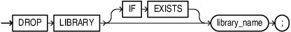

## 14.16 DROP LIBRARY Statement

The `DROP` `LIBRARY` statement drops an external procedure library from the database.

### Topics

- Prerequisites

- Syntax

- Semantics

- Example

- Related Topics

### Prerequisites

You must have the `DROP` `ANY` `LIBRARY` system privilege.

### Syntax

### drop_library ::=

[Description of the illustration drop_library.eps](img_text/drop_library.md)

### Semantics

library_name

Name of the external procedure library being dropped.

IF EXISTS

Drops the library if it exists. If no such library exists, the statement is ignored without error.

### Example

Example 14-33 Dropping a Library

The following statement drops the `ext_lib` library, which was created in "[CREATE LIBRARY Statement](CREATE-LIBRARY-statement.md)":

    DROP LIBRARY IF EXISTS ext_lib;

If `ext_lib` does not already exist, this statement is ignored without error. Note that the output message is the same whether or not the library exists (in this case, `Library dropped.`).

### Related Topics

- "[ALTER LIBRARY Statement](ALTER-LIBRARY-statement.md)"

- "[CREATE LIBRARY Statement](CREATE-LIBRARY-statement.md)"
