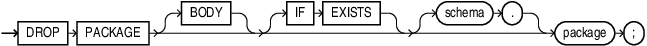

## 14.17 DROP PACKAGE Statement

The `DROP` `PACKAGE` statement drops a stored package from the database.

This statement drops the body and specification of a package.

**Note:**

Do not use this statement to drop a single object from a package. Instead, re-create the package without the object using the "[CREATE PACKAGE Statement](CREATE-PACKAGE-statement.md)" and "[CREATE PACKAGE BODY Statement](CREATE-PACKAGE-BODY-statement.md)" with the `OR` `REPLACE` clause.

### Topics

- Prerequisites

- Syntax

- Semantics

- Example

- Related Topics

### Prerequisites

The package must be in your schema or you must have the `DROP` `ANY` `PROCEDURE` system privilege.

### Syntax

### drop_package ::=

[Description of the illustration drop_package.eps](img_text/drop_package.md)

### Semantics

### drop_package

BODY

Drops only the body of the package. If you omit this clause, then the database drops both the body and specification of the package.

When you drop only the body of a package but not its specification, the database does not invalidate dependent objects. However, you cannot invoke a procedure or stored function declared in the package specification until you re-create the package body.

IF EXISTS

Drops the package if it exists. If no such package exists, the statement is ignored without error.

schema

Name of the schema containing the package. Default: your schema.

package

Name of the package to be dropped.

The database invalidates any local objects that depend on the package specification. If you subsequently reference one of these objects, then the database tries to recompile the object and returns an error if you have not re-created the dropped package.

If any statistics types are associated with the package, then the database disassociates the statistics types with the `FORCE` clause and drops any user-defined statistics collected with the statistics types.

**See Also:**

- [Oracle Database SQL Language Reference](../sqlrf/ASSOCIATE-STATISTICS.md) for information about the `ASSOCIATE` `STATISTICS` statement

- [Oracle Database SQL Language Reference](../sqlrf/DISASSOCIATE-STATISTICS.md) for information about the `DISASSOCIATE` `STATISTICS` statement

### Example

Example 14-34 Dropping a Package

This statement drops the specification and body of the `emp_mgmt` package, which was created in "[CREATE PACKAGE BODY Statement](CREATE-PACKAGE-BODY-statement.md)", invalidating all objects that depend on the specification:

    DROP PACKAGE emp_mgmt;

### Related Topics

- "[ALTER PACKAGE Statement](ALTER-PACKAGE-statement.md)"

- "[CREATE PACKAGE Statement](CREATE-PACKAGE-statement.md)"

- "[CREATE PACKAGE BODY Statement](CREATE-PACKAGE-BODY-statement.md)"
