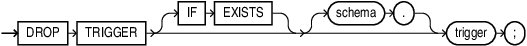

## 14.19 DROP TRIGGER Statement

The `DROP` `TRIGGER` statement drops a database trigger from the database.

### Topics

- Prerequisites

- Syntax

- Semantics

- Example

- Related Topics

### Prerequisites

The trigger must be in your schema or you must have the `DROP` `ANY` `TRIGGER` system privilege. To drop a trigger on `DATABASE` in another user's schema, you must also have the `ADMINISTER` `DATABASE` `TRIGGER` system privilege.

### Syntax

### drop_trigger ::=

[Description of the illustration drop_trigger.eps](img_text/drop_trigger.md)

### Semantics

IF EXISTS

Drops the trigger if it exists. If no such trigger exists, the statement is ignored without error.

schema

Name of the schema containing the trigger. Default: your schema.

trigger

Name of the trigger to be dropped.

### Example

Example 14-36 Dropping a Trigger

This statement drops the `salary_check` trigger in the schema `hr`:

    DROP TRIGGER hr.salary_check;

### Related Topics

- "[ALTER TRIGGER Statement](ALTER-TRIGGER-statement.md)"

- "[CREATE TRIGGER Statement](CREATE-TRIGGER-statement.md)"
