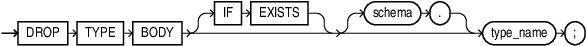

## 14.21 DROP TYPE BODY Statement

The `DROP` `TYPE` `BODY` statement drops the body of an ADT, `VARRAY` type, or nested table type.

When you drop a type body, the type specification still exists, and you can re-create the type body. Prior to re-creating the body, you can still use the type, although you cannot invoke its member functions.

### Topics

- Prerequisites

- Syntax

- Semantics

- Example

- Related Topics

### Prerequisites

The type body must be in your schema or you must have the `DROP` `ANY` `TYPE` system privilege.

### Syntax

### drop_type_body ::=

[Description of the illustration drop_type_body.eps](img_text/drop_type_body.md)

### Semantics

IF EXISTS

Drops the type body if it exists. If no such type body exists, the statement is ignored without error.

### schema

Name of the schema containing the type. Default: your schema.

### type_name

Name of the type body to be dropped.

Restriction on type_name

You can drop a type body only if it has no type or table dependencies.

### Example

Example 14-38 Dropping an ADT Body

This statement removes the ADT body `data_typ1`. See "[CREATE TYPE Statement](CREATE-TYPE-statement.md)" for the example that creates this ADT.

    DROP TYPE BODY data_typ1;

### Related Topics

- "[ALTER TYPE Statement](ALTER-TYPE-statement.md)"

- "[CREATE TYPE Statement](CREATE-TYPE-statement.md)"

- "[CREATE TYPE BODY Statement](CREATE-TYPE-BODY-statement.md)"
