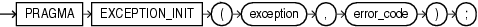

## 13.25 EXCEPTION_INIT Pragma

The `EXCEPTION_INIT` pragma associates a user-defined exception name with an error code.

The `EXCEPTION_INIT` pragma can appear only in the same declarative part as its associated exception, anywhere after the exception declaration.

### Topics

- Syntax

- Semantics

- Usage Notes

- Examples

- Related Topics

### Syntax

### exception_init_pragma ::=

[Description of the illustration exception_init_pragma.eps](img_text/exception_init_pragma.md)

### Semantics

### exception_init_pragma

exception

Name of a previously declared user-defined exception.

error_code

Error code to be associated with `exception`. `error_code` can be either 100 (the numeric code for "no data found" that "[SQLCODE Function](SQLCODE-function.md)" returns) or any negative integer greater than -1000000 except -1403 (another numeric code for "no data found").

**Note:**

`NO_DATA_FOUND` is a predefined exception.

If two `EXCEPTION_INIT` pragmas assign different error codes to the same user-defined exception, then the later pragma overrides the earlier pragma.

### Usage Notes

The `EXCEPTION_INIT` pragma should only be used to associate an exception with an error number that is already meaningfully defined by Oracle. Note that any error number may be used by Oracle in the future, which can create conflicts with unrelated application use of that number.

Negative integers greater than -65536 are only partially supported. Currently, if left unhandled beyond the current layer of entry into PL/SQL, the exception is converted to `ORA-6515` and the original exception is not recognized in the outer PL/SQL layer or client program.

Application-declared exceptions that are only raised and caught locally within a layer of entry into PL/SQL do not need the `EXCEPTION_INIT` pragma. The `RAISE_APPLICATION_ERROR` procedure and associated -20000 to -20999 range of error numbers should be used by application-declared exceptions that are intended to be recognizable in outer PL/SQL layers or in the client program.

### Examples

- [Example 11-5](internally-defined-exceptions.md), "Naming Internally Defined Exception"

- [Example 11-13](raising-exceptions-explicitly.md), "Raising User-Defined Exception with RAISE_APPLICATION_ERROR"

- [Example 12-13](bulk-sql-and-bulk-binding.md), "Handling FORALL Exceptions After FORALL Statement Completes"

### Related Topics

In this chapter:

- "[Exception Declaration](exception-declaration.md)"

- "[Exception Handler](exception-handler.md)"

- "[SQLCODE Function](SQLCODE-function.md)"

- "[SQLERRM Function](SQLERRM-function.md)"

In other chapters:

- "[Internally Defined Exceptions](internally-defined-exceptions.md)"

- "[RAISE_APPLICATION_ERROR Procedure](raising-exceptions-explicitly.md)"
