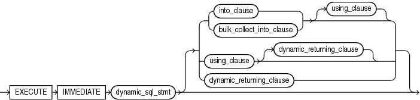
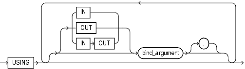

## 13.28 EXECUTE IMMEDIATE Statement

The `EXECUTE` `IMMEDIATE` statement builds and runs a dynamic SQL statement in a single operation.

Native dynamic SQL uses the `EXECUTE` `IMMEDIATE` statement to process most dynamic SQL statements.

**Caution:**

When using dynamic SQL, beware of SQL injection, a security risk. For more information about SQL injection, see "[SQL Injection](sql-injection.md)".

### Topics

- Syntax

- Semantics

- Examples

- Related Topics

### Syntax

### execute_immediate_statement ::=

[Description of the illustration execute_immediate_statement.eps](img_text/execute_immediate_statement.md)

([bulk_collect_into_clause ::=](RETURNING-INTO-clause.md), [dynamic_returning_clause ::=](RETURNING-INTO-clause.md), [into_clause ::=](RETURNING-INTO-clause.md))

### using_clause ::=

[Description of the illustration using_clause.eps](img_text/using_clause.md)

### Semantics

### execute_immediate_statement

dynamic_sql_stmt

String literal, string variable, or string expression that represents a SQL statement. Its type must be either `CHAR`, `VARCHAR2`, or `CLOB`.

**Note:**

If `dynamic_sql_statement` is a `SELECT` statement, and you omit both `into_clause` and `bulk_collect_into_clause`, then `execute_immediate_statement` never executes.

For example, this statement never increments the sequence:

    EXECUTE IMMEDIATE 'SELECT S.NEXTVAL FROM DUAL'

### into_clause

Specifies the variables or record in which to store the column values that the statement returns. For more information about this clause, see "[RETURNING INTO Clause](RETURNING-INTO-clause.md)".

Restriction on into_clause

Use if and only if `dynamic_sql_stmt` returns a single row.

### bulk_collect_into_clause

Specifies one or more collections in which to store the rows that the statement returns. For more information about this clause, see "[RETURNING INTO Clause](RETURNING-INTO-clause.md)".

Restriction on bulk_collect_into_clause

Use if and only if `dynamic_sql_stmt` can return multiple rows.

dynamic_returning_clause

Returns the column values of the rows affected by the dynamic SQL statement, in either individual variables or records. For more information about this clause, see "[RETURNING INTO Clause](RETURNING-INTO-clause.md)".

Restriction on dynamic_returning_clause

Use if and only if `dynamic_sql_stmt` has a `RETURNING` `INTO` clause.

### using_clause

Specifies bind variables, using positional notation.

**Note:**

If you repeat placeholder names in `dynamic_sql_statement`, be aware that the way placeholders are associated with bind variables depends on the kind of dynamic SQL statement. For details, see "[Repeated Placeholder Names in Dynamic SQL Statements](native-dynamic-sql.md)."

Restrictions on using_clause

- Use if and only if `dynamic_sql_stmt` includes placeholders for bind variables.

- If `dynamic_sql_stmt` has a `RETURNING` `INTO` clause (`static_returning_clause`), then `using_clause` can contain only `IN` bind variables. The bind variables in the `RETURNING` `INTO` clause are `OUT` bind variables by definition.

IN, OUT, IN OUT

Parameter modes of bind variables. An `IN` bind variable passes its value to `dynamic_sql_stmt`. An `OUT` bind variable stores a value that `dynamic_sql_stmt` returns. An `IN` `OUT` bind variable passes its initial value to `dynamic_sql_stmt` and stores a value that `dynamic_sql_stmt` returns. Default: `IN`.

For DML a statement with a `RETURNING` clause, you can place `OUT` bind variables in the `RETURNING` `INTO` clause without specifying the parameter mode, which is always `OUT`.

bind_argument

An expression whose value replaces its corresponding placeholder in `dynamic_sql_stmt` at run time.

Every placeholder in `dynamic_sql_stmt` must be associated with a `bind_argument` in the `USING` clause or `RETURNING` `INTO` clause (or both) or with a define variable in the `INTO` clause.

You can run `dynamic_sql_stmt` repeatedly using different values for the bind variables. You incur some overhead, because `EXECUTE` `IMMEDIATE` prepares the dynamic string before every execution.

**Note:**

Bind variables can be evaluated in any order. If a program determines order of evaluation, then at the point where the program does so, its behavior is undefined.

Restrictions on bind_argument

- `bind_argument` cannot be an associative array indexed by string.

- `bind_argument` cannot be the reserved word `NULL`.

  To pass the value `NULL` to the dynamic SQL statement, use an uninitialized variable where you want to use `NULL`, as in [Example 7-7](native-dynamic-sql.md).

### Examples

- [Example 7-1](native-dynamic-sql.md), "Invoking Subprogram from Dynamic PL/SQL Block"

- [Example 7-7](native-dynamic-sql.md), "Uninitialized Variable Represents NULL in USING Clause"

- [Example 7-10](native-dynamic-sql.md), "Repeated Placeholder Names in Dynamic PL/SQL Block"

### Related Topics

In this chapter:

- "[RETURNING INTO Clause](RETURNING-INTO-clause.md)"

In other chapters:

- "[EXECUTE IMMEDIATE Statement](native-dynamic-sql.md)"

- "[DBMS_SQL Package](dbms_sql-package.md)"
