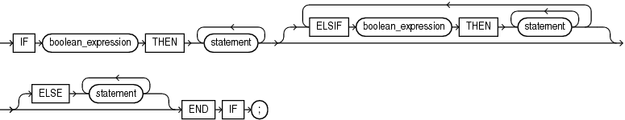

## 13.38 IF Statement

The `IF` statement either runs or skips a sequence of one or more statements, depending on the value of a `BOOLEAN` expression.

### Topics

- Syntax

- Semantics

- Examples

- Related Topics

### Syntax

### if_statement ::=

[Description of the illustration if_statement.eps](img_text/if_statement.md)

( [boolean_expression ::=](expression.md) , [statement ::=](block.md) )

### Semantics

### boolean_expression

Expression whose value is `TRUE`, `FALSE`, or `NULL`.

The first `boolean_expression` is always evaluated. Each other `boolean_expression` is evaluated only if the values of the preceding expressions are `FALSE`.

If a `boolean_expression` is evaluated and its value is `TRUE`, the statements after the corresponding `THEN` run. The succeeding expressions are not evaluated, and the statements associated with them do not run.

ELSE

If no `boolean_expression` has the value `TRUE`, the statements after `ELSE` run.

### Examples

- [Example 4-1](conditional-selection-statements.md), "IF THEN Statement"

- [Example 4-2](conditional-selection-statements.md), "IF THEN ELSE Statement"

- [Example 4-3](conditional-selection-statements.md), "Nested IF THEN ELSE Statements"

- [Example 4-4](conditional-selection-statements.md), "IF THEN ELSIF Statement"

### Related Topics

In this chapter:

- "[CASE Statement](CASE-statement.md)"

- "[Expression](expression.md)"

In other chapters:

- "[Conditional Selection Statements](conditional-selection-statements.md)"
