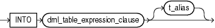
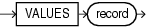

## 13.42 INSERT Statement Extension

The PL/SQL extension to the SQL `INSERT` statement lets you specify a record name in the `values_clause` of the `single_table_insert` instead of specifying a column list in the `insert_into_clause`

Effectively, this form of the `INSERT` statement inserts the record into the table; actually, it adds a row to the table and gives each column of the row the value of the corresponding record field.

**See Also:**

[Oracle Database SQL Language Reference](../sqlrf/INSERT.md) for the syntax of the SQL `INSERT` statement

### Topics

- Syntax

- Semantics

- Examples

- Related Topics

### Syntax

### insert_into_clause ::=

[Description of the illustration insert_into_clause.eps](img_text/insert_into_clause.md)

### values_clause ::=

[Description of the illustration values_clause.eps](img_text/values_clause.md)

### Semantics

### insert_into_clause

dml_table_expression_clause

Typically a table name. For complete information, see [Oracle Database SQL Language Reference](../sqlrf/INSERT.md).

t_alias

An alias for `dml_table_expression_clause`.

### values_clause

record

Name of a record variable of type `RECORD` or `%ROWTYPE`. `record` must represent a row of the item explained by `dml_table_expression_clause`. That is, for every column of the row, the record must have a field with a compatible data type. If a column has a `NOT` `NULL` constraint, then its corresponding field cannot have a `NULL` value.

**See Also:**

[Oracle Database SQL Language Reference](../sqlrf/INSERT.md) for the complete syntax of the `INSERT` statement

### Examples

- [Example 5-54](inserting-records-tables.md), "Initializing Table by Inserting Record of Default Values"

### Related Topics

In this chapter:

- "[Record Variable Declaration](record-variable-declaration.md)"

- "[%ROWTYPE Attribute](ROWTYPE-attribute.md)"

In other chapters:

- "[Inserting Records into Tables](inserting-records-tables.md)"

- "[Restrictions on Record Inserts and Updates](restrictions-record-inserts-and-updates.md)"
