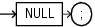

## 13.44 NULL Statement

The `NULL` statement is a ''no-op" (no operation)—it only passes control to the next statement.

**Note:**

The `NULL` statement and the `BOOLEAN` value `NULL` are not related.

### Topics

- Syntax

- Examples

- Related Topics

### Syntax

### null_statement ::=

[Description of the illustration null_statement.eps](img_text/null_statement.md)

### Examples

- [Example 4-31](sequential-control-statements.md), "GOTO Statement Goes to Labeled NULL Statement"

- [Example 4-34](sequential-control-statements.md), "NULL Statement Showing No Action"

- [Example 4-35](sequential-control-statements.md), "NULL Statement as Placeholder During Subprogram Creation"

### Related Topics

- "[NULL Statement](sequential-control-statements.md)"
