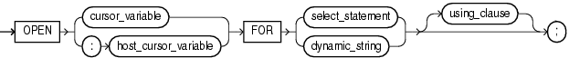
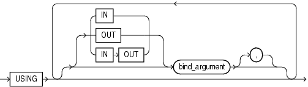

## 13.46 OPEN FOR Statement

The `OPEN` `FOR` statement associates a cursor variable with a query, allocates database resources to process the query, identifies the result set, and positions the cursor before the first row of the result set.

If the query has a `FOR` `UPDATE` clause, then the `OPEN` `FOR` statement locks the rows of the result set.

### Topics

- Syntax

- Semantics

- Examples

- Related Topics

### Syntax

### open_for_statement ::=

[Description of the illustration open_for_statement.eps](img_text/open_for_statement.md)

### using_clause ::=

[Description of the illustration using_clause.eps](img_text/using_clause.md)

### Semantics

### open_for_statement

cursor_variable

Name of a cursor variable. If `cursor_variable` is the formal parameter of a subprogram, then it must not have a return type. For information about cursor variables as subprogram parameters, see "[Cursor Variables as Subprogram Parameters](cursor-variables.md)".

:host_cursor_variable

Name of a cursor variable that was declared in a PL/SQL host environment and passed to PL/SQL as a bind variable. Do not put space between the colon (:) and `host_cursor_variable`.

The data type of a host cursor variable is compatible with the return type of any PL/SQL cursor variable.

select_statement

SQL `SELECT` statement (not a PL/SQL `SELECT` `INTO` statement). Typically, `select_statement` returns multiple rows.

**See:**

[Oracle Database SQL Language Reference](../sqlrf/SELECT.md) for `SELECT` statement syntax

dynamic_string

String literal, string variable, or string expression of the data type `CHAR`, `VARCHAR2`, or `CLOB`, which represents a SQL `SELECT` statement. Typically, `dynamic_statement` represents a SQL `SELECT` statement that returns multiple rows.

### using_clause

Specifies bind variables, using positional notation.

**Note:**

If you repeat placeholder names in `dynamic_sql_statement`, be aware that the way placeholders are associated with bind variables depends on the kind of dynamic SQL statement. For details, see "[Repeated Placeholder Names in Dynamic SQL Statements](native-dynamic-sql.md)."

Restriction on using_clause

Use if and only if `select_statement` or `dynamic_sql_stmt` includes placeholders for bind variables.

IN, OUT, IN OUT

Parameter modes of bind variables. An `IN` bind variable passes its value to the `select_statement` or `dynamic_string`. An `OUT` bind variable stores a value that `dynamic_string` returns. An `IN` `OUT` bind variable passes its initial value to `dynamic_string` and stores a value that `dynamic_string` returns. Default: `IN`.

bind_argument

Expression whose value replaces its corresponding placeholder in `select_statement` or `dynamic_string` at run time. You must specify a `bind_argument` for every placeholder.

**Note:**

Bind variables can be evaluated in any order. If a program determines order of evaluation, then at the point where the program does so, its behavior is undefined.

Restrictions on bind_argument

- `bind_argument` cannot be an associative array indexed by string.

- `bind_argument` cannot be the reserved word `NULL`.

  To pass the value `NULL` to the dynamic SQL statement, use an uninitialized variable where you want to use `NULL`, as in [Example 7-7](native-dynamic-sql.md).

### Examples

- [Example 6-26](cursor-variables.md), "Fetching Data with Cursor Variables"

- [Example 6-30](cursor-variables.md), "Querying a Collection with Static SQL"

- [Example 6-31](cursor-variables.md), "Procedure to Open Cursor Variable for One Query"

- [Example 6-32](cursor-variables.md), "Opening Cursor Variable for Chosen Query (Same Return Type)"

- [Example 6-33](cursor-variables.md), "Opening Cursor Variable for Chosen Query (Different Return Types)"

- [Example 7-8](native-dynamic-sql.md), "Native Dynamic SQL with OPEN FOR, FETCH, and CLOSE Statements"

- [Example 7-9](native-dynamic-sql.md), "Querying a Collection with Native Dynamic SQL"

### Related Topics

In this chapter:

- "[CLOSE Statement](CLOSE-statement.md)"

- "[Cursor Variable Declaration](cursor-variable-declaration.md)"

- "[EXECUTE IMMEDIATE Statement](EXECUTE-IMMEDIATE-statement.md)"

- "[FETCH Statement](FETCH-statement.md)"

- "[OPEN Statement](OPEN-statement.md)"

In other chapters:

- "[Opening and Closing Cursor Variables](cursor-variables.md)"

- "[OPEN FOR, FETCH, and CLOSE Statements](native-dynamic-sql.md)"
