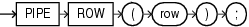

## 13.48 PIPE ROW Statement

The `PIPE` `ROW` statement, which can appear only in the body of a pipelined table function, returns a table row (but not control) to the invoker of the function.

**Note:**

- If a pipelined table function is part of an autonomous transaction, then it must `COMMIT` or `ROLLBACK` before each `PIPE` `ROW` statement, to avoid an error in the invoking subprogram.

- To improve performance, the PL/SQL runtime system delivers the piped rows to the invoker in batches.

### Topics

- Syntax

- Semantics

- Examples

- Related Topics

### Syntax

### pipe_row_statement ::=

[Description of the illustration pipe_row_statement.eps](img_text/pipe_row_statement.md)

### Semantics

### pipe_row_statement

row

Row (table element) that the function returns to its invoker, represented by an expression whose type is that of the table element.

If the expression is a record variable, it must be explicitly declared with the data type of the table element. It cannot be declared with a data type that is only structurally identical to the element type. For example, if the element type has a name, then the record variable cannot be declared explicitly with `%TYPE` or `%ROWTYPE` or implicitly with `%ROWTYPE` in a cursor `FOR` `LOOP` statement.

### Examples

- [Example 12-29](chaining-pipelined-table-functions-multiple-transformations.md), "Creating and Invoking Pipelined Table Function"

- [Example 12-30](chaining-pipelined-table-functions-multiple-transformations.md), "Pipelined Table Function Transforms Each Row to Two Rows"

- [Example 12-32](chaining-pipelined-table-functions-multiple-transformations.md), "Pipelined Table Function with Two Cursor Variable Parameters"

- [Example 12-33](chaining-pipelined-table-functions-multiple-transformations.md), "Pipelined Table Function as Aggregate Function"

- [Example 12-34](chaining-pipelined-table-functions-multiple-transformations.md), "Pipelined Table Function Does Not Handle NO_DATA_NEEDED"

- [Example 12-35](chaining-pipelined-table-functions-multiple-transformations.md), "Pipelined Table Function Handles NO_DATA_NEEDED"

### Related Topics

In this chapter:

- "[Function Declaration and Definition](function-declaration-and-definition.md)"

In other chapters:

- "[Creating Pipelined Table Functions](chaining-pipelined-table-functions-multiple-transformations.md)"
