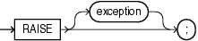

## 13.51 RAISE Statement

The `RAISE` statement explicitly raises an exception.

Outside an exception handler, you must specify the exception name. Inside an exception handler, if you omit the exception name, the `RAISE` statement reraises the current exception.

### Topics

- Syntax

- Semantics

- Examples

- Related Topics

### Syntax

### raise_statement ::=

[Description of the illustration raise_statement.eps](img_text/raise_statement.md)

### Semantics

exception

Name of an exception, either predefined (see [Table 11-3](predefined-exceptions.md)) or user-declared (see "[Exception Declaration](exception-declaration.md)").

`exception` is optional only in an exception handler, where the default is the current exception (see "[Reraising Current Exception with RAISE Statement](raising-exceptions-explicitly.md)").

### Examples

- [Example 11-10](raising-exceptions-explicitly.md), "Declaring, Raising, and Handling User-Defined Exception"

- [Example 11-11](raising-exceptions-explicitly.md), "Explicitly Raising Predefined Exception"

- [Example 11-12](raising-exceptions-explicitly.md), "Reraising Exception"

### Related Topics

In this chapter:

- "[Exception Declaration](exception-declaration.md)"

- "[Exception Handler](exception-handler.md)"

In other chapters:

- "[Raising Exceptions Explicitly](raising-exceptions-explicitly.md)"
