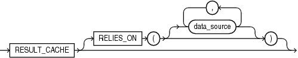

## 13.56 RESULT_CACHE Clause

Indicates to store the function results into the server result cache.

The `RESULT_CACHE` clause can appear in the following SQL statements:

- [CREATE FUNCTION Statement](CREATE-FUNCTION-statement.md)

- [CREATE TYPE BODY Statement](CREATE-TYPE-BODY-statement.md)

### Topics

- Syntax

- Semantics

- Examples

- Related Topics

### Syntax

### result_cache_clause ::=

[Description of the illustration result_cache_clause.eps](img_text/result_cache_clause.md)

### Semantics

### result_cache_clause

result_cache_clause can appear only once in the function.

### RESULT_CACHE

To make a function result-cached, include the RESULT_CACHE clause in the function definition. If you declare the function before defining it, you must also include the RESULT_CACHE option in the function declaration.

### Restriction on RESULT_CACHE

- `RESULT_CACHE` is disallowed on functions with `OUT` or `IN` `OUT` parameters.

- `RESULT_CACHE` is disallowed on functions with `IN` or `RETURN` parameter of (or containing) these types:

  - `BLOB`

  - `CLOB`

  - `NCLOB`

  - `REF` `CURSOR`

  - Collection

  - Object

  - Record or PL/SQL collection that contains an unsupported return type

- `RESULT_CACHE` is disallowed on function in an anonymous block.

- `RESULT_CACHE` is disallowed on pipelined table function and nested function.

### RELIES_ON

Specifies the data sources on which the results of the function depend. Each `data_source` is the name of either a database table or view.

**Note:**

- This clause is deprecated. As of Oracle Database 12c, the database detects all data sources that are queried while a result-cached function is running, and `RELIES_ON` clause does nothing.

- You cannot use `RELIES_ON` clause in a function declared in an anonymous block.

### Examples

- [Examples of Result-Cached Functions](pl-sql-function-result-cache.md)

### Related Topics

In this chapter:

- [Function Declaration and Definition](function-declaration-and-definition.md)

In other chapters:

- [PL/SQL Function Result Cache](pl-sql-function-result-cache.md)

In other books:

- [Oracle Database Performance Tuning Guide](../tgdba/tuning-result-cache.md)
