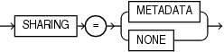

## 13.61 SHARING Clause

This clause applies only when creating an object in an application root. This type of object is called an application common object and it can be shared with the application PDBs that belong to the application root. The `SHARING` clause may only appear in the declarations of libraries, standalone object types, packages, and standalone subprograms in this context.

The `SHARING` clause can only appear in the context of creating an application common object with the following SQL statements:

- [CREATE FUNCTION Statement](CREATE-FUNCTION-statement.md)

- [CREATE LIBRARY Statement](CREATE-LIBRARY-statement.md)

- [CREATE PROCEDURE Statement](CREATE-PROCEDURE-statement.md)

- [CREATE PACKAGE Statement](CREATE-PACKAGE-statement.md)

- [CREATE TRIGGER Statement](CREATE-TRIGGER-statement.md)

- [CREATE TYPE Statement](CREATE-TYPE-statement.md)

### Topics

- Syntax

- Semantics

- Related Topics

### Syntax

### sharing_clause ::=

[Description of the illustration sharing_clause.eps](img_text/sharing_clause.md)

### Semantics

### sharing_clause

Specifies how the object is shared using one of the following sharing attributes:

- `METADATA` - A metadata link shares the metadata, but its data is unique to each container. This type of object is referred to as a metadata-linked application common object.

- `NONE` - The object is not shared.

If you omit this clause during an application operation, then the database uses the value of the `DEFAULT_SHARING` initialization parameter to determine the sharing attribute of the object. If the `DEFAULT_SHARING` initialization parameter does not have a value, then the default is `METADATA`.

### Restrictions on `SHARING` clause

The sharing clause may only appear during an application installation, upgrade or patch in an application root. You must issue an` ALTER PLUGGABLE DATABASE APPLICATION ... BEGIN` statement to start the operation and an `ALTER PLUGGABLE DATABASE APPLICATION ... END` statement to end the operation. The sharing_clause is illegal outside this context and this implies the object is not shared.

You cannot change the sharing attribute of an object after it is created.

### Related Topics

In other books:

- [Oracle Database Concepts](../multi/overview-of-the-multitenant-architecture.md) for more information about application maintenance

- [Oracle Database Concepts](../multi/overview-of-the-multitenant-architecture.md) for an example of patching an application using the automated technique

- [Oracle Database Reference](../refrn/DEFAULT_SHARING.md) for more information on the `DEFAULT_SHARING` initialization parameter

- [Oracle Database Administrator’s Guide](../multi/administering-application-containers-with-sql-plus.md) for complete information on creating application common objects
