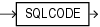

## 13.62 SQLCODE Function

In an exception handler, the `SQLCODE` function returns the numeric code of the exception being handled. (Outside an exception handler, `SQLCODE` returns `0`.)

For an internally defined exception, the numeric code is the number of the associated Oracle Database error. This number is negative except for the error "no data found", whose numeric code is +100.

For a user-defined exception, the numeric code is either +1 (default) or the error code associated with the exception by the `EXCEPTION_INIT` pragma.

A SQL statement cannot invoke `SQLCODE`.

If a function invokes `SQLCODE`, and you use the `RESTRICT_REFERENCES` pragma to assert the purity of the function, then you cannot specify the constraints `WNPS` and `RNPS`.

### Topics

- Syntax

- Examples

- Related Topics

### Syntax

### sqlcode_function ::=

[Description of the illustration sqlcode_function.eps](img_text/sqlcode_function.md)

### Examples

- [Example 11-23](retrieving-error-code-and-error-message.md), "Displaying SQLCODE and SQLERRM Values"

### Related Topics

In this chapter:

- "[Block](block.md)"

- "[EXCEPTION_INIT Pragma](EXCEPTION_INIT-pragma.md)"

- "[Exception Handler](exception-handler.md)"

- "[RESTRICT_REFERENCES Pragma](RESTRICT_REFERENCES-pragma.md)"

- "[SQLERRM Function](SQLERRM-function.md)"

In other chapters:

- "[Retrieving Error Code and Error Message](retrieving-error-code-and-error-message.md)"

**See Also:**

[Oracle Database Error Messages Reference](../errmg/ORA-00000.md) for a list of Oracle Database error messages and information about them, including their numbers
