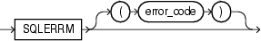

## 13.63 SQLERRM Function

The `SQLERRM` function returns the error message associated with an error code.

**Note:**

The language of the error message depends on the `NLS_LANGUAGE` parameter. For information about this parameter, see [Oracle Database Globalization Support Guide](../nlspg/setting-up-globalization-support-environment.md).

A SQL statement cannot invoke `SQLERRM`.

If a function invokes `SQLERRM`, and you use the `RESTRICT_REFERENCES` pragma to assert the purity of the function, then you cannot specify the constraints `WNPS` and `RNPS`.

**Note:**

`DBMS_UTILITY`.`FORMAT_ERROR_STACK` is recommended over `SQLERRM`, unless you use the `FORALL` statement with its `SAVE` `EXCEPTIONS` clause. For more information, see "[Retrieving Error Code and Error Message](retrieving-error-code-and-error-message.md)".

### Topics

- Syntax

- Semantics

- Examples

- Related Topics

### Syntax

### sqlerrm_function ::=

[Description of the illustration sqlerrm_function.eps](img_text/sqlerrm_function.md)

### Semantics

### sqlerrm_function

error_code

Expression whose value is an Oracle Database error code.

Default: error code associated with the current value of `SQLCODE`.

Like `SQLCODE`, `SQLERRM` without `error_code` is useful only in an exception handler. Outside an exception handler, or if the value of `error_code` is zero, `SQLERRM` returns ORA-0000.

If the value of `error_code` is +100, `SQLERRM` returns ORA-01403.

If the value of `error_code` is a positive number other than +100, `SQLERRM` returns this message:

    -error_code: non-ORACLE exception

If the value of `error_code` is a negative number whose absolute value is an Oracle Database error code, `SQLERRM` returns the error message associated with that error code. For example:

    BEGIN
      DBMS_OUTPUT.PUT_LINE('SQLERRM(-6511): ' || TO_CHAR(SQLERRM(-6511)));
    END;
    /

Result:

    SQLERRM(-6511): ORA-06511: PL/SQL: cursor already open

If the value of `error_code` is a negative number whose absolute value is not an Oracle Database error code, `SQLERRM` returns this message:

    ORA-error_code: Message error_code not found; product=RDBMS;
    facility=ORA

For example:

    BEGIN
      DBMS_OUTPUT.PUT_LINE('SQLERRM(-50000): ' || TO_CHAR(SQLERRM(-50000)));
    END;
    /

Result:

    SQLERRM(-50000): ORA-50000: Message 50000 not found; product=RDBMS;
    facility=ORA

### Examples

- [Example 11-23](retrieving-error-code-and-error-message.md), "Displaying SQLCODE and SQLERRM Values"

- [Example 12-13](bulk-sql-and-bulk-binding.md), "Handling FORALL Exceptions After FORALL Statement Completes"

- [Example 12-13](bulk-sql-and-bulk-binding.md), "Handling FORALL Exceptions After FORALL Statement Completes"

### Related Topics

In this chapter:

- "[Block](block.md)"

- "[EXCEPTION_INIT Pragma](EXCEPTION_INIT-pragma.md)"

- "[RESTRICT_REFERENCES Pragma](RESTRICT_REFERENCES-pragma.md)"

- "[SQLCODE Function](SQLCODE-function.md)"

In other chapters:

- "[Retrieving Error Code and Error Message](retrieving-error-code-and-error-message.md)"

**See Also:**

[Oracle Database Error Messages Reference](../errmg/ORA-00000.md) for a list of Oracle Database error messages and information about them
