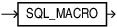

## 13.64 SQL_MACRO Clause

The `SQL_MACRO` clause marks a function as a SQL macro which can be used in a table expression.

A SQL macro referenced in a view is always executed with the view owner's privileges.

The `AUTHID` property cannot be specified. When a SQL macro is invoked, the function body executes with definer's rights to construct the text to return. The resulting expression is evaluated with invoker's rights. The SQL macro owner must grant inherit privileges to the invoking function.

When a macro annotated function is used in PL/SQL, it works like a regular function returning character or `CLOB` type with no macro expansion.

The SQL_MACRO annotation can appear in the following SQL statement:

- [CREATE FUNCTION Statement](CREATE-FUNCTION-statement.md)

SQL Macro Usage Restrictions:

- A SQL macro can only appear in `FROM` clause of a query table expression.
- A SQL macro cannot appear in a virtual column expression, functional index, editioning view or materialized view.
- Type methods cannot be annotated with `SQL_MACRO`.

### Topics

- Syntax
- Semantics
- Examples
- Related Topics

### Syntax

### sql_macro_clause ::=

[Description of the illustration sql_macro_clause.eps](img_text/sql_macro_clause.md)

### Semantics

### sql_macro_clause

The sql_macro_clause can appear only once in the function. To make a SQL macro function, include the sql_macro_clause in the function definition. If you declare the SQL macro function before defining it, you must specify the sql_macro_clause in the function declaration.

Restrictions on sql_macro_clause

The `SQL_MACRO` annotation is disallowed with `RESULT_CACHE`, `PARALLEL_ENABLE`, and `PIPELINED`. Although the `DETERMINISTIC` property cannot be specified, a SQL macro is always implicitly deterministic.

The SQL macro function must have a return type of `VARCHAR2`, `CHAR`, or `CLOB`.

### Examples

Example 13-22 Budget : Using a SQL Macro in a Table Expression

This example shows the SQL macro named budget used in a table expression to return the total salary in each department for employees for a given job title.

    CREATE FUNCTION budget(job VARCHAR2) RETURN VARCHAR2 SQL_MACRO IS
    BEGIN
       RETURN q'{SELECT deptno, SUM(sal) budget
                 FROM scott.emp
                 WHERE job = budget.job
                 GROUP BY deptno}';
    END;
    /

This query shows the SQL macro budget used in a table expression.

    SELECT * FROM budget('MANAGER');

Result:

    DEPTNO     BUDGET
    ---------- ----------
            20       2975
            30       2850
            10       2450

Example 13-23 Take: Using a Table Macro with a Polymorphic View

This example creates a table macro named take which returns the first n rows from table t.

    CREATE FUNCTION take (n NUMBER, t DBMS_TF.TABLE_T)
                          RETURN VARCHAR2 SQL_MACRO IS
    BEGIN
       RETURN 'SELECT * FROM t FETCH FIRST take.n ROWS ONLY';
    END;
    /

The query returns the first two rows from table dept.

    SELECT * FROM take(2, dept);

Result:

        DEPTNO DNAME          LOC
    ---------- -------------- -------------
            10 ACCOUNTING     NEW YORK
            20 RESEARCH       DALLAS

You can use SQL Macros with bind variables and more complex SQL constructs.

    VAR row_count NUMBER;
    EXEC :row_count := 5

    WITH t AS (SELECT * FROM emp NATURAL JOIN dept ORDER BY ename)
    SELECT ename, dname FROM take(:row_count, t);

Result:

    ENAME      DNAME
    ---------- --------------
    ADAMS      RESEARCH
    ALLEN      SALES
    BLAKE      SALES
    CLARK      ACCOUNTING
    FORD       RESEARCH

### Related Topics

- [Overview of Polymorphic Table Functions](overview-polymorphic-table-functions.md)

- [Oracle Database PL/SQL Packages and Types Reference](../arpls/DBMS_TF.md) for more information about how to specify the PTF implementation package and use the `DBMS_TF` utilities
