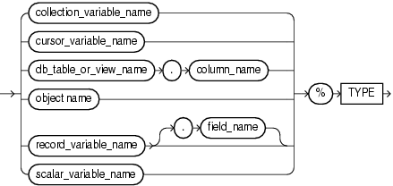

## 13.65 %TYPE Attribute

The `%TYPE` attribute lets you declare a constant, variable, collection element, record field, or subprogram parameter to be of the same data type as a previously declared variable or column (without knowing what that type is).

The `%TYPE` attribute cannot be used if the referenced character column has a collation other than `USING_NLS_COMP`.

The item declared with `%TYPE` is the referencing item, and the previously declared item is the referenced item.

The referencing item inherits the following from the referenced item:

- Data type and size

- Constraints (unless the referenced item is a column)

The referencing item does not inherit the initial value of the referenced item.

If the declaration of the referenced item changes, then the declaration of the referencing item changes accordingly.

### Topics

- Syntax

- Semantics

- Examples

- Related Topics

### Syntax

### type_attribute ::=

[Description of the illustration type_attribute.eps](img_text/type_attribute.md)

### Semantics

### type_attribute

collection_variable_name

Name of a collection variable.

Restriction on collection_variable_name

In a constant declaration, `collection_variable` cannot be an associative array variable.

cursor_variable_name

Name of a cursor variable.

db_table_or_view_name

Name of a database table or view that is accessible when the declaration is elaborated.

column_name

Name of a column of `db_table_or_view`.

object_name

Name of an instance of an ADT.

record_variable_name

Name of a record variable.

field_name

Name of a field of `record_variable`.

scalar_variable_name

Name of a scalar variable.

### Examples

- [Example 2-15](declarations.md), "Declaring Variable of Same Type as Column"

- [Example 2-16](declarations.md), "Declaring Variable of Same Type as Another Variable"

### Related Topics

In this chapter:

- "[Constant Declaration](constant-declaration.md)"

- "[%ROWTYPE Attribute](ROWTYPE-attribute.md)"

- "[Scalar Variable Declaration](scalar-variable-declaration.md)"

In other chapters:

- [About Data-Bound Collation](character-sets.md)

- "[Declaring Items using the %TYPE Attribute](declarations.md)"
