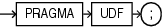

## 13.66 UDF Pragma

The `UDF` pragma tells the compiler that the PL/SQL unit is a user defined function that is used primarily in SQL statements, which might improve its performance.

### Syntax

### udf_pragma ::=

[Description of the illustration udf_pragma.eps](img_text/udf_pragma.md)
