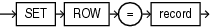
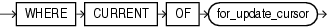

## 13.67 UPDATE Statement Extensions

PL/SQL extends the `update_set_clause` and `where_clause` of the SQL `UPDATE` statement as follows:

- In the `update_set_clause`, you can specify a record. For each selected row, the `UPDATE` statement updates each column with the value of the corresponding record field.

- In the `where_clause`, you can specify a `CURRENT` `OF` clause, which restricts the `UPDATE` statement to the current row of the specified cursor.

**See Also:**

[Oracle Database SQL Language Reference](../sqlrf/UPDATE.md) for the syntax of the SQL `UPDATE` statement

### Topics

- Syntax

- Semantics

- Examples

- Related Topics

### Syntax

### update_set_clause ::=

[Description of the illustration update_set_clause.eps](img_text/update_set_clause.md)

### where_clause ::=

[Description of the illustration where_clause.eps](img_text/where_clause.md)

### Semantics

### update_set_clause

record

Name of a record variable that represents a row of the item described by `dml_table_expression_clause`. That is, for every column of the row, the record must have a field with a compatible data type. If a column has a `NOT` `NULL` constraint, then its corresponding field cannot have a `NULL` value.

### where_clause

for_update_cursor

Name of a `FOR` `UPDATE` cursor; that is, an explicit cursor associated with a `FOR` `SELECT` `UPDATE` statement.

### Examples

- [Example 5-55](updating-rows-records.md), "Updating Rows with Records"

### Related Topics

In this chapter:

- "[Explicit Cursor Declaration and Definition](explicit-cursor-declaration-and-definition.md)"

- "[Record Variable Declaration](record-variable-declaration.md)"

- "[%ROWTYPE Attribute](ROWTYPE-attribute.md)"

In other chapters:

- "[Updating Rows with Records](updating-rows-records.md)"

- "[Restrictions on Record Inserts and Updates](restrictions-record-inserts-and-updates.md)"

- "[SELECT FOR UPDATE and FOR UPDATE Cursors](transaction-processing-and-control.md)"
