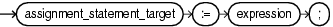
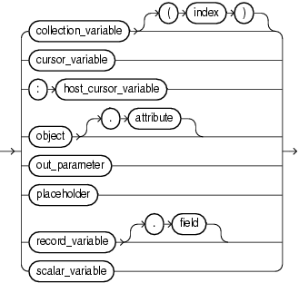
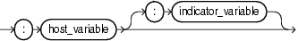

## 13.3 Assignment Statement

The assignment statement sets the value of a data item to a valid value.

### Topics

- Syntax

- Semantics

- Examples

- Related Topics

### Syntax

### assignment_statement ::=

[Description of the illustration assignment_statement.eps](img_text/assignment_statement.md)

([expression ::=](expression.md))

### assignment_statement_target ::=

[Description of the illustration assignment_statement_target.eps](img_text/assignment_statement_target.md)

### placeholder ::=

[Description of the illustration placeholder.eps](img_text/placeholder.md)

### Semantics

### assignment_statement

expression

Expression whose value is to be assigned to `assignment_statement_target`.

`expression` and `assignment_statement_target` must have compatible data types.

**Note:**

Collections with elements of the same type might not have the same data type. For the syntax of collection type definitions, see "[Collection Variable Declaration](collection-variable.md)".

### assignment_statement_target

Data item to which the value of `expression` is to be assigned.

collection_variable

Name of a collection variable.

index

Index of an element of `collection_variable`. Without `index`, the entire collection variable is the assignment statement target.

`index` must be a numeric expression whose data type either is `PLS_INTEGER` or can be implicitly converted to `PLS_INTEGER` (for information about the latter, see "[Predefined PLS_INTEGER Subtypes](pls_integer-and-binary_integer-data-types.md)").

cursor_variable

Name of a cursor variable.

:host_cursor_variable

Name of a cursor variable declared in a PL/SQL host environment and passed to PL/SQL as a bind variable. Do not put space between the colon (:) and `host_cursor_variable`.

The data type of a host cursor variable is compatible with the return type of any PL/SQL cursor variable.

object

Name of an instance of an abstract data type (ADT).

attribute

Name of an attribute of `object`. Without `attribute`, the entire ADT is the assignment statement target.

out_parameter

Name of a formal `OUT` or `IN` `OUT` parameter of the subprogram in which the assignment statement appears.

record_variable

Name of a record variable.

field

Name of a field of `record_variable`. Without `field`, the entire record variable is the assignment statement target.

scalar_variable

Name of a PL/SQL scalar variable.

### placeholder

:host_variable

Name of a variable declared in a PL/SQL host environment and passed to PL/SQL as a bind variable. Do not put space between the colon (:) and `host_variable`.

:indicator_variable

Name of an indicator variable declared in a PL/SQL host environment and passed to PL/SQL as a bind variable. (An indicator variable indicates the value or condition of its associated host variable. For example, in the Oracle Precompiler environment, an indicator variable can a detect null or truncated value in an output host variable.) Do not put space between `host_variable` and the colon (:) or between the colon and `indicator_variable`. This is correct:

    :host_variable:indicator_variable

### Examples

- [Example 2-24](assigning-values-variables.md), "Assigning Values to Variables with Assignment Statement"

- [Example 2-27](assigning-values-variables.md), "Assigning Value to BOOLEAN Variable"

- [Example 5-10](assigning-values-collection-variables.md), "Data Type Compatibility for Collection Assignment"

### Related Topics

In this chapter:

- "[Expression](expression.md)"

- "[FETCH Statement](FETCH-statement.md)"

- "[SELECT INTO Statement](SELECT-INTO-statement.md)"

In other chapters:

- "[Assigning Values to Variables](assigning-values-variables.md)"

- "[Assigning Values to Collection Variables](assigning-values-collection-variables.md)"

- "[Assigning Values to Record Variables](assigning-values-record-variables.md)"
