## 13.6 Block

The block, which groups related declarations and statements, is the basic unit of a PL/SQL source program.

It has an optional declarative part, a required executable part, and an optional exception-handling part. Declarations are local to the block and cease to exist when the block completes execution. Blocks can be nested.

An anonymous block is an executable statement.

### Topics

- Syntax

- Semantics

- Examples

- Related Topics

### Syntax

### plsql_block ::=

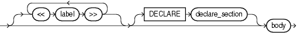
[Description of the illustration plsql_block.eps](img_text/plsql_block.md)

(body ::=)

### declare_section ::=

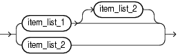
[Description of the illustration declare_section.eps](img_text/declare_section.md)

(item_list_2 ::=)

### item_list_1 ::=

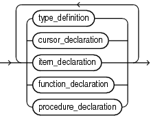
[Description of the illustration item_list_1.eps](img_text/item_list_1.md)

([cursor_declaration ::=](explicit-cursor-declaration-and-definition.md), [function_declaration ::=](function-declaration-and-definition.md), item_declaration ::=, [procedure_declaration ::=](procedure-declaration-and-definition.md), type_definition ::=)

### item_list_2 ::=

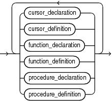
[Description of the illustration item_list_2.eps](img_text/item_list_2.md)

([cursor_declaration ::=](explicit-cursor-declaration-and-definition.md), [cursor_definition ::=](explicit-cursor-declaration-and-definition.md), [function_declaration ::=](function-declaration-and-definition.md), [function_definition ::=](function-declaration-and-definition.md), [procedure_declaration ::=](procedure-declaration-and-definition.md), [procedure_definition ::=](procedure-declaration-and-definition.md))

### type_definition ::=

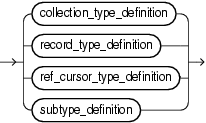
[Description of the illustration type_definition.eps](img_text/type_definition.md)

([collection_type_definition ::=](collection-variable.md), [record_type_definition ::=](record-variable-declaration.md), [ref_cursor_type_definition ::=](cursor-variable-declaration.md), subtype_definition ::=)

### subtype_definition ::=

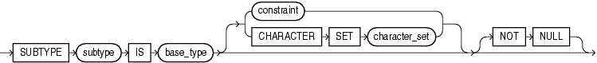
[Description of the illustration subtype_definition.eps](img_text/subtype_definition.md)

### constraint ::=

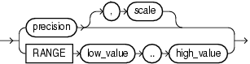
[Description of the illustration constraint.eps](img_text/constraint.md)

### item_declaration ::=

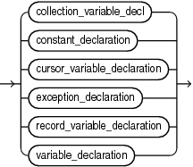
[Description of the illustration item_declaration.eps](img_text/item_declaration.md)

([collection_variable_decl ::=](collection-variable.md), [constant_declaration ::=](constant-declaration.md), [cursor_declaration ::=](explicit-cursor-declaration-and-definition.md), [cursor_variable_declaration ::=](cursor-variable-declaration.md), [exception_declaration ::=](exception-declaration.md), [record_variable_declaration ::=](record-variable-declaration.md), [variable_declaration ::=](scalar-variable-declaration.md))

### body ::=

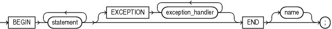
[Description of the illustration body.eps](img_text/body.md)

([exception_handler ::=](exception-handler.md))

### statement ::=

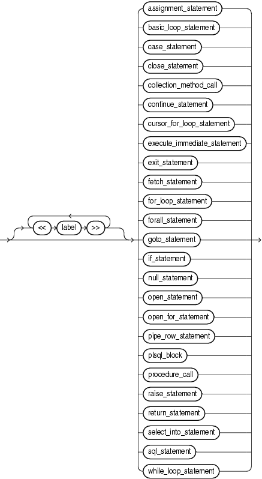
[Description of the illustration statement.eps](img_text/statement.md)

(plsql_block ::=, procedure_call ::=, sql_statement ::=)

### procedure_call ::=

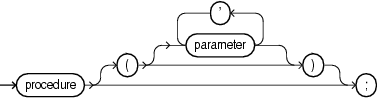
[Description of the illustration procedure_call.eps](img_text/procedure_call.md)

### sql_statement ::=

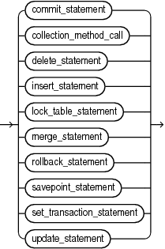
[Description of the illustration sql_statement.eps](img_text/sql_statement.md)

### Semantics

### plsql_block

label

Undeclared identifier, unique for the block.

DECLARE

Starts the declarative part of the block.

### declare_section

Contains local declarations, which exist only in the block and its sub-blocks and are not visible to enclosing blocks.

Restrictions on declare_section

- A `declare_section` in `create_package`, `create_package_body`, or `compound_trigger_block` cannot include `PRAGMA` `AUTONOMOUS_TRANSACTION`.

- A `declare_section` in `trigger_body` or `tps_body` cannot declare variables of the data type `LONG` or `LONG` `RAW`.

**See Also:**

- "[CREATE PACKAGE Statement](CREATE-PACKAGE-statement.md)" for more information about `create_package`

- "[CREATE PACKAGE BODY Statement](CREATE-PACKAGE-BODY-statement.md)" for more information about `create_package_body`

- "[CREATE TRIGGER Statement](CREATE-TRIGGER-statement.md)" for more information about `compound_trigger_block`, `trigger_body`, and `tps_body`

### subtype_definition

Static expressions can be used in subtype declarations. See [Static Expressions](expressions.md) for more information.

### subtype

Name of the user-defined subtype that you are defining.

base_type

Base type of the subtype that you are defining. `base_type` can be any scalar or user-defined PL/SQL datatype specifier such as `CHAR`, `DATE`, or `RECORD`.

CHARACTER SET character_set

Specifies the character set for a subtype of a character data type.

Restriction on CHARACTER SET character_set

Do not specify this clause if `base_type` is not a character data type.

NOT NULL

Imposes the `NOT` `NULL` constraint on data items declared with this subtype. For information about this constraint, see "[NOT NULL Constraint](declarations.md)".

constraint

Specifies a constraint for a subtype of a numeric data type.

Restriction on constraint

Do not specify `constraint` if `base_type` is not a numeric data type.

precision

Specifies the precision for a constrained subtype of a numeric data type.

Restriction on precision

Do not specify `precision` if `base_type` cannot specify precision.

scale

Specifies the scale for a constrained subtype of a numeric data type.

Restriction on scale

Do not specify `scale` if `base_type` cannot specify scale.

RANGE low_value .. high_value

Specifies the range for a constrained subtype of a numeric data type. The `low_value` and `high_value` must be numeric literals.

Restriction on RANGE high_value .. low_value

Specify this clause only if `base_type` is `PLS_INTEGER` or a subtype of `PLS_INTEGER` (either predefined or user-defined). (For a summary of the predefined subtypes of `PLS_INTEGER`, see [Table 3-3](pls_integer-and-binary_integer-data-types.md). For information about user-defined subtypes with ranges, see "[Constrained Subtypes](user-defined-pl-sql-subtypes.md)".)

### body

BEGIN

Starts the executable part of the block, which contains executable statements.

EXCEPTION

Starts the exception-handling part of the block. When PL/SQL raises an exception, normal execution of the block stops and control transfers to the appropriate `exception_handler`. After the exception handler completes, execution resumes with the statement following the block. For more information about exception-handling, see [PL/SQL Error Handling](plsql-error-handling.md).

exception_handler

See "[Exception Handler](exception-handler.md)".

END

Ends the block.

name

The name of the block to which `END` applies—a label, function name, procedure name, or package name.

### statement

### label

Undeclared identifier, unique for the statement.

assignment_statement

See "[Assignment Statement](assignment-statement.md)".

basic_loop_statement

See "[Basic LOOP Statement](basic-LOOP-statement.md)".

case_statement

See "[CASE Statement](CASE-statement.md)".

close_statement

See "[CLOSE Statement](CLOSE-statement.md)".

collection_method_call

Invocation of one of these collection methods, which are procedures:

- `DELETE`

- `EXTEND`

- `TRIM`

For syntax, see "[Collection Method Invocation](collection-method.md)".

continue_statement

See "[CONTINUE Statement](CONTINUE-statement.md)".

cursor_for_loop_statement

See "[Cursor FOR LOOP Statement](cursor-FOR-LOOP-statement.md)".

execute_immediate_statement

See "[EXECUTE IMMEDIATE Statement](EXECUTE-IMMEDIATE-statement.md)".

exit_statement

See "[EXIT Statement](EXIT-statement.md)".

fetch_statement

See "[FETCH Statement](FETCH-statement.md)".

for_loop_statement

See "[FOR LOOP Statement](FOR-LOOP-statement.md)".

forall_statement

See "[FORALL Statement](FORALL-statement.md)".

goto_statement

See "[GOTO Statement](GOTO-statement.md)".

if_statement

See "[IF Statement](IF-statement.md)".

null_statement

See "[NULL Statement](NULL-statement.md)".

open_statement

See "[OPEN Statement](OPEN-statement.md)".

open_for_statement

See "[OPEN FOR Statement](OPEN-FOR-statement.md)".

pipe_row_statement

See "[PIPE ROW Statement](PIPE-ROW-statement.md)".

Restriction on pipe_row_statement

This statement can appear only in the body of a pipelined table function; otherwise, PL/SQL raises an exception.

raise_statement

See "[RAISE Statement](RAISE-statement.md)".

return_statement

See "[RETURN Statement](RETURN-statement.md)".

select_into_statement

See "[SELECT INTO Statement](SELECT-INTO-statement.md)".

while_loop_statement

See "[WHILE LOOP Statement](WHILE-LOOP-statement.md)".

### procedure_call

### procedure

Name of the procedure that you are invoking.

parameter \[, parameter \]...

List of actual parameters for the procedure that you are invoking. The data type of each actual parameter must be compatible with the data type of the corresponding formal parameter. The mode of the formal parameter determines what the actual parameter can be:

| Formal Parameter Mode | Actual Parameter                                                   |
|:----------------------|:-------------------------------------------------------------------|
| `IN`                  | Constant, initialized variable, literal, or expression             |
| `OUT`                 | Variable whose data type is not defined as `NOT` `NULL`            |
| `IN` `OUT`            | Variable (typically, it is a string buffer or numeric accumulator) |

If the procedure specifies a default value for a parameter, you can omit that parameter from the parameter list. If the procedure has no parameters, or specifies a default value for every parameter, you can either omit the parameter list or specify an empty parameter list.

**See Also:**

"[Positional, Named, and Mixed Notation for Actual Parameters](subprogram-parameters.md)"

### sql_statement

commit_statement

SQL `COMMIT` statement. For syntax, see [Oracle Database SQL Language Reference](../sqlrf/COMMIT.md).

delete_statement

SQL `DELETE` statement. For syntax, see [Oracle Database SQL Language Reference](../sqlrf/DELETE.md). See also "[DELETE Statement Extension](DELETE-statement-extension.md)".

insert_statement

SQL `INSERT` statement. For syntax, see [Oracle Database SQL Language Reference](../sqlrf/DELETE.md). See also "[INSERT Statement Extension](INSERT-statement-extension.md)".

lock_table_statement

SQL `LOCK` `TABLE` statement. For syntax, see [Oracle Database SQL Language Reference](../sqlrf/LOCK-TABLE.md).

merge_statement

SQL `MERGE` statement. For syntax, see [Oracle Database SQL Language Reference](../sqlrf/MERGE.md).

rollback_statement

SQL `ROLLBACK` statement. For syntax, see [Oracle Database SQL Language Reference](../sqlrf/ROLLBACK.md).

savepoint_statement

SQL `SAVEPOINT` statement. For syntax, see [Oracle Database SQL Language Reference](../sqlrf/SAVEPOINT.md).

set_transaction_statement

SQL `SET` `TRANSACTION` statement. For syntax, see [Oracle Database SQL Language Reference](../sqlrf/SET-TRANSACTION.md).

update_statement

SQL `UPDATE` statement. For syntax, see [Oracle Database SQL Language Reference](../sqlrf/UPDATE.md). See also "[UPDATE Statement Extensions](UPDATE-statement-extensions.md)".

### Examples

- [Example 1-1](main-features-pl-sql.md), "PL/SQL Block Structure"

- [Example 2-23](scope-and-visibility-identifiers.md), "Block with Multiple and Duplicate Labels"

- [Example 4-30](sequential-control-statements.md), "Incorrect Label Placement"

### Related Topics

In this chapter:

- "[Comment](comment.md)"

In other chapters:

- "[Blocks](main-features-pl-sql.md)"

- "[Identifiers](lexical-units.md)"

- "[Pragmas](lexical-units.md)"

- "[PL/SQL Data Types](plsql-data-types.md)"

- "[User-Defined PL/SQL Subtypes](user-defined-pl-sql-subtypes.md)"
