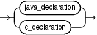
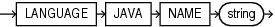
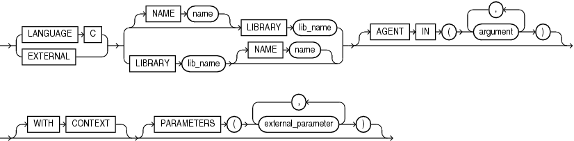
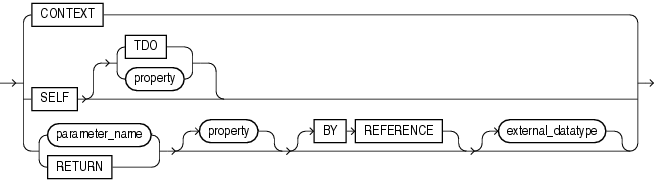
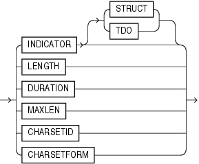

## 13.7 Call Specification

A call specification declares a Java method or a C language subprogram so that it can be invoked from PL/SQL. You can also use the SQL `CALL` statement to invoke such a method or subprogram. The call specification tells the database which Java method, or which named subprogram in which shared library, to invoke when an invocation is made. It also tells the database what type conversions to make for the arguments and return value.

A call specification can appear in the following SQL statements:

- [ALTER TYPE Statement](ALTER-TYPE-statement.md)

- [CREATE FUNCTION Statement](CREATE-FUNCTION-statement.md)

- [CREATE PROCEDURE Statement](CREATE-PROCEDURE-statement.md)

- [CREATE TYPE Statement](CREATE-TYPE-statement.md)

- [CREATE TYPE BODY Statement](CREATE-TYPE-BODY-statement.md)

### Topics

- Syntax

- Semantics

- Examples

- Related Topics

### Prerequisites

To invoke a call specification, you may need additional privileges, for example, `EXECUTE` privileges on a C library for a C call specification.

### Syntax

### call_spec ::=

[Description of the illustration call_spec.eps](img_text/call_spec.md)

### java_declaration ::=

[Description of the illustration java_declaration.eps](img_text/java_declaration.md)

### c_declaration ::=

[Description of the illustration c_declaration.eps](img_text/c_declaration.md)

### external_parameter ::=

[Description of the illustration external_parameter.eps](img_text/external_parameter.md)

### property ::=

[Description of the illustration property.eps](img_text/property.md)

### Semantics

### call_spec

Maps a C procedure or Java method name, parameter types, and return type to their SQL counterparts.

Call specifications can appear in PL/SQL standalone subprograms, package specifications and bodies, and type specifications and bodies. They cannot appear inside PL/SQL blocks.

### java_declaration

string

Identifies the Java implementation of the method.

### c_declaration

`LIBRARY` lib_name

Identifies a library created by the "[CREATE LIBRARY Statement](CREATE-LIBRARY-statement.md)".

### EXTERNAL

Deprecated way of declaring a C subprogram, supported only for backward compatibility.  Use `EXTERNAL` in a C call specification if it contains defaulted arguments or constrained PL/SQL types, otherwise use the `LANGUAGE` `C` syntax.

### Examples

Example 13-4 External Function Example

The hypothetical following statement creates a PL/SQL standalone function `get_val` that registers the C subprogram `c_get_val` as an external function. (The parameters have been omitted from this example.)

    CREATE FUNCTION get_val
       ( x_val IN NUMBER,
        y_val IN NUMBER,
        image IN LONG RAW )
       RETURN BINARY_INTEGER AS LANGUAGE C
          NAME "c_get_val"
          LIBRARY c_utils
          PARAMETERS (...);

### Related Topics

In this chapter:

- [Function Declaration and Definition](function-declaration-and-definition.md)

- [Procedure Declaration and Definition](procedure-declaration-and-definition.md)

In other chapters:

- [CREATE LIBRARY Statement](CREATE-LIBRARY-statement.md)

- [External Subprograms](external-subprograms.md)

In other books:

- [Oracle Database SQL Language Reference](../sqlrf/CALL.md) for information about the `CALL` statement

- [Oracle Database Development Guide](../adfns/coding-subprograms-and-packages.md) for information about restrictions on user-defined functions that are called from SQL statements

- [Oracle Database Java Developer's Guide](../jjdev/publishing-Java-classes.md) to learn how to write Java call specifications

- [Oracle Database Development Guide](../adfns/design_basics.md) to learn how to write C call specifications
