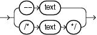

## 13.12 Comment

A comment is source program text that the PL/SQL compiler ignores. Its primary purpose is to document code, but you can also use it to disable obsolete or unfinished pieces of code (that is, you can turn the code into comments). PL/SQL has both single-line and multiline comments.

### Topics

- Syntax

- Semantics

- Examples

- Related Topics

### Syntax

### comment ::=

[Description of the illustration comment.eps](img_text/comment.md)

### Semantics

### comment

--

Turns the rest of the line into a single-line comment. Any text that wraps to the next line is not part of the comment.

**Caution:**

Do not put a single-line comment in a PL/SQL block to be processed dynamically by an Oracle Precompiler program. The Oracle Precompiler program ignores end-of-line characters, which means that a single-line comment ends when the block ends.

/\*

Begins a comment, which can span multiple lines.

\*/

Ends a comment.

text

Any text.

Restriction on text

In a multiline comment, `text` cannot include the multiline comment delimiter `/*` or `*/`. Therefore, one multiline comment cannot contain another multiline comment. However, a multiline comment can contain a single-line comment.

### Examples

- [Example 2-6](lexical-units.md), "Single-Line Comments"

- [Example 2-7](lexical-units.md), "Multiline Comments"

### Related Topics

- "[Comments](lexical-units.md)"
