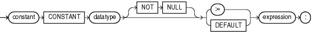

## 13.14 Constant Declaration

A constant holds a value that does not change. A constant declaration specifies the name, data type, and value of the constant and allocates storage for it. The declaration can also impose the `NOT` `NULL` constraint.

### Topics

- Syntax

- Semantics

- Examples

- Related Topics

### Syntax

### constant_declaration ::=

[Description of the illustration constant_declaration.eps](img_text/constant_declaration.md)

([datatype ::=](datatype-attribute.md), [expression ::=](expression.md))

### Semantics

### constant_declaration

constant

Name of the constant that you are declaring.

datatype

Data type for which a variable can be declared with an initial value.

NOT NULL

Imposes the `NOT` `NULL` constraint on the constant.

For information about this constraint, see "[NOT NULL Constraint](declarations.md)".

expression

Initial value for the constant. expression must have a data type that is compatible with datatype. When constant_declaration is elaborated, the value of expression is assigned to constant.

### Examples

- [Example 2-12](declarations.md), "Constant Declarations"

- [Example 2-13](declarations.md), "Variable and Constant Declarations with Initial Values"

### Related Topics

In this chapter:

- "[Collection Variable Declaration](collection-variable.md)"

- "[Record Variable Declaration](record-variable-declaration.md)"

- "[%ROWTYPE Attribute](ROWTYPE-attribute.md)"

- "[Scalar Variable Declaration](scalar-variable-declaration.md)"

- "[%TYPE Attribute](TYPE-attribute.md)"

In other chapters:

- "[Declaring Constants](declarations.md)"

- "[Declaring Associative Array Constants](associative-arrays.md)"

- "[Declaring Record Constants](record-variables.md)"
