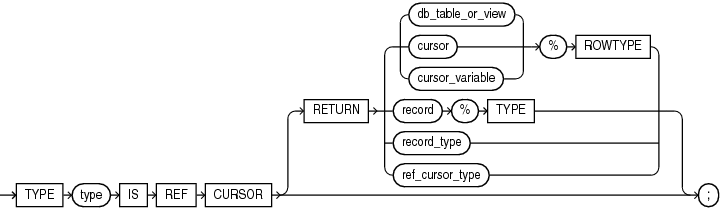
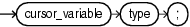

## 13.18 Cursor Variable Declaration

A cursor variable is like an explicit cursor that is not limited to one query.

To create a cursor variable, either declare a variable of the predefined type `SYS_REFCURSOR` or define a `REF` `CURSOR` type and then declare a variable of that type.

### Restrictions on Cursor Variables

- You cannot use a cursor variable in a cursor `FOR` `LOOP` statement.

- You cannot declare a cursor variable in a package specification.

  That is, a package cannot have a public cursor variable (a cursor variable that can be referenced from outside the package).

- You cannot store the value of a cursor variable in a collection or database column.

- You cannot use comparison operators to test cursor variables for equality, inequality, or nullity.

- Using a cursor variable in a server-to-server remote procedure call (RPC) causes an error. However, you can use a cursor variable in a server-to-server RPC if the remote database is a non-Oracle database accessed through a Procedural Gateway.

### Topics

- Syntax

- Semantics

- Examples

- Related Topics

### Syntax

### ref_cursor_type_definition ::=

[Description of the illustration ref_cursor_type_definition.eps](img_text/ref_cursor_type_definition.md)

### cursor_variable_declaration ::=

[Description of the illustration cursor_variable_declaration.eps](img_text/cursor_variable_declaration.md)

### Semantics

### ref_cursor_type_definition

type

Name of the `REF` `CURSOR` type that you are defining.

RETURN

Specifies the data type of the value that the cursor variable returns.

Specify `RETURN` to define a strong `REF` `CURSOR` type. Omit `RETURN` to define a weak `REF` `CURSOR` type. For information about strong and weak `REF` `CURSOR` types, see "[Creating Cursor Variables](cursor-variables.md)".

db_table_or_view

Name of a database table or view, which must be accessible when the declaration is elaborated.

cursor

Name of a previously declared explicit cursor.

cursor_variable

Name of a previously declared cursor variable.

record

Name of a user-defined record.

record_type

Name of a user-defined type that was defined with the data type specifier `RECORD`.

ref_cursor_type

Name of a user-defined type that was defined with the data type specifier `REF` `CURSOR`.

### cursor_variable_declaration

cursor_variable

Name of the cursor variable that you are declaring.

type

Type of the cursor variable that you are declaring—either `SYS_REFCURSOR` or the name of the `REF` `CURSOR` type that you defined previously.

`SYS_REFCURSOR` is a weak type. For information about strong and weak `REF` `CURSOR` types, see "[Creating Cursor Variables](cursor-variables.md)".

### Examples

- [Example 6-24](cursor-variables.md), "Cursor Variable Declarations"

- [Example 6-25](cursor-variables.md), "Cursor Variable with User-Defined Return Type"

- [Example 6-28](cursor-variables.md), "Variable in Cursor Variable Query—No Result Set Change"

- [Example 6-29](cursor-variables.md), "Variable in Cursor Variable Query—Result Set Change"

- [Example 6-30](cursor-variables.md), "Querying a Collection with Static SQL"

- [Example 6-31](cursor-variables.md), "Procedure to Open Cursor Variable for One Query"

- [Example 6-32](cursor-variables.md), "Opening Cursor Variable for Chosen Query (Same Return Type)"

- [Example 6-33](cursor-variables.md), "Opening Cursor Variable for Chosen Query (Different Return Types)"

- [Example 6-34](cursor-variables.md), "Cursor Variable as Host Variable in Pro\*C Client Program"

### Related Topics

In this chapter:

- "[CLOSE Statement](CLOSE-statement.md)"

- "[Named Cursor Attribute](named-cursor-attribute.md)"

- "[Explicit Cursor Declaration and Definition](explicit-cursor-declaration-and-definition.md)"

- "[FETCH Statement](FETCH-statement.md)"

- "[OPEN FOR Statement](OPEN-FOR-statement.md)"

- "[%ROWTYPE Attribute](ROWTYPE-attribute.md)"

- "[%TYPE Attribute](TYPE-attribute.md)"

In other chapters:

- "[Cursor Variables](cursor-variables.md)"

- "[Passing CURSOR Expressions to Pipelined Table Functions](chaining-pipelined-table-functions-multiple-transformations.md)"
