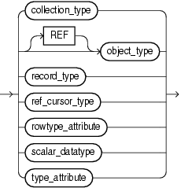

## 13.19 Datatype Attribute

The data type attribute of an ADT element.

A `datatype` allows you to declare the data type of record variables fields, constants, functions return value, collection variables and collection types elements.

- [Record Variable Declaration](record-variable-declaration.md)

- [Constant Declaration](constant-declaration.md)

- [Function Declaration and Definition](function-declaration-and-definition.md)

- [Collection Variable Declaration](collection-variable.md)

- [CREATE FUNCTION Statement](CREATE-FUNCTION-statement.md)

- [CREATE TYPE Statement](CREATE-TYPE-statement.md)

### Topics

- Syntax

- Semantics

- Related Topics

### Syntax

### datatype ::=

[Description of the illustration datatype.eps](img_text/datatype.md)

([rowtype_attribute ::=](ROWTYPE-attribute.md), [type_attribute ::=](TYPE-attribute.md))

### Semantics

### datatype

collection_type

Name of a user-defined varray or nested table type (not the name of an associative array type).

object_type

Instance of a user-defined type.

record_type

Name of a user-defined type that was defined with the data type specifier `RECORD`.

ref_cursor_type

Name of a user-defined type that was defined with the data type specifier `REF` `CURSOR`.

scalar_datatype

Name of a scalar data type, including any qualifiers for size, precision, and character or byte semantics.

### Related Topics

In other chapters:

- [PL/SQL Data Types](plsql-data-types.md)
