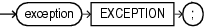

## 13.26 Exception Declaration

An exception declaration declares the name of a user-defined exception.

You can use the `EXCEPTION_INIT` pragma to assign this name to an internally defined exception.

### Topics

- Syntax

- Semantics

- Examples

- Related Topics

### Syntax

### exception_declaration ::=

[Description of the illustration exception_declaration.eps](img_text/exception_declaration.md)

### Semantics

### exception_declaration

exception

Name of the exception that you are declaring.

Restriction on exception

You can use `exception` only in an `EXCEPTION_INIT` pragma, `RAISE` statement, `RAISE_APPLICATION_ERROR` invocation, or exception handler.

**Caution:**

Oracle recommends against using a predefined exception name for `exception`. For details, see "[Redeclared Predefined Exceptions](redeclared-predefined-exceptions.md)". For a list of predefined exception names, see [Table 11-3](predefined-exceptions.md).

### Examples

- [Example 11-5](internally-defined-exceptions.md), "Naming Internally Defined Exception"

- [Example 11-9](redeclared-predefined-exceptions.md), "Redeclared Predefined Identifier"

- [Example 11-10](raising-exceptions-explicitly.md), "Declaring, Raising, and Handling User-Defined Exception"

### Related Topics

In this chapter:

- "[EXCEPTION_INIT Pragma](EXCEPTION_INIT-pragma.md)"

- "[Exception Handler](exception-handler.md)"

- "[RAISE Statement](RAISE-statement.md)"

In other chapters:

- "[Internally Defined Exceptions](internally-defined-exceptions.md)"

- "[User-Defined Exceptions](user-defined-exceptions.md)"
